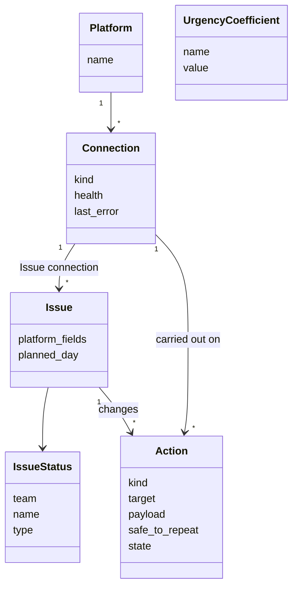
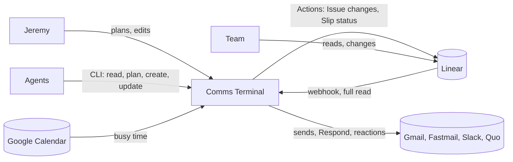
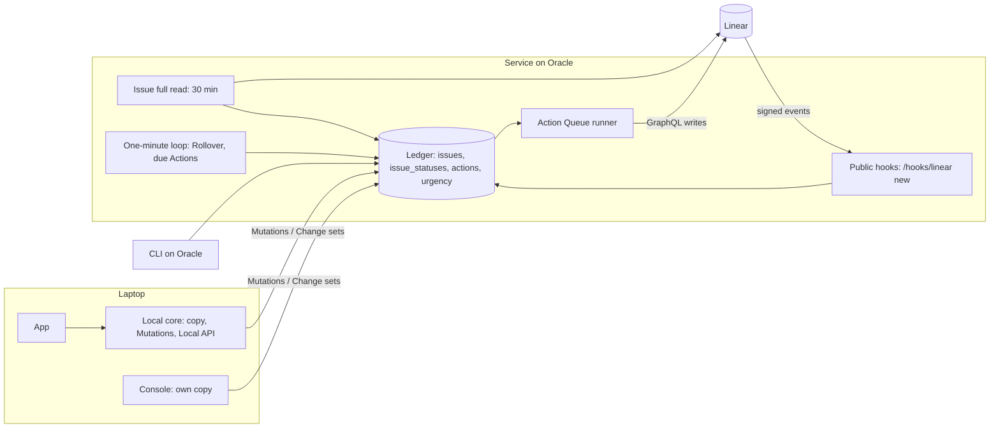
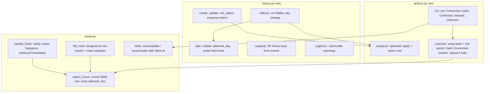

# Design — Issues and the Action Queue

Status: **approved** (2026-11-07, with the PRD `.agents/prd/2026-11-07-issues-and-action-queue.md`). Owner: Jeremy. Built from the grilling session of 2026-11-07 on `origin/main` `HEAD` at worktree creation.
Discovery: `.agents/discovery/2026-11-07-linear-daily-scheduling.md` (problem, measures, approaches, chosen strategy E).
ADRs: 0017 (Connections have kinds), 0018 (Issues copy, local Planned day), 0019 (one optimistic Action Queue).
Terms: `GLOSSARY.md` — Platform, Connection, Context connection, Issue connection, Issue, Planned day, Day capacity, Unplanned, Rollover, Slip status, Action, Action Step, Action Queue.

No implementation is authorized by this document.

## 1. Goal

Jeremy manages his Linear Issues inside Comms Terminal the way Super Productivity (with SuperPlan) and Sunsama let him: give each Issue a Planned day, see each day's load against his calendar, get SuperPlan's warnings, and change Issues without opening Linear. Linear stays the source of truth. Every change that leaves Comms Terminal, Issue or otherwise, is instant on screen and visible in one Action Queue.

## 2. Decisions (grilling, 2026-11-07)

| # | Decision |
|---|---|
| G1 | A Platform is any outside service; a Connection is one account of one kind: Email, SMS, Slack, Calendar, Context, Issue (ADR 0018). |
| G2 | Linear: one Jeremy-owned key with Read and Write; two Connections on it (Context, Issue). Changes show in Linear as Jeremy. |
| G3 | The copy holds what Linear's "assigned to me" filter returns. |
| G4 | Status changes use a picker of the Issue's team statuses. Nothing else is mapped except the Slip status. |
| G5 | Console, App and CLI create and update the core fields: title, description, status, priority, estimate, due date. Agents use the CLI under Jeremy's Linear rules. |
| G6 | Days are Jeremy's days: America/Halifax (`main.LOCAL_TZ`), workdays Monday–Friday (as Sequences). |
| G7 | Rollover runs in the Service's one-minute loop when Jeremy's day changes: unfinished Issues planned before today move to the next workday; Slip status (Linear: Blocked) is written. |
| G8 | Day capacity: 9 h less busy calendar time; today counts only the rest of today. Busy = an Event not declined and not marked free; a busy All-day Event zeroes the day. Estimate 1 point = 30 min; no estimate = 1 h. |
| G9 | Warnings as SuperPlan: planned after due date; planned more than 100 − p days out at urgency percentile p; larger than a whole day. |
| G10 | Urgency: Taskwarrior-style sum, coefficients stored in the database and settable (CLI and a Settings section). |
| G11 | Linear changes arrive by signed webhook (`/hooks/linear`) plus a full read every 30 min. |
| G12 | All Actions are optimistic and go through one Action Queue (ADR 0020). A failed write marks the Issue connection broken. |
| G13 | Undo of an Action is a new Action restoring the old value. |
| G14 | Issues page = Linear's List view with Display options; Planned day added as grouping, ordering and property; Urgency as ordering; no Board; options saved locally. |
| G15 | Today shows today's Issues with capacity; Calendar shows planned Issues on their day. |
| G16 | Console and App ship together; domain and CLI once. |
| G17 | The Action Queue doubles as Lemlist's Outreach queue: Actions scheduled, running, refused or unknown, by day and Connection, plus scheduled Drafts, coming Tasks and Enrollment starts. |
| G18 | "Action" widened to anything Comms Terminal carries out itself; the Sequence Step is an Action Step. No stored rename. |

## 3. Domain model

Field ownership: the Platform owns every Issue field in the copy; Comms Terminal owns `planned_day`, the Slip status choice per Issue connection, urgency coefficients and Display options.

## 4. Architecture

### L1 Context

### L2 Container

### L3 Component (Service)

Existing pieces reused: `remote.py` Mutations and Change sets (ADR 0012); `core.py` Local API (ADR 0013, grow-only); `serve.intake` hook pattern; `wake_loop`; `calendar.py` Events; `inbox.set_connection_error`; `sequences` business-day helpers; `agent.COMMANDS` / `CONSOLE_ONLY` parity.

## 5. Flows

**Linear change arrives.** Linear posts to `/hooks/linear` → `intake` finds the Issue connection → `linear.handle_hook` checks `Linear-Signature` (HMAC-SHA256 of the raw body, hex) and `webhookTimestamp` → `upsert_issue` → Change log → Clients. An Issue no longer assigned leaves the copy (kept while its pending Actions finish). The 30-minute full read upserts and removes the same way.

**Jeremy plans.** `issues.plan(issue, day)` is a `write` writer: instant on the laptop, a Mutation to the Service, never sent to Linear.

**Jeremy changes an Issue.** `issues.update(...)` applies to the copy at once and enqueues an Action (safe to repeat). The runner sends `issueUpdate` (or `issueCreate` with the Client-chosen id). Confirmed: nothing to do; the webhook echo matches. Refused: the copy takes Linear's value back; the Issue shows "Not saved: reason". 401/403: the Issue connection is broken (a Problem); its Actions wait. No answer: resend.

**Rollover.** In `wake_loop`, when Jeremy's date changes: for each open Issue with `planned_day` before today → `planned_day` = next workday; enqueue Slip status Action.

**Today and Calendar.** Today lists Issues with `planned_day` = today, with "used of capacity" and warnings. Calendar places planned Issues as Calendar Items on their day.

## 6. Surfaces

- **Issues page** (rail, Console and App): Linear List + Display options (grouping, sub-grouping, ordering, completed window, sub-issues, empty groups, properties) + Planned day + Urgency. Keys: plan (same input as Snooze `--until`), status picker, edit fields, new Issue, open in Linear.
- **Action Queue page** (rail): Today/Week grouping, columns Action, target (Person or Issue), Organization or project, source (Sequence, Issue, Draft), Connection; per-Connection counts per group.
- **CLI:** `comms-terminal issues [--day D|--unplanned]`, `issue ID`, `issue plan ID DATE|none`, `issue new --team … --title …`, `issue ID --status … --priority … --estimate … --due … --title … --description -`, `urgency list|set NAME VALUE`, `actions [--day D]`. Status, create and update go through the Action Queue like the console's.
- **Local API:** one query per view, one command per writer, grow-only.

## 7. Rollout order (proposed)

1. Connection kinds (ADR 0018): widen `connections`, move Context sources onto Context connections.
2. Issue copy: tables, full read, `/hooks/linear`, new key with Write, webhook created in Linear.
3. Action Queue (ADR 0020) with Issue Actions first; then Respond, reactions, sends.
4. Planned day, capacity, urgency, warnings, Rollover.
5. Issues page, Today, Calendar, Action Queue page (Console and App together); CLI.

## 8. Open items

| Item | Next evidence |
|---|---|
| Webhook creation | Resolved: Jeremy is a Linear admin |
| Slip status Blocked misleads the team | A week of use |
| No capacity buffer | Two weeks planned versus done |
| Unplanned Issues near their due date | Resolved: warn within 7 days (PRD FR-IS-13) |
| Moving sends onto the queue must keep ADR 0015's lock semantics exactly | Send tests before migration |
| `AGENTS.md` and `docs/runbook.md` still say "Context sources" and a Read-only Linear key | Update with step 1 and 2 |
