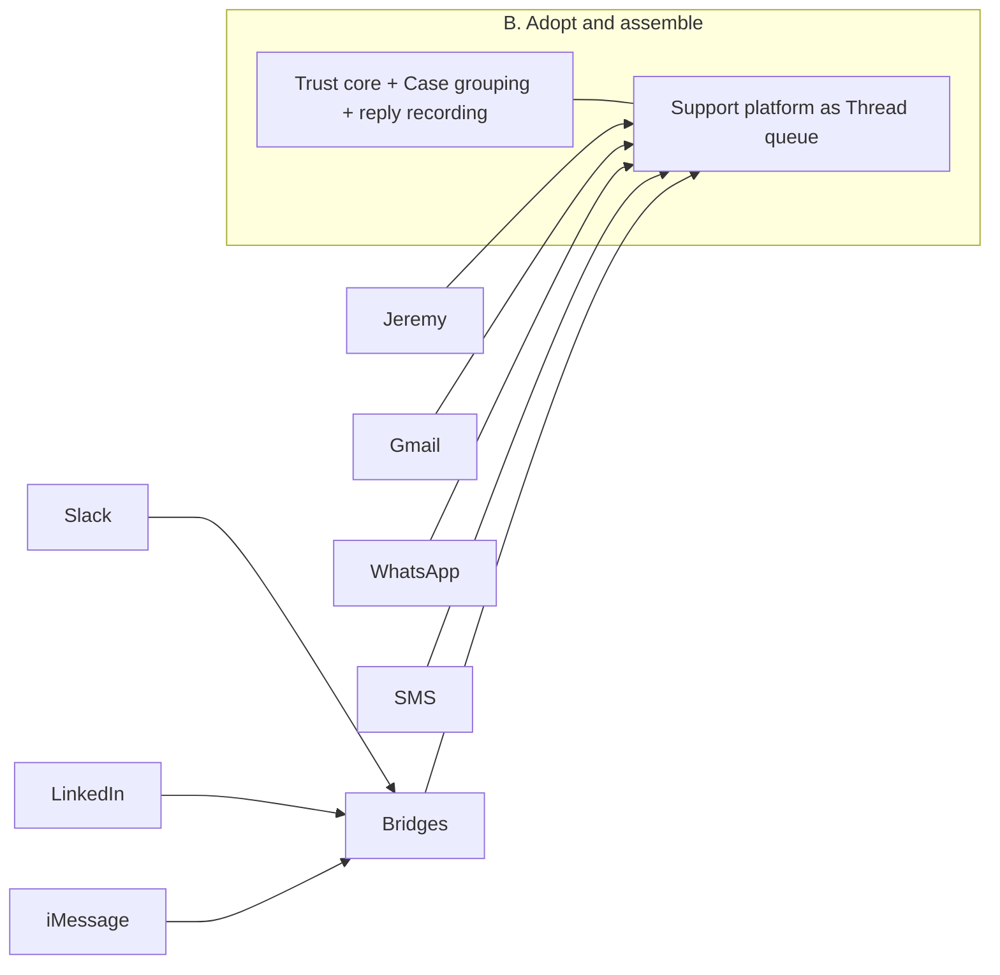
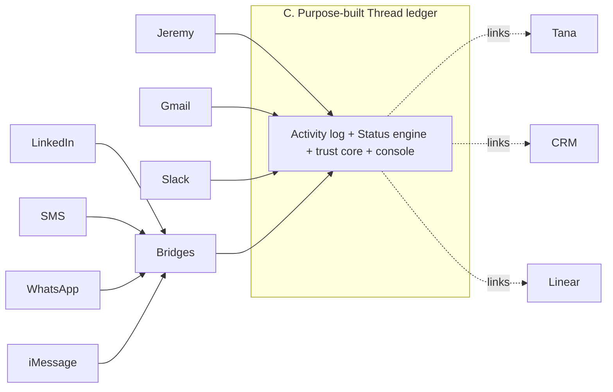
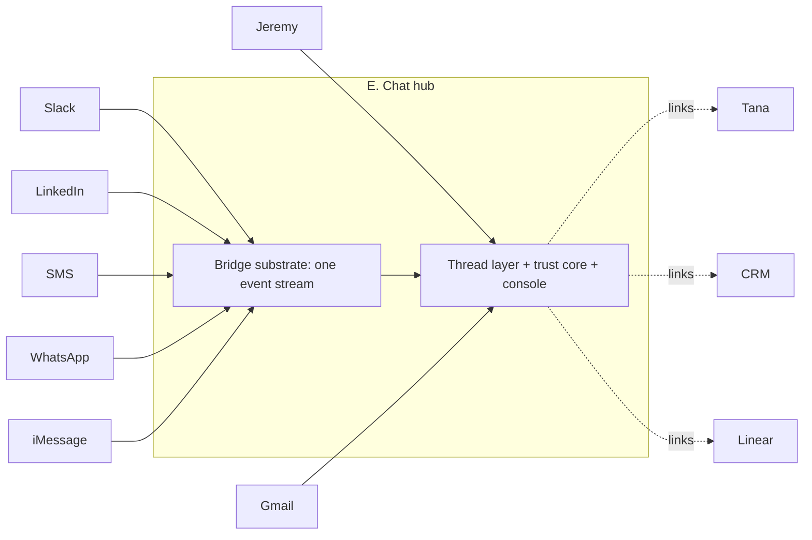
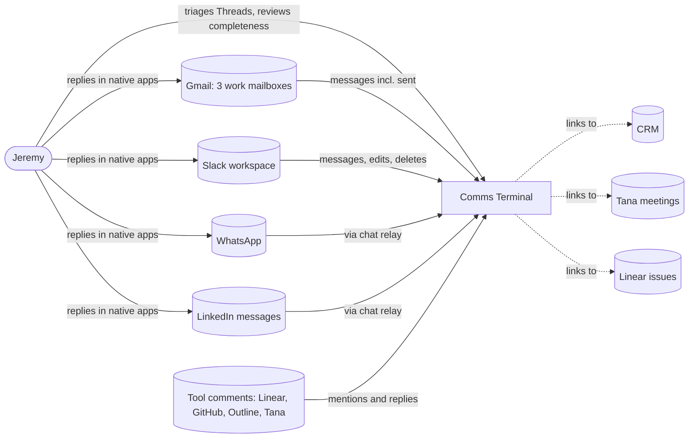
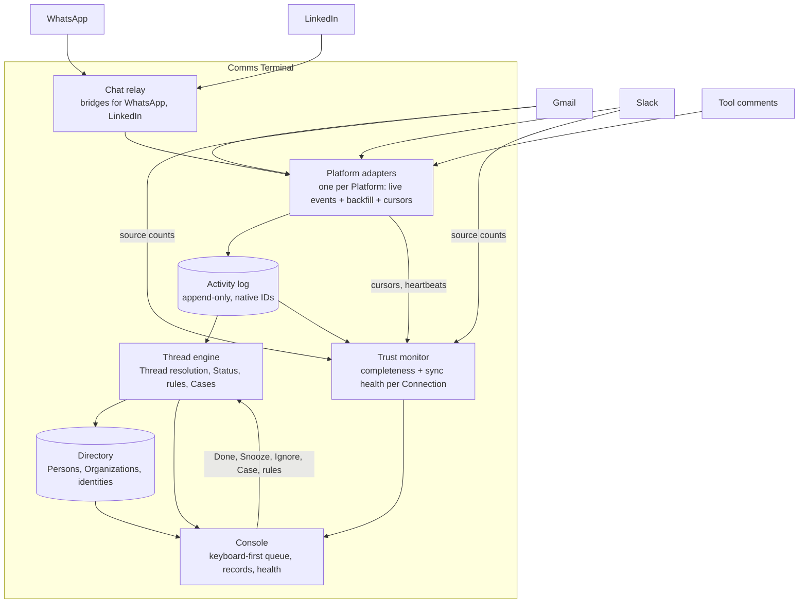
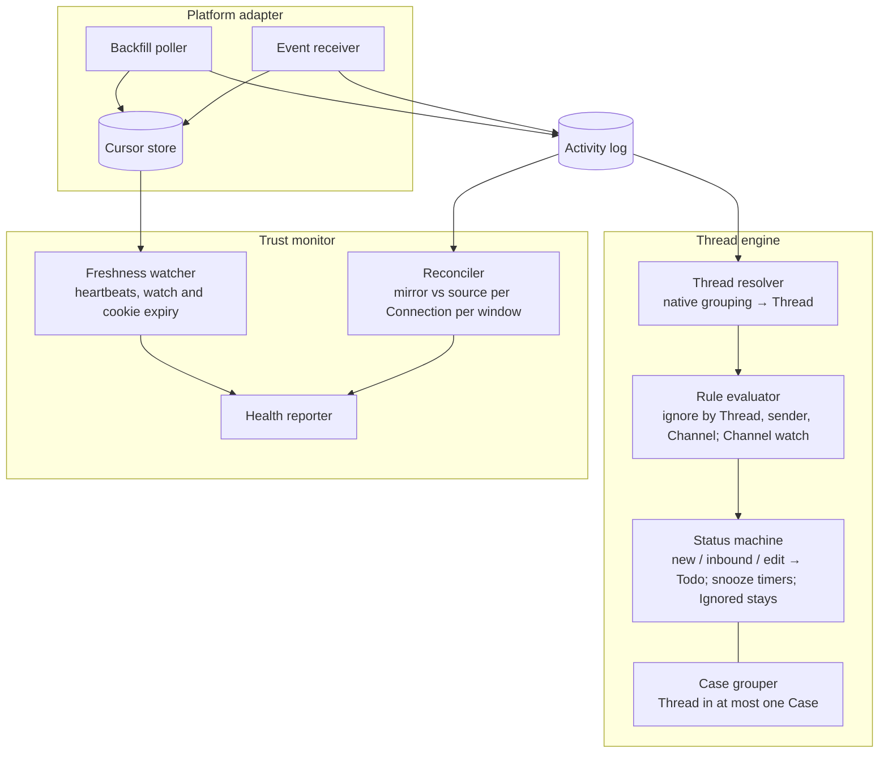

# Comms Terminal — Discovery

## Status

- Current phase: Complete — validated problem and strategy
- Gates:
  - Seed: approved 2026-10-10
  - Phase 1 (Context): approved 2026-10-10
  - Phase 2 (Problem): approved 2026-10-10, reopened and re-approved 2026-10-10
  - Phase 3 (Options): approved 2026-10-10
  - Phase 4 (Decision and validation): approved 2026-10-10
- Last updated: 2026-10-10T19:46+00:00

## Context

### Seed (confirmed 2026-10-10)

- Topic: universal inbox — one console for Jeremy's professional comms.
- Need, in Jeremy's words: "one inbox that i can integrate everything with and manage my comms from one console … i really like the plain b2b support approach but i want to use it for my professional comms."
- Known: single user (Jeremy); first sources are Gmail and Slack. Source: Jeremy's answers in the 2026-10-10 session.
- Early solution ideas, held as Phase 3 candidates: a Plain-style support console (Jeremy); one thread as one entry and Gmail archive write-back (agent suggestions, unconfirmed).
- Project directory `comms-terminal/` was empty at start; no prior memory of this project.

### Findings

#### From Jeremy (2026-10-10, ask tool round 1)

- Channels carrying real professional conversations: email, Slack, LinkedIn DMs, SMS / WhatsApp / iMessage, and tool comments (Linear, Outline, Tana, GitHub, calendar).
- Pains: dropped replies; app switching; no per-person view across channels; "i have adhd and cannot manage the state in my brain."
- What Plain gets right for him: the status queue (Todo / Snoozed / Done), the contact and company record, and "nothing is dropped, it's trusted thread management."
- Why now: "comms is the most painful part of my life to manage."

#### From Jeremy (2026-10-10, ask tool round 2)

- Most recent dropped reply: an email he saw, then lost. The failure was memory after reading, not discovery.
- Trust requires: provable completeness (every incoming message accounted for), visible sync health (no silent failure), and wake on reply (snoozed or done threads return to Todo when the other person writes). "Nothing acts without me" was offered and not selected.
- Donna's ball-in-court tracking misses threads, so he can't rely on it for comms.
- Constraints: "$10/mo max. open source preferred. id rather build the perfect solution than work on something half-baked." Phone access and keeping data on his own infrastructure were offered and not selected.

#### From Jeremy (2026-10-10, ask tool round 3)

- Current workarounds: Gmail unread or star, and an agent reminding him during planning. Both fail in the scenario above.
- Counterparties that matter: investors, customers and prospects, team, partners and vendors. All four.
- Volume: 30–60 conversations per day need a reply or action, across all channels.
- A person's record must show: cross-channel history, open loops in both directions, company and deal context, and meeting context.

#### From Jeremy (2026-10-10, unprompted)

- "it can be a narrow tool and integrate with others like tana, slack, linear, etc." The universal inbox may own a narrow job and lean on existing tools for adjacent jobs (for example tasks in Linear, meeting records in Tana, conversation in Slack) instead of replicating them.

#### Accounts and surfaces (memory; some items stale)

- Email: jeremy@agentmaple.com (primary); jeremy@agentmaple.ai (prospecting mailbox, delegated to the .com inbox, as of 2026-05); jeremy@jambr.ca (legacy, needs re-auth); personal Fastmail excluded from work. Source: `~/.memory/IDENTITY.md`, `2026-05-07-[decision]-use-agentmaple-ai-for-prospecting-mailbox.md`.
- Gmail volume: more than 100 non-self messages per 7 days, much of it automated alerts (2026-05 check, stale). Source: `2026-05-04-[tool]-super-productivity-gmail-email-due-provider.md`.
- Slack: Agent Maple workspace (#business, #dev, #session-alerts). Source: `2026-06-09-[fact]-agent-maple-slack-identity-map.md`.
- LinkedIn connected through Lemlist inbox; CRM is Twenty or Attio (current one unclear). Source: Donna context, `THREADS.md`.

#### Existing systems that touch comms (memory)

- **Donna** (OMP agent persona) runs the Company Model: reads Gmail, Slack, calendar, Linear, CRM, Lemlist, and transcripts read-only, and keeps Threads, commitments, and ball-in-court ledgers. Gmail threads already enter the Company Model as a Communication source. Inbox activity "must not replace goal control." Source: Donna manual, `IDENTITY.md`, `2026-07-22-[pref]-donna-full-scan-thread-coverage.md`.
- **Gmail Screener** (Apps Script, every minute) moves mail from non-contacts to a `Screener` label. Source: `2026-08-17-[tool]-gmail-screener.md`.
- **Super Productivity Gmail plugin** turned email into tasks; Jeremy distrusted it because of silent sync failure, stale mappings, and missing observability. A Lemlist task plugin had the same trust problem (auto-mutation without preview). Source: `2026-05-04-[tool]-super-productivity-gmail-email-due-provider.md`, `2026-05-06-[issue]-lemlist-prospecting-plugin-trust.md`.
- Standing rule: agents never send, post, or draft messages on Jeremy's behalf. Source: `2026-03-16-[pref]-never-send-messages-on-behalf.md`.
- ADHD workday structure: batch calls, then email, then LinkedIn; at most 3 action items per category. Source: `2026-04-23-[pref]-adhd-workday-structure.md`.

#### Analogues (public research, 2026-10-10)

- **Plain**: every channel becomes a thread in one queue; three statuses (Todo, Snoozed, Done); a snoozed thread wakes to Todo on new activity; customer, company, and tier records with SLAs; keyboard-first console (E done, Z snooze, W waiting on customer); its own app runs on its public API. Attractive to Jeremy: status queue, contact and company record, trust. [docs](https://www.plain.com/docs/product/what-is-plain.md), [statuses](https://www.plain.com/docs/graphql/threads/status-changes.md), [shortcuts](https://www.plain.com/docs/product/platform/keyboard-shortcuts.md)
- **Front / Missive**: team shared inboxes; conversation is the unit; Slack coverage partial or absent; team-oriented pricing.
- **Superhuman / Shortwave / HEY**: email-only clients with done and snooze; Superhuman "Go" assistant spans Gmail and Slack but keeps them separate.
- **Beeper**: universal chat (WhatsApp, Slack, LinkedIn, SMS); no email.
- **Akiflow / Sunsama**: turn a Gmail or Slack message into a task; triage the task, not the conversation.
- **Unipile**: developer API for email, LinkedIn, WhatsApp; no Slack.
- Early "AI inbox for founders" products (this+that, Boxzero, Mailient) exist with little evidence.
- Gap (inference from research): no mature product gives one person a Plain-style status queue across email and chat with wake-on-activity and person records.

#### Open-source and low-cost analogues (public research, 2026-10-10)

- **Chatwoot** (MIT core, very active): open / pending / snoozed / resolved; an incoming message reopens a snoozed or resolved conversation (wake on reply); contacts and companies; Cmd+K and shortcuts. Native email (IMAP/SMTP), WhatsApp, SMS, and a generic API channel. Slack is outbound-only, so personal Slack DMs would need a bridge. Needs about 4 GB RAM plus a database, cache, and worker. [repo](https://github.com/chatwoot/chatwoot), [slack](https://www.chatwoot.com/docs/product/features/slack)
- **Zammad** (AGPL): ticket states and organizations; Slack integration dropped in 7.0; heavy. **FreeScout** (AGPL): light, email-first; snooze and Slack are paid modules. **Libredesk** (AGPL): email, chat, WhatsApp; snooze. Peppermint, Papercups, and Helpy are archived or stale.
- **Matrix bridges** (mautrix, AGPL, active): Slack (logs in as the user), WhatsApp, Signal, SMS/RCS through Google Messages (needs an online Android phone), LinkedIn (young; cookie login; highest terms-of-service risk), iMessage (needs an always-on Mac). Beeper's bridge manager runs them without a self-hosted Matrix server. [mautrix](https://github.com/mautrix), [bbctl](https://github.com/beeper/bridge-manager)
- **Inbox Zero** (AGPL, active): Gmail/Outlook; "Reply Zero" tracks emails you owe and emails awaiting a response. No Slack ingestion. [repo](https://github.com/elie222/inbox-zero)
- **Universal Inbox** (Apache-2.0, Rust, small, active): turns GitHub, Linear, Gmail, and Slack notifications into snoozable inbox items or Todoist/TickTick tasks. Notification triage; no contacts, companies, SMS, or WhatsApp. Same name as this project. [repo](https://github.com/comms-terminal/comms-terminal)
- **Beeper** (free for 5 accounts; Plus about $9.99/month): WhatsApp, LinkedIn, Slack, Signal, SMS; no email and no Todo/Done queue.
- Gap (inference from research): no open-source or ≤$10/month product combines email and chat, contact and company records, a wake-on-reply status queue, provable completeness, and visible sync health. The nearest assembly is a support platform (Chatwoot) fed by chat bridges, plus custom glue for completeness and sync health.

#### Integration constraints (public docs, 2026-10-10)

- Gmail read/modify scopes are restricted. A Google Workspace "Internal" app avoids verification and the 7-day token expiry of testing mode; personal @gmail.com cannot. Push notifications through Pub/Sub need a watch renewal at least every 7 days. [scopes](https://developers.google.com/workspace/gmail/api/auth/scopes), [audience](https://support.google.com/cloud/answer/15549945)
- Slack: a personal inbox needs a user token to see DMs. An internal app in Jeremy's own workspace keeps normal rate limits; distributed non-Marketplace apps are throttled hard. Slack API terms limit retention and prohibit LLM training on Slack data. [tokens](https://docs.slack.dev/authentication/tokens), [rate limits](https://docs.slack.dev/changelog/2025/05/29/rate-limit-changes-for-non-marketplace-apps), [API terms](https://slack.com/terms-of-service/api)
- LinkedIn has no messaging API; access means cookie-based bridging with account-restriction risk. WhatsApp, SMS, and iMessage access is through unofficial bridges; SMS needs an online Android phone and iMessage needs an always-on Mac.

## Problem

### Statement (accepted 2026-10-10)

Jeremy, a founder with ADHD handling 30–60 professional conversations a day across email, Slack, LinkedIn, phone messaging, and tool comments, loses track of conversations he has already seen and owes a reply on. Conversation state — who owes whom what — lives only in his head and in per-app read markers, and no system he trusts holds it. Result: dropped or late replies to investors, customers, team, and partners.

### Scope

- **In scope**
  - Tracking who owes whom what, as Threads with a Status, across email, Slack, LinkedIn, WhatsApp, and tool comments.
  - Threads started by someone else's message or by Jeremy's own outbound message.
  - Recording Jeremy's replies sent from native apps as Activities in their Thread.
  - Optional Cases grouping Threads for one need across Platforms.
  - A per-Person and per-Organization view: cross-platform history, open Threads and Cases, company and deal context, and meeting context (context linked from the tools that own it).
- **Coverage rule**: every native message on every Connection becomes an Activity in its Thread, and every Thread has a Status; a new Thread starts in Todo. Noise reaches Ignored by Jeremy's action or an explicit rule; nothing is silently skipped. Slack channels are watched or ignored per channel.
- **Out of scope**: replying from the console. Jeremy replies in the native app.
- **Non-goals**: task management (Linear owns it), CRM pipeline (the CRM owns it), meeting notes (Tana owns them), sending or auto-replying on Jeremy's behalf.
- **Out of scope for now**: SMS and iMessage (no always-on device to relay them; decided 2026-10-10).

### Trust requirements (from Phase 1)

- **Provable completeness**: Jeremy can see that every message on every Connection is an Activity in a Thread with a Status.
- **Visible sync health**: a Connection that stops syncing is visible right away, never a silent failure.
- **Wake on reply**: a Snoozed or Done Thread returns to Todo when the other party writes.
- **Nothing changes Status silently**: only Jeremy, an explicit rule, or new inbound activity moves a Thread.

### Constraints

- Single user: Jeremy.
- $10/month maximum; open source preferred.
- Build the complete solution rather than a half-finished one.
- Narrow tool: integrate with Tana, Slack, Linear, and others for their jobs.
- Mirror native structure: one Activity per native message with its native ID; Threads follow each Platform's own grouping.
- Anchor on Plain's model; state a reason for every deviation.

### Success measures (accepted 2026-10-10)

- **Zero silent drops**: every Thread needing Jeremy's reply ends Done or explicitly Snoozed; none disappear unhandled.
- **One place to check**: daily comms triage starts in one console instead of five or more apps.

## Glossary

Anchored on Plain's Thread model; each deviation states its reason. Shape of Person, Organization, Case, and Activity borrowed from Jeremy's 2026-10-09 B2B support domain model; this is a separate system.

- **Thread**: the unit Jeremy works, as in Plain. Formed by each Platform's own grouping: an email thread; in Slack, a top-level message plus its replies (in channels and DMs alike, as Plain does for channels); on Platforms with no native threads (WhatsApp, SMS, iMessage, LinkedIn), one Thread per chat. A Thread carries the Status and belongs to at most one Case.
- **Activity**: a timestamped record of something that happened in a Thread, such as a message received, a message sent, or a status change. A message Activity mirrors one native message and keeps its native ID. Activities are never rewritten; a native edit or deletion is a new Activity. Each Activity belongs to exactly one Thread.
- **Status**: a Thread is **Todo** (Jeremy owes the next move), **Snoozed** (hidden for a set time or until the other party replies), or **Done**. A new Thread starts in Todo, including one Jeremy starts. A new inbound Activity, including an edit or deletion, returns a Snoozed or Done Thread to Todo. Jeremy's own reply does not change Status.
- **Ignored**: a kind of Done for noise, hidden from the queue and kept for audit. Set on a Thread by Jeremy, by an explicit rule, or by ignoring a sender or Channel. An Ignored Thread never reopens on new messages; only Jeremy un-ignores it.
- **Triage**: working the Todo queue.
- **Case**: an optional grouping of Threads that serve one need across Platforms, such as Logan's email plus his Slack ping. Deviation from Plain, which has no Case; reason: needs that span Platforms. A Case has no Status of its own and shows its Threads' Statuses. A Thread is in at most one Case; Jeremy moves it when its topic changes.
- **Person**: an individual Jeremy communicates with professionally. A Person's record groups their Threads and Cases.
- **Organization**: a company or group that Persons belong to, such as an investor firm, customer, partner, or Agent Maple itself.
- **Platform**: the medium a message travels through: email, Slack, LinkedIn, SMS, WhatsApp, iMessage, or tool comments.
- **Channel**: a container of Threads on a Platform, such as a Slack channel or DM. Jeremy chooses per Slack channel, when first seen, whether its Threads are watched or ignored.
- **Connection**: one connected account on a Platform, such as the jeremy@agentmaple.com Gmail account or the Agent Maple Slack workspace. Completeness and sync health are tracked per Connection.
- _Avoid_: Conversation (use Thread), Medium (use Platform), Loop, Commitment (Donna's Company Model term), Ticket.

## Options

Option set (Phase 3, revised 2026-10-10 against the Plain-anchored Thread model and feasibility research). Options are not eliminated in this phase; early concerns are noted only. Costs are rough. "Bridge" means an open-source relay that logs in to a chat Platform as Jeremy and passes messages on (mautrix family).

Every option except A must build the same trust core, because no researched product provides it: per-Connection completeness against the source, visible sync health, and recording of replies Jeremy sends from native apps.

### A. Baseline — native apps plus a daily review routine

- **Core idea**: no new system. Gmail snooze and stars, Slack "Later", other apps as they are; a fixed daily checklist that walks every app; Donna reminders.
- **Success measures**: one place to check — no; zero silent drops — only while the routine holds.
- **Assumptions**: a routine can hold state that Jeremy says cannot live in his head.
- **Risks**: keeps the Phase 1 failure (saw an email, lost it).
- **Cost / effort**: $0; no build. **Rules out**: nothing.

### B. Adopt and assemble — Chatwoot as the Thread queue

- **Core idea**: self-host Chatwoot (MIT core). Its conversation ≈ Thread; open / snoozed / resolved ≈ Todo / Snoozed / Done; it reopens on incoming messages and leaves status alone on outgoing ones (matches Plain). Contacts and companies ≈ Person and Organization. Email, WhatsApp, SMS connect natively; Slack, LinkedIn, iMessage arrive through bridges into its API channel. Build the trust core and Case grouping around it.
- **Success measures**: both, once the trust core exists.
- **Assumptions**: Case grouping and per-Channel ignore can be layered on Chatwoot without forking.
- **Risks / research findings**: its email inbox reads only INBOX, so mail Jeremy sends from Gmail is never imported — reply recording must be custom; outgoing messages posted through its API always fire a delivery webhook (workable by tagging and skipping them); support semantics leak (agents, inboxes, CSAT); heavy runtime (about 4 GB RAM, several services); glue on a large codebase Jeremy does not own.
- **Cost / effort**: $0 software; medium build; ongoing upkeep of a large stack. **Rules out**: a model or console that departs from Chatwoot's.

### C. Purpose-built Thread ledger — a narrow system that owns exactly the glossary

- **Core idea**: build a small system whose only job is the Phase 2 model: Connections mirror native messages into an append-only Activity log grouped by Thread; a Status engine (new Thread and new inbound message → Todo, snooze, ignore rules, per-Channel watch/ignore); optional Cases; the trust core; a keyboard-first console. Person and Organization context links out to the CRM and Tana; work links out to Linear. Direct integrations for Gmail and Slack; bridges for WhatsApp, SMS, iMessage, LinkedIn.
- **Success measures**: both, by design.
- **Assumptions / research findings**: a Google Workspace "Internal" app avoids verification and 7-day token expiry; a Slack internal app with a user token can read every channel, DM, and group DM Jeremy is in at normal rate limits, with real-time events (user events over Socket Mode still to be tested); bridges are reliable enough for the other Platforms.
- **Risks**: largest build; every Connection is owned code; risk of the half-finished outcome Jeremy wants to avoid unless scope is sequenced.
- **Cost / effort**: $0 software, self-hosted; high initial build; low upkeep if kept narrow. **Rules out**: nothing structural.

### D. Extend the open-source "Universal Inbox"

- **Core idea**: fork or contribute to universal-inbox.com (Apache-2.0; Rust backend, PostgreSQL, Redis; Rust/WASM frontend), which already has Gmail and Slack connectors, snooze, and a console.
- **Success measures**: one place to check — yes; zero silent drops — only after a model rework.
- **Risks / research findings**: it captures selectively — Gmail threads with one label (starred by default) and Slack messages Jeremy marks with a reaction — which is the opposite of the coverage rule; notification/task model, not Thread/Activity; effectively a single maintainer (bus-factor risk); a fork drifts from a very active upstream.
- **Cost / effort**: $0 software; high build (model rework in an unfamiliar stack). **Rules out**: staying close to upstream.

### E. Chat hub — one bridge substrate for chat Platforms, Thread layer on top (not proposed by Jeremy)

- **Core idea**: run Beeper's bridge manager or a Matrix homeserver so Slack, WhatsApp, SMS, iMessage, and LinkedIn all arrive as one uniform event stream (native IDs, edits and deletions as new events). The Thread layer, trust core, and console are written once against that stream. Email needs its own direct integration.
- **Success measures**: both, if bridge health is observable per Connection.
- **Research findings**: no maintained Matrix bridge reads an existing Gmail mailbox (Postmoogle needs its own mail domain and misses sent mail), so email — where the latest drop happened — sits outside the hub.
- **Risks**: homeserver and bridge operations; unofficial logins for Slack and LinkedIn carry account risk; two ingestion paths (hub plus email).
- **Cost / effort**: $0 software; medium build; medium operations. **Rules out**: chat Platforms without a bridge.

### F. Extend Donna's Company Model to own Threads (not proposed by Jeremy)

- **Core idea**: Donna already reads Gmail and Slack and tracks ball-in-court; make the Company Model own Threads and Activities, with a console for Jeremy.
- **Success measures**: one place to check — yes; zero silent drops — only after Donna's thread-coverage failures are fixed.
- **Risks**: Donna misses threads today; mixes company goal control with personal triage, which Jeremy's operating rules separate; approval-gated mutation versus fast triage; coupling to an agent persona's runtime.
- **Cost / effort**: $0 software; medium build inside an existing system. **Rules out**: an inbox independent of Donna.

### Early concerns (not eliminations)

- A and F start from the two systems Phase 1 found failing.
- B, C, D, and E all need bridges for WhatsApp, SMS, iMessage, and LinkedIn; only email and Slack have official APIs suited to a personal app.
- D's selective capture and E's missing email bridge each contradict a Phase 2 requirement directly.

### Context sketches (L1)

## Decision

**Chosen strategy (approved 2026-10-10): C — purpose-built Thread ledger.** A narrow system that owns exactly the Phase 2 glossary. Email and Slack connect through their official APIs as internal, single-user apps; WhatsApp and LinkedIn connect through a chat relay (bridges). Tool comments connect per tool. Person and Organization context links out to the CRM and Tana; work links out to Linear.

**Why C**

- The trust core — provable completeness and visible sync health — is the product. C builds the model around it; every other option bolts it onto a model built for something else.
- It holds exactly the glossary: no support-desk concepts (agents, inboxes, CSAT) and no notification/task model to rework.
- It fits the constraints: $0 software, open source, single user, "complete over half-baked," and a narrow tool that hands adjacent jobs to Linear, Tana, and the CRM.

**Rejected options**

| Option | Reason it lost |
|---|---|
| A. Baseline routine | Keeps the Phase 1 failure; no single place; no completeness. |
| B. Chatwoot + glue | Never imports mail Jeremy sends from Gmail; heavy runtime; support semantics leak; the trust core would sit on a large codebase Jeremy does not own. |
| D. Extend "Comms Terminal" | Captures only starred or reacted items, the opposite of the coverage rule; model rework in an unfamiliar stack; single maintainer. |
| E. Chat hub | Email — where the latest drop happened — has no maintained bridge, so it needs a second ingestion path anyway; adds homeserver operations. Its idea survives inside C as the chat relay for WhatsApp and LinkedIn. |
| F. Donna's Company Model | Donna misses threads today; mixes company goal control with personal triage. |

**Trade-offs accepted**

- Largest build; every Connection is owned code.
- WhatsApp and LinkedIn depend on unofficial bridges with account-restriction risk (LinkedIn highest).
- Scope must be sequenced so the tool is never half-finished in daily use.
- SMS and iMessage are out of scope for now (no always-on device).

## Validation

### Riskiest assumptions

| # | Assumption | Evidence now | Missing evidence |
|---|---|---|---|
| R1 | Triage load is workable with every inbound message as an Activity, Slack top-level messages as Threads, and edits waking Threads | 30–60 conversations a day need action (Jeremy); Gmail had more than 100 non-self messages a week in 2026-05 (stale); Slack volume unknown | A read-only count of new Threads per Platform per day under the Phase 2 rules |
| R2 | Completeness is provable per Connection by reconciling the mirror against the source | Gmail history and push APIs; Slack internal apps keep normal rate limits and user tokens read every conversation Jeremy is in | A reconciliation test against Jeremy's real Gmail and Slack Connections; Slack user events over Socket Mode untested |
| R3 | Sync failures are detectable fast enough to keep trust | Gmail watch expires within 7 days (known renewal point); LinkedIn bridge login is cookie-based (known expiry) | How bridges report their own health per Connection |
| R4 | Jeremy's own replies from native apps are captured | Gmail API sees sent mail; Slack user token sees Jeremy's own messages; bridges mirror messages sent from the phone (inference) | Confirmation per bridge |
| R5 | The build can be sequenced so daily use starts early without being half-finished | None | A sequencing plan in which each step is complete for the Platforms it covers |
| R6 | One email reaching two Connections (agentmaple.ai is delegated to the agentmaple.com inbox) does not produce duplicate Threads | Delegation recorded in memory (2026-05) | How the same message appears across the two Gmail Connections |

### Scenario walk-through

| Scenario | Result |
|---|---|
| Jeremy reads an email in Gmail and forgets it (Phase 1 failure) | **Holds.** The Thread stays Todo until he marks it Done or snoozes it; reading elsewhere changes nothing. |
| Logan emails, then pings on Slack "did you see my email?" | **Holds.** Two Todo Threads, both on Logan's record; optional Case groups them. One extra keystroke. |
| Investor WhatsApp: deck in March, intro request in May | **Bends.** One chat Thread reopens to Todo in May (good); if it sits in the "deck" Case, Jeremy must move it to a new Case. |
| Jeremy emails an investor first | **Holds.** New Thread in Todo; Jeremy snoozes it until they reply. |
| Logan sends five quick top-level DMs | **Bends (accepted).** Five Todo Threads; Done each or group into a Case. |
| #session-alerts first seen; Jeremy ignores it | **Bends.** Alerts disappear; a later message there that mentions Jeremy also stays ignored, because Ignored never reopens. |
| A Slack message is edited to fix a typo | **Bends (accepted).** The edit wakes the Thread to Todo. |
| Gmail push watch expires or a token is revoked | **Holds if built.** Sync health shows the Connection as stale. |
| A customer texts Jeremy by SMS | **Gap (accepted).** SMS is out of scope; the console lists no SMS Connection. |

## Architecture (abstract)

Technology-agnostic. External systems are named; the system's own parts are named by responsibility only.

### L1 — Context

### L2 — Containers

### L3 — Components (riskiest areas: R1, R2, R3)

## Open risks and unknowns

| Item | Impact | Next evidence |
|---|---|---|
| Relationship to Donna and the Company Model (both ingest Gmail and Slack and track threads; Donna misses threads) | Two owners for the same fact; duplicate work | Decide ownership in Phase 3–4 |
| Completeness and sync health exist in no researched product | The core trust requirement must be built regardless of option | Carry into Phase 3 |
| An Ignored Thread never reopens | A wrongly ignored Thread hides real replies | Ignored audit view; rules visible and reviewable |
| SMS and iMessage out of scope (no always-on device) | Customer or investor texts are not covered | Revisit if a device becomes available |
| Triage load (R1) | Too many Todo Threads defeats one place to check | Count new Threads per Platform per day |
| LinkedIn bridge account restriction | Loss of LinkedIn access | Weigh before connecting LinkedIn |
| Name collision with the open-source "Universal Inbox" project | Confusion if published | Low priority; revisit if the project goes public |
| Which CRM is current (Twenty or Attio) | Affects contact and company record source | Verify |

## Decision log

| Date | Request or decision | Source | Status | Supersedes |
|---|---|---|---|---|
| 2026-10-10 | Start a new project for a universal inbox; asked for best setup process | Jeremy, session | Recorded | — |
| 2026-10-10 | Single user (Jeremy only) | Jeremy, ask tool answer | Accepted | — |
| 2026-10-10 | First sources: Gmail and Slack | Jeremy, ask tool answer | Accepted (subject to Phase 2–4) | — |
| 2026-10-10 | Defer item-unit question; run phased discovery first (context, problem, divergence, convergence) | Jeremy, correction | Accepted | Agent's round-1 question on the inbox entry unit |
| 2026-10-10 | Seed confirmed | Jeremy, ask tool answer | Approved | — |
| 2026-10-10 | Phase 1 context approved | Jeremy, ask tool answer | Approved | — |
| 2026-10-10 | Problem statement accepted | Jeremy, ask tool answer | Accepted | — |
| 2026-10-10 | Track state; reply anywhere (replying from the console out of scope) | Jeremy, ask tool answer | Accepted | Seed wording "manage my comms from one console" narrowed to state |
| 2026-10-10 | Success measures: zero silent drops; one place to check (reply-time target and 15-minute sync-gap detection offered, not selected) | Jeremy, ask tool answer | Accepted | — |
| 2026-10-10 | Queue unit: Jeremy offered his 2026-10-09 B2B support domain model (Account, Contact, Case, Issue, Activity, Channel) for comparison | Jeremy, ask tool answer | Resolved below | — |
| 2026-10-10 | Core terms: Case, Activity, Channel, Person, Organization; Issue not included | Jeremy, ask tool answer | Accepted | Agent recommendations "Loop" and "Issue delegated to Linear" |
| 2026-10-10 | Separate system from Agent Maple customer support, same shape | Jeremy, ask tool answer | Accepted | — |
| 2026-10-10 | Statuses: Todo / Snoozed / Done; waiting on the other party is a snooze | Jeremy, ask tool answer | Accepted | Agent recommendation to add Waiting |
| 2026-10-10 | Term for a connected account on a Channel: Connection | Jeremy, ask tool answer | Accepted | Agent recommendation "Source" |
| 2026-10-10 | Coverage: everything inbound on every Connection must be attached or dismissed | Jeremy, ask tool answer | Accepted | Agent recommendation "human messages only" |
| 2026-10-10 | Cases can start from inbound or outbound messages | Jeremy, ask tool answer | Accepted | — |
| 2026-10-10 | Non-goals: task management, CRM pipeline, meeting notes, sending / auto-replies | Jeremy, ask tool answer | Accepted | — |
| 2026-10-10 | One Case per Activity | Jeremy, ask tool answer | Accepted | Agent recommendation "rarely more than one" |
| 2026-10-10 | A Case can involve many Persons | Jeremy, ask tool answer | Accepted | — |
| 2026-10-10 | Noise handling: use Plain's "ignore" concept | Jeremy, ask tool answer | Resolved below | Agent options for rule dismissal |
| 2026-10-10 | Status after Jeremy replies in a native app: asked how Plain works | Jeremy, ask tool answer | Resolved below | — |
| 2026-10-10 | Ignored = a kind of Done, hidden from the queue and auditable; set manually, by explicit rule, or by ignoring a sender or channel | Jeremy, ask tool answer | Accepted | — |
| 2026-10-10 | Jeremy's own reply leaves the Case in Todo; he marks Done or snoozes (for a time or until they reply) | Jeremy, ask tool answer | Accepted | — |
| 2026-10-10 | Compatibility means mirroring native structure: Activity = native message with native ID; edits and deletes recorded as new Activities. Two-way state sync and native-derived identity were offered and not selected | Jeremy, ask tool answer | Accepted | — |
| 2026-10-10 | Structure must be compatible with how email, Slack, and other channels work | Jeremy, unprompted | Accepted as constraint | — |
| 2026-10-10 | Conversation is a core term; a new message in a known Conversation joins its Case and wakes it; split is possible | Jeremy, ask tool answer | Accepted | Support model's "Conversation optional" |
| 2026-10-10 | An Activity in an unseen Conversation opens a new Case in Todo (Plain-style) | Jeremy, ask tool answer | Accepted | Agent alternative "unsorted holding area" |
| 2026-10-10 | Phase 2 gate: Jeremy asked for the Phase 2 outcome to be delineated before approving | Jeremy, ask tool answer | Done | — |
| 2026-10-10 | Phase 2 problem definition approved | Jeremy, ask tool answer | Approved | — |
| 2026-10-10 | Phase 2 reopened: Jeremy flagged "every incoming message on every Connection becomes an Activity on a Case" as likely wrong given Thread, Case, and Activity | Jeremy, unprompted | Reopened | Phase 2 coverage rule |
| 2026-10-10 | Jeremy's proposal: Thread is the unit; Cases are entities Threads are placed into; triage is all Threads with no Case; a Case has many Threads and Activities; a Thread has many Activities | Jeremy, ask tool answer | Under discussion | Agent's two-layer proposal and Activity-to-Case relationships |
| 2026-10-10 | Agent model (Thread in at most one Case; Status on Case; Done Case returns Thread to triage) | Jeremy, ask tool answer | Rejected: revise | — |
| 2026-10-10 | Anchor on Plain's Thread model; any deviation needs a stated reason | Jeremy, ask tool answer | Accepted as principle | — |
| 2026-10-10 | Rename the medium to Platform (Gmail, Slack, LinkedIn…); Channel now means a container of Threads (Slack channel or DM, WhatsApp chat) | Jeremy, ask tool answer | Accepted | Channel as medium; agent's "Space" |
| 2026-10-10 | Plain-anchored model: Thread is the work unit and carries Status; triage is the Todo queue | Agent proposal following Jeremy's anchor principle | Accepted via answers below | Jeremy's earlier "triage is all Threads with no Case" |
| 2026-10-10 | Keep Case as an optional grouping of Threads (deviation from Plain; reason: needs spanning Platforms) | Jeremy, ask tool answer | Accepted | Agent recommendation to drop Case |
| 2026-10-10 | Platforms with no native threads: one Thread per chat (follows Plain's reopen-on-reply rule) | Jeremy, ask tool answer | Accepted | — |
| 2026-10-10 | Slack DMs form Threads Plain channel-style: each top-level message plus replies | Jeremy, ask tool answer | Accepted | Agent recommendation "DM = one chat Thread" |
| 2026-10-10 | A Thread is in at most one Case | Jeremy, ask tool answer | Accepted | Agent recommendation many-to-many |
| 2026-10-10 | A Case has no Status of its own; it shows its Threads' Statuses | Jeremy, ask tool answer | Accepted | — |
| 2026-10-10 | Thread replaces Case as the queue unit: earlier entries "One Case per Activity", "own reply leaves the Case in Todo", "new message in known Conversation joins its Case", and "unseen Conversation opens a new Case in Todo" now apply to Threads (new Thread starts in Todo; own reply leaves the Thread's Status unchanged) | Consequence of the Plain-anchored model | Accepted | Those earlier entries |
| 2026-10-10 | Slack channel messages without a mention: per-channel choice (watch or ignore) when a channel is first seen | Jeremy, ask tool answer | Accepted | — |
| 2026-10-10 | Phase 2 re-approved with the Plain-anchored model; open item: whether an Ignored Thread reopens on new messages | Jeremy, ask tool answer | Approved | — |
| 2026-10-10 | Phase 3 option set (A–F) approved | Jeremy, ask tool answer | Approved | — |
| 2026-10-10 | Strategy C chosen: purpose-built Thread ledger; Gmail and Slack direct; bridges for other chat Platforms | Jeremy, ask tool answer | Accepted | Options A, B, D, E, F |
| 2026-10-10 | No always-on Android phone or Mac available for SMS or iMessage bridges | Jeremy, ask tool answer | Recorded | — |
| 2026-10-10 | An Ignored Thread never reopens until Jeremy un-ignores it | Jeremy, ask tool answer | Accepted | Agent recommendation "depends on how ignored" |
| 2026-10-10 | A Thread Jeremy starts begins in Todo, like any new Thread (no deviation from Plain) | Jeremy, ask tool answer | Accepted | Agent recommendation "Snoozed until reply" |
| 2026-10-10 | SMS and iMessage dropped from scope for now | Jeremy, ask tool answer | Accepted | Phase 2 scope "every Platform" |
| 2026-10-10 | Inbound edits and deletions wake a Thread to Todo | Jeremy, ask tool answer | Accepted | Agent recommendation "record, don't wake" |
| 2026-10-10 | Chatty Slack DMs stay Plain channel-style (each top-level message is a Thread) after the scenario check | Jeremy, ask tool answer | Confirmed | — |
| 2026-10-10 | Phase 4 approved: strategy C, abstract C4 L1–L3, riskiest assumptions R1–R6, open risks | Jeremy, ask tool answer | Approved | — |
| 2026-10-10 | Requirements session: allowlist screening — Threads reach the queue only from Persons Jeremy has screened in (a flag on the Person, set manually); others are mirrored as Ignored in a reviewable Screened-out list | Jeremy, requirements grilling | Accepted | Phase 2 coverage rule that every inbound message reaches the queue |
| 2026-10-10 | Requirements session correction: blocklist, not allowlist. Every new sender reaches the queue by default; Jeremy can ignore a Person or an email address, which ignores their Threads automatically | Jeremy, requirements grilling | Accepted | The allowlist screening entry above; Phase 2 coverage rule restored except for ignored Persons and addresses |
| 2026-10-10 | MVP includes Slack alongside Gmail, to embed multi-platform from the start; per-channel watch/ignore and Channel ignore are in the MVP | Jeremy, requirements session | Accepted | MVP "Gmail only first" |
| 2026-10-10 | PRD review (docs/prd.md decisions 36–46): Plain behavior adopted for email, Slack (time-based grouping, selected channels), backfill (none), status details, snooze; DMs included as a deviation; Ignore separated from Block | Jeremy, PRD annotations and ask tool | Accepted | Earlier Thread-formation, backfill, own-reply, and channel decisions in this log |
| 2026-10-10 | Rename Conversation to Thread. Unlike Plain, a Thread here is native message grouping and the Case is the need | Jeremy, unprompted | Accepted | Term "Conversation" (also on the two entries above) |
| 2026-10-10 | The tool may be narrow and integrate with Tana, Slack, Linear, and others for adjacent jobs | Jeremy, unprompted | Accepted as constraint for Phase 2–3 | — |
| 2026-10-12 | PRD revision 3 (docs/prd.md decisions 51–56): reply from the console on both channels; Plain status model (Status + Status detail); Plain integration architecture (email by forwarding and provider sending, Slack bot events, DMs via user events); event-driven ingestion. Email completeness can no longer be reconciled (ADR 0002) | Jeremy | Accepted | Read-only mirror; Gmail API polling; R2 provable completeness for email |
| 2026-10-12 | PRD decision 66: no Slack reconciliation or polling, as in Plain; completeness relies on event delivery on both channels. Agent recommended keeping reconciliation for the trust core | Jeremy ("never encountered dropped messages" on Plain) | Accepted | R2 provable completeness and 15-minute sync warning |
| 2026-10-12 | SMS scope reopened in a child discovery: `.agents/discovery/2026-10-12-sms.md` | Jeremy, `/discovery sms` | Open | "SMS and iMessage out of scope for now" (pending child outcome) |
| 2026-10-12 | SMS child discovery complete: a Work number via Quo becomes an SMS Connection; the Personal number (iMessage) stays out of scope | Jeremy, `.agents/discovery/2026-10-12-sms.md` | Accepted | "SMS out of scope for now" (SMS only; iMessage unchanged) |

## Sources

- 2026-10-10 session conversation with Jeremy.
- `~/.memory/IDENTITY.md` (preferences, accounts, Donna expectations).
- Directory listing of `comms-terminal/` (empty at start).
- `~/.memory/` records cited inline (read-only search by a sub-agent; some records date from 2026-05 and may be stale).
- Public web research on Plain, analogues, and Gmail/Slack API constraints (sub-agent, 2026-10-10). Analogue prices came from third-party roundups and are left out of this document.
- Public web research on open-source and ≤$10/month options, with GitHub activity checked 2026-10-10 (sub-agent). Unverified items: Zammad reopen-on-reply, Chatwoot Gmail OAuth, Libredesk reopen and companies, ban-risk levels, Beeper pricing.
