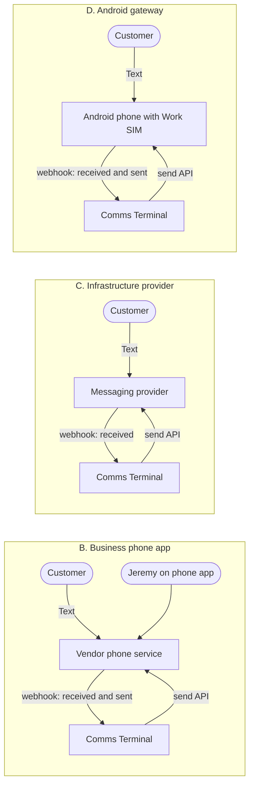
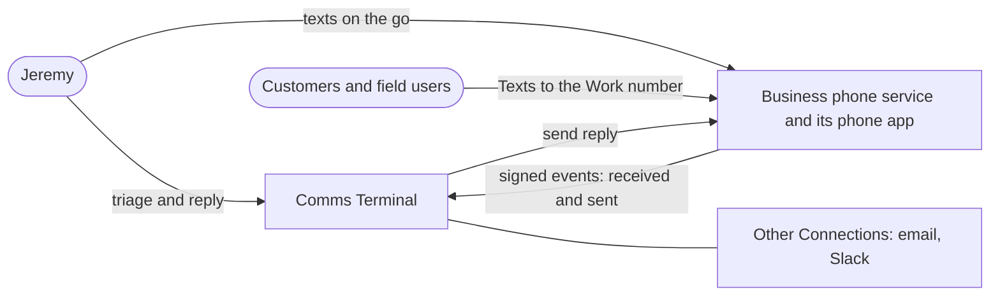
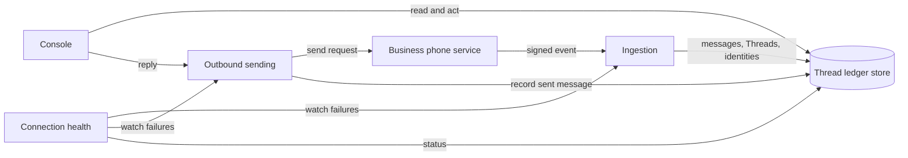
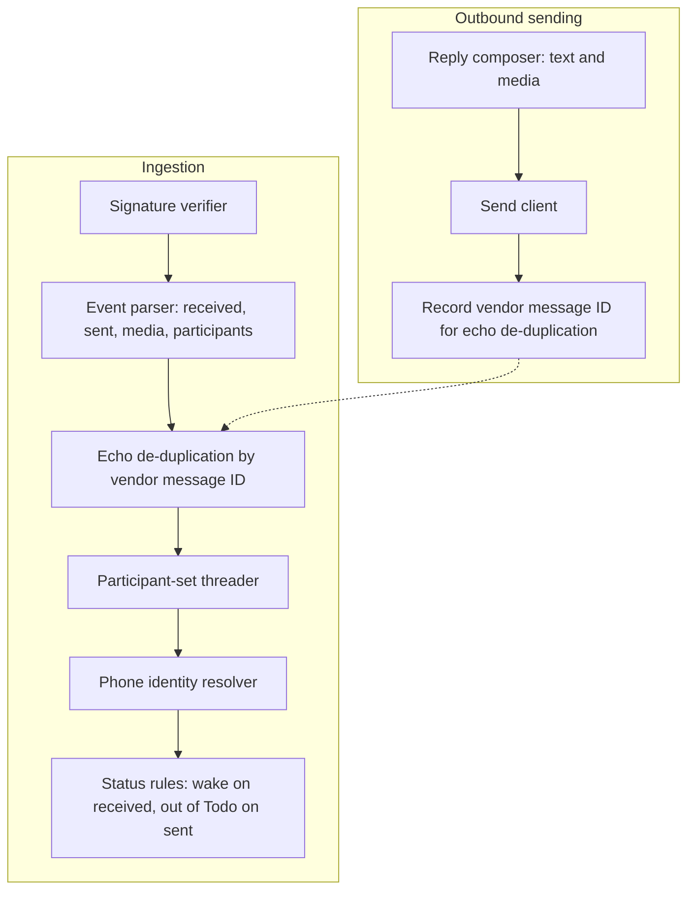

# SMS Connection — Discovery

## Status

- Current phase: Complete — validated problem and strategy
- Gates:
  - Seed: approved 2026-10-12
  - Phase 1 (Context): approved 2026-10-12
  - Phase 2 (Problem): approved 2026-10-12
  - Phase 3 (Options): approved 2026-10-12
  - Phase 4 (Decision and validation): approved 2026-10-12
- Last updated: 2026-10-12T19:12+00:00

## Context

### Seed (confirmed 2026-10-12)

- Topic: SMS (and possibly iMessage) as a Comms Terminal Connection.
- Need, in Jeremy's words: "how hard would it be to add imessage, or sms to this as a connection?" then "quo vs twilio".
- Known: the parent discovery (`2026-10-10-comms-terminal.md`) is complete. It put SMS and iMessage out of scope because no always-on Android phone or Mac is available (parent decision log 2026-10-10; PRD decisions #23 and #24). Parent Phase 1 budget constraint: "$10/mo max. open source preferred." Ingestion today follows the signed-hook pattern (`src/comms_terminal/slack.py`, email hook).
- Early solution ideas, held as Phase 3 candidates: Quo (formerly OpenPhone), Twilio, BlueBubbles on a Mac, an Android SMS gateway, a Beeper relay.

### Findings

#### From Jeremy (2026-10-12, ask tool rounds 1–2)

- Actors who text Jeremy about work: customers and field users, and the team (cofounder Logan Carr, contractors).
- Current carrier of those texts: Jeremy's iPhone on his personal number (iMessage and SMS).
- Frequency of the pain: occasional (a few times a month).
- Concrete failure: "Saw it, forgot to reply." The text was read on the iPhone, the read state cleared, and the conversation fell out of mind. This is the failure the Thread ledger already fixes for email and Slack.
- Number: a new number for work is acceptable.
- Sending: Jeremy must be able to text from the phone and from the console, and phone sends must appear as replies in Comms Terminal.
- Budget: "Price not a driver" for SMS. This supersedes the parent "$10/mo max" for this Connection.
- Content that must be covered: 1:1 texts, photos (MMS), group texts. Calls and voicemail are excluded.

#### From public research (2026-10-12, sub-agent; sources in Sources)

- iMessage and carrier SMS on a personal iPhone number have no cloud API. Routes to that number need an always-on Mac (BlueBubbles) or an Android phone holding the SIM (SMS gateway apps). The carrier email and forwarding routes ended in 2024–2025. iPhone Shortcuts can forward only incoming texts and cannot see sent ones.
- Business-number services with an API and webhooks: Quo (formerly OpenPhone), Twilio, Telnyx, Plivo, and Dialpad.
  - Quo and Dialpad bundle a phone app. Twilio, Telnyx and Plivo are infrastructure only.
  - Quo Starter costs $19/month ($15 billed annually). The API comes with any plan. Texts sent through the API cost $0.01 per segment. Webhooks include `message.received` and `message.delivered`. The Standard Webhooks signature is HMAC-SHA256.
- US texting from a business number requires A2P 10DLC registration, about $20 one-time plus $1.50–2 a month. Approval can take up to about 20 days, and the number cannot text US numbers while approval is pending.
  - Twilio's sole-proprietor tier excludes any entity with an EIN.
  - _Inference:_ Agent Maple is a company, so it would register as a standard brand.
- Unverified items:
  - Whether a text sent from the Quo mobile app fires `message.delivered`.
  - MMS support through the Quo API (sources conflict).
  - Group-text support on each provider.
  - Whether texts typed in the native Android SMS app reach the gateway's `sms:sent` webhook.

#### From the Quo API (2026-10-12, read-only probe after discovery closed)

- Jeremy already has a Quo workspace (owner), and the API key works.
- The workspace holds two Canadian numbers:
  - (506) 832-4154, held by Jeremy. Its phone-number ID is `PN2ppcGyMM`.
  - (249) 501-9153, held by Logan Carr.
- The API key is workspace-wide, so it sees Logan's number too. The Connection must scope webhooks and sends to Jeremy's number.
- Messaging restrictions on both numbers: Canada unrestricted, US restricted, international restricted.
- No webhooks exist yet.

#### Tensions found

- Team texts and existing customer threads live on the personal iMessage number. A new work number covers only conversations that move to it. Logan and current customers would have to switch, or those conversations stay uncovered.
- Requirement "phone sends appear as replies" depends on an unverified webhook behavior for every business-number option. The infrastructure-only options (Twilio, Telnyx, Plivo) have no phone app at all.
- Group texts and MMS are required, while provider support for both is the least verified area.

#### Open unknowns

- Whether Logan and existing customers would move to a work number, or whether iMessage coverage on the personal number is still required.
- Quo webhook behavior for app-sent texts, MMS via API, and group texts. All three can be tested during Quo's 7-day trial.
- 10DLC registration path and timeline for Agent Maple.

## Problem

### Statement (approved 2026-10-12)

Jeremy reads work texts from customers, field users and teammates on his iPhone. He then loses track of the replies he owes, because texts live outside the Thread ledger and the phone's read state is the only record. The result is late or dropped replies to customers, a few times a month. Evidence: Phase 1 answers ("saw it, forgot to reply"; occasional; texters are customers, field users and the team).

### Scope

- **In scope (one Work number):** 1:1 Texts, MMS photos, and Group texts as Threads. Wake on reply, as for email and Slack. Reply from the console. Replies sent from the phone are recorded on the Thread.
- **Out of scope:** the Personal number (iMessage and SMS); customers and field users move to the Work number, and team chat moves to Slack. Calls, voicemail, and bulk or marketing texting are also out of scope.
- **Non-goals:** replacing the phone app; auto-replies.

### Success measures

1. Every Text to the Work number shows as a Thread within 1 minute.
2. A reply sent from the phone or the console moves the Thread out of Todo within 1 minute.
3. Jeremy reports zero dropped work Texts in the first 30 days.
4. A broken Connection shows as broken in the console, as for other Connections.

## Glossary

Inherits the parent glossary (Connection, Thread, Platform, Person, Organization). New terms:

- **Text**: one SMS or MMS message.
- **Work number**: the business phone number Jeremy gives customers and field users for work texting; the SMS Connection's address.
- **Personal number**: Jeremy's own iPhone number; outside this Connection.
- **Group text**: a conversation with two or more other participants. One participant set forms one Thread; a changed set starts a new Thread.
- **Phone identity**: a phone number attached to a Person, like an email address or Slack user. An unknown number creates a new Person; Jeremy merges by hand.

## Options

Comms Terminal today has a terminal console with no phone surface (`src/comms_terminal/tui.py`, `serve.py`). Any "send from the phone" path therefore needs a phone app outside Comms Terminal. Concerns in this phase are early notes only; no option is eliminated here.

### A. Baseline: no Connection; phone-side habit

- **Core idea**: keep work texts on the iPhone. Jeremy uses "mark as unread" or a reminder to hold owed replies.
- **How it addresses the problem**: weakly. The phone's read state stays the only record, which is the stated cause of the problem.
- **Success measures moved**: none. Measures 1, 2 and 4 are not met by design.
- **Assumptions**: occasional drops are tolerable.
- **Risks**: the problem persists.
- **Cost and effort**: none.
- **What it rules out later**: nothing.

### B. Business phone app with an API (proposed by Jeremy: Quo; Dialpad is the same class)

- **Core idea**: the Work number lives in a vendor phone app on the iPhone. The vendor pushes signed webhooks for received and sent Texts to Comms Terminal. The console replies through the vendor's send API.
- **How it addresses the problem**: every work Text becomes a Thread. Replies from the phone app or the console move the Thread out of Todo.
- **Success measures moved**: 1, 2 and 4. Measure 2 for phone sends depends on the assumption below.
- **Key assumptions**:
  - A Text sent from the vendor phone app fires a webhook (unverified for Quo; documented for Dialpad's `direction: all`).
  - MMS and Group texts arrive through webhooks and can be sent through the API (unverified).
- **Risks**:
  - Vendor lock on the Work number; mitigated because both vendors allow porting out.
  - 10DLC approval delays texting by up to about 20 days.
  - Vendor webhook outages; parent decision 66 accepted event delivery without reconciliation.
- **Cost and effort**:
  - Quo: about $19/month plus $0.01 per API-sent segment plus 10DLC fees. Dialpad: $27+/month.
  - Adapter effort is about the size of the Slack adapter.
- **What it rules out later**: little. The number can be ported out.

### C. Messaging infrastructure provider, console-only sending (Twilio, Telnyx, Plivo)

- **Core idea**: buy a Work number from a provider with no phone app. Inbound Texts arrive by signed webhook, and Comms Terminal is the only client that sends.
- **How it addresses the problem**: every Text becomes a Thread, and console replies are recorded with certainty because the console is the only sender.
- **Success measures moved**: 1, 3 and 4. Measure 2 holds for the console only. Phone sending fails the Phase 1 need unless a phone surface for Comms Terminal is built.
- **Assumptions**: Jeremy accepts not texting from the phone, or a phone surface gets built later.
- **Risks**:
  - No phone client, so a field user's urgent Text waits for the console.
  - Group MMS support on long-code numbers varies by provider (unverified).
- **Cost and effort**: about $5–7/month plus 10DLC fees. Adapter effort is similar to B.
- **What it rules out later**: phone sending, until a phone surface for Comms Terminal exists.

### D. Android gateway phone holding a Work SIM (not proposed by Jeremy; capcom6 SMS Gateway, httpSMS)

- **Core idea**: put a prepaid line in a cheap Android phone that runs an open-source gateway app. The gateway pushes signed webhooks for received and sent Texts, and Comms Terminal sends through the gateway. Jeremy texts from that Android phone.
- **How it addresses the problem**: every Text becomes a Thread. It is carrier SMS and MMS on a real mobile line, so 10DLC registration does not apply.
- **Success measures moved**: 1, 2 (the assumption below holds) and 4.
- **Key assumptions**:
  - Texts typed in the native Android SMS app reach the gateway's `sms:sent` webhook (unverified).
  - Group MMS is captured (unverified).
- **Risks**:
  - It adds an always-on device, contrary to parent decision #23.
  - Jeremy carries or babysits a second phone.
  - The phone's battery and connectivity become Connection health.
- **Cost and effort**: phone plus a prepaid line, about $10–15/month. Open source.
- **What it rules out later**: little.

### Out of scope, recorded for completeness

- **Personal-number relays** (BlueBubbles on an always-on Mac; iPhone Shortcuts forwarding incoming Texts only). Phase 2 put the Personal number out of scope. They return only if that scope reopens.

### Option sketches (C4 L1)

## Decision

**Chosen: B. Business phone app with an API, with Quo only.** Approved 2026-10-12. Jeremy chose Quo with no fallback vendor ("Choose quo only"); the agent had proposed Dialpad as a fallback.

### Rationale

- B is the only option that meets every success measure and the Phase 1 need to send from both the phone and the console without adding a device.
- B matches the parent's event-driven ingestion pattern (signed hook in, send API out).
- Price is not a driver for SMS (decision log 2026-10-12), which removes B's main cost objection.
- Within B, Quo is cheaper and simpler. Dialpad documents outbound webhooks (`direction: all`) more clearly, but Jeremy ruled it out as a fallback.

### Rejected options

- **A. Baseline**: leaves the stated cause (read state as the only record) untouched and moves no success measure.
- **C. Infrastructure provider**: fails the requirement to send from the phone. The only remedy is building a phone surface for Comms Terminal, which is larger than the whole Connection.
- **D. Android gateway**: adds an always-on device, contrary to parent decision #23, and a second phone to carry. Its phone-send capture is as unverified as B's.

### Trade-offs accepted

- Vendor dependence for the Work number; porting out stays possible.
- Up to about 20 days of 10DLC review before the Work number can text US numbers.
- No reconciliation by default, consistent with parent decision 66. Open risk R3 below covers this.

## Validation

### Riskiest assumptions

| # | Assumption | Evidence now | Missing evidence |
|---|---|---|---|
| V1 | A Text sent from the Quo phone app fires a sent-message webhook | **Confirmed 2026-10-12.** A Text typed in the Quo app ("test", 21:18:03 UTC) arrived at `/hooks/quo` as a verified `message.delivered` with `userId`, `conversationId`, `senderIdentifier` and `recipientIdentifiers`. The reply arrived as `message.received` in the same `conversationId`. | None |
| V2 | MMS photos and Group texts arrive through webhooks with media and the full participant list, and can be sent through the API | **Partly confirmed 2026-10-12.** 1:1 MMS works both ways: an inbound photo arrived as `message.received` with `image/jpeg` media, and a photo sent from the app arrived as `message.delivered` with `image/png`. Both media URLs (share.quo.com, signed) fetched with HTTP 200. **Group outbound fires no event:** a Group text sent from the app at 21:20:47 UTC to two people stayed at status `sent`, and no `message.delivered` arrived after the 3-minute wait. _Inference:_ group MMS gets no delivery receipt, so the subscribed events never fire. Quo's conversation list does show the group, with both participants. | Inbound Group text (a member replies) and its `recipientIdentifiers`; sending media and groups through the API |
| V3 | Customers and field users adopt the Work number | None. The Phase 2 answer assumes it | Count of work Texts still arriving on the Personal number after 30 days (Jeremy's report) |
| V4 | Agent Maple can complete US texting registration in reasonable time | Vendor docs give up to about 20 days. The Quo API shows US messaging "restricted" on both Canadian numbers; Canadian texting is unrestricted | Confirm in Quo which registration lifts the US restriction for a Canadian number, then record the start and approval dates |

### Scenario walk-through

| Scenario | Result |
|---|---|
| Customer texts the Work number; Jeremy reads it in the phone app and forgets | **Holds.** The Thread stays in Todo regardless of read state. |
| Jeremy replies from the phone app | **Holds if V1.** The sent-message webhook moves the Thread out of Todo. |
| Jeremy replies from the console | **Holds, with one care point.** The vendor also emits a sent-message event for console sends; it must not create a duplicate message (component "echo de-duplication" below). |
| Field user sends a photo | **Bends unless V2.** Without media in the webhook, the Thread still wakes but shows no photo. |
| Superintendent adds a colleague to a group text | **Holds if V2.** A new participant set starts a new Thread (glossary). |
| A customer texts the Personal number from habit | **Gap (accepted).** The Personal number is out of scope; the success-measure-3 report catches it (V3). |
| Logan texts about work | **Holds by policy.** Team chat moves to Slack (Phase 2 decision). |
| An unknown number texts | **Holds.** A new Person with a Phone identity; Jeremy merges by hand. |
| The vendor's webhook delivery fails for an hour | **Bends.** No reconciliation (parent decision 66); messages may be missed until the vendor retries. See R3. |
| A recipient replies STOP | **Holds.** Compliance handling sits with the vendor. |

## Architecture (abstract)

### L1 Context

### L2 Container

### L3 Component (Ingestion and Outbound sending; these carry V1 and V2)

## Open risks and unknowns

| # | Item | Impact | Next evidence needed |
|---|---|---|---|
| R1 | ~~Phone-app sends may not fire a webhook (V1)~~ Closed 2026-10-12: confirmed live | — | — |
| R2 | ~~Group texts sent from the phone fire no webhook (V2)~~ Closed 2026-10-12: group texts waived; the Connection drops them | — | — |
| R3 | No reconciliation for missed webhooks | Silent drop of a Text, against measure 3 | Decide after the trial whether a periodic check against the vendor's message list is warranted |
| R4 | Contacts keep texting the Personal number (V3) | Coverage gap that the console cannot show | Jeremy's 30-day report |
| R5 | 10DLC review delay (V4) | Up to about 20 days before the Work number can text US numbers | Registration start and approval dates |

## Decision log

| Date | Request or decision | Source | Status | Supersedes |
|---|---|---|---|---|
| 2026-10-12 | SMS discovery opened as a child of the completed comms-terminal discovery; reopens the parent's "SMS and iMessage out of scope for now" | Jeremy, `/discovery sms` and seed confirmation | Accepted | — |
| 2026-10-12 | Price is not a driver for the SMS Connection | Jeremy, ask tool answer | Accepted | Parent constraint "$10/mo max" (for SMS only) |
| 2026-10-12 | A new work number is acceptable; texting must work from both the phone and the console | Jeremy, ask tool answer | Accepted | — |
| 2026-10-12 | Problem statement, scope, and success measures approved | Jeremy, ask tool answer | Approved | — |
| 2026-10-12 | Personal iMessage number out of scope; customers and field users move to the Work number, team chat to Slack | Jeremy, ask tool answer | Accepted | Phase 1 tension "team texts on personal number" |
| 2026-10-12 | Group text: one Thread per participant set | Jeremy, ask tool answer | Accepted | — |
| 2026-10-12 | Phone number is a Phone identity on a Person; manual merge | Jeremy, ask tool answer | Accepted | Auto-match from contacts |
| 2026-10-12 | Phase 2 approved | Jeremy, ask tool answer | Approved | — |
| 2026-10-12 | Phase 3 option set (A–D) approved | Jeremy, ask tool answer | Approved | — |
| 2026-10-12 | Agent recommends Strategy B (Quo first, Dialpad fallback) | Agent | Superseded | — |
| 2026-10-12 | Strategy B chosen with Quo only; no fallback vendor. C4 diagrams and risks R1–R5 approved | Jeremy ("Choose quo only"), ask tool answer | Accepted | Options A, C, D; Dialpad fallback |
| 2026-10-12 | Group texting waived: the inbound group reply never reached Quo; the Connection drops group texts | Jeremy ("waive this and continue without the group texting support") | Accepted | Phase 2 scope "Group texts as Threads" |
| 2026-10-12 | SMS Connection built and live on the Quo Work number: Texts, photos, app replies, console replies (schema 5; Platform renamed quo in schema 6) | Jeremy, live tests | Done | — |

## Sources

- `.agents/discovery/2026-10-10-comms-terminal.md`: parent discovery; read the Status, Phase 1 constraints, scope, the SMS scenario, risks, and the decision log.
- `docs/prd.md`: decisions #23 and #24.
- `src/comms_terminal/schema.sql`, `src/comms_terminal/slack.py`: Connection and identity model, hook pattern.
- Public web research sub-agent, 2026-10-12. Sources include: support.quo.com (API and webhooks), quo.com/docs (webhook payloads, send message), twilio.com (SMS pricing, webhook security, hosted numbers, A2P 10DLC sole-proprietor docs), telnyx.com and support.telnyx.com (messaging pricing, 10DLC fees), github.com/BlueBubblesApp/bluebubbles-server, github.com/capcom6/android-sms-gateway and docs.sms-gate.app, github.com/NdoleStudio/httpsms, developers.dialpad.com, verizon.com (Message+ end), Apple Shortcuts guide. Some prices came from third-party pricing roundups (usecarly, ringly, krispcall). Unverified items are listed in Findings.
