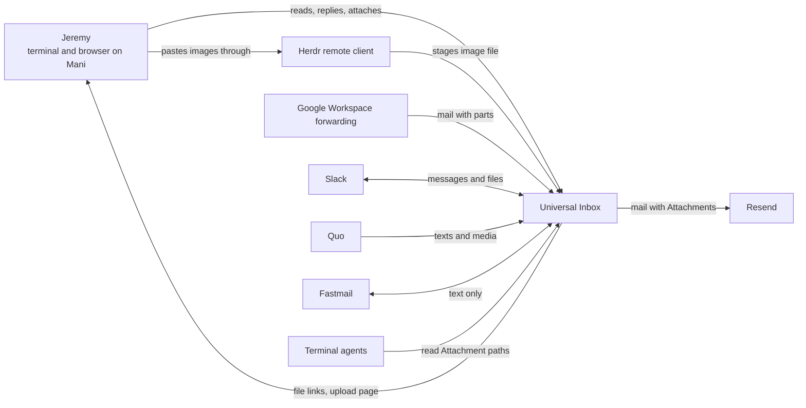
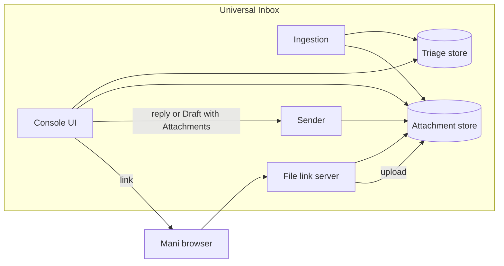
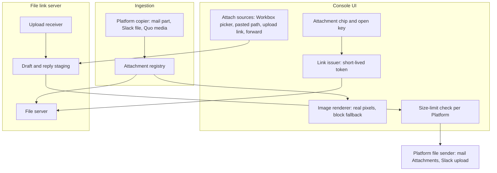

# Attachments — Discovery

## Status

- Current phase: Complete — validated problem and strategy
- Gates:
  - Seed: approved 2026-10-15
  - Phase 1 (Context): approved 2026-10-15
  - Phase 2 (Problem): approved 2026-10-15
  - Phase 3 (Options): approved 2026-10-15
  - Phase 4 (Decision and validation): approved 2026-10-15
- Last updated: 2026-10-15 (UTC)

## Context

### Seed (confirmed 2026-10-15)

- Topic: Attachments in Universal Inbox across Email (Gmail, Fastmail), Slack, and SMS (Quo).
- Need, in Jeremy's words: "i want to add support for attachments".
- Known: `GLOSSARY.md` defines Attachment as a file sent with a message, seen in the console and fetched from the Platform. Received Attachments show as chips (name, type, size) that open the message in Gmail, because Gmail's per-attachment link needs an internal ID that a forwarded copy lacks (PRD decisions #105–#109, #114). Sending Attachments is deferred (`docs/requirements.md`).
- Earlier answers the same day (grilling round 1): cover both directions, receiving first; all three Platforms in scope.
- Early solution idea, held as a Phase 3 candidate: receive first, then send.

### Findings

#### From the codebase (2026-10-15, sub-agent; paths under `src/universal_inbox/`)

Inbound, per Platform:

| Platform | What is stored | File bytes on Workbox |
|---|---|---|
| Gmail (forwarded) | Full raw message, `raw/<sha256>.eml` (`email.py:257`, `inbox.py:981-992`); Attachments parsed at render time (`render.py:412-428`) | Yes, inside the .eml |
| Fastmail | `data.attachments = [[name, type, size]]` (`fastmail.py:54-55`); no blob ID, no raw copy | No |
| Slack | `data.attachments = [[name, mimetype, size]]` (`slack.py:77-78`); no file ID or `url_private` | No |
| Quo | `data.media = [[type, signed url]]` plus a placeholder `["photo", type, 0]` (`quo.py:48,56`) | No, URL only |

- No attachment column exists; everything is in `activities.data` JSON (`schema.sql:123`).
- Inline `cid:` images and `application/ics` are skipped; `text/calendar` renders as an invite card.

Console:

- Chips render with a paperclip icon (`tui.py:1368-1372`, `render.chip`) as a terminal hyperlink, opened only by Ghostty Ctrl+Shift+click (Jeremy's choice, PRD #114).
- Targets: Gmail opens a Gmail search for the Message-ID; Fastmail the message's web URL; Slack a `slack://channel` URL; Quo the signed media URL.
- No key opens, saves, or downloads an Attachment. `y` (copy for a terminal agent) lists Attachments by name, type, and size only (`tui.py:1772`).

Outbound (every send path is text only):

- Gmail Connection: Resend (`email.py:181-231`); its API accepts attachments, the payload sends none.
- Fastmail: the MCP `send_email` tool (`fastmail.py:146-196`); attachment support unknown. JMAP and IMAP scopes were refused.
- Slack: `chat.postMessage` with the user token; no `files:read` or `files:write` scope (`scripts/oauth_slack.py:19-22`).
- Quo: `POST /v1/messages` with `{content, from, to}`; MMS sending through the API is unverified (`.agents/discovery/2026-10-12-sms.md` lines 47, 123). MMS receiving and signed media URLs were verified live (same file, V2).
- The console reaches the service over a Unix socket (`serve.py`); the `Sender` protocol has no file argument (`inbox.py:259`). Drafts (`composition_drafts`) have no attachment field.

Where things run:

- The console is Textual on Workbox, reached over SSH from Ghostty on Mani. The database, `raw/`, and the service live on Workbox.
- Nothing in the code moves files between Mani and Workbox.

Prior non-goals: attachments were deferred in the reply decision (#51), new-thread composition, and Slack Drafts (`.agents/prd/2026-10-15-slack-drafts.md:48`). No terminal images (#105, Herdr Kitty-graphics bugs).

#### From Jeremy

Answers from Phase 1 rounds 1–2 on 2026-10-15 (ask tool):

- Trigger: Jeremy needed to send a file, and the reply had to be finished outside the console. Last case: email from the Gmail Connection (`jeremy@agentmaple.com`).
- Receiving: a received Attachment needs action daily. Jeremy reads or views it on Mani, hands it to an agent, or forwards it.
- Sending: files come from Mani's disk, from Google Drive or share links, or from a received Attachment (forwarding).
- Priority: sending and receiving hurt equally. This refines the seed's "receive first" ordering.
- Acceptable costs: keeping copies of received Attachments on Workbox, and Slack re-consent for file scopes.
- Not selected: a helper program on Mani, or a paid API tier. Inference: a design that needs either one should be avoided unless nothing else works.
- Analogue: Plain.
- Sending frequency: a few times a week. Drive files are sent as share links, which already work, so they need no file handling.
- Images: Jeremy wants received images in the terminal, at real resolution where the terminal allows, with a coarse fallback. This reopens decision #105 (no terminal images).
- Principle (Jeremy): "everything should be contained in the inbox app. i don't think anything should be installed on mani extra". No helper on Mani.

#### Jeremy's idea: "upload attachment" (2026-10-15)

- Jeremy, in chat: "cant we just have 'upload attachment'? default looks at workbox locally, but supports upload from mani via the same connection that is established for the ui?" This follows the aerc and neomutt model: the file picker browses the host the client runs on. Held as a Phase 3 candidate.
- Herdr's `--remote` client and saved machines bridge **clipboard images** only. On Ctrl+V, Herdr stages the image as a temporary file on the remote host and pastes its remote path into the pane (Herdr v0.6.0, #205, built for Claude Code image paste). Source: herdr.dev/docs/how-to-work and the Herdr changelog, read 2026-10-15.
- No Herdr or Ghostty route was found for arbitrary files such as PDFs. Kitty's file-transfer protocol (`kitten transfer`) is Kitty-only, and Ghostty support was not found (searched 2026-10-15; absence not proven).
- Attach mode: verified 2026-10-15 that Workbox runs `herdr remote-client-bridge` (started 11:13 that day, Herdr 0.9.1). So Mani attaches as a Herdr remote client, and the clipboard-image bridge applies. A live Ctrl+V test into a Textual app is still untested.
- Reading (Jeremy, 2026-10-15): "i think the link to open is fine for reading". A received Attachment opens on Mani through a link served by the inbox, opened with Ctrl+Shift+click in Mani's browser.

#### Platform APIs and Plain (research sub-agent, 2026-10-15)

| Platform | Get received file | Send file | Source |
|---|---|---|---|
| Gmail (forwarded) | Bytes already in raw `.eml` | Resend `attachments[]` (`content` or hosted `path`); 40 MB per email after Base64 | resend.com/docs/api-reference/emails/send-email |
| Fastmail (MCP) | Not possible: "At this time, we don't support accessing attachments via MCP." | Not possible through MCP (same statement; live tool schema not fetched) | fastmail.help article 15869557281295 |
| Slack | `url_private` with Bearer token and `files:read` (user token works) | `files.getUploadURLExternal` → POST bytes → `files.completeUploadExternal` with `channel_id`, `thread_ts`, `initial_comment`; `files:write`, user token works. `files.upload` was sunset 2025-11-12 | docs.slack.dev file object, files.read scope, completeUploadExternal |
| Quo | Webhook `media[{type, url}]`; signed URL lifetime undocumented, so download on arrival | Not possible: `POST /v1/messages` has no media field; the 2026-03-30 spec has no send operation | openphone.com/docs send-a-text-message; quo.com/docs/2026-03-30 |

- Fastmail workaround (inference, unverified): JMAP with an API token supports blob download and upload (RFC 8620). That is a second credential beside the MCP OAuth.
- Plain, the chosen analogue:
  - One channel-neutral Attachment model: every email, Slack, and chat entry carries `attachments` with id, file name, size, extension, and MIME type.
  - One upload path for every channel: an upload URL, then the Attachment IDs passed to the reply or new-thread call. Unreferenced uploads are deleted after 24 hours.
  - Short-lived authorised download URLs (3 minutes), with optional virus-scan status.
  - Per-channel size limits enforced at send: email 6 MB, Slack 50 MB; executables blocked.
  - Plain very likely re-hosts Slack and email files (inferred). UI details such as drag-and-drop and previews were not found.
  - Source: plain.com/docs/graphql/attachments and createAttachmentDownloadUrl.
- Ghostty: OSC 8 refuses `file://` links without a hostname (so Workbox paths can't open on Mani). Dropping a file pastes its Mani path. OSC 52 clipboard works. No file-transfer protocol documented. Source: ghostty.org/docs/vt/osc/8 and osc/52.

#### Terminal images (research sub-agent, 2026-10-15)

- Herdr is the layer that decides. It redraws every pane, so only Kitty graphics or text reach Ghostty. Sixel is dead: Herdr closed it as not planned (#3030, #4330), and Ghostty has no Sixel either.
- Workbox runs Herdr 0.9.1; the latest is 0.9.5 (2026-10-14). 0.9.2 rewrote graphics to render Kitty natively. #3697 (images never painted) and #4858 (placeholder images stretched) are still open, and so are #3946, #3877, #3676 and #3882.
- The `textual-image` library (0.14.1, maintained) supports Kitty, Sixel, and half-block. Half-block works over any truecolor SSH session, but it is too coarse to read text inside screenshots. Its Kitty path uses Unicode placeholders, the mode that #4858 distorts.
- Unverified: Kitty rendering on Herdr 0.9.5 over Jeremy's SSH setup; whether omp still turns images off under Herdr.

#### Hosts (memory, `2026-10-06-[fact]-mani-herdr-workbox-access`, confirmed 2026-10-13)

- Mani is Jeremy's workstation, with the desktop and browser. Workbox is headless, with no display.
- SSH and Herdr run from Mani into Workbox. A separate Workbox→Mani route exists for previews, but it drops while Mani sleeps.
- Ghostty runs on Mani. A terminal hyperlink is opened on Mani by Ctrl+Shift+click (PRD #114).

## Problem

### Statement (approved 2026-10-15)

Jeremy works his Threads in the inbox console (on Workbox, reached from Mani). He cannot open, view, hand to an agent, forward, or send a file without leaving the console. The inbox keeps file bytes only for forwarded Gmail, other Platforms keep only names or short-lived links, and every send path is text only. So any Thread that involves a file is finished in Gmail, Slack, or Quo: daily for received files, and a few times a week for sent ones. That breaks the one-console workflow the inbox exists for, and agents handed a Thread with `y` see only file names. Evidence: Phase 1 (the Gmail reply trigger, daily receiving, the code map).

### Scope

- In scope:
  - Received Attachments and Inline images on Gmail, Slack, and SMS.
  - Sending Attachments on Gmail and Slack, in replies and Drafts.
- Not in scope, as non-goals (Jeremy, 2026-10-15):
  - Fastmail Attachments in either direction; Fastmail chips stay as today.
  - Sending Attachments by SMS.
  - Anything installed on Mani.
  - File handling for Google Drive, which is sent as share links.
  - Rich text.

### Success measures (approved 2026-10-15)

1. For two weeks after release, no reply has to be finished outside the console because of a file (Gmail and Slack).
2. Any received Attachment on Gmail, Slack, or SMS opens on Mani with at most one key plus one Ctrl+Shift+click, and still opens after its Platform link expires.
3. Received images show in the console without leaving it: real pixels where Herdr allows, a coarse preview otherwise.
4. `y` gives the agent a readable Workbox path for each Attachment.
5. Attaching a file takes at most three actions, from any source: Workbox's disk, a pasted image, a file on Mani's disk through the upload link, or a received Attachment being forwarded.
6. Sending respects each Platform's size limit and says so before sending, not after a failure.

## Glossary

- **Attachment**: a file that arrives or is sent with a message, or is added to a Draft to go with it, listed beside the message. A Slack file or an SMS photo is an Attachment. (Revised 2026-10-15.)
- **Inline image**: an image placed inside an email body where it appears; part of the body, not an Attachment. (New 2026-10-15.)

## Options

Fact used by every option (`deploy/universal-inbox.service`, `docs/runbook.md` D3): the service listens on `127.0.0.1:8787`. The Cloudflare Tunnel publishes only `^/hooks/(email|slack|quo)$`. Links Mani can open therefore need either a Workbox LAN listener (Mani has a direct `/32` route to `192.168.0.107`) or a new tunnel path behind authentication.

### S0 — Baseline: do nothing

- Core idea: chips keep opening the message in its native app. Sending a file is finished in Gmail or Slack; Drive files go as links.
- Measures moved: none.
- Assumptions: the native round-trip is tolerable.
- Risks: the daily pain stays; agents stay blind to file contents.
- Cost: zero. Rules out nothing.

### S1 — Copy on arrival, one Attachment store (Plain-like; shaped by Jeremy's ideas)

- Core idea:
  - At ingest, copy every Attachment's bytes to Workbox: Gmail parts from the raw message, Slack files with `files:read`, Quo media from the webhook URL.
  - One Attachment record per file across Platforms.
  - The console opens files through a short-lived link the inbox serves, and shows images in the terminal: Kitty graphics where Herdr paints them, half-block otherwise.
  - `y` gives agents file paths.
  - Drafts and replies hold Attachments from four sources: a Workbox file picker, a pasted image (Herdr Ctrl+V), the inbox upload page, or a received Attachment being forwarded.
  - Gmail sends through Resend `attachments`; Slack through `files.getUploadURLExternal` and `files.completeUploadExternal`.
- Measures moved: 1–6.
- Assumptions: Workbox storage is ample; Herdr's image paste reaches a Textual input; Mani can reach a link served by the inbox.
- Risks: storage grows forever; a link server is a new exposed surface; Slack re-consent; Kitty distortion (#4858).
- Cost: largest. Rules out little. Fetch-on-open could later evict old copies.

### S2 — Fetch on open, with a cache

- Core idea: store only references (Slack file ID, Quo URL). Download the first time a file is opened or rendered, then cache it. Gmail already has the bytes. Sending is the same as in S1.
- Measures moved: 1, 3–6, and 2 only partly.
- Assumptions: Platform links outlive the need.
- Risks: Quo signed URL lifetime is undocumented, so old SMS media may be lost, which breaks measure 2. Deleted Slack files are lost. Images render with a fetch delay.
- Cost: medium; less storage.
- Rules out: guaranteed access to old media.

### S3 — Browser companion for files (not proposed by Jeremy)

- Core idea: the inbox serves a read-and-compose web view of a Thread: Gmail-like HTML with images, downloads, and a composer with drag-and-drop attach. A console key opens it in Mani's browser. The terminal stays text with chips.
- Measures moved: 1, 2, 5, 6 well. Measure 3 only in the browser, not the console. Measure 4 needs a separate path.
- Assumptions: switching to the browser for file work is acceptable.
- Risks: two composers to keep in step; drifts toward a web app.
- Cost: large.
- Rules out: terminal images (#105 stays).

### S4 — The same Textual app in the browser (`textual serve`; not proposed by Jeremy)

- Core idea: run the existing console through `textual serve`, so Mani's browser hosts the same app. `App.deliver_binary` downloads files natively. The terminal path keeps working over Herdr.
- Measures moved: 2 and 4 (with copies); 5 only if uploads work; 3 unclear.
- Assumptions: `textual serve` supports file upload (unverified) and runs on Workbox behind a reachable link.
- Risks: upload unproven; a second runtime to keep alive; keyboard capture differs in the browser.
- Cost: medium, with the most uncertainty.
- Rules out little.

Early concerns, with no options eliminated: S2 conflicts with measure 2 for SMS; S3 and S4 move file work out of the terminal, which strains the "contained in the inbox app" principle.

## Decision

Approved 2026-10-15: **S1, copy on arrival into one Attachment store.** File links (opening and uploading) are served on Workbox's LAN address, behind short-lived unguessable tokens. A public tunnel path behind Cloudflare Access sign-in is the recorded upgrade for use away from home (Jeremy: "LAN now, public later").

- Why S1:
  - It is the only option that moves all six measures.
  - It keeps file work inside the inbox app (the principle).
  - It removes the dependence on Platform links that expire.
  - It matches Plain's single model.
  - Storage cost is small. Measured 2026-10-15: 92 email Attachments total 9.3 MB (largest 2.9 MB) and 13 Slack files total 2.5 MB, across about a month of history.
- Why the others lost:
  - S0 moves nothing.
  - S2 loses old SMS media, because Quo's URL lifetime is undocumented, which breaks measure 2.
  - S3 moves images and composing out of the terminal into a second composer.
  - S4 rests on unproven `textual serve` uploads and a second runtime.
- Trade-offs accepted:
  - The store grows without limit; eviction can come later.
  - A new LAN listener on Workbox.
  - Slack re-consent.
  - Kitty images may distort until Herdr fixes #4858; half-block is the fallback.
  - Links open only on the home network.

## Validation

### Riskiest assumptions

| # | Assumption | Evidence now | Missing |
|---|---|---|---|
| A1 | Herdr's Ctrl+V image bridge delivers a Workbox path into a Textual input | Herdr v0.6.0 #205 documents it; Workbox runs `herdr remote-client-bridge` (verified 2026-10-15) | A live paste into a Textual app |
| A2 | Real-pixel images render through Herdr 0.9.x | Herdr 0.9.2 rewrote Kitty graphics; #3697 and #4858 are open | A live render on Herdr 0.9.1 or 0.9.5; half-block covers the failure |
| A3 | Mani's browser can reach a Workbox LAN link | Mani has a direct `/32` route to `192.168.0.107` (memory, 2026-09-19) | An off-home-network case |
| A4 | Storage stays small | 11.8 MB across ~1 month (measured) | None material |
| A5 | A Slack user token with `files:read` downloads DM and channel files | Slack docs (file object, `files:read`) | Re-consent, then one download |
| A6 | Quo media can be copied on arrival | Webhook carries `media[{type,url}]`; signed URLs returned 200 in SMS discovery | No SMS media in the database yet (0 messages) |

### Scenario walk-through

- A contract PDF arrives in Gmail. One key on the chip, then a Ctrl+Shift+click opens it in Mani's browser. Holds.
- A reply needs a signed PDF from Mani's Downloads. A key shows the upload link; click it, pick the file, and it lands on the reply; Ctrl+S sends through Resend. Three actions. **Bends:** reply text lives only in console memory today (`app.drafts`), so an upload must attach to a reply that the service knows about. Reply Attachments need server-side staging.
- A Slack screenshot arrives. It is copied with `files:read` and shown under the message, in Kitty or half-block. Holds; Kitty may distort (A2).
- Forwarding a received Attachment. **Bends:** the console has no forward action today. Measure 5 needs one: a new email Draft prefilled with the chosen Attachments.
- `y` hands a Thread to an agent. The agent gets Workbox paths it can read as the same user. Holds.
- A file over the Platform limit (Resend 40 MB per email). The Draft refuses before sending and names the limit. Holds. The recipient side may accept less, for example Gmail's 25 MB inbound limit. That limit is unverified and worth stating in the warning.
- An SMS or Fastmail reply. Attach isn't offered (non-goal). Holds.
- Jeremy away from home opens a link. **Breaks:** a LAN-only link won't load. Accepted for now; the tunnel with authentication is the upgrade.
- An Inline image in a newsletter shows in place, or as `[image: alt]` when it can't be fetched. Remote images are not downloaded, which avoids tracking pixels. Proposed; this needs a decision during requirements.

## Architecture (abstract)

### L1 Context

### L2 Container

### L3 Component (Attachment handling)

## Open risks and unknowns

- Reply Attachments need server-side staging, because reply text is console memory only today.
- A forward action does not exist yet and is needed for measure 5.
- LAN-only links fail away from home.
- Inline remote images: fetch or not (tracking pixels).
- Quo: signed media URL lifetime is undocumented, so received media must be copied promptly.
- Slack: needs `files:read` and `files:write` and a re-consent (accepted cost).
- Herdr clipboard-image paste into a Textual pane: untested live.
- Terminal images: Kitty graphics through Herdr 0.9.x are untested, and #4858 distortion is open.

## Decision log

- 2026-10-15 — Scope: both directions, receiving first; Email, Slack, and SMS. Source: Jeremy, grilling round 1 (ask tool). Status: accepted as seed input. Supersedes: "attachments deferred" (requirements.md) once a strategy is approved.
- 2026-10-15 — Seed confirmed. Source: Jeremy (ask tool). Status: approved.
- 2026-10-15 — Sending and receiving rank equally; this refines "receive first". Source: Jeremy, Phase 1 round 2. Status: evidence for Phase 3 ordering.
- 2026-10-15 — Acceptable costs are file copies on Workbox and Slack re-consent; a helper on Mani and a paid API tier were not selected. Source: Jeremy, Phase 1 round 2. Status: constraint.
- 2026-10-15 — Principle: everything stays inside the inbox app, and nothing extra is installed on Mani. Source: Jeremy, in chat. Status: constraint. Supersedes: the open Mani-helper question.
- 2026-10-15 — Received images should show in the terminal at real resolution where possible, with a coarse fallback. Source: Jeremy, Phase 1 round 3. Status: evidence; reopens PRD #105.
- 2026-10-15 — Reading a received Attachment on Mani: a link served by the inbox, opened in Mani's browser, is enough. Source: Jeremy, in chat. Status: accepted as Phase 3 input.
- 2026-10-15 — Non-image files on Mani reach a Draft through an upload link served by the inbox, opened in Mani's browser. Images arrive by pasting with Ctrl+V through Herdr. Files on Workbox's disk are picked inside the app. Source: Jeremy, in chat and ask tool. Status: accepted as Phase 3 input. Supersedes: the reach-back and manual routes as primary routes.
- 2026-10-15 — Phase 1 gate approved. Source: Jeremy (ask tool). Status: approved.
- 2026-10-15 — Problem statement and success measures approved. Source: Jeremy (ask tool). Status: approved.
- 2026-10-15 — Fastmail Attachments (both directions) and SMS sending are non-goals. Source: Jeremy (ask tool). Status: accepted.
- 2026-10-15 — Glossary: Attachment revised to cover Draft files and drop "fetched from the Platform"; Inline image added, following Plain's split between `attachments` and `inlineAttachments`. Source: Jeremy (ask tool). Status: written to `GLOSSARY.md`.
- 2026-10-15 — Phase 2 gate approved (scope, terms, edge cases). Source: Jeremy (ask tool). Status: approved.
- 2026-10-15 — Phase 3 gate approved (five options). Source: Jeremy (ask tool). Status: approved.
- 2026-10-15 — Phase 4 gate approved: S1, its validation, and its open risks. Source: Jeremy (ask tool). Status: approved. Supersedes: "attachments deferred" (`docs/requirements.md`, PRD #51) and "chips open the message in Gmail" (PRD #106), pending requirements.
- 2026-10-15 — File links are LAN only for now; a public path behind sign-in comes later. Source: Jeremy (ask tool). Status: accepted.
- 2026-10-15 — Process: questions must be self-contained, because chat text in the same turn is hidden behind the dialog. Source: Jeremy. Status: rule `~/.claude/rules/ask-tool-self-contained.md`.

## Sources

- Codebase map by a read-only sub-agent on 2026-10-15 at commit `efa91a6` (`dev`). Citations are from its report; lines were not all re-read.
- `GLOSSARY.md`, `docs/requirements.md`, `docs/prd.md` decisions #51, #105–#110, #114.
