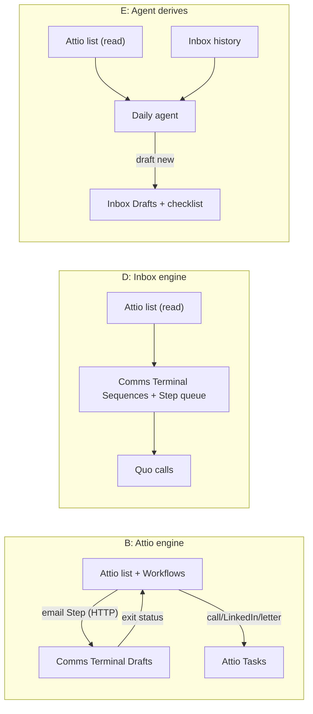
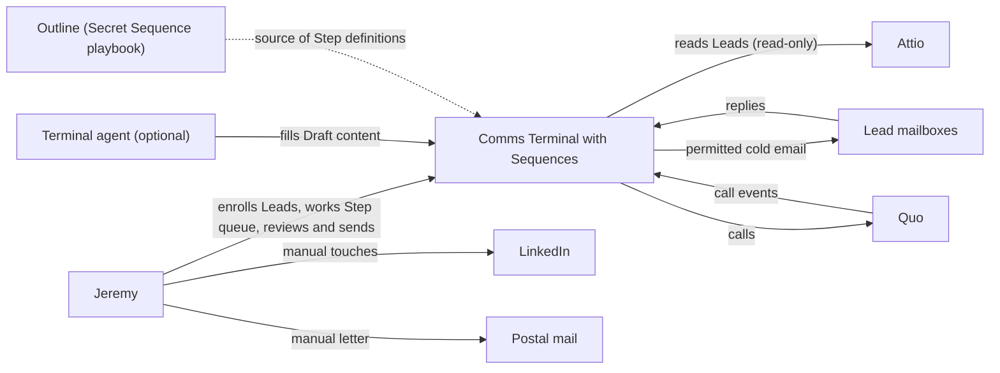
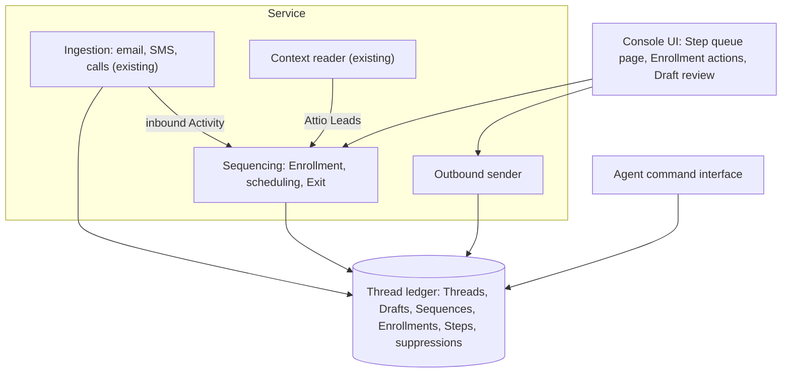
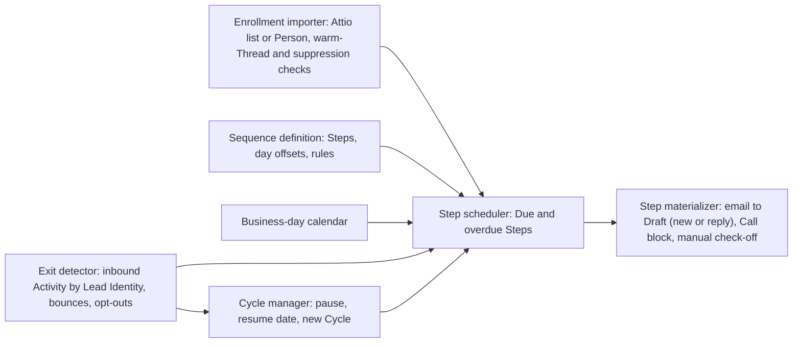

# Cold-outreach sequencing discovery (Lemlist replacement)

## Status

- Current phase: Complete — validated problem and strategy D
- Gates:
  - Seed: approved with widening 2026-10-15
  - Phase 1 (Context): approved 2026-10-16
  - Phase 2 (Problem): approved 2026-10-16 (M5 dropped)
  - Phase 3 (Options): approved 2026-10-16
  - Phase 4 (Decision and validation): approved 2026-10-16
- Last updated: 2026-10-16 (UTC).

## Context

### Seed (confirmed 2026-10-15)

- Topic: replacing Lemlist's cold-outreach sequencing. One candidate is Attio as the step engine, with each due step becoming a Draft in Comms Terminal for review and send. The topic covers full Lemlist replacement: sequences, channels, sending, and the daily step queue.
- Trigger, in Jeremy's words: "lemlist had a sequence for cold outreach. can we explore setting up sequencing in attio and using attio steps to create drafts in universal inbox?"
- Jeremy widened the seed from "Attio steps create Inbox Drafts" to "Lemlist replacement" at the seed gate.
- Early solution ideas (Phase 3 candidates, not decisions): Attio Sequences or Workflows as the step engine; Attio steps creating Inbox Drafts.

### Lemlist account (live, 2026-10-15)

- Lemlist API calls for team info and campaigns return `HTTP 402: route is available starting emailPro plan`. Channels report `plan: null`, and email (`jeremy@agentmaple.com`, `jeremy@agentmaple.ai`, both Google) and LinkedIn report connected but unavailable. Inference: the Lemlist plan is downgraded or lapsed. The old sequence content cannot be read through the API.
- Historical model (memory `2026-04-23-[pref]-adhd-workday-structure.md`, April 2026): NB outbound used 50 active leads, 25 new leads per week, a 14-day sequence, and 50–60 daily email/call touches including automated emails. Clearing the daily Lemlist manual queue was the founder-sales baseline (memory `2026-03-10-[pattern]-jeremy-sales-approach.md`).
- Lemlist was the sending and tracking layer; Jeremy read and replied in Gmail (same memory). Medium confidence: memory, possibly stale.

### Attio workspace (live, 2026-10-15)

- Workspace "Agent Maple", Jeremy is admin. Objects: People, Companies, Deals. Lists: Fundraising Deals, Revenue Deals, Paying Customers. No prospecting list or sequence exists yet.
- Comms Terminal reads Attio read-only as a Context source (FR-13b, `src/comms_terminal/attio.py`) and imports recently touched Attio People.
- Attio plan tier is unknown (Sequences need Pro).

### Comms Terminal today (repo, 2026-10-15)

- Persistent email/SMS/Slack Drafts exist; a Draft can be sent as a new Thread (`1b440d0`). Jeremy sends from the console.
- Terminal agent commands create and edit Drafts and never send: `comms-terminal draft new --connection ID --to --subject --body` (`src/comms_terminal/agent.py`, `e402167`).
- Connections: Gmail `jeremy@agentmaple.com` (sends through Resend), Fastmail `legere@fastmail.com`, Slack, Quo `+15068324154`.
- The service already has public HTTPS ingress for webhooks (ADR 0002; Quo call webhooks in `e53ec04`).
- Constraint from the composition discovery: Resend and Fastmail restrict cold or unsolicited mail, so the current email send path is not presumed permitted for cold outreach (`.agents/prd/2026-10-13-new-thread-composition.md` B1/L12). Non-SMS spend cap is $10/month (`docs/prd.md`).

### Attio capabilities (official docs, researched 2026-10-15)

- **Sequences** (Pro/Enterprise; $99/user/month, $79 annual): automated multi-step email only. The docs show no manual-review, task, call, or LinkedIn steps (inferred from absence). Gaps between steps are at least one day; sending windows and business-days-only are available. Enrollment comes from records, lists, bulk select, or a workflow "Enroll in sequence" block. A reply always exits the sequence. Emails send through the synced Gmail/Microsoft 365 mailbox; an unsubscribe link is mandatory. Limits: 12/hour and 200/24h per mailbox. Policy: "Attio sequences should not be used: Cold or high volume sales outreach". No technical enforcement found. Sources: [create a sequence](https://attio.com/help/reference/automations/sequences/create-a-sequence), [manage sequences](https://attio.com/help/reference/automations/sequences/manage-sequences), [email outbox](https://attio.com/help/reference/email-calendar/email-outbox).
- **Workflows** (all plans, credit-limited: Free 250, Plus 1,500, Pro 10,000 credits/month). Triggers include record or list-entry changes, attribute change, task created, webhook received, and recurring schedule. Blocks include Delay / Delay until, Create/Complete task, Enroll/Exit sequence, Send HTTP request, Execute code, and AI blocks. No sequence-event triggers. Writes, tasks, and HTTP cost one credit each. Source: [block library](https://attio.com/help/reference/automations/workflows/workflows-block-library), [credits](https://attio.com/help/reference/workspace-settings-billing/manage-workspace-and-seat-credits).
- **API/webhooks**: webhooks for records, list entries, tasks, notes, and activities. The only sequence endpoint is the unsubscribe list; enrollments and steps are not exposed. A third party learns a step is due through a workflow (Delay until, then Send HTTP request), a scheduled workflow, or polling `GET /v2/tasks`. Task content cannot be edited after creation; `deadline_at`, `is_completed`, `linked_records`, and `assignees` can. Source: [webhooks](https://docs.attio.com/rest-api/guides/webhooks), [tasks](https://docs.attio.com/rest-api/endpoint-reference/tasks/list-tasks).

### Analogues (manual step becomes a reviewable draft)

- Lemlist "mark steps as manual": the step becomes an editable task with variables filled in ([help](https://help.lemlist.com/en/articles/10301600-mark-steps-as-manual)).
- Outreach: Manual Email, Call, LinkedIn Task steps; "Send & Complete" advances the prospect ([overview](https://support.outreach.io/hc/en-us/articles/360045065834)).
- HubSpot: manual email task step, optionally pausing the sequence until done ([KB](https://knowledge.hubspot.com/sequences/create-and-edit-sequences)).
- Apollo: manual email steps land in a task queue with AI drafts ([tasks](https://knowledge.apollo.io/hc/en-us/articles/28705458602125)).
- Overloop: "Require manual review before sending" per email step ([help](https://support.overloop.com/en/articles/8657102-personalize-your-campaign-emails-with-manual-review)).

### Deliverability and law (researched 2026-10-15)

- Google bulk-sender rules (one-click unsubscribe, DMARC) apply at about 5,000/day per primary domain; 50/day is far below. Every sender needs SPF or DKIM; spam rate should stay under 0.10% ([Google](https://support.google.com/a/answer/81126)). Workspace cap is 2,000/day per user.
- CAN-SPAM (US): opt-out regime; accurate headers, physical address, working opt-out honored within 10 business days ([FTC](https://www.ftc.gov/business-guidance/resources/can-spam-act-compliance-guide-business); page fetched via search excerpt).
- CASL (Canada): consent regime. Implied consent covers a conspicuously published business address with no "no CEMs" statement, when the message relates to the recipient's role ([CRTC](https://crtc.gc.ca/eng/com500/guide.htm)). Each message needs sender identification and unsubscribe. Not legal advice.
- A separate sending domain with warm-up is industry practice to protect the main domain; Google does not require it.

### The Sequence to replace: "The Secret Sequence" (Outline, read 2026-10-16)

Jeremy named the Sequence: "its the secret sequence that can be found in outline". Outline document "Top of Funnel Sequencing" (`/doc/top-of-funnel-sequencing-tabGXmYl66`) holds James O'Sullivan's Apollo Academy "Secret Sequence" (March 2025). It assumes a Monday start and a five-day week. Every Step is manual:

| Day | Step | Rule |
|---|---|---|
| 1 Mon | Manual email | Personalized first email |
| 2 Tue | Call block | Call twice; voicemail only on the second |
| 3 Wed | LinkedIn | Connection request |
| 4 Thu | Call block | Call twice; no voicemail |
| 4 Thu | Physical letter | Lands Thu/Fri; courier for priority, first-class otherwise |
| 9 Tue | Manual email | Reply to the first email, same thread |
| 10 Wed | Call block | Same as day 2 |
| 11 Thu | LinkedIn | Message, plus view profile or engage with content |
| 12 Fri | Call block | Voicemail promising a call at a specific time; call then; scripted second voicemail |
| 15 Mon | Call block | Scripted voicemail promising an email |
| 15 Mon | Manual email | Restated value, new similar-company examples, meeting link |

- No movement by the end of the week: pause 3–5 weeks, update the pitch from new research, restart from day 1.
- Totals per lead: 3 emails (one a same-thread reply), 5 call blocks (two dials each), 2 LinkedIn touches, 1 letter.
- A call block stays open after a missed first dial ("do not mark complete"); the call Step has internal state.

### Lemlist task history (live, 2026-10-16)

- The tasks route still works without a seat. 169 email tasks and 200 phone tasks; zero LinkedIn tasks. 117 tasks still pending; none completed after 2026-06-08.
- Observed Steps: "[Name] Initial Outreach" (manual email, day 0), "Call twice, second time leave a Voicemail" (+1 day), "Call twice, no voicemail" (+3–4 days). Calls ran through Aircall. Sequence content routes return 402.
- Campaigns: "[Jeremy] [NB / NS] [10-1000emp] [PM & Exec Leadership] [GCs]", "[Caleb] [ONT] [10-1000emp] [PM & Exec Leadership] [GCs]", and "[Caleb] Nurture". Subject pattern: "Local AI Company - Looking to pilot with {Company}". Lemlist's LinkedIn inbox sync still runs.
- Inference: the Lemlist campaign implemented part of the Secret Sequence; LinkedIn and letter Steps were done outside Lemlist or skipped.

### From Jeremy (Phase 1 interview, 2026-10-15/16)

- Lemlist: "gave up our seat but still have the data and mcp".
- Sequence source: the Secret Sequence in Outline (above).
- Review policy before send: deferred by Jeremy. The Secret Sequence makes every email manual, so this question mainly applies to optional automation.
- Volume: same as April — about 25 new leads per week, about 50 active, up to about 50–60 touches per day.
- Lead source: Attio.
- Users: Jeremy only.
- LinkedIn Steps: yes, include them.
- Cold outbound today: stopped since June.
- Call Steps: Quo.
- Budget: current Attio plan, no upgrade. Exact Attio tier remains unknown.

## Problem

### Statement (approved 2026-10-16)

Jeremy runs founder-led cold outbound alone, to construction general-contractor leadership. Since giving up the Lemlist seat in June, he has had nothing that tells him which Secret Sequence Step is due for which Lead today, prepares it, and records it as done. The Secret Sequence is 15 working days of manual emails, call blocks, LinkedIn touches, and a letter.

Cause: Leads live in Attio, but Attio Sequences only auto-send email and Attio says not to use them for cold outreach. Comms Terminal drafts and sends but knows nothing about Sequences. Lemlist costs too much for one seat.

Consequence: cold outbound has stopped. No Lemlist task was completed after 2026-06-08, and outbound pipeline is zero against an April baseline of 25 new Leads per week.

Evidence: Lemlist task history; the Outline Secret Sequence; Attio docs; Jeremy's Phase 1 answers.

### Scope (approved 2026-10-16)

In scope:
- The Secret Sequence as the defined Sequence: Steps, day offsets, Monday start, five-day week.
- Enrolling Attio People as Leads.
- A daily Step queue.
- Email Steps arrive as reviewable Drafts; the day-9 email replies in the first email's thread.
- Call Steps go through Quo, including Call block state and voicemail rules.
- LinkedIn and letter Steps as manual Steps.
- Exit on reply or booked meeting.
- With no movement, pause 3–5 weeks, then start a new Cycle.
- A permitted cold-email send path with unsubscribe and sender identity.

Removed with M5: "Step outcomes visible in Attio". Attio supplies Leads only.

Out of scope / non-goals: lead sourcing and enrichment; multiple users; LinkedIn automation; letter fulfilment automation; A/B tests and open/click tracking; bulk or high-volume sending; Lemlist history migration; one-for-one Lemlist feature rebuild.

Deferred: auto-send of any Step without review (Jeremy's decision, later).

### Success measures (approved 2026-10-16)

| Id | Measure | Target |
|---|---|---|
| M1 | Restart | About 25 Leads enrolled per week and about 50 active within 4 weeks |
| M2 | No dropped Steps | Every Due Step appears on its day; 0 missed or duplicated over 2 weeks |
| M3 | Fast email Steps | Draft ready with Lead context; under 2 minutes to review and send |
| M4 | Reply stops | A reply on any channel exits the Lead before its next Step |
| M6 | Cost | Current Attio plan plus the $10/month non-SMS cap; Quo is the existing exception; no Lemlist cost |
| M7 | Compliant | Sender identity, postal address, working unsubscribe; provider terms allow cold outreach |

M5 (Step history in Attio) was dropped by Jeremy.

## Glossary

- **Sequence**: an ordered set of Steps with day offsets; here, the Secret Sequence.
- **Step**: one touch in a Sequence: email, Call block, LinkedIn touch, or letter.
- **Enrollment**: one Lead's run through a Sequence, from day 1 to Exit or pause.
- **Cycle**: one 15-day pass; a restart after the 3–5 week pause begins a new Cycle.
- **Due Step**: a Step whose day has come for a Lead and is not yet done.
- **Step queue**: today's Due Steps across all Leads.
- **Call block**: a call Step of up to two dials; it stays open after a missed first dial, and its voicemail rules depend on the Step.
- **Paused / Finished**: Enrollment states. Superseded "Exit" (2026-10-16); canonical definitions are in `GLOSSARY.md`.
- **Draft**: a saved, unsent Comms Terminal message that Jeremy reviews and sends.

## Options

Load per month at April volume: about 108 new Leads × 13 Steps ≈ 1,400 Steps, of which about 320 are emails. Daily Step queue: about 50–65 Steps.

### A — Rejoin a seat-based sequencer (baseline: adopt)

- **Core idea:** buy back one seat of Lemlist (Email plan, list price $69/month) or Apollo (Basic, about $49–59/user/month; third-party figures, unverified). Configure the Secret Sequence with manual email, call, and LinkedIn task Steps. Attio stays the lead record through sync.
- **Measures:** M1–M4 likely, from mature products. Fails M6. M7 depends on the tool sending through Jeremy's Google mailbox; Lemlist did this before.
- **Assumptions:** the cost is acceptable after all; Quo calls integrate or are logged by hand.
- **Risks:** a second inbox and Step queue outside Comms Terminal; the same cost that caused the drop.
- **Cost/effort:** about $600–830/year; setup in hours.
- **Rules out:** a single Step queue in Inbox.
- **Prior art:** the Lemlist history itself (169 email tasks, 200 call tasks).

### B — Attio Workflows as Step engine; Inbox receives email Drafts (Jeremy's original idea)

- **Core idea:** add a Lead to an Attio "Prospecting" list to enroll it. Attio Workflows with "Delay until" fire each Step. An email Step sends an HTTP request to Comms Terminal, which creates a Draft (the day-9 email as a reply on the first Thread). Call, LinkedIn, and letter Steps become Attio Tasks. Exit: Inbox writes a status to the Attio list entry, and the workflows filter on it.
- **Measures:** M1, M3 plausible. M2 depends on workflow reliability and two queues (Attio Tasks plus Inbox Drafts). M4 needs a new Attio write path from Inbox. M6 at risk: about 1,400 Steps plus status writes ≈ 1,600+ credits/month, over Plus (1,500) and far over Free (250); the plan tier is unknown.
- **Assumptions:** Attio's "Delay until" handles business days and a Monday start; HTTP blocks reach Inbox's public ingress; the plan has enough credits.
- **Risks:** Call block state and the day-12 "call at the promised time" do not fit the Task model; Attio Task content cannot be edited; no sequence visibility in Inbox; Inbox becomes an Attio writer.
- **Cost/effort:** medium: workflow setup plus an Inbox Draft-creation webhook and an Attio write. Possible plan upgrade.
- **Rules out:** a single Step queue; keeping Attio read-only.

### C — Attio native Sequences for email; Workflow Tasks for the rest

- **Core idea:** an Attio Sequence auto-sends the three emails from the synced Gmail mailbox. Workflows create Tasks for calls, LinkedIn, and the letter. Attio handles reply exit and unsubscribe.
- **Measures:** M4 strong for email replies (built in). Fails the manual-email rule of the Secret Sequence (it auto-sends, which pre-empts the deferred review decision). Fails M6 (Pro $79–99/user/month). Fails M7 (Attio's terms exclude cold outreach).
- **Assumptions:** Jeremy accepts auto-send and the policy risk.
- **Risks:** Attio account or mailbox action; drafts never pass through Inbox.
- **Cost/effort:** low build; Pro plan.
- **Rules out:** Inbox involvement in email Steps.
- **Early concern:** conflicts with two constraints; listed for completeness.

### D — Comms Terminal owns Sequences (Jeremy's Phase 2 idea)

- **Core idea:** Inbox stores the Sequence definition, Enrollments, and Step state. Enrollment pulls People from an Attio list or a selected Person (read-only, using the existing token). A daily scheduler fills a Step queue page in the console. Email Steps become Drafts (the day-9 email as a reply on the day-1 Thread). Call Steps open a Quo call, keep Call block state, and match Quo call webhooks to the Step. LinkedIn and letter Steps are check-off Steps. Any inbound Activity from the Lead's Identities exits the Enrollment, because Inbox already sees their email, SMS, and calls.
- **Measures:** M1–M4 directly in one queue; M6 build-only cost; M7 still needs a permitted send path.
- **Assumptions:** the Inbox scheduler and data store can hold Sequence state; replies match to the Lead by Identity; LinkedIn replies can be seen. Inbox does not ingest LinkedIn today; Lemlist's LinkedIn sync still runs; manual Exit is the fallback.
- **Risks:** the largest build; Inbox scope grows from inbox to sales engagement; NFR-8 simplicity pressure; Attio list changes are not pushed (poll or manual enroll).
- **Cost/effort:** medium-high build; no subscription.
- **Rules out:** Step history in Attio (accepted with M5 dropped).

### E — Agent-run Sequence with derived state (not proposed by Jeremy)

- **Core idea:** no Sequence engine. The Secret Sequence stays a playbook (Outline). An Attio list entry date marks Enrollment. Each morning a terminal agent reads the list and each Lead's Inbox history (`comms-terminal thread`, Drafts, calls), derives the Due Steps, creates email Drafts with `comms-terminal draft new`, and writes a call/LinkedIn/letter checklist. Replies are seen in Inbox history.
- **Measures:** M3 strong (the agent drafts with context); M6 near zero; M1 plausible. M2 weak: derived state is non-deterministic, and a skipped run or misread history drops Steps. M4 depends on the agent reading every channel.
- **Assumptions:** history is complete enough to derive the Step; agent runs daily without fail.
- **Risks:** silent misses, the same trust failure Jeremy had with plugins; no single checkable record of Step state.
- **Cost/effort:** low build: an agent prompt plus a small checklist output.
- **Rules out:** nothing; it can grow into D.

### F — Manual process (baseline: manual)

- **Core idea:** a calendar or Linear task per Lead per Step, created by hand at Enrollment from the Secret Sequence; emails composed as Inbox Drafts.
- **Measures:** M6 met; M2 and M3 poor at 50–65 Steps/day; M4 manual.
- **Risks:** about 13 tasks to create per Lead, about 325 per week; abandonment.
- **Cost/effort:** none to build; high daily effort.

### Cross-cutting constraints (all options)

- **Cold send path (M7):** Inbox email sends through Resend, whose policy restricts cold mail. Lemlist sent through Jeremy's Google mailboxes (`jeremy@agentmaple.com`, `jeremy@agentmaple.ai`). Third-party sources say low-volume B2B outreach from Google Workspace is common but carries a suspension risk if it looks like spam ([Suped](https://suped.com/email-deliverability/answers/why-are-sales-reps-google-workspace-emails-suspended-when-using-sales-tools-like-outreach-or-yes), [Hunter](https://hunter.io/blog/is-gmail-killing-email-outreach/)). Choices: the Google mailbox via API/SMTP, a separate sending domain, or another provider whose terms allow cold mail.
- **LinkedIn replies:** no option sees them without Lemlist sync, LinkedIn itself, or manual Exit.
- **Letters:** manual in every option.

## Deciding questions

Added 2026-10-16 at Jeremy's request: the smallest set of questions whose answers decide between options A–F.

| Id | Question | Answers and effect | Answer |
|---|---|---|---|
| DQ1 | Is new subscription spend acceptable? | No: A and C out; B only if the current plan already has about 1,600 Workflow credits a month. Yes: A and C stay in. | **No** — "Current plan, no upgrade" (Phase 1). A and C out. |
| DQ2 | Which Attio plan is the workspace on? | Free/Plus: B out, since credits fall short of about 1,600/month. Pro/Enterprise: B stays in. | **Free or Plus** — B out. |
| DQ3 | Must Step history live in Attio? | Yes: B favored. No: D and E favored. | **No** — M5 dropped (Phase 2). B weakened. |
| DQ4 | Where do you work the daily Step queue? | One place, Inbox: D or E. A split between Attio Tasks and Inbox Drafts is acceptable: B stays in. | **One queue in Inbox** — D or E. |
| DQ5 | Must every Due Step be guaranteed, with stored and checkable state? | Yes: D (or B). Best effort is fine: E (cheapest). | **Guaranteed, stored state** — D. |
| DQ6 | Is it acceptable for Comms Terminal to grow from an inbox into sales engagement? | Yes: D. No: E (agent outside Inbox) or B. | **Yes, build into Inbox** — D. |
| DQ7 | Will any email Step auto-send without review? | Deferred by Jeremy. If yes later: D adds auto-send to its sender; it does not change the direction among D/E/B, but it raises the send-path bar (V1). | Deferred; non-deciding for D vs E |

Result: DQ1–DQ6 leave only D. E's agent drafting survives as an optional content helper inside D. An answer that would change this: new spend (DQ1), a split queue (DQ4), best-effort reliability (DQ5), or a lean Inbox (DQ6).

Cross-cutting, not deciding: the cold send path (V1) applies to every remaining option.

## Decision (approved 2026-10-16)

**Recommended: D — Comms Terminal owns Sequences**, with E's agent drafting kept as an optional content helper. The agent fills Draft bodies through the existing `comms-terminal draft` commands, and Inbox alone holds Step state.

Reasons:
- M2 and M4 need a stored, checkable record of each Step and a view of every inbound reply. Inbox already ingests email, SMS, and Quo calls by Identity and already holds Drafts and Threads. No other option has both.
- M6 rules out A and C, and likely B (about 1,600 credits/month against an unknown plan; Plus has 1,500).
- B splits the Step queue between Attio Tasks and Inbox Drafts, needs a new Attio write path, and cannot model Call block state.
- E is cheapest, but its state is derived and its misses are silent. That repeats the plugin trust failure from the parent discovery. Its drafting strength survives inside D.
- Deciding questions DQ1–DQ6 eliminate A, B, C, E, and F (see Deciding questions).
- Jeremy's Phase 2 answer points the same way: "we may need to build them into universal inbox".

Rejected:
- A: fails M6 and keeps a second queue; it is the cost that caused the stop.
- B: credit cost, two queues, Call block mismatch, Attio writes.
- C: auto-send conflicts with the manual Secret Sequence; Pro cost; Attio's terms exclude cold outreach.
- E alone: no reliable Step record (M2).
- F: about 325 hand-made tasks per week.

Accepted trade-offs:
- Largest build of the options, and Inbox scope grows into sales engagement. NFR-8 simplicity pressure is accepted.
- Attio stays read-only and holds no Step history (M5 dropped).
- LinkedIn replies stay invisible without a source; manual Exit is the fallback.

## Validation

### Riskiest assumptions

| Id | Assumption | Evidence now | Missing |
|---|---|---|---|
| V1 | A permitted cold-email send path exists within M6 | Resend restricts cold mail (composition PRD B1). Lemlist sent through Jeremy's Google mailboxes with no recorded suspension (inference). Third-party sources: low-volume B2B from Workspace is common but carries risk. | Google Workspace terms read first-hand; Jeremy's choice of mailbox or domain; ADR 0002 names Resend, so a new send path is a new decision. Replies to a separate domain must still reach Inbox. |
| V2 | Inbox sees every reply channel for Exit (M4) | Email, SMS, Quo calls already ingested by Identity. Lemlist LinkedIn sync still runs (2026-10-16). | A LinkedIn reply source, or acceptance of manual Exit. Identity coverage when a Lead replies from another address. |
| V3 | Sequence state fits Inbox without breaking NFR-8 | Inbox already has Threads, Drafts with revisions, Snoozed timers, a long-running service, and agent commands. | A size estimate; whether a scheduler is new machinery or reuses the Snooze timer. |
| V4 | 50–65 Steps/day are workable in the console (M3) | In April Jeremy cleared the Lemlist manual queue daily. | A timed prototype on real Leads. |
| V5 | Enrollment from Attio is simple read-only | `attio.py` reads People with the existing token; Attio exposes list entries. | Which list, and whether polling or manual enroll. |
| V6 | Opt-out for 1:1 manual email satisfies CASL/CAN-SPAM | Both laws need identification and an unsubscribe mechanism (CRTC, FTC). Inference: a reply-based opt-out may qualify. | Confirmation from CRTC guidance; postal address in the signature. |

### Scenario walk-through

| Scenario | Result |
|---|---|
| Monday: enroll 25 Leads | **Holds.** 25 day-1 email Drafts in the Step queue, optionally pre-filled by the agent; each send starts a Thread in Waiting for them. |
| Tuesday Call block, first dial missed | **Holds.** The block stays open; the second dial takes the voicemail rule shown on the Step; Quo logs both calls on the Lead's Thread. Voicemail itself is marked by hand. |
| Day 9 email | **Holds.** The Draft is a reply on the day-1 Thread. |
| Lead replies by email on day 5 | **Holds.** The inbound Activity matches the Lead's Identity; the Enrollment Exits; later Steps cancel. |
| Lead calls back on Quo | **Holds.** Inbound call by phone Identity Exits the Enrollment. |
| Lead replies on LinkedIn | **Bends.** Inbox is blind; Jeremy Exits by hand, or a LinkedIn source is added later. |
| Day 12 "call at the promised time" | **Bends.** The Step needs a time of day; it holds if Steps can carry a time, as Snooze does. |
| Jeremy misses a day | **Bends.** Due Steps must carry over as overdue, never drop. Open design choice: later Steps keep their offsets from day 1, or shift from the last completed Step. |
| "Remove me" reply or bounce | **Holds** with a suppression record: Exit plus no future Enrollment. |
| No movement after day 15 | **Holds.** The Enrollment pauses with a resume date; a new Cycle starts after 3–5 weeks. |
| Lead has no phone number in Attio | **Bends.** Call Steps are flagged or skipped at Enrollment. |
| Lead already has an open warm Thread | **Bends.** Enrollment needs a warning; cold Steps must never go to a live conversation by accident. |

## Architecture (abstract)

### L1 — Context

### L2 — Container

### L3 — Component (Sequencing)

## MVP shape (grilling, 2026-10-16)

Jeremy confirmed this shared understanding after a grilling session. Terms are in `GLOSSARY.md`; the decision is ADR 0003.

- **Sequences** are created and edited in the console. Edits are live: they change Steps not yet due. Steps already due, and their Drafts, keep their current form.
- **Steps** have a kind: email, call, LinkedIn, or letter. Each Step holds shared text with fill-ins (`{first_name}`, `{last_name}`, `{company}`), a gap in Mon–Fri business days counted from the previous Step's completion, and an optional fixed time of day. Call Steps hold script and voicemail text and show the Person's phone. LinkedIn Steps hold an action (connect, message, engage) and note text. Letter Steps hold the letter text; Jeremy looks up the address. "Task" is not a term: the Step is the to-do item.
- **Email Steps** become a Draft on their due day, sent from the Sequence's Connection. An email Step may name an earlier email Step; its Draft is then the reply Draft on that Step's Thread. An email Step is done when its Draft is sent.
- **Reply Drafts**: saved replies are refactored into persistent Drafts, at most one per Thread. The console's reply box edits that Draft.
- **Other Steps** are marked done by Jeremy, including call Steps; Quo calls show on the Thread.
- **Skip**: any Step can be skipped; deleting a Step's Draft skips it, and `z` undoes. A skip counts as done for the gap rule.
- **Missing fill-in**: the Step is still due and flagged. Sending is refused while any `{…}` marker remains. A call Step with no number shows "no phone".
- **Enrollment**: Jeremy enrolls a Person from the console or the agent command. A Person has at most one Active or Paused Enrollment per Sequence; running it again after it is Finished creates a new Enrollment. Unsubscribed Persons are refused. There is no warm-conversation check. The first Step is due on the enroll day, or the next weekday; Halifax time.
- **Pause**: any inbound message or call from the Person, or a connected outbound call, pauses the Enrollment and puts the Thread in Todo. Sending a paused Enrollment's existing Drafts is refused. On resume, the next Step is due immediately.
- **Finish**: Completed (set automatically when the last Step is done), Unsubscribed (blocks every Sequence), or Canceled. (Renamed from Opted out / Other at the PRD gates, 2026-10-16.) Finishing deletes the Enrollment's unsent Step Drafts; `z` undoes.
- **Steps page**: a rail entry showing the count of Due Steps.
- **Agent commands**: `comms-terminal steps` lists Due Steps as Markdown with Person context, and `comms-terminal enroll PERSON SEQUENCE` enrolls. Neither sends, completes, or finishes anything. The existing `draft` commands edit Step Drafts.
- **Send gate**: removed at the PRD gates (2026-10-16): "out of scope and unneccessarily complex. all contacts are eligible for email".
- **Deferred**: build slices (order and boundaries), the cold send path (V1), and auto-send.

## Open risks and unknowns

| Item | Impact | Next evidence needed |
|---|---|---|
| V1 permitted cold-email send path | Blocks sending any email Step; may supersede part of ADR 0002 | Google Workspace terms; Jeremy's mailbox/domain choice |
| V2 LinkedIn reply visibility | Missed Exit on LinkedIn replies | LinkedIn source or manual-Exit acceptance |
| V3 Inbox size and simplicity | Build risk, NFR-8 | Size estimate; Snooze-timer reuse check |
| V4 daily Step load | M3 fails if too slow | Timed prototype |
| V6 opt-out mechanism | Legal exposure | CRTC guidance; signature with postal address |
| Missed-day scheduling rule | Spacing or overdue piles | Jeremy's choice in requirements |
| Auto-send decision (deferred) | Changes sender and review design | Jeremy, later |
| Attio plan tier | Only matters if B or C return | Attio billing page |

## Decision log

| Date | Request or decision | Source | Status | Supersedes |
|---|---|---|---|---|
| 2026-10-15 | Seed widened from "Attio steps create Inbox Drafts" to full Lemlist replacement | Jeremy, seed gate | Approved | Proposed seed |
| 2026-10-16 | Phase 1 approved; outbound stopped since June; Quo for calls; current Attio plan, no upgrade | Jeremy, Phase 1 gate | Approved | — |
| 2026-10-16 | Problem, scope, glossary approved; M5 (Attio Step history) dropped, so Attio supplies Leads only and "Step outcomes visible in Attio" leaves scope | Jeremy, Phase 2 answers | Approved | Draft M5 and scope item |
| 2026-10-16 | "Attio sequences might not be the direction ... build them into universal inbox" recorded as Phase 3 candidate D | Jeremy, Phase 2 answer | Candidate | — |
| 2026-10-16 | Phase 3 option set A–F approved | Jeremy, Phase 3 gate | Approved | — |
| 2026-10-16 | Add a deciding-questions step to `/discovery` (`~/.omp/agent/commands/discovery.md`) and to this document | Jeremy | Done | — |
| 2026-10-16 | Deciding answers: Attio Free or Plus; one queue in Inbox; guaranteed stored state; Inbox grows into sales engagement | Jeremy, DQ2/DQ4–DQ6 | Recorded | — |
| 2026-10-16 | Recommend D (Inbox owns Sequences) with optional agent drafting | Agent, Phase 4, from DQ1–DQ6 | Proposed | — |
| 2026-10-16 | Phase 4 approved: strategy D, C4 L1–L3 diagrams, open risks V1–V6 | Jeremy, Phase 4 gate | Approved | — |
| 2026-10-16 | MVP shape agreed in grilling (see MVP shape); Enrollment pauses on inbound instead of exiting; "Exit" replaced by Paused/Finished; "Lead" and "Task" not used; ADR 0003 written | Jeremy, grilling session | Approved | Glossary "Exit", "Lead" (this doc) |
| 2026-10-16 | Target Sequence is the Secret Sequence in Outline; lead source Attio; Jeremy only; LinkedIn Steps included; April volume; review-before-send decision deferred | Jeremy, Phase 1 answers | Recorded | — |

## Sources

- Lemlist MCP (`get_team_info`, `get_campaigns`: 402; `get_user_channels`), 2026-10-15. Old campaigns unreadable.
- Attio MCP (`whoami`, `list-lists`, `list-objects`), 2026-10-15.
- Repository: `src/comms_terminal/agent.py`, `email.py`, `docs/adr/0002-plain-integration-architecture.md`, `docs/prd.md`, `.agents/discovery/2026-10-12-new-thread-composition.md`, `.agents/prd/2026-10-13-new-thread-composition.md`.
- Memory: `~/.memory/2026-03-10-[pattern]-jeremy-sales-approach.md`, `2026-04-23-[pref]-adhd-workday-structure.md`, `2026-03-16-[pref]-never-send-messages-on-behalf.md`. QMD search failed; files were searched directly.
- Outline: "Top of Funnel Sequencing" (`9da6ae59-4185-4dec-b824-d3e974580a97`), 2026-10-16.
- Lemlist MCP `get_tasks` and `get_inbox_conversations` (sentOnly), 2026-10-16.
- Web search: Apollo pricing (third-party, inconsistent); Google Workspace cold-email risk (third-party), 2026-10-16.
- Web research via subagent, official docs where available; cited inline.
