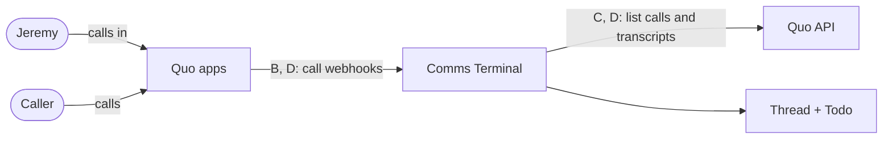
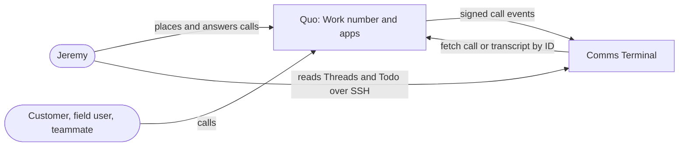
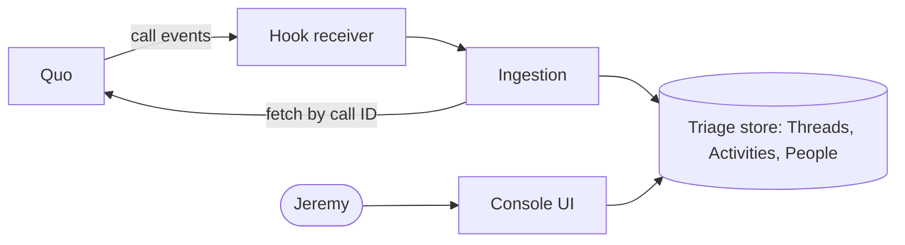
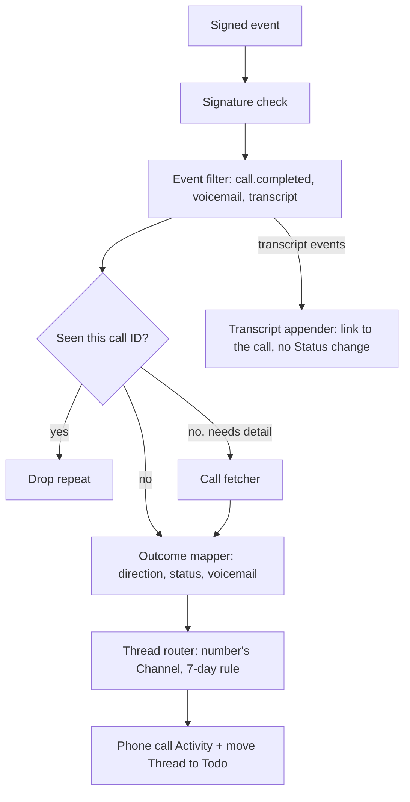

# Discovery: phone calls in Comms Terminal

Started as "a phone dialer in the inbox"; this file was `2026-10-15-phone-dialer.md` until the topic narrowed to Phone calls.

## 1. Status

- Current phase: **Complete** (all gates approved)
- Gates:
  - Seed: approved 2026-10-15
  - Phase 1: approved 2026-10-15
  - Phase 2: approved 2026-10-15 (problem, scope, success measures and glossary each approved by ask tool; Todo rule revised by Jeremy)
  - Phase 3: approved 2026-10-15
  - Phase 4: approved 2026-10-15
- Last updated: 2026-10-15 (America/Moncton)

## 2. Context

### Seed (confirmed 2026-10-15)

- Topic: phone calls in Comms Terminal on the Work number (Quo).
- Need, in Jeremy's words: "id like to add a phone dialer into the inbox".
- Known:
  - The SMS discovery (`2026-10-12-sms.md`) put calls and voicemail out of scope and chose Quo only for the Work number, (506) 832-4154.
  - The console is a Textual TUI that Jeremy runs over SSH on Workbox (`docs/design/console.md` §1), so the terminal session has no local microphone or speaker.
  - Quo already delivers Texts through `/hooks/quo` (`src/comms_terminal/quo.py`).
- Early solution idea (Phase 3 candidate): a dialer inside the inbox.

### Findings

#### From Jeremy (2026-10-15, ask tool round 1)

- Today: he finds the number in the Thread or People list and dials it by hand in the Quo app on the iPhone.
- Frequency: daily calling.
- Ledger: "a phone call is a type of activity." Calls belong in the Thread history as Activity.
- Open question from Jeremy: "i can't connect to quo via the terminal or console?" Answered: Quo's API cannot place calls, and the console has no audio.
- Reaction: "if we can't put a dialer in the console, i might not want to do this at all."
- Follow-up: "can we listen for quo webhooks and have them be activities in threads" (candidate scope: calls as Activity, without a dialer).

- Confirmed (2026-10-15, chat): "yes, all are 'phone call' activities with properties like connected?, call length, call direction, call transcript." He accepted the agent's proposed defaults: a missed call or voicemail puts the Thread in Todo; a connected call counts as a reply; unknown numbers create a Person. His transcript property replaces the agent's proposal to skip transcripts.

#### Phase 1 synthesis (2026-10-15)

- **Actor:** Jeremy, calling customers, field users and teammates daily on the Work number from the Quo app on his iPhone.
- **Current workflow:** he finds the number in the Thread or People list and dials it by hand in Quo. Call history lives only in Quo, outside the Thread.
- **Pains:**
  - A call is invisible in the Thread, so a Thread looks untouched after a call. Evidence: daily calling, and calls being out of scope today.
  - Typing numbers by hand. Evidence: today's workflow.
  - _Inference, unconfirmed:_ a missed call or voicemail can slip, the same failure as "saw it, forgot to reply" for Texts.
- **Constraints:**
  - Quo only; no second vendor (SMS decision, 2026-10-12).
  - Quo's API cannot place calls.
  - The console runs over SSH and has no audio.
  - Activities are never rewritten (`GLOSSARY.md`), while Quo sends a call's transcript in a later event than the call itself.
- **Analogues:** Quo's HubSpot integration (logs calls on the contact; dialing is a `tel:` handoff); Dialpad (an API call rings your own device first, then dials out).
- **Open unknowns:**
  - What Quo's call events actually send on this workspace; nothing has been tested.
  - Whether a voicemail is its own property or the same transcript property.
  - Whether a `tel:` handoff on Mani is still wanted.

#### From the repository, for call Activity (2026-10-15)

- The live Quo webhook (ID `43687`) is on the new webhook API, scoped to `PN2ppcGyMM`, and subscribes only to message events (`docs/runbook.md` §3b). Call events need adding to it.
- Activity `kind` is limited to `MESSAGE`, `EDIT`, `DELETE` by a CHECK constraint (`src/comms_terminal/schema.sql`); a call kind needs a schema migration.
- An SMS Channel is the peer's number, threaded with a 7-day quiet gap (`GLOSSARY.md` Thread), so a call on the same number would join that Thread.

#### From the repository (2026-10-15)

- Console links already open in Mani's browser with ctrl+shift+click through Ghostty (`src/comms_terminal/tui.py`, help row "open a link in your browser"; `o` shows a Thread's native link).
- People hold phone numbers as Identities (`GLOSSARY.md`: Person, Identity).

#### From public research (2026-10-15, sub-agent; sources in Sources)

- Quo's API cannot place a call. Calls are read-only in both v1 and `Quo-Api-Version: 2026-03-30` (list, retrieve, recordings, transcripts, summaries, voicemails). Quo's MCP has `fetch-missed-calls` and `fetch-call-transcripts`; it has no dial tool.
- Quo call webhooks exist. The new webhook API (Standard Webhooks signing, same as the Texts hook) sends `call.ringing`, `call.answered`, `call.completed`, `call.missed` (incoming only), `call.forwarded`, `call.voicemail.completed`, plus recording, transcript and summary events. Payloads carry direction, status, duration, `hasVoicemail`, `phoneNumberId`, and participants as E.164.
- Click-to-call into Quo works through the operating system's `tel:` handler. The Quo desktop app (Mac or Windows) opens with the number filled in, and Jeremy clicks Call; Mac shows a confirmation first. HubSpot's Quo integration uses this same handoff.
- `openphone://dial?number=…&action=call` starts a call automatically, on the Quo mobile apps only.
- A real in-console or in-browser dialer needs another voice provider (Twilio or Telnyx WebRTC, or a call-bridge that rings Jeremy's phone first). Twilio can show the Quo number as outbound caller ID after verification; inbound calls stay on Quo. Telnyx's caller-ID rules for non-Telnyx numbers are ambiguous.
- Analogue: Dialpad's API rings the user's own device first, then dials out once the user answers. Quo has no equivalent.
- _Inference, untested:_ a `tel:` link printed in the console opens on Mani (ctrl+shift+click), which then hands off to Quo desktop. That depends on Mani's operating system and its default calling app.

## 3. Problem

### Statement (approved 2026-10-15)

Jeremy calls customers, field users and teammates daily on the Work number. Each call lives only in Quo, so the Thread never shows it: a Thread looks untouched after a call, a missed call or voicemail has no place in Todo, and what was said is lost to the Thread. Evidence: Phase 1 (daily calling; calls out of scope today; dialing by hand in Quo).

### Scope

- **In scope:**
  - Every call on (506) 832-4154, incoming and outgoing, from any Quo app, recorded as a Phone call Activity in that number's Thread.
  - Properties: direction (incoming, outgoing); Call outcome (connected, missed, voicemail, no answer); length (talk time, or voicemail length for a voicemail, else 0); Call transcript, appended later; Quo link to the call (unverified that call events carry one).
  - Every Phone call puts its Thread in Todo, whatever its direction or outcome. A Snoozed or Waiting-for-them Thread wakes to Todo; a Done Thread the call joins reopens to Todo. The Call transcript never changes Status.
  - An unknown number creates a Person with that phone Identity, as for Texts.
- **Out of scope:**
  - Placing or talking on calls in the console.
  - Dialing handoff: Mani runs Linux, and Quo desktop (the `tel:` handler) has no Linux build.
  - Logan's number and other workspace numbers.
  - Recordings, AI summaries, who answered, forwarding, and phone-menu choices.
- **Non-goals:** replacing the Quo app; a second voice vendor.

### Success measures (approved 2026-10-15)

1. Every call on the Work number, from any Quo app, shows in its Thread within 1 minute of ending. Check: one week of Quo call history matches the console, with zero calls missing.
2. Every Phone call puts its Thread in Todo.
3. A Call transcript shows on each connected call or voicemail within 15 minutes, when Quo has one.

### Edge cases (approved with the glossary)

- A call 8 or more days after the last Activity with that number starts a new Thread, titled by outcome (for example "Missed call" or "Phone call, 4m").
- When Quo has no transcript (a short or missed call), the Phone call stands alone.
- A repeated Quo call event is recorded once (repeats dropped by call ID).
- Calls on Logan's number never arrive (the webhook is limited to Jeremy's number).

## 4. Glossary

- **Phone call**: an Activity recording one call on the Work number, incoming or outgoing, from any Quo app; it joins its number's Thread by the 7-day rule. _Avoid_: Call log, Call event, Dial.
- **Call outcome**: connected, missed, voicemail, or no answer. Missed and voicemail are incoming only; no answer is outgoing only.
- **Call transcript**: a later record appended to a Phone call, holding Quo's transcript of the conversation or voicemail; it never changes the Thread's Status.

## 5. Options

Strategies for getting Quo calls into Threads. All of them stay inside the approved scope; they differ in how call data reaches the inbox.

### A. Baseline: no ingestion; Quo app as the call record

- **Core idea:** keep calls in Quo. After a call, Jeremy reopens or snoozes the Thread by hand, or writes a note.
- **How it addresses the problem:** weakly. Threads still look untouched, and missed calls stay outside Todo.
- **Success measures moved:** none.
- **Assumptions:** Jeremy's manual step after each call holds up at daily volume.
- **Risks:** the same "saw it, forgot" failure that the Texts Connection fixed.
- **Cost:** none.
- **Rules out later:** nothing.

### B. Live call webhooks (proposed by Jeremy)

- **Core idea:** add call events to the existing Quo webhook (ID `43687`). Each `call.completed` becomes a Phone call. `call.voicemail.completed` and `call.transcript.completed` append the Call transcript.
- **How it addresses the problem:** directly. Calls land in their Thread seconds after they end, and Todo follows.
- **Success measures moved:** 1, 2, 3.
- **Assumptions:**
  - Quo fires call events for calls placed or answered in every Quo app (iPhone, web), as it does `message.delivered` for app-sent Texts.
  - Quo retries failed deliveries (true for message events, per `quo.py`).
  - Call events carry enough data (outcome, length, voicemail flag), or a follow-up fetch fills the gap (`call.missed` carries only an ID).
- **Risks:**
  - A webhook dropped beyond Quo's retries loses that call with no trace, which breaks measure 1.
  - The webhook API's call events are new (May 2026).
- **Cost:** small. Same hook, signing and Channel; new event parsing, one new Activity kind (schema migration), and transcript appending.
- **Rules out later:** nothing; a reconcile pass can be added on top.

### C. Poll Quo's calls API

- **Core idea:** no webhook; the service lists recent calls on Jeremy's number every minute (`GET /calls`, filtered by phone number and creation time) and fetches transcripts until they appear.
- **How it addresses the problem:** directly, with up to a minute of lag.
- **Success measures moved:** 1 (completeness by construction), 2, 3.
- **Assumptions:**
  - Quo's rate limits allow polling every minute, plus transcript fetches.
  - The 2026-03-30 `GET /calls` filters by phone number and time without needing a participant list (v1 requires one).
- **Risks:**
  - Constant API traffic for a few calls a day.
  - A second ingestion style for one Platform (Texts use webhooks).
- **Cost:** medium. A poll loop like Fastmail's 10-minute Sent poll (`fastmail.py`), plus cursor state.
- **Rules out later:** nothing.

### D. Webhooks plus a reconcile poll (not proposed by Jeremy)

- **Core idea:** B for speed, plus a periodic pass (for example every 10 minutes, like the Fastmail poll) that lists recent calls and fills in any the webhook missed, along with any late transcripts. The same pass can backfill past calls once at connect time.
- **How it addresses the problem:** directly. Webhooks give speed, and the poll guarantees completeness.
- **Success measures moved:** 1 (fast and complete), 2, 3.
- **Assumptions:** B's assumptions, plus C's API-filter assumption; repeats are dropped by call ID.
- **Risks:** two paths can record the same call. This is handled by call-ID de-duplication, which ingest already does for message IDs.
- **Cost:** B plus a small poll loop.
- **Rules out later:** nothing.

### Early concerns (not eliminations)

- B's completeness rests on Quo retries alone. Texts accept that today, but measure 1 says "zero missing".
- No option is testable until a real call shows what Quo sends on this workspace.

## 6. Decision

**Chosen (approved 2026-10-15): B. Live call webhooks, with D's reconcile poll held back until evidence shows it is needed.**

- **Why B:** it is the smallest change that moves all three success measures. It reuses the live Quo hook, signing, Channel and Thread rules, and Texts already trust Quo webhooks with Quo's retries.
- **Why not D now:** the reconcile poll answers one risk, a webhook lost beyond Quo's retries, and there is no evidence yet that this happens. Success measure 1's one-week comparison against Quo call history is the trigger: one missing call means adding D's poll.
- **Rejected:**
  - A (baseline): moves no success measure.
  - C (poll only): constant API traffic and up to a minute of lag, to guard against a failure nobody has seen. It also gives Quo a second ingestion style.
  - D (now): held back rather than rejected, as above.
- **Trade-offs accepted:**
  - A dropped webhook goes unnoticed until the one-week check, or until Jeremy notices.
  - Past calls are not backfilled; only calls after connection appear.

## 7. Validation

### Riskiest assumptions

| # | Assumption | Evidence now | Evidence missing |
|---|---|---|---|
| V1 | Quo fires call events for calls placed or answered in any Quo app, on the webhook scoped to `PN2ppcGyMM` | Quo docs list the call events, and every event carries `phoneNumberId`. App-sent Texts already arrive as `message.delivered` (`docs/runbook.md` §3b) | One real incoming and one outgoing call on Jeremy's number |
| V2 | The four Call outcomes can be derived from `direction`, `status` and `hasVoicemail` | Docs: `call.completed` statuses (answered, unanswered, …) and `hasVoicemail` | Docs say `call.answered` also fires when an **outgoing** call reaches the other person's voicemail. That call may report as answered and be recorded as connected rather than no answer |
| V3 | Quo produces transcripts for Jeremy's calls and voicemails | Docs: `call.transcript.completed` and `call.voicemail.completed` exist | Whether Jeremy's Quo plan includes call transcripts and voicemail transcription (not checked; the API key sits in encrypted credstore) |
| V4 | Call events can be added to the existing webhook (`43687`) | The webhook API has update, test and retry endpoints | Whether adding events keeps the same signing secret, or needs a new webhook and a new secret |
| V5 | Quo retries failed call-event deliveries, as it does message events | `quo.py`: "Quo retries any non-2xx" | Retry window for call events; the one-week comparison |

### Scenario walk-through

| Scenario | Result |
|---|---|
| Customer calls, Jeremy misses it, a voicemail is left | Holds. Recorded as voicemail and moved to Todo; the voicemail transcript is appended later |
| Jeremy calls a field user from the iPhone, connected for 4 minutes | Holds, given V1. Recorded as connected and moved to Todo; the transcript is appended if Quo makes one (V3) |
| Jeremy calls and it reaches their voicemail | **Bends** (V2): may be recorded as connected |
| Unknown number calls | Holds: a new Person with that phone Identity |
| A call on a Done Thread within 7 days | Holds: the Thread reopens to Todo |
| A call 10 days after the last Text | Holds: a new Thread titled "Missed call" or "Phone call, 4m" |
| A forwarded or AI-handled call | **Bends**: outside the four outcomes. Proposed reading: missed, since Jeremy did not talk |
| A transcript arrives before or without its call | **Bends**: needs the call fetched by ID first. The same fetch fills `call.missed`, which carries only the ID |
| A webhook is lost beyond Quo's retries | **Breaks** silently until the one-week check. Remedy: D's reconcile poll |
| A call on Logan's number | Holds: excluded by the webhook's number scope |
| The same event delivered twice | Holds: dropped by call ID |

## 8. Architecture (abstract)

### L1 Context

### L2 Container

### L3 Component (Ingestion: where V1, V2 and V3 live)

## 9. Open risks and unknowns

| Item | Impact | Next evidence needed |
|---|---|---|
| V1: call events for app calls on this workspace | No calls arrive at all | One test call in each direction on (506) 832-4154 with call events subscribed |
| V2: outgoing calls that reach voicemail may report as answered | Wrong outcome (connected) | The same test, ending at the other person's voicemail |
| V3: transcripts on Jeremy's Quo plan | Success measure 3 cannot be met | Quo plan features, or one connected test call |
| V4: updating webhook `43687` in place | A new secret to install | Quo's webhook update docs, or a test update |
| V5: lost webhooks | A silently missing call | One-week comparison (success measure 1); add the reconcile poll if one is missing |
| Forwarded or AI-handled calls | Outcome unclear | Jeremy's call on the proposed "missed" reading |
| Quo link in call events | Property may be absent | Test event payload |

## 10. Decision log

| Date | Request or decision | Source | Status | Supersedes |
|---|---|---|---|---|
| 2026-10-15 | Seed confirmed: phone calls on the Work number via Quo; dialer is a candidate | Jeremy, ask tool | Accepted | — |
| 2026-10-15 | A phone call is a type of Activity | Jeremy, ask tool round 1 | Accepted | SMS discovery scope line "Calls, voicemail … out of scope" (for this topic) |
| 2026-10-15 | An in-console dialer is infeasible: Quo cannot place calls via API, and the console has no audio | Public research; `docs/design/console.md` | Accepted | Seed's early idea (dialer) as the main candidate |
| 2026-10-15 | Focus moves to Quo call webhooks recorded as "phone call" Activities in Threads | Jeremy, chat ("can we listen for quo webhooks…") | Accepted | — |
| 2026-10-15 | Phone call properties: connected, length, direction, transcript. Agent defaults accepted for Todo, reply, and Person behaviour | Jeremy, chat ("yes, all are 'phone call' activities…") | Accepted | Agent default to skip transcripts |
| 2026-10-15 | Phase 1 approved | Jeremy, ask tool | Accepted | — |
| 2026-10-15 | Properties: direction, Call outcome (connected, missed, voicemail, no answer), length, Call transcript, Quo link. Summary, recording, answered-by, forwarding and menu are skipped | Jeremy picked the agent's proposal ("what i said was only a suggestion") | Accepted | "connected?" yes/no property |
| 2026-10-15 | The Call transcript arrives as a later record appended to the Phone call; no Activity is rewritten | Jeremy, ask tool | Accepted | — |
| 2026-10-15 | Every Phone call puts its Thread in Todo | Jeremy ("all call activities should move a thread to todo"), confirmed by ask tool | Accepted | Default "connected call counts as a reply" |
| 2026-10-15 | Mani is Linux; dialing handoff out of scope | Jeremy, ask tool | Accepted | — |
| 2026-10-15 | Success measures 1–3 approved; measure 4 (zero Logan calls) removed | Jeremy, ask tool ("remove 4.") | Accepted | — |
| 2026-10-15 | Problem, scope and glossary approved; Phase 2 closed | Jeremy, ask tool | Accepted | — |
| 2026-10-15 | Phase 3 option set (A–D) approved | Jeremy, ask tool | Accepted | — |
| 2026-10-15 | Agent recommends B, with D's reconcile poll held back until the one-week check shows a missing call | Agent | Superseded by approval below | — |
| 2026-10-15 | Strategy B chosen, with D deferred until a missing call is found; diagrams and open risks approved; forwarded or AI-handled calls read as missed | Jeremy, ask tool | Accepted | Options A, C; D for now |
| 2026-10-15 | Built on Jeremy's "implement this". A Phone call is stored as a MESSAGE Activity with `call` data (direction, outcome, length) and a one-line summary as content. A Call transcript is an EDIT targeting the call, recorded as Jeremy's so it never moves Status. No schema migration. A transcript that arrives before its call gets HTTP 503, so Quo delivers it again | Agent (`src/comms_terminal/quo.py`, `inbox.py`, `tests/test_quo.py`) | Built; webhook update and deploy pending | — |

## 11. Sources

- `.agents/discovery/2026-10-12-sms.md`, `docs/design/console.md`, `src/comms_terminal/quo.py`, `src/comms_terminal/tui.py`, `GLOSSARY.md` (read 2026-10-15).
- `src/comms_terminal/fastmail.py` (10-minute Sent poll pattern), `src/comms_terminal/inbox.py` (ingest drops repeats by message ID), 2026-10-15.
- Public web research sub-agent, 2026-10-15 (no account calls): Quo v1 OpenAPI spec (openphone-public-api-prod S3), quo.com/docs/2026-03-30 (introduction, webhooks-event-payloads, versioning, llms-full.txt changelog), quo.com/docs/mdx/mcp/tools.md, support.quo.com (deep-linking, click-to-call, HubSpot, Salesforce), twilio.com (Voice JS SDK, verified caller ID, Call resource), developers.telnyx.com (WebRTC JS SDK, verified numbers), developers.dialpad.com (call, users initiate_call). Limits: absence of a Quo Chrome click-to-call extension is unverified; Quo port-out terms not found.
