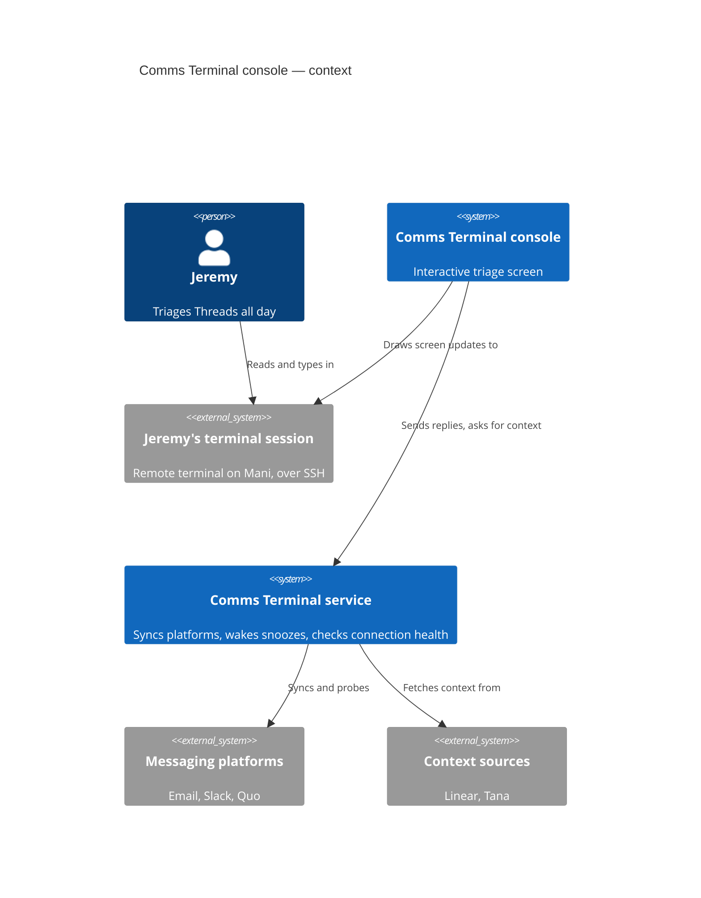
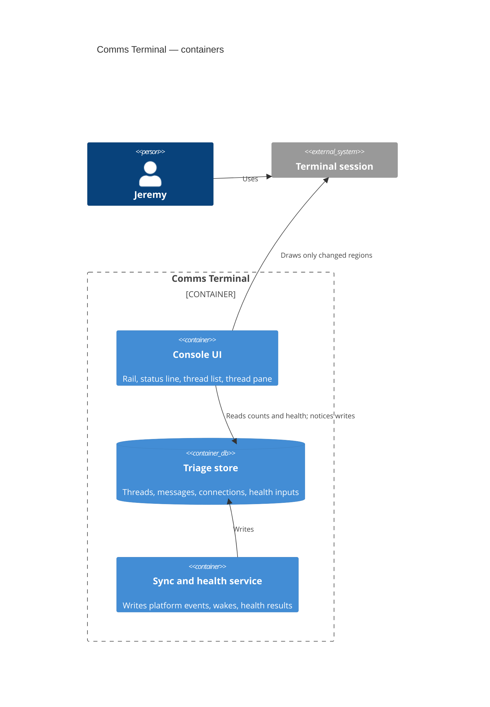
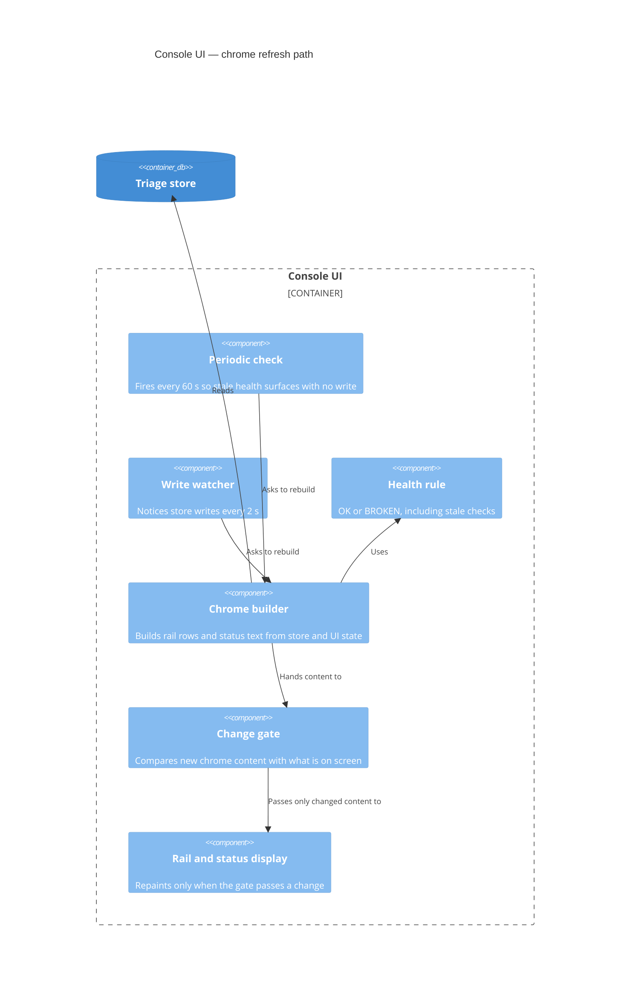

# TUI redraw smoothness — discovery

## Status

- Current phase: complete; B implemented 2026-10-15
- Seed: approved 2026-10-15
- Phase 1 gate: approved 2026-10-15
- Phase 2 gate: approved 2026-10-15
- Phase 3 gate: approved 2026-10-15
- Phase 4 gate: approved 2026-10-15
- Last updated: 2026-10-15 (America/Toronto)

## Context

### Seed (approved 2026-10-15)

- Topic: the Comms Terminal console (TUI) redraws in a way Jeremy finds disruptive.
- Need, in Jeremy's words: "the screen flashes periodically" and "i want to make it smoother, the redraws are disruptive".
- Early solution ideas (Phase 3 candidates only): rebuild only when values change; update rows in place; skip service writes that change nothing.

### Actor and situation

- Jeremy is the only user. He runs the console in Ghostty on Mani, over a direct SSH session to the host that runs it, with no tmux or other multiplexer (process chain: `comms-terminal` → `fish` → `sshd`).
- The console stays open all day. The disruption hits in every mode he uses: reading a long thread, scanning or moving through the list, typing a reply, and glancing at it while idle (Jeremy, 2026-10-15).
- He sees the whole screen flash, about once a minute (Jeremy, 2026-10-15).

### Redraw triggers in the code (`src/comms_terminal/tui.py`)

| Trigger | Cadence | What redraws |
|---|---|---|
| `set_interval(60, refresh_chrome)` (line 3470) | every 60 s, always | Rail rebuilt with `clear_options` + `add_options` (line 578); status line re-rendered (line 2924). Added so connection health goes stale visibly with no DB write. |
| `check_changes` (line 3637) | 2 s check, acts only on a DB write by another connection | `refresh_all`: rail, status line, thread table (`table.clear(columns=True)` and full rebuild, line 806), open thread (messages removed and remounted, scroll restored one frame later, line 1397), Linear context panel reset to loading and refetched (line 1618). |
| `ThreadsPage.tick` (line 767) | every 1 s | Time cell of Snoozed rows only. |
| `tick_countdowns` (line 3471) | every 1 s | Header and properties of an open Snoozed thread; subtitle of Snoozed case cards. |
| `on_resize` | on terminal resize | Thread table rebuilt. |

### Service write cadence (`serve.py`, `fastmail.py`)

- Writes on new mail, Slack, and Quo events; after every 10-minute Fastmail Sent poll (`set_probe`, even when unchanged); after every 30-minute health check (`set_probe`, even when unchanged).
- `wake_loop` runs every 60 s but writes only when a snooze or wait is due.
- Live measurement: no DB writes in a 30 s sample or a 130 s sample on 2026-10-15. So the once-a-minute flash does not come from the DB path.

### Terminal output measurement (2026-10-15)

The installed console ran in a 200×50 pty against a copy of the live DB, with no service socket, answering the synchronized-output query the way Ghostty does (`scratchpad/ptyprobe.py`).

- At idle the console wrote nothing between its first paint and t = 60 s. It wrote 17,245 bytes at t = 60 s and again at t = 120 s.
- That burst repaints the rail (columns 1–30 on 49 rows), its border (columns 31–32), and the status line (one full 200-column row). It contains no clear-screen, cursor, or mode sequences. It sits inside one synchronized-output frame (`ESC[?2026h` … `ESC[?2026l`).
- Inference: the content is identical before and after, yet Textual resends the whole rail and status line because they were rebuilt. Why this looks like a whole-screen flash in Ghostty over SSH is unresolved (open unknown).

### Pains

| Pain | Evidence | Frequency |
|---|---|---|
| Whole-screen flash at idle | Jeremy; 60 s burst measured | every 60 s |
| Full rebuild of list and open thread on any service write, including writes that change nothing | code trace | on every 10- and 30-minute `set_probe`, plus real events |
| Open thread can jump (scroll restored a frame later) and the Linear panel blinks to loading on a refresh | code trace (lines 1397–1404, 1618) | on every DB write |

### Constraints and prior decisions

- The rail and status line must still show a connection as BROKEN when its health check goes stale with no write (NFR-2, decision #119; `health.py` `STALE` = 65 min). The 60 s timer exists for this.
- The console picks up service writes within about 2 s (`check_changes` docstring).
- Selection follows the thread, not the row number (`refresh_data`).
- Repository convention: ponytail-minimal changes; every task in its own worktree off `dev` (project memory).

### Analogues

- Inference, unverified: long-running TUIs such as `htop`, `k9s`, and `lazygit` refresh on timers and avoid visible flicker by changing only the cells whose values changed.

### Open unknowns

1. Why a one-frame repaint of the rail and status line reads as a whole-screen flash in Ghostty over SSH. Candidates: Ghostty's handling of synchronized frames over SSH, or a repaint the pty probe missed (the probe had no service socket and no open context panels).
2. Whether the disruption from service-write refreshes (list rebuild, thread scroll jump, Linear blink) also bothers Jeremy, or whether only the 60 s flash is noticeable today.

## Problem

### Statement (draft)

Jeremy keeps the console open all day in Ghostty over SSH. Every 60 seconds the whole screen appears to flash, whatever he is doing: reading, scanning, typing, or idle. The cause is a timer that rebuilds the rail and status line and resends them to the terminal, even when nothing on them changed (measured: 17 KB of identical content every 60 s). The result is about 60 attention breaks an hour while he reads and writes.

### Scope

- In scope: no-op redraws on a timer, where the console repaints content that has not changed. Today that is the 60 s chrome refresh; any other timer path that repaints unchanged content is also in scope.
- Out of scope: refreshes caused by service writes (list rebuild, thread remount and scroll jump, Linear panel blink). Jeremy has not noticed them (2026-10-15). They are recorded as a latent issue.
- Non-goals: changing the terminal, SSH, or Mani setup; replacing the UI framework; changing what health states mean or how soon BROKEN appears (NFR-2, decision #119); removing the snooze countdowns.

### Success measures

1. At idle with no data change, the console writes 0 bytes to the terminal over 5 minutes (pty probe; today 17 KB a minute).
2. Jeremy sees no periodic flash over a normal working day.
3. A connection whose last health check passes the 65-minute stale threshold still shows BROKEN in the rail and status line within 60 s, with no DB write.
4. Snoozed countdowns still update every second, and only their cells redraw.

## Glossary

- **Redraw**: the console writing to the terminal to repaint a region of the screen.
- **Refresh**: the console re-reading data and rebuilding a widget's content; it causes a redraw.
- **No-op redraw**: a redraw whose output matches what is already on screen.
- **Flash**: Jeremy's perceived blink of the screen during a redraw.
- **Chrome**: the rail and the status line, rebuilt together by `refresh_chrome`.
- **Service write**: a DB write by the `serve` process that `check_changes` detects through `PRAGMA data_version`.

## Options

Measures: (1) 0 idle bytes in 5 min; (2) no flash seen over a day; (3) stale health shows BROKEN within 60 s; (4) countdowns still tick.

### A. Baseline: leave it, or stretch the timer

- Idea: keep the code, or raise the 60 s interval to 5–10 min.
- Measures: none fully. Stretching cuts flashes from 60 to 6–12 an hour but breaks (3), since BROKEN could lag up to the new interval.
- Assumptions: an occasional flash is tolerable.
- Risks: the disruption continues.
- Cost: none, or one number.
- Rules out: nothing.

### B. Change-gated chrome refresh

- Idea: keep the 60 s check but build the rail options and status line text first, and touch the widgets only when that content differs from what is on screen.
- Measures: (1), (2), (3), (4). Health staleness is still checked every 60 s; the screen only changes when the answer changes.
- Assumptions: the built text captures everything the chrome shows, including highlight and selection marks; when the text matches, no redraw happens.
- Risks: a missed input (for example highlight state) leaves the chrome stale until the next real change.
- Cost: small; one comparison in `refresh_rail` and one in `refresh_line`.
- Rules out: nothing; it composes with C and D.
- Prior art: Textual's guidance is to update widgets only when their data changes, via reactive attributes that refresh on change (https://textual.textualize.io/guide/reactivity/).

### C. Event-driven staleness timer

- Idea: drop the 60 s poll. Refresh the chrome on DB writes (already done by `check_changes`) and once more at the exact moment the next connection's health check would go stale (`probed_at` + 65 min).
- Measures: (1), (2), (3), (4).
- Assumptions: the only time-driven change in the chrome is health going stale. Nothing else in the rail or status line changes with the clock.
- Risks: the deadline must be rescheduled after every write and connection change; host suspend or clock jumps can delay it; a future time-based chrome element would be silently missed.
- Cost: medium; deadline computation and timer rescheduling.
- Rules out: nothing, but it couples the chrome to health rules in `health.py`.

### D. Fine-grained rail updates

- Idea: update only the rail rows whose labels changed (for example with `OptionList.replace_option_prompt`, https://textual.textualize.io/widgets/option_list/) instead of clearing and re-adding every option.
- Measures: (1) and (2) when nothing changed; when one count changes, only that row repaints. (3), (4) kept.
- Assumptions: the rail's set and order of rows rarely change; a structural change can fall back to a full rebuild.
- Risks: more code paths (row added or removed, connection added).
- Cost: medium.
- Rules out: nothing; it is the pattern that would also suit the out-of-scope service-write refreshes later.

### E. Terminal-side: confirm synchronized output over SSH

- Idea: verify that Ghostty on Mani receives and honours synchronized-output frames over this SSH session, and fix the session or terminfo if not, so that a redraw lands atomically and invisibly.
- Measures: possibly (2); not (1).
- Assumptions: the flash is visible tearing rather than the redraw itself.
- Risks: the pty probe already showed one well-formed sync frame, so this may change nothing; it touches the terminal setup, which is a non-goal.
- Cost: low to investigate.
- Rules out: nothing.

### Early concerns (not eliminations)

- Unknown 1 (why a rail-plus-status repaint looks like a whole-screen flash) matters less for B, C, and D: with no redraw there is nothing to flash. It decides E.
- A and E leave measure (1) unmet by design.

## Decision

Chosen (approved 2026-10-15): **B — change-gated chrome refresh**.

### Comparison

| Option | (1) 0 idle bytes | (2) no flash | (3) BROKEN within 60 s | (4) countdowns | Cost | Main risk |
|---|---|---|---|---|---|---|
| A Baseline / stretch | no | no | stretch breaks it | yes | none | disruption continues |
| B Change-gated | yes | yes | yes | yes | small | a missed display input |
| C Event-driven timer | yes | yes | yes, if rescheduling is right | yes | medium | suspend, clock jumps, missed time-based chrome |
| D Fine-grained rows | yes | yes | yes | yes | medium | more code paths |
| E Terminal-side | no | maybe | yes | yes | low | likely changes nothing |

### Rationale

- B meets all four measures for the smallest change. The 60 s check stays, so health staleness (NFR-2) works exactly as today. Only the redraw is gated.
- C reaches the same screen result but adds timer rescheduling to save a cheap check. The check is invisible once B gates the redraw.
- D refines what B does when content really changes. A real change (a count moving or a connection going BROKEN) redrawing the rail once is acceptable and matches what Jeremy expects.
- E cannot meet measure (1), and the probe already saw a well-formed sync frame.

### Rejected

- A: leaves the disruption, or breaks NFR-2 timing.
- C: more moving parts for no visible gain over B.
- D: deferred; worth revisiting together with the latent service-write refreshes.
- E: deferred; revisit only if real changes still read as whole-screen flashes after B.

### Accepted trade-offs

- The console still reads the DB every 60 s for the chrome. That is cheap and invisible.
- A real chrome change still repaints the whole rail rather than one row.

## Validation

### Riskiest assumptions

| # | Assumption | Evidence now | Missing |
|---|---|---|---|
| 1 | Today's 60 s timer is the only source of the once-a-minute flash | Jeremy: once a minute; DB had 0 writes in 130 s; the probe's only idle output was the t = 60 s and t = 120 s bursts, rail and status line only | the probe had no service socket or open context panels; real Ghostty on Mani not captured |
| 2 | The built rail and status text covers everything they show | `refresh_rail` (line 578) and `refresh_line` (line 2924) build from DB counts, section, view, connections, health, source states, focus highlight, width, and bindings; no clock text | the highlight is set separately from the options and must stay applied on a skipped rebuild |
| 3 | Not touching the widgets produces no terminal output | the probe showed 0 bytes between first paint and t = 60 s while nothing was touched; Textual reactive attributes refresh only on a changed value (https://textual.textualize.io/guide/reactivity/) | a post-change pty probe |
| 4 | Removing the redraw removes the perceived whole-screen flash, even though its cause (unknown 1) is unexplained | with no bytes written, the terminal has nothing to repaint | Jeremy's observation over a day |

### Scenario walk-through

| Scenario | Under B | Result |
|---|---|---|
| Idle, nothing changes, 60 s tick | text matches, widgets untouched | 0 bytes; holds |
| Reading a long thread at the tick | chrome untouched; thread pane never involved | holds |
| Typing a reply at the tick | chrome untouched | holds |
| Health check goes stale (over 65 min) | tick text shows BROKEN; differs; one rebuild | one legitimate redraw; holds (3) |
| New mail arrives (service write) | `refresh_all` as today; chrome rebuilt only if counts changed | out-of-scope list and thread refresh unchanged; chrome holds |
| 10- or 30-minute no-op service write | chrome gated; list and open thread still rebuilt by `refresh_all` | **bends**: out-of-scope latent refresh still fires 2–8 times an hour |
| Jeremy moves through the rail | section mark changes; rebuild | holds |
| Rail focus toggles with no content change | rebuild skipped; highlight reactive still set | holds if the highlight is applied on skipped rebuilds (assumption 2) |
| Terminal resize | status keys refit; text differs; update | holds |
| Open Snoozed thread | `tick_countdowns` updates header and properties every second | **bends** measure (4): a whole properties block, not just the countdown cell, repaints each second. Pre-existing; Jeremy reports no per-second flash |

## Architecture (abstract)

### L1 Context

### L2 Container

### L3 Component (console UI, chrome path)

## Open risks and unknowns

| Item | Impact | Next evidence needed |
|---|---|---|
| Unknown 1: why a rail-plus-status repaint reads as a whole-screen flash in Ghostty over SSH | if real changes still flash after B, E becomes relevant | Jeremy's observation of a real change (for example a count moving) after B |
| Probe gaps: no service socket, no open context panels, simulated sync reply | another 60 s path could exist only in the live console | pty or Ghostty capture of the live console on Mani across a 60 s tick |
| Highlight state on a skipped rebuild | resolved: the first post-fix probe still redrew the rail once at t = 60 s because a highlight left from startup focus was cleared then; the rail now clears it on blur | — |
| Latent: service-write refreshes rebuild the list and open thread, including the 10- and 30-minute no-op `set_probe` writes | the open thread may jump and the Linear panel blink, 2–8 times an hour | Jeremy noticing them; candidate D, or skipping unchanged `set_probe` writes |
| Open Snoozed thread repaints its whole properties block every second | possible flicker on a Snoozed thread | Jeremy noticing it |

## Decision log

| Date | Request or decision | Source | Status | Supersedes |
|---|---|---|---|---|
| 2026-10-15 | Seed confirmed: TUI redraw smoothness | Jeremy | approved | — |
| 2026-10-15 | Flash is whole screen, about once a minute, disruptive in all modes; Ghostty on Mani over SSH | Jeremy | evidence | — |
| 2026-10-15 | Phase 1 approved | Jeremy | approved | — |
| 2026-10-15 | Only the 60 s flash is noticed; service-write refreshes out of scope (latent) | Jeremy | decision | — |
| 2026-10-15 | Phase 2 approved: problem, scope, measures, glossary | Jeremy | approved | — |
| 2026-10-15 | Phase 3 approved: option set A–E | Jeremy | approved | — |
| 2026-10-15 | Proposed B (change-gated chrome refresh) | Claude | proposed | — |
| 2026-10-15 | Phase 4 approved: B chosen, diagrams and open risks accepted | Jeremy | approved | — |
| 2026-10-15 | B implemented: rail and status line skip unchanged rebuilds; rail clears its highlight on blur. pty probe of the worktree build: 0 bytes from first paint to t = 130 s (before: 17 KB each minute) | Claude | done | — |

## Sources

- `src/comms_terminal/tui.py`, `serve.py`, `fastmail.py`, `inbox.py` (`wake`), `health.py` on `dev` at `e53ec04` plus local changes.
- Live DB `~/.local/share/comms-terminal/inbox.db`: `PRAGMA data_version` sampled read-only for 30 s and 130 s.
- pty probe of the installed console (Textual 8.2.8) against a DB copy. Limits: no service socket, so context sources stayed hidden; one terminal size; a simulated Ghostty sync reply rather than real Ghostty.
- Jeremy's answers, 2026-10-15.
