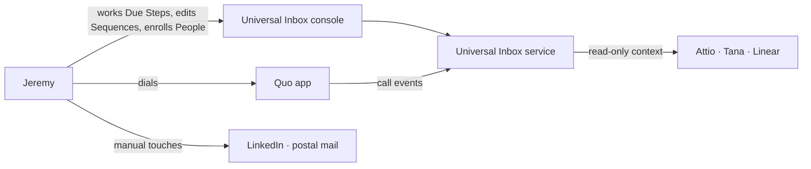
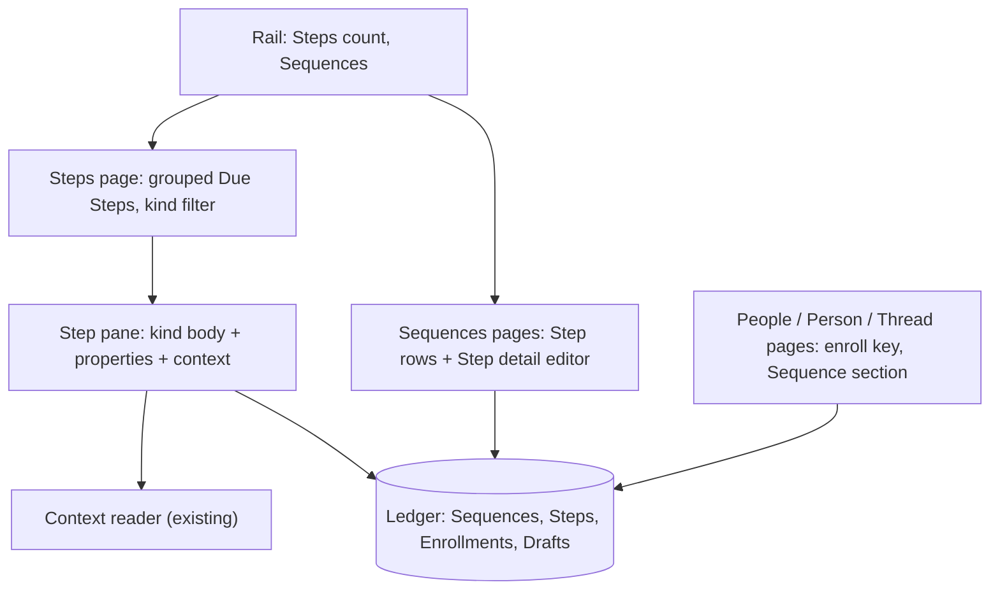
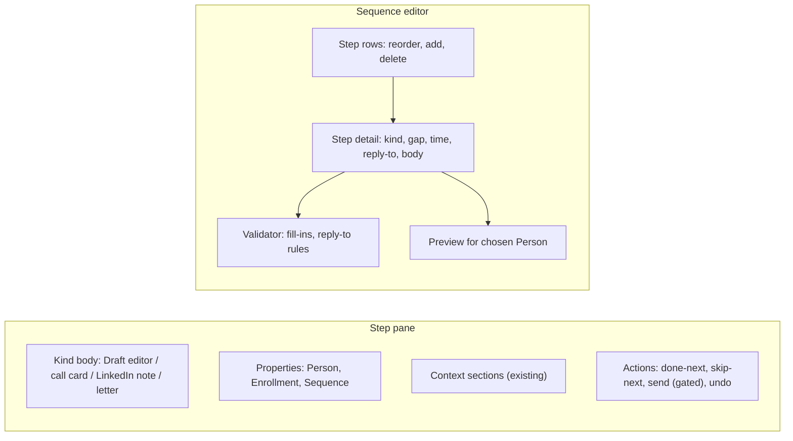

# Sequencing feature and UX direction discovery

## Status

- Current phase: Complete — direction A approved
- Gates:
  - Seed: approved 2026-10-16
  - Phase 1 (Context): approved 2026-10-16 (with corrections)
  - Phase 2 (Problem): approved 2026-10-16
  - Phase 3 (Options): approved 2026-10-16
  - Phase 4 (Decision and validation): approved 2026-10-16
- Last updated: 2026-10-16 (UTC).

## Context

### Seed (confirmed 2026-10-16)

- Topic: the Sequencing feature in the Universal Inbox console: what it does and its UX and design direction. Covers the Steps page, the Sequence editor, enrolling, Enrollment states on Person and Thread pages, and the day-to-day feel of Step Drafts and Call blocks.
- Trigger, in Jeremy's words: "i want to define the actual feature and direction for the sequencing now that we know we want to build into universal inbox. i want to have a ux and design direction".
- Parent: strategy discovery `.agents/discovery/2026-10-15-attio-sequences.md` (complete; strategy D) and ADR 0003. Jeremy declined the cold-send-path topic (V1) for now in favour of this one.

### Agreed MVP model (grilling, 2026-10-16; parent doc "MVP shape")

- Sequences edited in the console; live edits change Steps not yet due.
- Step kinds: email, call, LinkedIn, letter. Each holds shared text with `{first_name}`, `{last_name}`, `{company}`, a business-day gap counted from the previous Step's completion, and an optional fixed time.
- An email Step becomes a Draft on its due day, optionally a reply Draft on an earlier email Step's Thread. It is done when that Draft is sent. Saved replies become persistent Drafts, at most one per Thread.
- Other Steps are marked done. A Step can be skipped; deleting its Draft skips it.
- Enrollment: from the console or `universal-inbox enroll`. One Active or Paused Enrollment per Person per Sequence; Opted out refuses. First Step due on the enroll day.
- Any inbound message or call, or a connected call, pauses the Enrollment. Resume makes the next Step due immediately. Finished: Completed, Opted out, or Other.
- A Steps page with a rail count. Agent commands `steps` and `enroll`. Step send is gated until a Connection is allowed for cold mail.
- Deferred: build slices, the cold send path, auto-send.

### Console conventions (`docs/design/console.md`, read 2026-10-16)

- **Form:** Textual app over SSH on Workbox; the service holds credentials; the app refreshes on database change every 2 s (§1).
- **Look:** gruvbox-material light; herdr-style rounded bordered panels with pill titles; focused border blue; one bottom bar with grouped keys, counts, and health; colour never carries meaning alone (§2).
- **Screens:** one cohesive view of rail, main list, and Thread pane laid out like a Linear issue (conversation and reply on the left, properties on the right); related Threads under the properties; Cases as Linear-style issues with Thread cards; always-visible composer (§3, #89–#99).
- **Rail:** sections `threads` (Todo, Snoozed, Done, Ignored, Drafts), `cases`, `browse` (People, Organizations, Channels), `connections`, `context` (§3 Layout; Drafts replaced All per `docs/prd.md:65`).
- **Keys:** Gmail-style: `j`/`k`, `r`/`a` reply, `e` Done, `b` snooze, `m` Ignore, `l` Case, `z` undo, `s` status, `p` Person, `y` copy for agent, `ctrl+enter` send; `1`–`9` all taken (§4).
- **Pickers:** snooze menu of `1 hour`, `tomorrow 9:00`, `next Monday 9:00`, or a typed time (§3).
- **UX review:** UX Fundamentals pass (#83–#87): toasts state the consequence and the way back; empty views explain what empty means; every menu shows "enter … · esc cancel"; waiting age in lists; rows fit narrow panes (§7).
- **Visual QA states:** Textual test driver SVG screenshots plus a real herdr pane (§5).
- **Prior design process:** `storybook/` (untracked in the main checkout) holds the composition mocks: Storybook stories linked to PRD requirements and scenarios (`scene-catalog.json`), with native Textual captures rendered by `native/render.py` from `native/scenes.py`.

### From Jeremy (Phase 1 interview, 2026-10-16)

- Work order in April: "1 and 2, depending on the day": batched by kind (emails, then a calling block) on some days, and top to bottom by due time on others.
- Lemlist pains: overdue pile-ups; missing context (switching to Gmail or Attio); too many clicks per task; "the queue working was too tedious".
- Calling: Quo desktop or phone app. Inbox shows the number; Quo's call event comes back to Inbox.
- Admired analogues: Linear; Outreach / Apollo task mode.
- Enrolling: "i add the people from the people page in inbox".
- Personalization: heavy research for each cold email, 5+ minutes each. At about 15 emails a day that is 75+ minutes of research and writing; inference: agent drafting carries much of the value.
- Context beside a Step: "reuse the people and thread existing context system" (Attio, Tana, Linear sections; related Threads).
- Screen: Jeremy often uses a half-width pane. Correction at the Phase 1 gate: "it needs to be responsive to width but not a constraint". Layout must work from about 80 to 160+ columns.
- Structure: "structure can be the same as other app pages" (rail, main list, Linear-style detail pane with a properties column).

### Phase 1 summary

- **Actors:** Jeremy (only user); Persons in Enrollments; Quo app (dialer, outside Inbox); a terminal agent (research and drafting); Attio, Tana, Linear (context).
- **Workflow:** enroll from People; each day work 50–65 Due Steps, batched by kind or top to bottom depending on the day; research-heavy emails; calls dialled in Quo; LinkedIn and letters by hand.
- **Pains (Lemlist, April):** overdue pile-ups; missing context; too many clicks per task; tedious queue working.
- **Constraints:** responsive to width (80–160+ columns), not fixed to a pane size; same page structure as other console pages; console conventions (`docs/design/console.md`); MVP model from grilling; Step send gated.
- **Analogues:** Linear (keyboard triage, layout); Outreach/Apollo task mode (one-at-a-time, complete-and-next); Lemlist focus mode and missing-variable preview; Close CRM's merged inbox.
- **Unknowns:** how agent drafting is triggered and reviewed; how often Sequences are edited; how many LinkedIn and letter Steps occur in practice.

### Analogues (web research, 2026-10-16)

Confidence: vendor help pages are Medium; community posts and G2 reviews are Low.

- **Outreach Task Flow:** a play button starts a one-at-a-time flow, scoped by task source and sorted by priority. Completion takes the matching input: "Send & Complete" for email, "Log Call & Complete" (with a disposition) for calls. An optional context pane shows the prospect's activity. Each step can "Skip task when overdue by…" so prospects move on instead of piling up ([O1](https://support.outreach.io/hc/en-us/articles/360005161034), [O3](https://support.outreach.io/support/solutions/articles/159000426204)).
- **HubSpot:** tasks grouped due today / overdue / tomorrow; clicking a count launches a queue; a manual email task opens the composer prefilled ("Review and send"); delays count business days; a step can pause the sequence until done ([H2](https://knowledge.hubspot.com/sequences/complete-your-sequence-tasks), [H5](https://knowledge.hubspot.com/sequences/create-and-edit-sequences)).
- **Apollo:** tabs by task type sorted by due date; calls open its dialer; a preview shows empty variables in red ([A1](https://knowledge.apollo.io/hc/en-us/articles/45138622305549), [A2](https://knowledge.apollo.io/hc/en-us/articles/4409735256845)).
- **Salesloft Rhythm:** Cadence steps grouped by step, with a preview per group ([S1](https://salesloft.com/salesloft-u/lesson/rhythm-focus-zone/)).
- **Lemlist Tasks:** filters by channel and status; focus mode "Mark as Done and Call next" (Shift+↓); completing a task offers Done, Interested, or Not interested; its Launch preview steps through each email per lead and filters "Missing variable" ([L1](https://help.lemlist.com/en/articles/4519880), [L4](https://help.lemlist.com/en/articles/10191432-campaign-preview)).
- **Keyboard-first:** Linear Triage (1 accept, 2 decline, H snooze; snoozed items return on time or new activity) ([LN1](https://linear.app/docs/triage)); Close CRM merges tasks and emails in one inbox with `e` done and a call-next shortcut ([C1](https://help.close.com/docs/keyboard-shortcuts)); Superhuman reminders and snippets ([SH1](https://help.superhuman.com/hc/en-us/articles/43822934607251-Remind-Me)); HEY Reply Later ([HY1](https://www.hey.com/features/reply-later/)). No established terminal sales tool was found (unverified).
- **Reported pains:** overdue pile-ups (Outreach suggests a threshold and cleanup days) ([O6](https://www.outreach.io/blog/how-to-develop-a-top-performing-sdr-team)); a reviewer wanted a prospect's tasks back to back; hard to see when the next task is due ([G1](https://g2.com/products/outreach/reviews_and_filters?page=10)). "Batch similar work" is vendor advice without measured evidence (Speculative).

## Problem

### Statement (approved 2026-10-16)

Jeremy works 50–65 Due Steps a day: research-heavy emails (5+ minutes each), calls dialled in Quo, LinkedIn touches, and letters. In Lemlist, working that queue was tedious: too many clicks per task, context in other apps, overdue pile-ups. The agreed MVP model says what Sequences do, but not how working them feels in the console. Without a UX direction, Sequencing could repeat Lemlist's tedium inside Inbox; then the queue isn't cleared daily, Steps slip, and outbound stalls again.

### Scope (approved 2026-10-16)

In scope:
- Steps page: grouping, kind filter, ordering, overdue display.
- Working a Step: Step pane with Draft, call, LinkedIn, or letter detail plus the existing Person/Thread context; complete and go to the next.
- Sequences list and editor.
- Enrolling from the People page, one or many.
- Enrollment shown on Person and Thread pages, with pause, resume, and finish interactions.
- Agent drafts: how they arrive and how Jeremy reviews them.
- Fill-in preview and missing markers.
- Empty, error, and gated-send states.
- Keys, bottom bar, toasts, undo.
- Responsive layout at 80–160+ columns.
- Storybook mocks with native captures for review on Mani.

Out: cold send path, build slices, auto-send; dialer integration (the Quo app stays outside); reports, analytics, A/B tests; implementation and code.

### Success measures (approved 2026-10-16)

| Id | Measure | Target |
|---|---|---|
| U1 | Few keys | A non-email Step completes in 1–2 keys from the Step pane and advances; an email Step takes at most 2 keys beyond editing (send, next) |
| U2 | No app switching | Every Step shows the existing Person/Thread context; no leaving the console for context |
| U3 | Overdue visible, never a wall | Overdue Steps show their age; a missed day adds at most one day's Steps |
| U4 | Daily clear | Queue cleared on at least 4 of 5 weekdays (measured after launch) |
| U5 | Research offloaded (post-MVP, DQ5) | An Agent draft is waiting before Jeremy opens the Step; review and send in about 2 minutes, against 5+ minutes of research |
| U6 | Consistent | Page structure, keys, and toasts follow `docs/design/console.md`; visual QA passes at 80 and 160 columns |
| U7 | Enroll from People | One at a time from a People row or Person page; time target dropped (DQ8) |

## Glossary

Canonical terms live in `GLOSSARY.md` (Outreach section): Sequence, Step, Enrollment, Due Step, Finished, Opted out, Draft (including reply Drafts). UX terms approved 2026-10-16:

- **Steps page**: the rail page listing Due Steps across Enrollments, like a Thread Status view.
- **Step pane**: the detail pane for the selected Step, laid out like the Thread pane: its body (Draft, call script, LinkedIn note, or letter) on the left; properties (Person, Enrollment, Sequence, context) on the right.
- **Agent draft**: an email Step's Draft whose body an agent researched and wrote, marked as such until Jeremy edits or sends it.

## Options

All options keep the console's page structure (rail, main list, detail pane with a properties column), per Jeremy's Phase 1 correction, and reuse the existing context sections. Mocks are approximate, about 70 columns wide.

### A — Steps list + Step pane (Thread-view pattern)

- **Core idea:** a Steps page in the rail with groups Overdue / Today / Later today, each row showing a kind glyph, Person · Organization, Step label ("Day 2 · Call block"), and age. Selecting a row shows the Step pane beside or under the list, exactly as a Thread shows beside a Status view. `e` marks done and the next row takes focus; email Steps embed the Draft editor; `ctrl+enter` sends and advances. Kind filter keys (for example `f` cycles All / Email / Call / LinkedIn / Letter) support batching by kind.
- **Measures:** U1, U2, U6 directly; U3 through the Overdue group with ages; U7 separate.
- **Assumptions:** list plus pane fits at 80 columns by stacking (the Thread pane already folds properties below 84 columns).
- **Risks:** at 50–65 rows the list is long; the pane competes for space with context.
- **Cost:** low-medium; mirrors existing `Page`, Status view, and Thread pane code.
- **Rules out:** nothing; B can layer on top.
- **Prior art:** Linear issue list; HubSpot task queue; console's own Status views.

```
╭─ steps · today ──────────────╮╭─ Day 2 · Call block ────────────╮
│ overdue                      ││ Dana Roy · K-Line Construction  │
│ 󰏲 Dana Roy · K-Line   Day 2 1d││ +1 506 555 0101                 │
│ today                        ││ Call twice; voicemail on the    │
│ 󰇮 Sam Lee · Magil    Day 1   ││ second.                         │
│ 󰏲 Ana Ruiz · Iron Dog Day 4  ││ Script: …                       │
│ 󰌻 Jo Park · Lindsay  Day 3   ││─────────────────────────────────│
│ …                     38 due ││ Attio · Tana · Threads (2)      │
╰──────────────────────────────╯╰─────────────────────────────────╯
 j/k move  e done·next  x skip  f kind  p person  b put off  ? keys
```

### B — Focus flow (Outreach Task Flow / Lemlist focus mode)

- **Core idea:** A's Steps page plus a flow mode. `enter` on a group, or a play key, starts a one-at-a-time flow scoped to that group or kind. The Step fills the main area, with progress ("Calls 4 of 18") in the title. Done, skip, or send moves to the next Step automatically; `esc` returns to the list where you left off.
- **Measures:** U1 best (no list navigation); U4 helped by the visible progress count; U2 as A.
- **Assumptions:** Jeremy prefers one Step at a time on some days; the list stays for the other days ("1 and 2, depending on the day").
- **Risks:** two modes to learn and test; the flow hides the overview.
- **Cost:** medium (A plus a mode).
- **Prior art:** Outreach Task Flow, Apollo task execution, Lemlist "Mark as Done and Call next".

```
╭─ calls · 4 of 18 ────────────────────────────────────────────╮
│ Dana Roy · Project Manager · K-Line Construction             │
│ +1 506 555 0101                      Day 2 · Call block      │
│ Call twice; voicemail on the second.                         │
│ Voicemail: "Hi Dana, Jeremy from Agent Maple …"              │
│──────────────────────────────────────────────────────────────│
│ Attio  PM at K-Line · Revenue Deals: none                    │
│ Tana   met at CCA conference …                               │
│ Threads  Day 1 email sent 1d ago, no reply                   │
╰──────────────────────────────────────────────────────────────╯
 e done·next  x skip·next  b put off  esc list  p person
```

### C — Batch sessions with agent preparation (not proposed by Jeremy)

- **Core idea:** the Steps page is organised into batches by kind: "Emails (15, 12 Agent drafts ready)", "Call block (18)", "LinkedIn (9)", "Letters (2)". A morning agent run researches and writes every due email as an Agent draft before Jeremy starts. The call batch is a dense sheet: one row per Person with number, Step rule, and outcome keys (`1` connected, `2` voicemail, `3` no answer) entered in place, so 18 calls take no page changes.
- **Measures:** U5 strongest (research done before the session); U1 strong for calls; U4 via batch counts. U2 weaker in the dense call sheet (context needs a toggle).
- **Assumptions:** batching by kind is the common case; agent research quality is acceptable; outcome keys add value even though Jeremy marks Steps done by hand.
- **Risks:** a different page shape from other pages (sheet rows); top-to-bottom days are less natural; depends on a reliable agent run.
- **Cost:** medium-high (batch views, sheet, agent routine).
- **Prior art:** Salesloft Cadence grouped by step; Lemlist "batch similar work" advice (Speculative); power-hour practice.

```
╭─ steps ──────────────────────────────────────────────────────╮
│ 󰇮 Emails        15   12 Agent drafts ready · 3 need research │
│ 󰏲 Call block    18   ▸ start                                 │
│ 󰌻 LinkedIn       9                                           │
│ 󰛏 Letters        2                                           │
│──────────────────────────────────────────────────────────────│
│ call block  Dana Roy   K-Line   +1 506…  Day 2  [1][2][3]    │
│             Sam Lee    Magil    +1 902…  Day 4  [1][2][3]    │
╰──────────────────────────────────────────────────────────────╯
```

### D — Person-centric Enrollment board

- **Core idea:** the main list shows Enrollments (People), not Steps. Each row shows the Person, the current Step, its due state, and progress (for example "Day 4 of 15 · 5/13 Steps"). Opening a row shows the Person with their Steps timeline (done, due, upcoming) and the Due Step's work area. All of one Person's due Steps are worked back to back.
- **Measures:** U2 strongest (whole Person in view); answers the reviewer pain "a prospect's tasks back to back" and "hard to see when the next task is due". U1 weaker for kind batching; U3 shown per Person.
- **Assumptions:** per-Person work is how Jeremy wants to work. In April it was by kind or due time; per Person was not chosen.
- **Risks:** batching by kind means hopping between People; the Steps count is indirect.
- **Cost:** medium.
- **Prior art:** Outreach prospect sequence view; Linear project view.

```
╭─ enrollments · active ───────╮╭─ Dana Roy · Secret Sequence ────╮
│ Dana Roy   Day 2 call  due   ││ ✓ Day 1  email sent             │
│ Sam Lee    Day 1 email due   ││ ▸ Day 2  call block   due today │
│ Ana Ruiz   Day 9 email in 2d ││ · Day 3  LinkedIn connect       │
│ Jo Park    Day 4 letter due  ││ · Day 4  call block · letter    │
│ …                         50 ││ …                               │
╰──────────────────────────────╯╰─────────────────────────────────╯
```

### E — Baseline: reuse existing pages, no Steps page

- **Core idea:** no new page. Email Steps appear in the Drafts page with an Enrollment label; other Steps wake as Todo items on the Person's latest Thread (like a follow-up) with the Step text shown in the Thread pane; done means Done on that Thread.
- **Measures:** U6 trivially; U1 weak (Steps mixed with replies); U3 weak (no overdue view); U4 hard to see. Conflicts with the grilling decision "New Steps page".
- **Risks:** call/LinkedIn Steps for Persons with no Thread have nowhere to live; the queue is invisible as a whole.
- **Cost:** lowest.
- **Prior art:** Close CRM's merged inbox (tasks and email together).

### Cross-cutting sub-decisions (any option)

- **Sequence editor:** (i) a Linear-style page with Steps as cards (kind, gap, time, text), edited in place; (ii) the whole Sequence as one editable text document in the console; (iii) agent edits via a command, console shows read-only.
- **Enroll from People:** multi-select rows (space to mark, `n`/enroll key on the selection) with a confirm sheet listing missing fill-ins and Opted out refusals.
- **Enrollment on Person/Thread pages:** a properties-column section "Sequence" showing Sequence, current Step, next due, state, with pause/resume/finish keys.
- **Agent draft review:** the Draft shows an "Agent draft" marker and the agent's research notes above the body; editing clears the marker.

## Deciding questions

| Id | Question | Answers and effect | Answer |
|---|---|---|---|
| DQ1 | Is there a Steps page? | No: E. Yes: A–D. | **Yes**: grilling Q14 chose a new Steps page. E out. |
| DQ4 | Is the main list per Person or per Step? | Per Person: D. Per Step: A–C. | **Per Step** from evidence: April work was by kind or by due time (Phase 1 Q1). D out as the main list; its Steps timeline moves to the Person page. |
| DQ3 | Is the primary grouping by due date or by kind batch? | Due + kind filter: A/B. Kind batches: C. | **Due + kind filter** from evidence: "1 and 2, depending on the day" needs both orders; a filter gives batching without fixing it. |
| DQ6 | Do call Steps take outcome keys? | Yes: C's sheet. No: done only. | **No**: grilling Q18 "You mark it done"; Quo logs outcomes on the Thread. |
| DQ2 | List + pane only, or also a focus flow? | List only: A. Flow: B. | **A: list + pane only** (Jeremy). |
| DQ5 | How are Agent drafts prepared? | Scheduled run: C-style prep. Per batch. Not in MVP. | **Not in MVP** (Jeremy). U5 moves to post-MVP. |
| DQ7 | Sequence editor format | Step cards; one text document; diagram-as-code; hybrid. | **Step rows + Step detail pane** (Jeremy, after research). Jeremy: "isn't a sequence a series of steps? why is it not a collection of items?" The whole-Sequence text form, Mermaid, and YAML are rejected. |
| DQ8 | Enrolling 25 People | Multi-select with confirm; one at a time. | **One at a time** (Jeremy). U7's time target dropped. |

Result: **A — Steps list + Step pane**, with the Sequence editor in the same rows-plus-pane shape. Answers that would change it: a focus flow (DQ2), batches as the primary grouping (DQ3), or per-Person work (DQ4).

### Editor research (2026-10-16)

- Every sales tool splits a Step list from the body editor. HubSpot lists Steps with business-day delays and a per-email "start a new thread or reply to a previous sequence email" choice ([HubSpot](https://knowledge.hubspot.com/sequences/create-and-edit-sequences)). Outreach forbids a reply as the first Step ([Outreach](https://support.outreach.io/hc/en-us/articles/216698798)). Attio's threading toggle locks later subjects to "RE: …" ([Attio](https://attio.com/help/reference/automations/sequences/create-a-sequence)).
- Textual's TextArea highlights Markdown; `App.suspend()` can hand off to `$EDITOR` ([Textual TextArea](https://textual.textualize.io/widgets/text_area/), [suspend](https://textual.textualize.io/guide/app/#suspending)).
- Mermaid suits only a later read-only timeline. YAML coerces values (`no` becomes false) and makes long bodies fragile.

## Decision (approved 2026-10-16)

**A — Steps list + Step pane**, the console's own Status-view-plus-Thread-pane pattern, applied to:

- **Steps page:** a rail entry "Steps" with the Due count. Groups: Overdue (with age), Today, Later today (Steps with a fixed time). Each row: kind glyph, Person · Organization, Sequence Step label ("Day 2 · Call"), flags (missing fill-in, paused Draft). `f` cycles the kind filter (All, Email, Call, LinkedIn, Letter) for batching days; due order serves the other days.
- **Step pane:** beside the list, like the Thread pane. Left: the Step body by kind. Email: the Step's Draft, editable in place, sent with `ctrl+enter`. Call: number, rule, script, voicemail text. LinkedIn: action and note. Letter: text. Right: properties (Person, Organization, Enrollment state and day, Sequence) and the existing Attio, Tana, Linear, and related-Thread sections.
- **Keys:** `e` done and next; `x` skip and next (deleting an email Step's Draft); `z` undo; `p` Person; `y` copy for an agent; `ctrl+enter` send (refused with an explanation while sending is gated).
- **Sequences:** a rail entry listing Sequences. A Sequence page lists its Steps as rows (#, kind, gap, time, reply-to); the Step detail pane edits fields and the body, with a preview for a chosen Person and warnings for unknown `{fill_in}`, a bad reply-to, or a reply as the first Step. `n` new, `x` delete, `J`/`K` reorder, `z` undo. The page states how many Enrollments are active and that edits apply to Steps not yet due.
- **Enroll:** one at a time: an enroll key on a People row or the Person page, then pick a Sequence. Refusals (Opted out, already enrolled) explain themselves in the toast.
- **Person and Thread pages:** a "Sequence" section in the properties column: Sequence, state (Active, Paused, Finished), current day, next Due Step, and the Steps timeline (done, due, upcoming) taken from option D. Keys: resume, finish (Completed, Opted out, Other).
- **Pause feedback:** when an inbound message pauses an Enrollment mid-session, its Due Steps leave the Steps page with a toast stating the consequence and the way back ("Dana replied: Enrollment paused, Steps hidden. Resume on Dana's page").

Rejected:
- B: Jeremy chose one mode.
- C: batch-first grouping and the call sheet conflict with mixed work orders and manual completion; agent prep is out of MVP.
- D as the main list: per-Person work was never Jeremy's order. Its timeline survives on the Person page.
- E: no Steps page, against the grilling decision.

Accepted trade-offs:
- A long list on heavy days, with grouping and the kind filter as the only relief.
- No progress count beyond group totals.
- Agent drafts wait (U5 post-MVP).
- Enrolling 25 People takes 25 separate actions.

## Validation

### Riskiest assumptions

| Id | Assumption | Evidence now | Missing |
|---|---|---|---|
| X1 | List + pane fits 80–160+ columns | The Thread pane folds properties below 84 columns (`console.md` §3) | Native captures at 80 and 160 columns of a Step pane with context and an email Draft |
| X2 | An email Draft is workable inside the Step pane | The inline composer already lives in the Thread pane (#99) | A capture with a long body and the context column |
| X3 | Group + filter prevents the "wall" feeling | The shift rule caps a missed day; Outreach users report overdue pain | A scenario capture with a missed day |
| X4 | Pauses mid-session are understood | The toast convention states consequence and way back (#84) | A capture of a paused Step leaving the list |
| X5 | "Step" in the editor and "Due Step" on the Steps page read as distinct | Glossary separates them | UI labels on both pages |
| X6 | No put-off key is needed | Grilling chose fixed Step times only | Real day-12 use; `b` must not appear in Step keys |

### Scenario walk-through

| Scenario | Result |
|---|---|
| Monday, 25 email Steps | **Bends.** `f` to Email; each Step's Draft opens in the pane; Jeremy researches outside and edits; `ctrl+enter` is refused while sending is gated (V1), with the reason and how to enable it. |
| Tuesday call block | **Holds.** `f` to Call; the pane shows number, rule, and script; dial in Quo; `e` done moves to the next row. |
| A missed Monday | **Holds.** Tuesday shows Monday's Steps under Overdue with "1d"; later Steps shift, so no wall builds. |
| Reply during a session | **Bends.** The Enrollment pauses; its Steps leave the list; a toast explains; the Thread goes to Todo. Needs the live refresh to keep the cursor stable. |
| Missing `{company}` | **Holds.** The row is flagged; the marker is highlighted in the Draft; send is refused until it is removed. |
| 80-column pane | **Bends.** The pane must stack under the list or replace it on `enter` (as narrow Thread views do); to confirm in captures. |
| Editing a live Sequence | **Holds.** The editor states active Enrollments and that already-due Steps keep their text. |
| Enroll an Opted out Person | **Holds.** The enroll key refuses with a toast naming the reason. |
| Day-12 timed call | **Holds** with fixed Step times: the Step appears under Later today and moves to Today at its time. |

## Architecture (abstract)

### L1 — Context



### L2 — Container (console responsibilities)



### L3 — Component (Step pane and Sequence editor)



## Open risks and unknowns

| Item | Impact | Next evidence needed |
|---|---|---|
| Cold send path (parent V1) | Step emails cannot go live | Separate decision; deferred by Jeremy |
| X1/X2 narrow layout and in-pane Draft | U6 at 80 columns | Storybook native captures at 80 and 160 columns |
| X4 mid-session pause | Confusion, lost cursor | Capture plus live-refresh check |
| X6 no put-off key | Day-12 flexibility | Real use after launch |
| Design gate | Visual work must pass `design-source-visual-qa` before implementation | Run the skill on the mocks |

## Decision log

| Date | Request or decision | Source | Status | Supersedes |
|---|---|---|---|---|
| 2026-10-16 | Phase 3 option set A–E approved; Jeremy leans A | Jeremy, gate 3 | Approved | — |
| 2026-10-16 | DQ7: Step rows + Step detail pane; whole-Sequence text form dropped; U7 time target dropped; U5 post-MVP | Jeremy | Recorded | Hybrid text form, U7 target |
| 2026-10-16 | Phase 4 approved: direction A, diagrams, open risks | Jeremy, gate 4 | Approved | — |
| 2026-10-16 | Recommend A with rows-plus-pane editor, D's timeline on Person pages | Agent, Phase 4 | Proposed | — |
| 2026-10-16 | DQ2 A only; DQ5 Agent drafts not in MVP; DQ7 editor format to be researched; DQ8 enroll one at a time | Jeremy, deciding questions | Recorded | — |
| 2026-10-16 | Phase 1 approved with corrections; Phase 2 problem, scope, measures U1–U7, UX glossary (Steps page, Step pane, Agent draft) approved | Jeremy, gates 1–2 | Approved | — |
| 2026-10-16 | Phase 1 corrections: width is responsive, not a half-width constraint; structure same as other app pages | Jeremy, Phase 1 gate | Recorded | Half-width constraint |
| 2026-10-16 | Phase 1 interview: work order varies (batched or by due time); pains: overdue, context, clicks, tedium; Quo app; Linear and Outreach/Apollo task mode admired; enroll from People page; heavy research per email; reuse existing context system; half-width pane | Jeremy, Phase 1 | Recorded | — |
| 2026-10-16 | Seed confirmed: sequencing feature and UX direction; new doc linked to the strategy doc | Jeremy, seed gate | Approved | Proposed cold-send-path seed |

## Sources

- `docs/design/console.md` (read 2026-10-16).
- `.agents/discovery/2026-10-15-attio-sequences.md`, `docs/adr/0003-inbox-owns-outreach-sequences.md`, `GLOSSARY.md`.
- Web research via subagents: task-queue UX analogues; Sequence editor formats (2026-10-16).
- `storybook/` listing (`package.json`, `src/*.stories.js`, `native/`, `scene-catalog.json` head).
