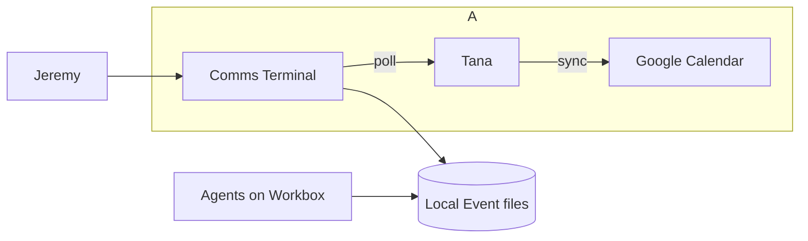
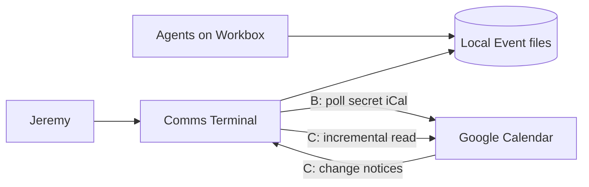
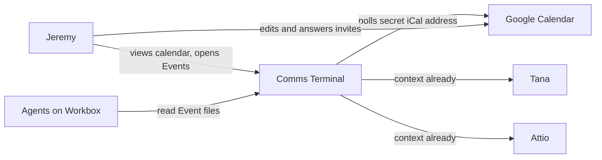
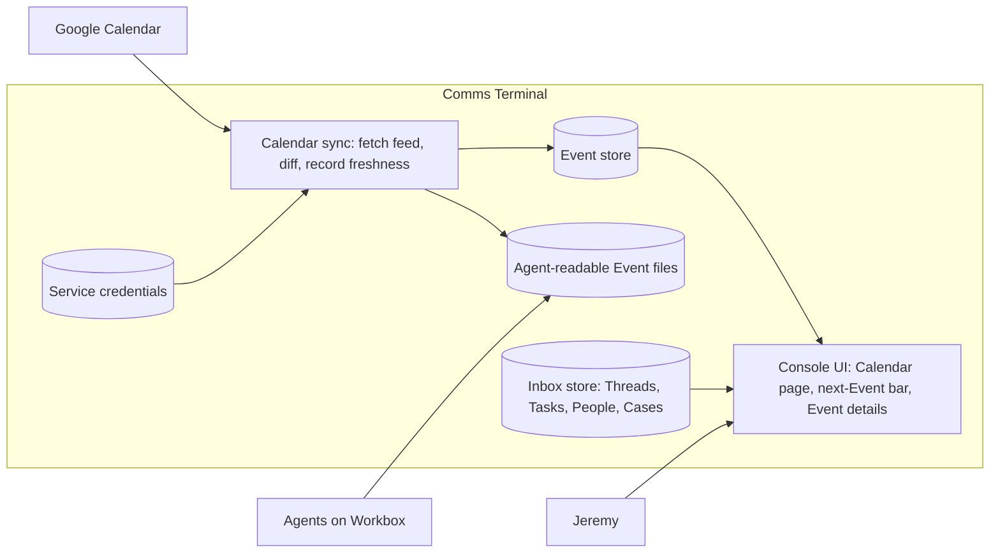
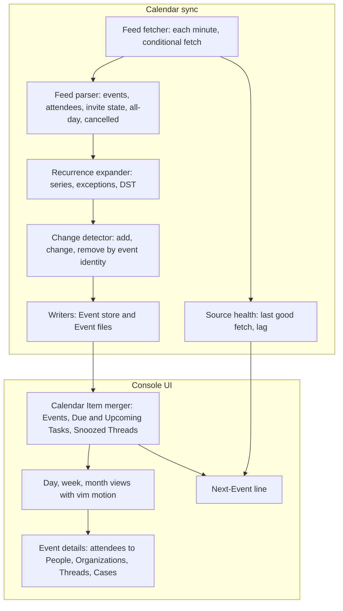

# Discovery: read-only calendar in the console

## 1. Status

- Current phase: complete
- Gates: Seed approved 2026-10-20 · Phase 1 approved 2026-10-20 · Phase 2 approved 2026-10-20 · Phase 3 approved 2026-10-20 · Phase 4 approved 2026-10-20
- Last updated: 2026-10-20 15:25 UTC

## 2. Context

### Seed (approved 2026-10-20)

- Topic: a read-only calendar like renCal, inside the Comms Terminal console.
- Need, in Jeremy's words: "i essentially want to build something similar to rencal, that can pull read-only from my google calendar".
- Early solution ideas (Phase 3 candidates, not decisions): renCal-style views; a read-only pull from Google Calendar.
- This topic reopens decision #122 (2026-10-13): "Meetings come from Tana only: no Google Calendar Connection".

### Actors

- **Jeremy**: works all day in terminals (herdr, Ghostty) and runs the console over SSH on Workbox. The console is meant to be the one screen for the workday.
- **Claude Code / OMP agents on Workbox**: should answer calendar questions ("when am I free Thursday?", "when did I last meet NBIF?") from local files, as renCal's `~/caldir` allows.

### Current workflow and workarounds

- To see the calendar, Jeremy leaves the terminal for a browser or phone (Jeremy, Phase 1 round 1).
- The console already shows Meetings in two places:
  - The Tana section on Thread, Person, Organization, and Case pages shows the next upcoming and the last three Meetings whose attendees match (FR-13a, `src/comms_terminal/tana.py:45`).
  - A calendar invite email renders as an event card in its Thread (`docs/design/console.md`, Thread rendering).
- Neither shows Jeremy's own day, week, or next meeting.

### Pains

| Pain | Evidence | Frequency |
|---|---|---|
| Leaving the terminal to check the calendar breaks flow. | Jeremy, round 2: "Rare; it's the switching". | Every calendar check (several times a day, inferred). |
| Missing or arriving late to meetings. | Jeremy, round 1 selected it; round 2 says misses are rare. | Rare. |

### Trigger

Jeremy saw renCal and wants the same feel in the terminal; he also wants the console to be the home base for the workday, with the calendar as a missing piece (round 1: "1 and 3").

### Wanted renCal parts (round 1)

- Day, week, and month views.
- Next meeting at a glance (renCal's "in your bar").
- Agent-queryable local event files.
- Not selected: a plain agenda list.

### Constraints and prior decisions

- **Calendars**: work only, `jeremy@agentmaple.com` (round 1).
- **Read-only boundary**: read-only now; keep the door open for writes such as RSVP or create later (round 2).
- **Auth**: Jeremy prefers no new Google credential; reuse what exists if possible (round 2).
- **Decision #122** (`docs/prd.md`): Meetings come from Tana only; meetings are never Threads or Activities. Considered and dropped then: meetings as Threads from Google Calendar.
- **GLOSSARY "Meeting"**: a calendar event read from a Context source; never a Thread or an Activity.
- **Console form**: Textual terminal app over SSH (decisions #71–#72); service holds all credentials, console holds none (decision #73, NFR-5).
- **Today view PRD** (2026-10-17) left Meetings out of "needs me now".
- **Comms Terminal has no Google OAuth**: Gmail reaches it by forwarding, so a direct Google Calendar pull needs a new Google sign-in.

### Facts found

- Tana already syncs `jeremy@agentmaple.com` from Google Calendar: provider `google-calendar`, connection `read-only`, `lastSyncedAt` 2026-10-20T02:35:28Z (Tana `listCalendars`, read at 2026-10-20T14:59Z, about 12.4 hours earlier). Tana's sync cadence is unknown.
- Tana's MCP server offers `listEvents` (date range, title query, timezone) and `readEvent`; the service already holds a Tana sign-in and an MCP client (`mcp.py`, `tana.py`).

### Analogues

- **renCal** (https://rencal.org/): open-source desktop calendar for Linux and macOS. Attractive: keyboard-first (vim keys, Ctrl K command bar), month, week, and board views, search, next meeting in the Omarchy bar with one-click join, offline use, sync with Google, iCloud, Outlook, and CalDAV, and events stored as `.ics` files under `~/caldir` that an agent can query.

### Open unknowns

- Tana calendar sync cadence and whether it is fresh enough for "next meeting".
- Whether Google Workspace allows a secret iCal address for `jeremy@agentmaple.com`.

## 3. Problem

### Statement (approved 2026-10-20)

Jeremy, working all day in the terminal console, has to leave it for a browser or phone whenever he needs his schedule (what is next, today, this week), because the console only shows Meetings per Person or Organization and never his own calendar. Each check breaks flow, and agents on Workbox cannot answer calendar questions without a live source.

Evidence: Phase 1 rounds 1–2 (switching is the main pain; misses are rare); FR-13a scope; renCal's `~/caldir` analogue.

### Scope (approved 2026-10-20)

In scope:
- Jeremy's work calendar, `jeremy@agentmaple.com`.
- Read-only: day, week, and month views and the next Event, inside the console, keyboard-first.
- Opening an Event's join link and details.
- A local, agent-readable copy of Events on Workbox, including past Events.
- Comms Terminal items with their own date or time placed on the calendar: Tasks on their due day and Snoozed Threads at their wake-up time.
- From an Event: links to the People and Organizations among its attendees and to their open Threads and Cases.

Out of scope for now:
- Writes to Google (RSVP, create, edit, delete). The door stays open for later.
- Personal, teammate, and shared calendars.
- Reminders and desktop notifications.
- Context-source tasks (Attio, Tana, Linear) as Calendar Items.

Non-goals:
- Events as Threads or Activities (decision #122 stands on this point).
- Replacing Google Calendar or Tana as the owner of Events.
- Meeting notes (Tana owns them).
- Scheduling or booking free time for others.
- People, Organizations, Channels, or Cases as Calendar Items; they have no date of their own.

### Edge cases (approved 2026-10-20)

- Declined Events show dimmed.
- All-day Events (OOO, holidays) show in a strip above the hours.
- Unanswered invites show a marker.
- Cancelled Events are hidden.

### Success measures (approved 2026-10-20)

1. Zero browser or phone trips to view the work calendar in a normal workday (Jeremy's self-report after one week).
2. The next Event (title, start, countdown) is visible from every console page without a keypress.
3. Day, week, and month views are reachable in two keys or fewer, with vim motion between days and weeks.
4. A change in Google Calendar shows in the console and in the local copy within one minute.
5. Agents on Workbox answer "when am I free Thursday?" and "when did I last meet NBIF?" from local files, with no network call.
6. A join link opens in Mani's browser in one action.

Tension carried into Phase 3: one-minute freshness against "no new Google auth". Tana's last sync was 12.4 hours before the check, so Tana alone likely cannot meet one minute.

## 4. Glossary

- **Event**: any entry with a date or time on Jeremy's work calendar. Types: Meeting, Block, All-day.
- **Meeting**: an Event with attendees besides Jeremy; FR-13a matches these to People and Organizations. Never a Thread or an Activity.
- **Block**: an Event with no other attendees, such as focus time, lunch, or a reminder to self.
- **All-day Event**: an Event with a date and no time, such as OOO or a holiday; shown in a strip above the hours.
- **Invite state**: Jeremy's answer to an Event: Accepted, Tentative, Unanswered, or Declined.
- **Calendar Item**: anything placed on the calendar: an Event, a Task on its due day, or a Snoozed Thread at its wake-up time.
- GLOSSARY change to make later: Meeting's "_Avoid_: Event (alone)" no longer holds; Event is now its parent term.

## 5. Options

All options share the same console side: a Calendar page (day, week, month), a next-Event line in the bottom bar, Event details with attendee links, and Tasks and Snoozed Threads placed as Calendar Items. They differ in where Events come from, how fresh they are, and what they rule out later.

Shared fact for every option: the service already has a public, verified hook ingress (`/hooks/email|slack|quo|resend`, `docs/design/api-and-database.md`), a five-minute Context-source cache, and a Tana MCP client.

### A. Tana relay (no new auth)

- **Core idea**: the service polls Tana's `listEvents` and `readEvent` for Jeremy's work calendar and keeps a local Event store plus an agent-readable mirror.
- **Solves**: Events in the console and on disk using the Tana sign-in the service already holds.
- **Measures moved**: 1, 2, 3, 5, 6. Measure 4 (one minute) depends on Tana's Google sync cadence.
- **Assumptions**: Tana syncs Google often enough; Tana returns invite state, attendees, all-day, cancellation, and join links.
- **Risks**: Tana's last Google sync was 12.4 hours before the check (one observation); Tana-native Events mix in; MCP rate limits; writes later would go through Tana's own read-only connection, which cannot write back.
- **Cost**: low; reuses `mcp.py` and `tana.py`.
- **Rules out later**: RSVP or create through this path.

### B. Google secret iCal address (no OAuth)

- **Core idea**: the service polls the calendar's "Secret address in iCal format" every minute and writes Events to a local store plus a folder of `.ics` files.
- **Solves**: a direct Google source with no OAuth flow; the `.ics` folder matches renCal's `~/caldir` for agents.
- **Measures moved**: 1–6, if the feed is fresh.
- **Assumptions**: the agentmaple.com Workspace admin allows the secret address (Google help: "your admin might've changed the sharing settings"); the feed reflects changes within a minute; it carries attendees, PARTSTAT, and conference links.
- **Risks**: the URL is a bearer secret (stored like other service credentials); feed freshness is unverified; whole-feed download each minute.
- **Cost**: low to medium; one HTTP fetch and an iCalendar parser.
- **Rules out later**: any write; a later write path needs option C.

### C. Google Calendar API with push (new OAuth)

- **Core idea**: an OAuth client with `calendar.readonly`; incremental sync with sync tokens; `events.watch` sends change notices to a new verified route on the existing public ingress; the service mirrors Events locally and as `.ics` files.
- **Solves**: full fidelity and near-real-time freshness; the same sign-in can later widen to RSVP and create.
- **Measures moved**: 1–6, including one-minute freshness.
- **Assumptions**: Jeremy accepts one Google sign-in, which he prefers to avoid; an OAuth client in the agentmaple.com Google Cloud project.
- **Risks**: channel renewal (no automatic renewal, per Google's push guide); token refresh; a new public route; "no new Google auth" preference broken.
- **Cost**: medium to high.
- **Rules out later**: nothing; it is the widest path.

### D. Adopt existing tools beside the console (baseline: adopt)

- **Core idea**: run vdirsyncer (Google CalDAV with Jeremy's own OAuth client, or its read-only `http` storage on the secret address) into a local vdir of `.ics` files, and view it with an existing terminal calendar (such as khal) in a herdr pane, or renCal on Mani. The console only reads the vdir for its next-Event line and Calendar Items.
- **Solves**: views and agent files with little new code.
- **Measures moved**: 1, 3, 5, 6 partially; 2 if the console reads the vdir; Tasks and Snoozed Threads stay out of the calendar views.
- **Assumptions**: a second tool's keys and look are acceptable; the vdir is enough for agents.
- **Risks**: two apps instead of one home base; no links from Events to People, Threads, or Cases in the calendar views; vdirsyncer's Google path also needs an OAuth client.
- **Cost**: low.
- **Rules out later**: a single console calendar without rework.

### E. Invite-derived Events (no new source)

- **Core idea**: build Events from calendar invitations already arriving through the Gmail Connection (the console already renders them as event cards).
- **Solves**: Meetings others invite Jeremy to, with no new auth.
- **Measures moved**: 2, 5 partially.
- **Assumptions**: invites reach the forwarded mailbox.
- **Risks**: misses Events Jeremy creates himself, Blocks, and changes made without an email; incomplete by design.
- **Cost**: low.
- **Rules out later**: nothing, but the gap stays.

### F. Do nothing; Tana's next Meeting in the bar (baseline: minimal)

- **Core idea**: keep Google Calendar in the browser; add only the next Meeting from Tana to the bottom bar.
- **Measures moved**: 2 partially.
- **Risks**: the main pain (switching for day and week views) stays.
- **Cost**: very low.

### Early concerns (not eliminations)

- One-minute freshness with no new auth is met only by B, and only if the feed is fresh and allowed. A and E likely miss it; C meets it but needs auth.
- A hybrid is possible: B now, C later when writes arrive.

### C4 L1 sketches

## 6. Deciding questions

Answered from earlier evidence (no question needed):

| Question | Answer | Effect |
|---|---|---|
| One home base, or a second app beside the console? | One home base, with Event links to People, Threads, and Cases (Phase 1 trigger; Phase 2 scope). | Eliminates D. |
| Must own Events, Blocks, and day/week views be covered? | Yes (success measures 1–3). | Eliminates E and F. |
| Does Tana return enough detail? | Yes: attendees, invite state, organizer, location, recurrence, local time (Tana `listEvents`, 2026-10-20 15:05 UTC). Join links were not in the list rows. | Leaves A open on fidelity. |

Asked of Jeremy, most eliminating first:

| # | Question | Plausible answers and effect | Answer |
|---|---|---|---|
| DQ1 | If both cannot hold: one-minute freshness or no new Google sign-in? | Freshness: keeps C, and B if allowed and fresh. No auth: A or B, and the one-minute target relaxes. | **Freshness wins.** |
| DQ2 | RSVP or create from the console within about three months? | Yes: strongly favors C. No: no premium on a write path. | **Probably not.** |
| DQ3 | Does the "Secret address in iCal format" exist for `jeremy@agentmaple.com`? | No: eliminates B. Yes: keeps B. | **Yes, it is there.** |
| DQ4 | Measure Tana's real freshness? | Test: decides A. Skip and drop: eliminates A. | **Skip; drop A.** |

## 7. Decision

**Chosen: B, the Google secret iCal address, polled by the service.** C (Google Calendar API with push) stays on record as the path if B fails its freshness check; Jeremy expects not to need it (Phase 4 gate: "probably don't need fallback c").

Why:
- DQ1 makes one-minute freshness the binding measure. B can meet it with no OAuth; C meets it for certain but needs a sign-in Jeremy prefers to avoid.
- DQ2 removes the write-path premium that would favor C now.
- DQ3 keeps B available.
- B's `.ics` folder matches renCal's `~/caldir` pattern for agents (success measure 5) with the least new machinery.

Which answers would change it:
- B's feed lags more than one minute in the validation check: switch to C (DQ1 already accepts the sign-in).
- Writes become likely soon (DQ2 flips): go straight to C.

Rejected options:
- **A, Tana relay**: Jeremy dropped it (DQ4); Tana's Google sync timing is unknown and its connection is read-only, so it can never carry writes.
- **D, adopt tools beside the console**: breaks the one-home-base goal and has no Event links to People, Threads, or Cases.
- **E, invite-derived Events**: misses Events Jeremy creates and Blocks.
- **F, do nothing**: leaves the main pain.

Accepted trade-offs:
- The secret address is a bearer secret; anyone with it reads the calendar. It is held only by the service, like other credentials, and Google's Reset replaces it.
- The whole feed downloads every minute.
- No writes ever through B; writes later need C.
- Decision #122 changes: Events now come from Google Calendar for the Calendar page. The Tana section's Meetings (FR-13a) stay as they are.

## 8. Validation

### Riskiest assumptions

| # | Assumption | Evidence now | Missing evidence |
|---|---|---|---|
| R1 | The secret feed shows a Google change within one minute. | None. Google's help page describes the feed but gives no freshness figure. | Move a test Event in Google, fetch the feed each 15 s, record the lag (5 trials). Decides B against C. |
| R2 | The feed carries what the console needs: attendees and invite state, declined Events, cancellations, all-day Events, conference links, recurring series with exceptions. | Tana's copy of the same calendar carries attendees, invite state, and recurrence; the feed is unchecked. | Fetch the feed once and check each field against today's Events (Standup series, "Canadian Tire Appointment" with `needsAction`, an all-day Event). |
| R3 | Past Events are in the feed, so agents can answer "when did I last meet NBIF?". | None. | Check the feed's earliest Event date. |
| R4 | Recurring series expand correctly across daylight-saving changes in America/Moncton. | Tana shows the Standup as one series with per-day instances at -03:00. | Expand the Standup across the November 2026 DST change and compare with Google. |
| R5 | One-minute polling is acceptable to Google (no throttling of the secret address). | None. | Observe responses over a day of polling. |

### Spike results (2026-10-20, Workbox, feed fetched every 15 s)

Jeremy authorized the agent to run the test in his Google Calendar ("do it yourself"). The agent created, moved, and deleted an Event titled "spike test" on 2026-10-27; it no longer exists.

| Action in Google (UTC) | Seen in feed (UTC) | Lag |
|---|---|---|
| Create, about 15:43:45 | 15:43:55 | ≤ 10 s |
| Move 3:00 to 3:45 pm, 15:44:19 | 15:44:27 | ≤ 8 s |
| Delete, 15:44:46 | 15:44:59 | ≤ 13 s |

- **R1 holds**: the secret feed reflects changes within one poll; the lag is bounded by the 15 s poll interval.
- **R2 mostly holds** (one fetch, 15:30 UTC): 508 KB, 467 VEVENTs, 0.8 s fetch. ATTENDEE PARTSTAT carries DECLINED (40), NEEDS-ACTION (352), TENTATIVE (21); X-GOOGLE-CONFERENCE on 145 Events; 16 all-day; zero STATUS:CANCELLED (cancelled Events and instances leave the feed or become EXDATEs, so "cancelled hidden" is free).
- **R3 holds**: history reaches back to 1970 (recurring series); single Events up to 2026-12-09.
- **Recurrence is real work**: 47 RRULE series, 43 RECURRENCE-ID overrides, 17 EXDATE lines.
- **No caching**: `Cache-Control: no-cache, no-store`, no ETag or Last-Modified, so every poll downloads the whole feed.
- DTSTAMP changes per fetch; event content is otherwise stable between polls (two polls 30 s apart with DTSTAMP ignored showed no change).
- Seen in Google's sidebar, outside scope: Birthdays, Tasks, Holidays in Canada, JML Personal, Kelly Kelly Counselling. The secret address covers only the primary `jeremy@agentmaple.com` calendar.

### Scenario walk-through

| Scenario | Result |
|---|---|
| Jeremy is in a Thread at 09:58; Standup is at 10:00. | Holds: the bottom bar shows "Agent Maple Standup · in 2 min" on every page (measure 2). |
| Logan moves Sales & Marketing from 12:00 to 13:00. | Holds only if R1 holds; otherwise this is the case that sends the decision to C. |
| Jeremy opens Wednesday's week view. | Holds: the Standup, Sales & Marketing, and "Iron Maple On-Site" (a Block) show; Tasks due that day show in the all-day strip; Snoozed Threads at their wake-up times. |
| An invite arrives that Jeremy has not answered ("Canadian Tire Appointment" shows `needsAction` for another address; Jeremy's own is accepted). | Holds if R2 holds: unanswered invites carry a marker; read-only, so Jeremy answers in Google. |
| Jeremy declines an Event in Google. | Bends: it shows dimmed only if the feed keeps declined Events (R2). |
| An agent is asked "when did I last meet NBIF?". | Holds if R3 holds: it searches the local `.ics` files for `nbif` attendees with no network call. |
| Jeremy opens the Standup's details. | Holds: attendees link to their People and Organization (Agent Maple teammates match like everyone else, as in FR-13a) and to their open Threads and Cases. |
| Jeremy joins a Meet call. | Bends: depends on the feed carrying the conference link (R2); the link then opens in Mani's browser, as Thread links do today. |
| A personal Event ("Dinner with mom") on the work calendar. | Holds: it is a Block and shows like any other; personal calendars stay out of scope. |
| Google is unreachable for ten minutes. | Holds: the console keeps the last copy and shows the calendar source as stale in the bottom bar, like other source health. |

## 9. Architecture (abstract)

### L1 Context

### L2 Container

### L3 Component (Calendar sync and Console, where R1–R4 live)

### Design settled in grilling (2026-10-20)

Recorded in ADR 0005 (`docs/adr/0005-google-calendar-via-secret-ical-feed.md`) and `GLOSSARY.md` (Calendar section). Option C is not needed: the spike passed.

- **Source**: the service polls the secret iCal address every 30 s; the address is an optional service credential.
- **Storage**: each Event as Google gives it (series rule, moved occurrences, removed dates), with first-seen and deleted marks. Writes happen only when content changes. Deleted Events are kept forever, including a single removed occurrence of a series.
- **Expansion**: on read, for any range, with `recurring-ical-events`; no fixed horizon.
- **Failure**: the Calendar keeps the last copy and shows "as of HH:MM"; after three failed polls the bottom bar shows Google Calendar broken beside the Context sources. The service records it so the laptop console sees it.
- **Rail**: Calendar sits directly under Today.
- **View**: one scrolling month grid of week rows with a separator row at each month start; it opens on two weeks before through two weeks after the current week, with the cursor on today, and scrolls past them.
- **Cells**: Events (time and truncated title, `+N` on overflow) and one count line for inbox items: ☐ Tasks, ⏰ Snoozed Threads, ➤ scheduled Draft sends, ▸ Enrollment starts. Declined Events dimmed; Deleted Events struck through; unanswered invites marked.
- **Day pane**: follows the grid cursor and lists every Calendar Item of that day in time order.
- **Keys**: grid `h/l` day, `j/k` week, `t` today, `{ }` month, `Tab` to the day pane; day pane `j/k`, `Enter` opens (Event details, Thread, or Task's Draft), `o` join link, `Tab`/`Esc` back.
- **Event details**: title, Invite state, time and repeat, location, join link, organizer, attendees with their answers linked to People (with open Threads and Cases), Organizations, description with boilerplate folded, and Tana's summary and documents for a Meeting.
- **Bottom bar**: the Event in progress with time left, then the next timed Event on any day; Declined, All-day, and Deleted Events are skipped.
- **Calendar Items**: Events, Tasks on their day, Snoozed Threads at wake time, Drafts at send time, Enrollments on their start day.
- **Agents**: `comms-terminal events [--from] [--to] [--attendee] [--query] [--last N] [--deleted] [--json]`, Events only, local time America/Halifax, run from Workbox through the wrapper.
- **Terms**: Event provider (not Calendar provider), Deleted Event.

## 10. Open risks and unknowns

| Item | Impact | Next evidence |
|---|---|---|
| R1 feed freshness unknown | If slower than one minute, B fails measure 4 and C (new sign-in) is needed | Five timed trials moving a test Event |
| R2 feed fidelity (declined, conference links, cancellations) | Dimmed declines and one-action join may not work | One feed fetch checked against known Events |
| R3 past history in the feed | Agents cannot answer "last met" questions | Check earliest Event in the feed |
| R4 recurrence and DST expansion | Wrong times around clock changes | Expand Standup across 2026-11-01 |
| R5 Google throttling of one-minute polling | Feed errors or bans | A day of polling |
| Secret address exposure | Anyone with it reads the calendar | Hold it only as a service credential; reset in Google if leaked |
| Decision #122 and GLOSSARY change | Docs disagree until updated | Update PRD decision log and GLOSSARY when requirements are written |

**Later use case (2026-10-20, Jeremy).** At 13:45 an NBIF contact emailed "Would you be available for a quick call today?"; Jeremy saw it hours later and replied "Sorry I didn't see this in time." Two Calendar follow-ons would have caught it:
- A Thread asking for time today surfaces as time-bound, ahead of the rest of Todo.
- Replying to it shows today's free time from the Calendar beside the composer, so the answer names a slot.

## 11. Decision log

| Date | Request or decision | Source | Status | Supersedes |
|---|---|---|---|---|
| 2026-10-20 | Seed: renCal-like read-only calendar inside the console, from Google Calendar | Jeremy, seed question | Approved | — (reopens #122 for discussion) |
| 2026-10-20 | Calendars: work only (`jeremy@agentmaple.com`) | Jeremy, round 1 | Recorded | — |
| 2026-10-20 | Wanted: day/week/month views, next meeting glance, agent-queryable files | Jeremy, round 1 | Recorded | — |
| 2026-10-20 | Read-only now; writes (RSVP, create) possible later | Jeremy, round 2 | Recorded | — |
| 2026-10-20 | Prefer no new Google auth | Jeremy, round 2 | Recorded | — |
| 2026-10-20 | Agent readers: Claude Code / OMP on Workbox | Jeremy, round 2 | Recorded | — |
| 2026-10-20 | Phase 1 gate | Jeremy | Approved | — |
| 2026-10-20 | Problem statement and scope approved | Jeremy, Phase 2 | Approved | — |
| 2026-10-20 | Freshness target: one minute | Jeremy, Phase 2 | Recorded | — (conflicts with "no new Google auth"; carried to Phase 3) |
| 2026-10-20 | Term "Event" for any calendar entry; Meeting is an Event type | Jeremy, Phase 2: "event", "Meeting is an event type" | Recorded | GLOSSARY Meeting's "Avoid: Event (alone)" |
| 2026-10-20 | Event types Meeting, Block, All-day; declined dimmed, all-day strip, unanswered marked, cancelled hidden | Jeremy, Phase 2 | Approved | — |
| 2026-10-20 | Calendar also places Tasks and Snoozed Threads; Events link to attendee People, Organizations, Threads, Cases | Jeremy, Phase 2: "inbox threads, cases, tasks, people, orgs, channels. some of those should not be on cal obviously"; split approved | Approved | — |
| 2026-10-20 | Phase 2 gate | Jeremy | Approved | — |
| 2026-10-20 | Phase 3 option set A–F | Jeremy | Approved | — |
| 2026-10-20 | DQ1 freshness wins over no new sign-in | Jeremy | Recorded | Phase 1 "prefer no new Google auth" (now a preference, not a constraint) |
| 2026-10-20 | DQ2 writes probably not within three months | Jeremy | Recorded | — |
| 2026-10-20 | DQ3 secret iCal address exists | Jeremy | Recorded | — |
| 2026-10-20 | DQ4 skip Tana freshness test; drop A | Jeremy | Recorded | — |
| 2026-10-20 | Chosen: B (secret iCal, polled); C recorded, not planned | Jeremy, Phase 4 gate: approved, "probably don't need fallback c" | Approved | Decision #122 "Tana only, no Calendar" for the Calendar page |

## 12. Sources

- https://rencal.org/ home page (fetched 2026-10-20; marketing page only, docs not read).
- `docs/prd.md` (FR-13a, decision #122), `docs/design/console.md`, `GLOSSARY.md`, `src/comms_terminal/tana.py`.
- Tana MCP `listCalendars` (2026-10-20T14:59Z, again about 15:05Z) and `listEvents` 2026-10-20 to 2026-10-22, America/Moncton.
- Google Calendar push notifications guide: https://developers.google.com/workspace/calendar/api/guides/push (channels expire; no automatic renewal).
- Google Calendar help, secret iCal address: https://support.google.com/calendar/answer/37648 (admin may disable; no freshness figure).
- vdirsyncer configuration manual: https://vdirsyncer.pimutils.org/en/stable/config.html (Google storage needs an own OAuth client; `http` storage is read-only).
- renCal installation docs: https://rencal.org/docs/installation/. Its source repository was not found at the guessed GitHub URL; renCal internals were not inspected.
- Not inspected: the secret iCal feed itself (R1–R5).
- Jeremy's answers to seed, Phase 1 rounds 1–2, and Phase 2.
- `GLOSSARY.md` terms Task, Due Task, Today, Deferred start.
- Limit: the QMD memory search for prior calendar decisions failed ("Object is disposed"); global memory was not searched.
