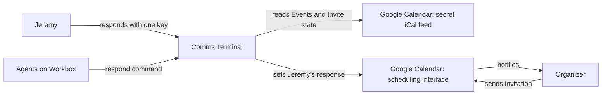
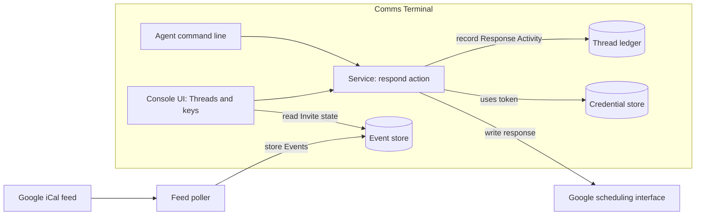
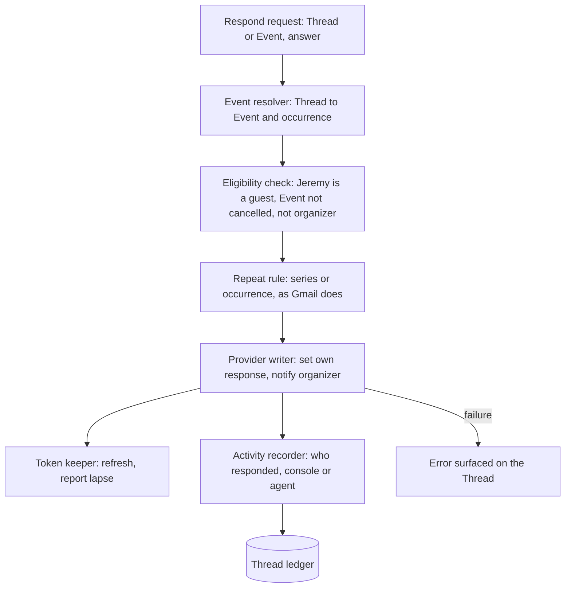

# Invite actions in Comms Terminal — discovery

## 1. Status

- Current phase: complete
- Gates: Phase 1 approved 2026-10-27 · Phase 2 approved 2026-10-27 · Phase 3 approved 2026-10-27 · Phase 4 approved 2026-10-27
- Last updated: 2026-10-27 18:19 ADT (UTC−3)

## 2. Context

### Seed (confirmed 2026-10-27, broadened by Jeremy)

- **Topic:** acting on calendar invitations from Comms Terminal: RSVP (accept, maybe, decline), propose a new time, add a note, forward to Logan.
- **Trigger:** the Brendan Wood "Pints" invite (Thu 2026-10-29 16:00) sat unanswered; Comms Terminal shows it but cannot answer it. Jeremy: "i want to add the ability to rsvp into comms terminal".
- **Early ideas:** RSVP itself; ADR 0005's Google Calendar API path. Both are Phase 3 candidates, not decisions.

### Facts gathered (sources in §12)

- The calendar is read-only. The service polls Google's secret iCal address for `jeremy@agentmaple.com` every 30 seconds (ADR 0005, accepted 2026-10-20). The feed "can never write". ADR 0005 names the Google Calendar API with push notifications as "the path if Jeremy later wants to answer invites or create Events from the console", rejected then because it needs an OAuth client and a sign-in Jeremy preferred to avoid.
- The 2026-10-20 calendar discovery listed "Writes to Google (RSVP, create, edit, delete)" as out of scope, with "the door open for later".
- The feed carries each attendee's answer (PARTSTAT). The console already shows Jeremy's answer: Accepted, Tentative/Maybe, Unanswered ("?"), Declined (dimmed).
- Meetings are Activities on Threads (ADR 0007, accepted 2026-10-24): an Event with an attendee outside agentmaple.com gets a Meeting Thread, including invites Jeremy declined or has not answered.
- An invitation also arrives as an email ("Invitation: …"), which becomes its own email Thread. Example: Pints produced email Thread 758 and Meeting Thread 759. The live store holds 18 invitation-email Threads, all from October 2026.
- Email sends through Resend from the Connection's address. Comms Terminal holds no Google OAuth token today (credentials listed in `serve.py`).
- Volume, 2026-09-27 to 2026-12-31 (live `events`, 158 occurrences): 154 Accepted, 3 Unanswered, 1 Tentative. About 32 occurrences have an organizer outside agentmaple.com. Jeremy answers almost every invite today, outside the console. The open ones: Pints (Brendan Wood), Colin Smyth intro (Joe Gushue, Nov 3), WMI webinar (Nov 17), and Serenity touch-in (Oct 21, Tentative).
- Only the primary work calendar is read. The `.ai` and Fastmail calendars are outside the feed.

### From Jeremy (2026-10-27)

- **Actors:** Jeremy (the invitee); organizers, mostly outside agentmaple.com (Brendan Wood, Joe Gushue, WMI, CGP); agents on Workbox that read and act through the `comms-terminal` CLI.
- **Today:** Jeremy answers with Gmail's Yes / Maybe / No buttons on the invitation email.
- **Pain:** leaving the console. He sees the invite in Comms Terminal, then switches to Gmail to answer it.
- **Frequency (inferred from data):** about 32 externally organized occurrences in three months, roughly 10 a month.
- **Invite actions wanted:** Accept / Maybe / Decline only. Notes, proposing a new time and forwarding to Logan are not wanted.
- **Where:** the Meeting Thread, the invitation email Thread, and the agent CLI. The Calendar page was not chosen.
- **Agents:** "It should be scripted into the rsvp, this is an exception." Agents may RSVP through the CLI, an explicit exception to the standing rule that agents never send.
- **Calendars:** agentmaple.com only.
- **Analogue:** Gmail's buttons: Yes / Maybe / No right on the message, nothing more.
- **Constraint:** one Google sign-in is now acceptable if the service keeps it renewed. This reverses the Oct 20 preference behind ADR 0005's read-only choice.

### Open unknowns

- Whether an RSVP needs to reach the organizer as an email, or whether updating Google's copy of the Event is enough (Google notifies the organizer either way; to be checked in Phase 3).
- How fast the console should reflect a new answer (the feed lags 8–13 seconds).

## 3. Problem

**Statement.** Jeremy, triaging in Comms Terminal, sees about ten external invites a month (a Meeting Thread and an invitation email Thread each) but must switch to Gmail's Yes / Maybe / No buttons to respond, because the console reads the calendar through a read-only feed (ADR 0005). Each response costs a context switch, and agents can see Invite state but cannot respond for him. Evidence: §2.

**In scope**
- Accept / Maybe / Decline on the agentmaple.com calendar.
- From the Meeting Thread, the invitation email Thread, and the agent CLI.
- Agents may respond (explicit exception to the no-send rule).
- The console shows the new Invite state afterwards.
- Repeating Events: behave the way Gmail's invitation buttons do (inference to verify in Phase 4: the response covers what the invitation covers, so a series invitation answers the series).

**Out of scope / non-goals**
- Notes, proposing a new time, forwarding, adding guests.
- Creating, moving or cancelling Events.
- Responding from the Calendar page.
- agentmaple.ai and Fastmail calendars.
- Merging the two Threads each invite creates.

**Success measures**
1. One key from either Thread responds to the invite: Gmail-button simple, no form, no confirm step beyond the key.
2. Google shows the organizer the response, the same as a Gmail-button response, within one minute.
3. The console shows the new Invite state within one minute.
4. Over two weeks of normal use, zero trips to Gmail or Google Calendar just to respond.
5. An agent's CLI response gives the same result as Jeremy's key and is recorded on the Thread.

## 4. Glossary

- **Invite state:** Jeremy's answer to an Event: Accepted, Tentative, Unanswered, Declined (from the 2026-10-20 calendar discovery).
- **Respond:** set Jeremy's Invite state on an Event (Accept, Maybe, Decline) so the organizer sees it, the way Gmail's invitation buttons do.

## 5. Approaches

Survey depth: standard (Jeremy, 2026-10-27).

### Frameworks

- **iTIP / iMIP (RFC 5546, RFC 6047):** the open standard for invite responses. The invitee sends the organizer an iCalendar `METHOD:REPLY` carrying only their own attendee line with a new PARTSTAT. Only the respondent may set their own status. A third-party Google note says Google accepts a REPLY with METHOD:REPLY, only the responding attendee, an updated PARTSTAT and a current DTSTAMP.
- **Calendar provider scheduling API:** the invitee patches their own attendee entry's response status on their copy of the Event, and the provider notifies the organizer (Google Calendar API `events.patch`, `responseStatus`, `sendUpdates`).
- **Provider response links:** Google's invitation emails carry Yes / Maybe / No links with a per-invitee token. The footer warns that forwarding the email "could allow any recipient to send a response", so the link answers without a sign-in. Undocumented as an interface.

### Reference cases

- **aerc** (terminal email client): `:accept`, `:accept-tentative`, `:decline` parse the invitation's calendar part and compose an iMIP REPLY.
- **notmuch (Emacs) and nmh `mhical`:** the same iMIP pattern; the notmuch author reports it working with Google and Outlook invites, lightly tested.
- **Superhuman, Notion Calendar:** respond through the provider's API after a sign-in. Superhuman's help pages document invite context but no RSVP shortcut.
- No search found a terminal or console tool that uses provider response links.

### Stack fit

- The service already holds each Event's iCalendar data (UID, ORGANIZER, SEQUENCE, attendees) from the feed.
- It already sends email from jeremy@agentmaple.com, but through a sending service rather than Gmail, so Gmail's own sent-copy and calendar side effects do not happen.
- Stored invitation emails keep their raw message (`raw/<sha256>.eml` beside the database), including the `text/calendar` part with the Event's UID and Google's response links (Pints, activity 1509). Corrected 2026-10-27; an earlier version of this line said text only.
- Workbox agents already have a Google Workspace connection with calendar write access for Jeremy's accounts, separate from Comms Terminal.

### Approach set (rung order, boring first)

| Approach | Rung | Adoption evidence | New moving parts | Extra cost | Measures moved | Assumptions and risks |
|---|---|---|---|---|---|---|
| A. Using an "open in Google" key, we would jump from either Thread to the Event in the browser and respond there | No build | Universal fallback | One key binding | None | 1 partly; fails 4 | Still leaves the console: the pain stays |
| B. Using the agents' existing Google Workspace connection, agents would respond for Jeremy from Workbox | No build (agent path only) | Already installed | None in Comms Terminal | None | 5 only | No console key; agent's response is not recorded on the Thread |
| C. Using provider response links from the stored invitation emails, one key would fetch Jeremy's Yes / Maybe / No link | Stack | Gmail's own buttons; no tool found that automates it | Link extraction from the raw message; a fetcher | None | 1, 2, 3, 4, 5 for Google-sent invites | Undocumented interface; links absent for non-Google organizers; token links are bearer secrets |
| D. Using iMIP, one key would email the organizer an iCalendar REPLY built from the stored Event | Popular (open standard) | aerc, notmuch, nmh, Thunderbird-class clients | Reply builder; sends through the existing email path | None | 1, 2, 4, 5 | Jeremy's own Google calendar keeps showing Unanswered, so 3 fails unless the console keeps its own answer; organizer-side handling varies |
| E. Using the calendar provider's scheduling API, one key would set Jeremy's response on his copy of the Event and let Google notify the organizer | Popular | Superhuman, Notion Calendar; ADR 0005 names it | One sign-in and token renewal; a write client | None (free API quota) | 1, 2, 3, 4, 5 | Needs one sign-in (now acceptable); token can lapse; repeat handling follows the provider |

Early concerns (no elimination yet): C rests on an undocumented link; D splits Jeremy's calendar from the organizer's view; E adds the first Google credential to the service.

## 6. Deciding questions

Ordered most-eliminating first.

| # | Question | Plausible answers and effect | Answer |
|---|---|---|---|
| 1 | Must Jeremy's own calendar show the new response, not only the organizer's? | Yes: D fails measure 3 unless the console keeps a second copy of the answer. No: D stays open. | Yes, from success measures 2 and 3 (approved Phase 2). D eliminated. |
| 2 | Must a console key respond without leaving the console, and be recorded on the Thread? | Yes: A (leaves the console) and B (no key, nothing on the Thread) fail. | Yes, from measures 1, 4 and 5. A and B eliminated. |
| 3 | What share of external invites come from organizers outside Google? | Small: C stays viable. Material: C misses that share. | About 13 of 51 occurrences (Jul 2026 to Mar 2027) have organizers whose mail runs on Microsoft or other systems (NBIF, UNB, STMEC, Chestnut, McInnes Cooper, RBC, Iron Maple, Zoom). Source: live `events` plus MX lookups, which are a proxy for the calendar system. C eliminated. |
| 4 | Where may the one Google sign-in live, and with what reach? | On the service: E as designed. Off Oracle: reopens the choice. | On the service, with full calendar access (Jeremy, 2026-10-27), leaving room for later Event writes. |

## 7. Decision

**Chosen: E.** Comms Terminal's service responds through Google Calendar's own scheduling interface: it sets Jeremy's response on his copy of the Event, and Google notifies the organizer, including organizers outside Google (Google emails them a standard reply, as it does for Gmail-button answers). Reads stay on the secret iCal feed (ADR 0005), which shows the new Invite state 8–13 seconds later. The console's key on either Thread and the agent CLI both call the same service action, and each response is recorded on the Meeting Thread.

**Why:** E is the only approach that moves all five success measures. It is the popular pattern (Superhuman, Notion Calendar) and the path ADR 0005 already named. It adds one sign-in and a write client, and no new process.

**Rejected:**
- A (open in Google): leaves the console, so the pain stays.
- B (agents' Workbox connection): no console key, and nothing lands on the Thread.
- C (Google's response links): undocumented, and misses about a quarter of external invites.
- D (emailed iMIP reply): Jeremy's own calendar keeps saying Unanswered.

**Trade-offs accepted:** the service holds its first Google credential, with full calendar access by Jeremy's choice, on the shared Oracle host. Agents may respond, an explicit exception to the no-send rule.

## 8. Validation

### Riskiest assumptions

| Assumption | Evidence now | Missing |
|---|---|---|
| A response set through Google's interface reaches organizers outside Google the way a Gmail-button answer does | Google's interface documents organizer notification (`sendUpdates`); Gmail-button answers to Outlook invites already work for Jeremy | One live test with a Microsoft-hosted organizer (for example a test invite from an Outlook account) |
| As a guest, Jeremy can change only his own response, and the write cannot disturb other attendees | iTIP rule: only the respondent sets their own status | A test on a guest Event, checking the other attendees afterwards |
| A response to a repeating Event behaves like Gmail's buttons | Gmail's invitation buttons answer what the invitation covers | Confirm series-versus-occurrence behaviour on a weekly test Event |
| The sign-in stays valid without weekly renewal | Google issues long-lived refresh tokens to internal Workspace apps; apps left in testing mode lose them after seven days | Confirm the app type when the client is created |
| The invitation email Thread can find its Event | The Meeting Thread already links to its Event (ADR 0007) | Stored invitation emails keep no calendar part or Event ID (activity 1509). Matching needs the calendar part kept at ingest, or a match on organizer, title and time |

### Scenario walk-through

- **Pints (Google organizer, single Event):** one key on Thread 759 or 758 sets Accepted; Google tells Brendan; the feed shows Accepted within a minute. Holds.
- **NBIF invite (Microsoft organizer):** Google sends the organizer a standard reply. Holds if assumption 1 holds.
- **Weekly series (Serenity touch-in):** follows Gmail's buttons. Bends until assumption 3 is checked.
- **Agent responds:** the agent runs the CLI command, which goes through the same service action and lands on the Thread. Holds; it relies on the no-send exception.
- **Invitation email arrives before the feed shows the Event (up to 30 s):** the key has no Event yet. Bends: show the key once the Event is known.
- **Invite to jeremy@agentmaple.ai, or a forwarded invite where Jeremy isn't a guest:** no Event on his calendar, so no key. Out of scope; it fails safe.
- **Event cancelled before he responds:** the write is refused, and the console says the Event is gone. Holds.
- **Jeremy is the organizer:** there is nothing to respond to; no key. Holds.

## 9. Architecture (abstract)

### L1 Context

### L2 Container

### L3 Component (service, respond path)

## 10. Open risks and unknowns

| Item | Impact | Next evidence needed |
|---|---|---|
| Organizers outside Google may not receive the response | About a quarter of external invites | Live test with a Microsoft-hosted organizer |
| Full calendar access on a shared host | A leaked token can read and change every Event | Decide on revocation and monitoring; Jeremy chose full access |
| Invitation email Threads lack an Event link | The key works on Meeting Threads first | Keep the calendar part at ingest, or define the match rule |
| Repeat behaviour | Wrong scope on a series answer | Weekly test Event |
| Token lapse | Responses fail silently | Visible lapse state, as the feed already has for fetch failures |
| No-send exception for agents | Agents send outward replies | Record the exception in the agent rules when the feature ships |

## 11. Decision log

| Date | Request or decision | Source | Status | Supersedes |
|---|---|---|---|---|
| 2026-10-27 | Seed confirmed and broadened from "RSVP" to "invite actions" (RSVP, propose a time, note, forward to Logan) | Jeremy, seed question | Superseded same day | — |
| 2026-10-27 | Wanted invite actions are Accept / Maybe / Decline only | Jeremy, Phase 1 round 1 | Accepted | Broadened seed scope |
| 2026-10-27 | One Google sign-in is acceptable | Jeremy, Phase 1 round 1 | Accepted | Oct 20 preference to avoid a sign-in (ADR 0005 context) |
| 2026-10-27 | Phase 1 gate approved | Jeremy | Accepted | — |
| 2026-10-27 | Problem statement, scope, non-goals and success measures approved; repeating Events follow Gmail's buttons; canonical term "Respond" | Jeremy, Phase 2 round 1 | Accepted | Candidate term "Invite action" |
| 2026-10-27 | Phase 2 gate approved; survey depth standard | Jeremy | Accepted | — |
| 2026-10-27 | Phase 3 approach set A–E approved | Jeremy | Accepted | — |
| 2026-10-27 | Google sign-in lives on the service with full calendar access | Jeremy, Phase 4 deciding question 4 | Accepted | — |
| 2026-10-27 | Agents may RSVP through the CLI: an exception to "agents never send" | Jeremy, Phase 1 round 2 | Accepted | Global no-send rule, for RSVPs only |
| 2026-10-27 | Phase 4 reopened: Jeremy doesn't understand why E was chosen; explanation given before re-asking the gate | Jeremy | Closed | Phase 4 gate attempt 1 |
| 2026-10-27 | Phase 4 approved: "ok yes, E" after the explanation; strategy E, diagrams and open risks stand | Jeremy | Accepted | Phase 4 reopening |
| 2026-10-27 | Correction: stored invitation emails keep the raw message with its calendar part, not text only; approach C's moving parts adjusted. The choice is unchanged (C still misses organizers outside Google) | PRD inspection; Jeremy approved fixing this document | Accepted | §5 stack-fit line |
| 2026-10-27 | Agents can't respond to invites (PRD gap-closing round) | Jeremy | Accepted | The agent exception and success measure 5 above |

## 12. Sources

- Comms Terminal repo `JMLegere/comms-terminal`, `origin/main` at `209fc1d`: `docs/adr/0005-google-calendar-via-secret-ical-feed.md`, `docs/adr/0007-meetings-are-threads.md`, `src/comms_terminal/calendar.py`, `serve.py` credential list, `email.py`.
- `.agents/discovery/2026-10-20-calendar.md` (worktree `comms-terminal-gcal-crash-20261025`).
- Live Oracle store, read-only: `comms-terminal events --json` for 2026-09-27 to 2026-12-31; thread titles; Threads 758 and 759. Organizer domain is a proxy for "external invite"; Logan's Events count as internal.
- Web: RFC 6047; Google Calendar API events reference; aerc invite-reply commit; notmuch and nmh `mhical`; Google Workspace Updates 2019-04 on forwarded-invite RSVP; Superhuman help pages.
- MX lookups for organizer domains (a proxy for each organizer's calendar system).
- Limits: Gmail MCP unavailable this session; how invites are answered today is not visible in the data.
