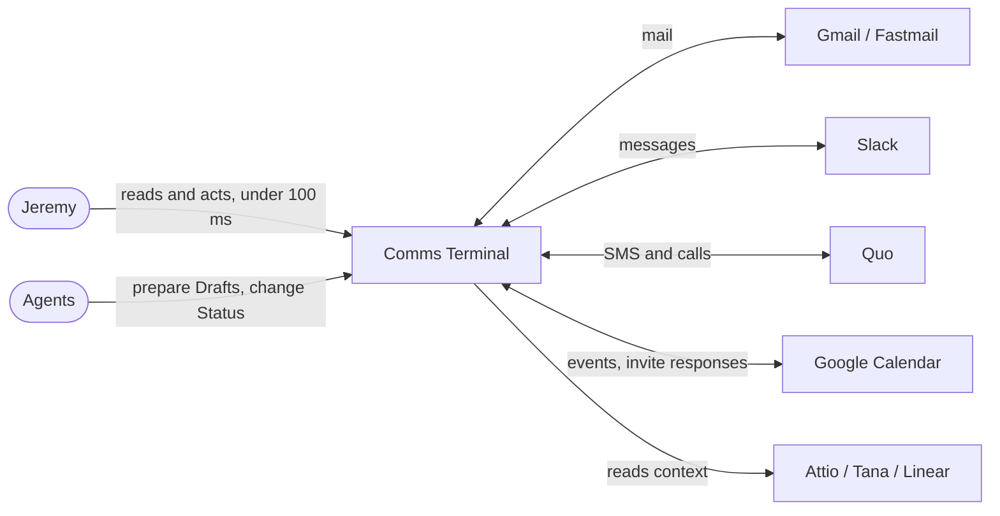
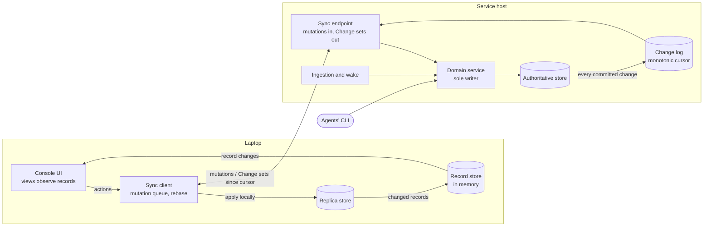
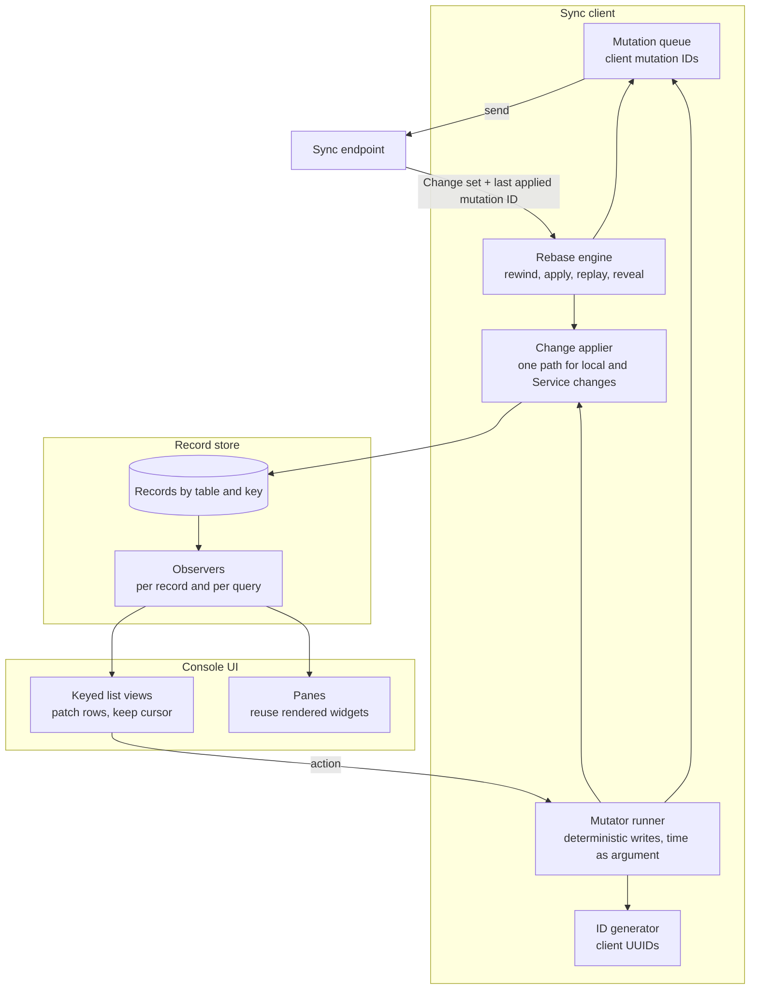

# Discovery — Instant console writes and targeted refresh

## 1. Status

- **Current phase:** complete
- Phase 1 gate: approved 2026-10-29
- Phase 2 gate: approved 2026-10-29
- Phase 3 gate: approved 2026-10-29
- Phase 4 gate: approved 2026-10-29
- **Last updated:** 2026-10-29 (UTC)

## 2. Context

### Confirmed seed (2026-10-29)
- **Topic:** Comms Terminal console speed, Linear-style: never wait on Oracle, repaint only what changed.
- **Need (Jeremy):** "i want to address gap 1 and 2", following a comparison with Linear's sync engine. Seed note: "i want to probably do all of this", listing Linear's local workspace copy with delta sync, in-memory object graph, instant writes with a transaction queue, server-ordered sync IDs pushed to clients with rollback on rejection, and re-rendering only what changed.
- **Gap 1:** 17 `create` writers wait for the service before the screen changes.
- **Gap 2:** every snapshot runs `refresh_all`, which rebuilds the current page and every pane.
- **Early ideas (Phase 3 candidates, not decisions):** client-generated IDs; a snapshot that names changed records; per-record reactive UI updates; Linear's sync-engine model as a whole.

### How the laptop console works today
Source: `docs/adr/0004-local-console-over-server-replica.md`, `docs/adr/0011-remote-owns-socket-client.md`, `src/comms_terminal/remote.py`, `src/comms_terminal/writers.py`, `src/comms_terminal/tui.py` at `d5e823d`.

- **Replica:** the console reads a local SQLite copy plus raw `.eml` files. Oracle's service is the sole writer (ADR 0004).
- **Transport:** one SSH master connection; each request opens a relay session over it (`Link.command`). ADR 0004 measured a 70–90 ms round trip from the laptop.
- **Writes, three kinds** (`writers.py`):
  - `write` (33 functions): the console runs the same domain function on its copy (paints at once), queues the call, and a background thread sends queued calls in order. A refused call shows a toast; the next snapshot restores the service's state.
  - `create` (17 functions): the console waits for queued writes to drain, calls the service synchronously on the UI thread, then repeats the call locally and compares row IDs; a mismatch fetches a snapshot before returning. Functions: `block`, `add_identity`, `stage`, `set_membership`, `create_sole_proprietorship`, `create_case`, `add_channel_rule`, `set_stage`, `set_value`, `create_sequence`, `replace_sequence`, `add_step`, `enroll`, `task_new_thread`, `complete_task`, `skip_task`, `pick`.
  - `service` (2): `store_file`, `upload_url`; the service only.
- **Sync:** `/sync` long-polls a change token (`remote.Changes`, built on `data_version`). When anything changed, the service returns the whole database, gzipped and base64-encoded, plus every raw message name and every Attachment capability. The console swaps it in with `sqlite3.backup`, but only when no local write is pending. After its own write queue drains, the console asks for a snapshot at once, so each local write also comes back as a full snapshot.
- **Repaint:** `apply_snapshot` and the 2 s `check_changes` (local mode) call `MainScreen.refresh_all`, which calls `current.refresh_data()`. On Today that rebuilds the Threads, Tasks, Drafts and Unattended lists. Today also refreshes on the 60 s `minute` tick. 21 `refresh_data` implementations exist in `tui.py`.

### Measured now (Oracle, read-only, 2026-10-29)
| Measure | Value | Note |
|---|---|---|
| Live DB size | 5.3 MB | ADR 0004 assumed about 2 MB |
| Snapshot gzip size | 1.5 MB (about 2.0 MB as base64) | sent once per change |
| Server serialize + gzip | 175 ms | per snapshot, before transfer |
| Rows | 906 Threads, 1,961 Activities, 1,170 Persons, 381 Organizations, 489 Events, 35 Tasks | small enough to hold in memory |
| Activities, last 24 h | 244 | lower bound on service-side changes; probes and status writes add more |
| New SSH connection, Workbox → Oracle | 810–900 ms | Workbox only; the laptop reuses a master connection |

Not measured: laptop-side keypress-to-paint, snapshot transfer and apply time on Mani, or how long a `create` blocks. Mani was unreachable over SSH during this session.

### Pains with evidence
| Pain | Evidence | Frequency |
|---|---|---|
| Cursor jumps after a rebuild | Today Tasks cursor jump, fixed in `d5e823d` (`.agents/issues/2026-10-29-today-tasks-cursor-jumps-to-first-task-on-refresh.md`); Steps cursor jump (`.agents/issues/2026-10-19-steps-cursor-jumps-back-to-step-1.md`) | every autosave or snapshot while the bug existed |
| Thread pane flashes on no-change refreshes | `.agents/issues/2026-10-20-thread-pane-flashes-on-no-change-refresh.md` | each snapshot and minute tick |
| Linear panel blinks, open Thread jumps on service writes | `.agents/discovery/2026-10-15-tui-redraw-smoothness.md` (latent risk; candidate D deferred) | 2–8 times an hour (estimate in that document) |
| `create` actions wait on the round trip | ADR 0004 accepted about 150 ms | per `e`/`x` on a Task, enroll, stage changes |

### Prior decisions that constrain this
- ADR 0004 rejected client-generated IDs (a key migration across 18 tables; creates rare, about 150 ms acceptable) and a row-level change feed (DB about 2 MB; `data_version` was the only change signal).
- ADR 0004: offline, the copy is read-only; a code or schema mismatch makes it read-only until the launcher installs the service's build.
- ADR 0011: no automatic retry for uncertain effects; the service stays the sole writer.
- The redraw discovery (2026-10-15) chose smaller fixes and deferred fine-grained updates (candidate D).

### Actors
- **Jeremy** in the laptop console (Mani).
- **The service on Oracle:** ingestion (Gmail, Fastmail, Slack, Quo, Calendar), wake, probes, sends; the only writer.
- **Agents** writing through the CLI on Oracle (Draft edits, Thread status), which reach the console only by snapshot.

### Analogues
- **Linear:** Jeremy's named target model (see seed note).
- **Plain:** named by Jeremy; public detail is thin (low confidence).

### What Jeremy feels (2026-10-29)
- Screen jumps and flickers after saves, new mail or agent edits.
- `e`/`x` on Tasks lag.
- Moving between rows feels slow even with no writes. This is a read-path cost, separate from sync: ADR 0004 measured 340–420 ms to move to the next Thread and debounces moves closer than 80 ms. No latency harness exists in `tests/` or `docs/` today.

### Constraints from Jeremy (2026-10-29)
- Offline: read-only is fine (keeps ADR 0004).
- Target: keypress-to-paint p95 under 100 ms for every action, creates included, and no rebuild-caused jumps.
- Budget: whatever it takes.

### Open unknowns
- Laptop-side timings: row move, `create` block, snapshot transfer and apply. Needs Mani reachable or a replay harness.
- Share of snapshots caused by the console's own writes versus ingestion, probes and agents.

## 3. Problem

**Statement.** Jeremy, working Threads, Tasks and Drafts in the laptop console, waits on Oracle for 17 create actions (`e`/`x` on Tasks, enroll, stage changes and others), loses his cursor and focus to whole-screen rebuilds after any change anywhere, and pays 340–420 ms to move between rows. The cause is that the console treats the database as a file it re-reads (a whole-database Snapshot per Change, a full Rebuild per Snapshot, a SQL re-render per row move) instead of live records it updates in place. The consequence is lag on his most frequent actions, flicker, and a recurring bug class (three rebuild issue reports in two weeks). Evidence: Section 2.

**In scope**
- The create-action write path: paint before Oracle answers.
- Replica sync: what travels per Change.
- Repaint: only what changed; cursor, focus and typed text preserved.
- The row-move read path.
- A latency harness that measures all of the above.

**Out of scope and non-goals**
- Offline writes (the Replica stays read-only offline).
- Ingestion speed, provider send latency, file upload.
- CLI, agent and Workbox SSH console latency.
- Multi-user collaboration; web or mobile clients.
- Replacing SQLite on Oracle as the store of record.

**Success measures** (live-size data, on the laptop)
1. p95 keypress-to-paint under 100 ms for row moves and every write and create action.
2. Zero refresh-caused changes to the item under the cursor, editor focus, typed text or scroll across any sync (a test per list).
3. Panes whose data did not change are not repainted (frame-capture test: no blank frames).
4. Sync bytes for a single-record Change under 10 KB (about 2 MB today).
5. A Change the Service refuses still reverts visibly by the next sync, with a toast (ADR 0011 correctness kept).

**Edge cases to walk in Phase 4**
- An agent edits the Draft Jeremy is typing.
- An optimistic `e` on a Task the Service refuses (Enrollment Paused).
- New mail arrives on the open Thread.
- An optimistic create's ID collides with a row the Service made.

## 4. Glossary
- **Replica:** the laptop copy of the Service's data.
- **Service:** the Oracle process; the only writer.
- **Change:** one committed Service transaction, ordered by a Change token.
- **Snapshot:** a whole-database copy (today's transfer unit).
- **Change set:** the records changed since a token.
- **Optimistic apply:** the Replica applies a write before the Service confirms it.
- **Rebuild:** a list re-created from scratch (`refresh_data`).
- **Targeted update:** a repaint of only the rows and panes whose records changed.
- **Keypress-to-paint:** from a key event to the frame that shows its result.

## 5. Approaches

Survey depth: deep (Jeremy, 2026-10-29).

### Frameworks
- **Local-first** (Ink & Switch, 2019): the "no spinners" goal. Only its speed ideal applies here; offline and CRDTs are out of scope. <https://inkandswitch.com/local-first/>
- **Client-side prediction with server reconciliation** (game netcode): number each request, keep unconfirmed ones, re-apply them on top of each authoritative state. <https://www.gabrielgambetta.com/client-side-prediction-server-reconciliation.html>
- **Mutation queue / transactional outbox:** queue writes locally, deliver asynchronously; the server must be idempotent for a resent request. <https://microservices.io/patterns/data/transactional-outbox.html>
- **Change log with a monotonic cursor (CDC):** each Change gets an increasing sequence number; the client asks for Changes since its cursor. Trigger-fed changelog tables do this in SQLite without new dependencies (inference; no cited deployment). <https://www.sqlite.org/lang_createtrigger.html>
- **SQLite session extension:** binary changesets and patchsets. The Python stdlib `sqlite3` cannot use it (no API; the stdlib build here lacks it), only APSW can. <https://www.sqlite.org/sessionintro.html>, <https://rogerbinns.github.io/apsw/session.html>
- **ID generation without a round trip:** client UUID/ULID (Zero, PowerSync), PowerSync's sequential-ID mapping (a UUID column beside the integer key), or server-reserved ID blocks (hi/lo allocation; common in ORMs, recalled from general knowledge rather than cited). <https://docs.powersync.com/client-sdks/advanced/sequential-id-mapping.md>
- **Fine-grained reactivity:** views observe the records they read and re-render only when those change (MobX in Linear).
- **Keyed list diffing:** match rows by stable key and apply minimal inserts, updates and removes (React reconciliation). <https://legacy.reactjs.org/docs/reconciliation.html>

### Reference cases
1. **Linear:** client UUIDs; a global monotonic `lastSyncId`; delta packets naming model, id and data; a persisted transaction queue rebased on server values; MobX observers. Pitfall: a transaction may be sent twice across a restart. No public rejection-handling writeup found. <https://github.com/wzhudev/reverse-linear-sync-engine>, <https://linear.app/blog/scaling-the-linear-sync-engine>
2. **Replicache / Zero:** client mutation IDs; a pull returns a patch and `lastMutationIDChanges`; the client rewinds to server state, applies the patch, replays pending mutators (which must be deterministic), then reveals the result in one step; a refused mutation is reverted. Row-version diffing tells the server which rows to send. Pitfall: optimistic UI only helps when mutations usually succeed. <https://doc.replicache.dev/concepts/how-it-works>, <https://doc.replicache.dev/strategies/row-version>, <https://zero.rocicorp.dev/docs/mutators.md>
3. **PowerSync** (SQLite on the client): applies local writes over the last checkpoint and waits for a write checkpoint so it never shows server data missing its own writes. Pitfall: flicker when the backend applies uploads asynchronously. Its backends are Postgres-class databases, so it serves as a design reference only. <https://docs.powersync.com/architecture/consistency.md>

### Stack fit
- The 33 `write` writers already run the same domain function locally first, then queue it. This is the Replicache mutator pattern without rebase.
- `remote.Changes` already gives a change token; `/sync` already long-polls.
- 20 tables use integer keys; 10 triggers exist in `schema.sql`.
- SQLite 3.50.4 and Python 3.12 on both hosts; no session extension in stdlib.
- Textual 8.2.8 `DataTable` supports keyed `update_cell`, `remove_row` and `add_row` (no insert at index; `sort` places rows). `clear()` resets the cursor to row 0, which is the root of the rebuild jumps. Drafts already patch a row by key (`DraftsPage.repaint_row`).

### Approach set (rung order)
| Approach | Rung | Adoption evidence | New moving parts | Extra cost | Measures moved | Assumptions and risks |
|---|---|---|---|---|---|---|
| **A. Baseline:** using today's design, keep creates waiting and fix rebuild bugs one by one | No build | Current state | None | None | Part of 2 | Fails 1, 3, 4; the bug class keeps recurring |
| **B. Keyed patching on full Snapshots:** using keyed list diffing and content-keyed panes, each list diffs fresh rows against shown rows and patches by key; creates become optimistic with server-reserved ID blocks | Stack | React-style keyed diffing; hi/lo IDs | Per-list diff helper; ID-block reservation | None | 1 (creates), 2, 3 | Fails 4 (about 2 MB per Change); every list still re-queries on each Snapshot |
| **C. Change log plus keyed patching:** using a trigger-fed changelog with a monotonic cursor, `/sync` sends changed rows since the cursor plus the last applied write; the Replica applies them, re-runs pending writes on top, and repaints only lists whose tables or rows changed; creates use reserved IDs or client IDs | Stack + popular | Linear `lastSyncId`; Replicache patch and rebase | Changelog table and triggers; delta apply; rebase; dependency map per list | None | 1, 2, 3, 4, 5 | Triggers must cover every table; delta apply must match the schema version |
| **D. Full sync engine (Linear model):** using an in-memory record store with fine-grained observers, all reads come from memory; mutation queue with client mutation IDs; deltas and rebase as in C; client-generated IDs | Popular | Linear, Replicache, Zero | Record store, observer layer, view rewrite to read memory, ID migration | None | 1, 2, 3, 4, 5, plus row-move cost | Largest rewrite (about 7,600 lines of `tui.py` read through SQL); two sources of truth while migrating |
| **E. Page or WAL shipping:** using physical replication, send only changed database pages | Popular | Litestream-style | Page-diff transport | None | 4 | Says nothing about which records changed, so the UI still re-queries everything |
| **F. Adopt a sync product** (category: hosted local-first sync services) | Popular | PowerSync, ElectricSQL | Whole vendor stack | Possible fees | 1–5 | Backends are Postgres-class: replacing SQLite on Oracle is a non-goal |

Early concerns, not eliminations:
- Row-move cost (340–420 ms) is a render problem. Only D addresses it directly. B and C would need a separate render cache keyed by record version.
- C is a natural step toward D: D's record store can be fed by C's deltas.

## 6. Deciding questions

1. **Where does row-move time go?** (answered by measurement)
   - Plausible answers: mostly SQL reads (favors the in-memory store, approach D); mostly rendering (D alone does little; render reuse decides); about half each (D helps half; render reuse is needed in every approach).
   - **Answer:** about half each. Headless profile on a copy of the live DB inside the Oracle container (ARM; slower than the laptop, so relative shares only): 25 Thread moves on Done, median 511 ms, p95 1,039 ms. Per move, `thread_view` took about 113 ms, of which `_participants` took 91 ms in N+1 `person_view` lookups (257 calls for 25 moves). `message_widgets` took 46 ms and `paint_status` 44 ms. Of busy time, Textual took 43% and SQLite 22%.
2. **How do creates get IDs without waiting?**
   - Plausible answers: server-reserved integer blocks (no key migration; recommended); client UUID column (Linear and PowerSync pattern; migration across the create tables).
   - **Answer (Jeremy):** client UUID column.
3. **Delivery shape?**
   - Plausible answers: staged (change log, deltas, rebase and row patching first; then read and render fixes; build the in-memory store only if p95 stays over 100 ms; recommended); full Linear model now; row patching only.
   - **Answer (Jeremy):** full Linear model now.
4. **Must the Replica keep SQLite?** (answered from code)
   - **Answer:** yes, for now. The domain functions (`inbox.py`, `sequences.py`, `pipeline.py`, about 5,400 lines) run on SQL, and the console runs them locally for instant writes. The record store therefore sits beside the SQLite Replica as a projection, unless the domain functions are rewritten.

## 7. Decision

**Chosen strategy: the full Linear model (approach D), with client UUIDs for created rows.**
- An in-memory record store on the laptop, loaded from the Replica at start. Every view reads from it and observes the records it uses.
- One change-apply path on the laptop feeds the record store. It carries both local optimistic writes and Service Change sets, so SQLite and memory cannot diverge.
- Writes go into a mutation queue with client mutation IDs. The Service applies each one once (idempotent on that ID) and reports the last ID it applied.
- The Service keeps a change log with a monotonic cursor; `/sync` returns Change sets since the client's cursor. The whole-database Snapshot remains the reset path for a new install, a lost cursor or a schema change.
- On each Change set the laptop rewinds to Service state, applies the set, replays still-pending writes, then reveals the result in one step (Replicache rebase). A refused write reverts with a toast.
- Created rows get a client-generated UUID beside their integer key; references to created rows move to the UUID.
- Lists and panes patch rows by key and never rebuild from scratch; rendered message widgets are reused.

**Rationale:** Jeremy chose to reach the end state in one project. It is the only approach that moves all five success measures and the row-move read cost, and it matches the proven model at Linear and Replicache.

**Rejected approaches**
- Baseline: fails every speed measure; the bug class keeps recurring.
- Keyed patching on full Snapshots: fails the payload measure; every list still re-queries.
- Change log plus keyed patching, staged (recommended): Jeremy preferred one project to the end state over measuring after each stage.
- Page or WAL shipping: gives no record-level change information.
- Adopting a sync product: needs a Postgres-class backend; replacing SQLite on Oracle is a non-goal.
- Reserved integer ID blocks (recommended for IDs): Jeremy chose client UUIDs, the proven Linear and PowerSync pattern.

**Trade-offs accepted**
- The largest rewrite: about 7,600 lines of `tui.py` move from SQL reads to the record store.
- Two stores on the laptop (SQLite Replica and memory) for as long as domain functions stay on SQL.
- A key migration across the create tables.
- Benefits land at the end of one long project rather than per stage.

## 8. Validation

### Riskiest assumptions
| Assumption | Evidence now | Missing |
|---|---|---|
| The record store and the SQLite Replica stay in agreement | Linear keeps a local database and memory in step through one sync path; the Replica can record its own writes with the same triggers as the Service | A prototype in which one change-apply path updates both stores; property test comparing store and SQL reads |
| The in-memory store plus widget reuse gets row moves under 100 ms | Profile: reads about half, rendering about half of 511 ms (ARM) | Laptop numbers; a prototype that reuses message widgets |
| Replayed writes are deterministic | Replicache requires deterministic mutators; the console already re-runs domain functions locally | Audit of the 50 writers for `clock.now()`, randomness and reads outside their arguments; time must travel as an argument |
| The UUID migration is safe on the live database | PowerSync's sequential-ID mapping; the updater validates migrations against a live backup (`AGENTS.md`) | List of every reference to a created row; migration rehearsal on a backup |
| The change log covers every table | Triggers are cheap; 10 already exist | A test that fails when a table lacks change-log triggers |
| The Service applies a resent write once | Linear warns a transaction can be sent twice across a restart | Client mutation ID ledger on the Service |
| Loading the record store at start stays fast | About 6,000 rows today | Startup measurement on the laptop |

### Scenario walk-through
| Scenario | Result |
|---|---|
| Typing Evan's Task Draft while autosave, new mail and agent edits arrive | **Holds.** Autosave changes one Draft record; only views reading that Draft repaint; the Tasks cursor and editor focus stay. |
| `e` on a Task | **Bends.** Completing a Task creates the next Task (`materialize`) using `clock.now()`. It paints at once only if time is passed in as an argument and the new Task gets a client UUID. |
| `e` refused because the Enrollment was Paused on the Service | **Holds.** The Service refuses; the Change set restores the Task; a toast explains. |
| An agent edits the Draft Jeremy is typing | **Bends.** Replay puts Jeremy's text on top (the existing "console save wins" rule), but the Draft revision check would refuse the replay. Replayed saves need a rule for revisions. |
| New mail on the open Thread | **Holds.** The Change set adds one Activity; the Thread view appends one message widget. |
| A created row collides with a row the Service made | **Holds.** UUIDs do not collide. |
| Schema or build mismatch | **Holds.** Change sets are refused across schema versions; the Snapshot reset path and the existing read-only banner apply. |
| Laptop offline | **Holds.** Read-only, as today. |

## 9. Architecture (abstract)

### L1 — Context

### L2 — Containers

### L3 — Components on the laptop (where the riskiest assumptions sit)

## 10. Open risks and unknowns
| Item | Impact | Next evidence needed |
|---|---|---|
| Two laptop stores drift | Wrong screens, lost writes | Single change-apply path prototype plus a store-versus-SQL property test |
| Rendering cost stays high after reads move to memory | Row moves miss 100 ms | Laptop profile; widget-reuse prototype |
| Nondeterministic writers break replay | Replays differ from the Service | Writer audit for time and randomness |
| Draft revision check refuses replayed saves | Typed text refused after an agent edit | A replay rule for revisions |
| UUID migration on live data | Failed deploy or broken references | Reference inventory; rehearsal on a backup |
| No laptop timings yet | Targets unverified | Latency harness on Mani |
| One long project | Benefits arrive late; the rebuild bugs persist meanwhile | Keep fixing rebuild bugs as they appear |

## 11. Decision log
| Date | Request or decision | Source | Status | Supersedes |
|---|---|---|---|---|
| 2026-10-29 | Seed confirmed: both gaps; Jeremy leans toward the full Linear model | Jeremy, seed question | Recorded as Phase 3 candidate | — |
| 2026-10-29 | Phase 1 approved; offline stays read-only; target <100 ms p95 for every action incl. creates; budget unlimited | Jeremy, Phase 1 questions and gate | Approved | — |
| 2026-10-29 | Phase 2 approved: problem, scope, non-goals, five success measures, glossary | Jeremy, Phase 2 gate | Approved | — |
| 2026-10-29 | Phase 3 survey depth: deep | Jeremy | Approved | — |
| 2026-10-29 | Phase 3 approved: approach set complete | Jeremy, Phase 3 gate | Approved | — |
| 2026-10-29 | Create IDs: client UUID column (recommendation was reserved integer blocks) | Jeremy, deciding question 2 | Decided | ADR 0004's rejection of client IDs, pending an ADR |
| 2026-10-29 | Delivery: full Linear model now (recommendation was staged) | Jeremy, deciding question 3 | Decided | — |
| 2026-10-29 | Phase 4 approved: strategy, diagrams and open risks; discovery closed | Jeremy, Phase 4 gate | Approved | — |
| 2026-10-29 | Correction: Gap 1 covers only the 17 `create` writers; 33 `write` writers already paint at once | `writers.py`, ADR 0004 | Accepted | Earlier chat claim that every write waits |

## 12. Sources
- `docs/adr/0004-…`, `docs/adr/0011-…` (origin/main).
- `src/comms_terminal/remote.py`, `writers.py`, `tui.py` at `d5e823d`.
- Oracle live DB, read-only probe (sizes, counts, serialize timing).
- Issue reports and the 2026-10-15 redraw discovery under `.agents/`.
- Headless row-move profile on a temporary copy of the live DB inside the Oracle container (copy deleted after).
- Background survey of Linear, Replicache/Zero, PowerSync, SQLite session extension and Textual DataTable (sources in Section 5).
- Limits: no laptop-side timings; Mani unreachable; Oracle ARM timings are relative only.
