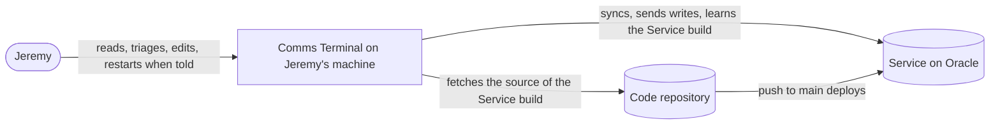
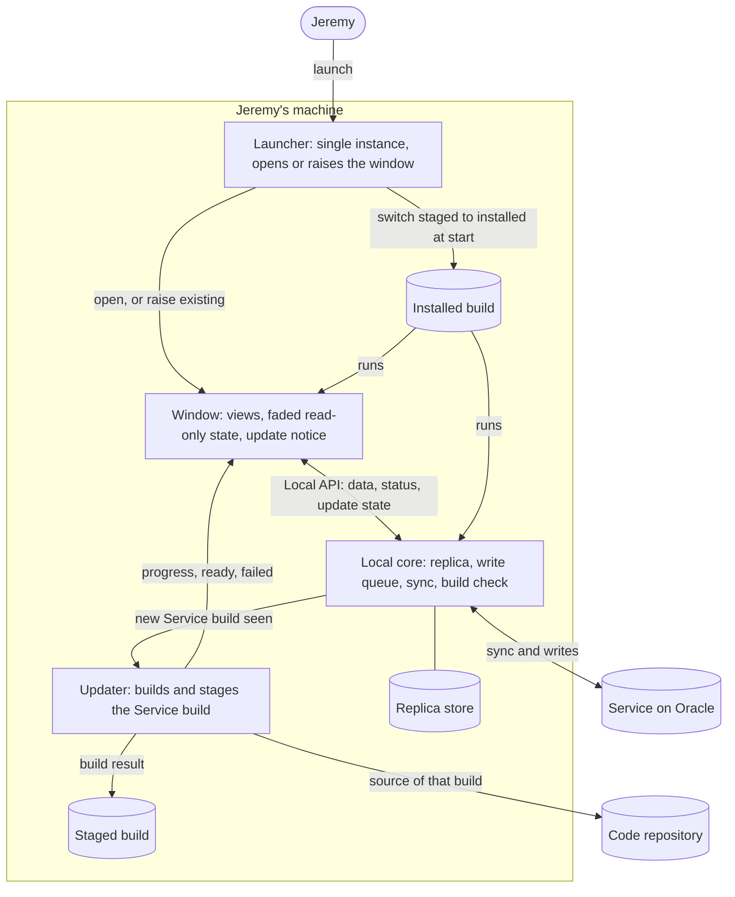
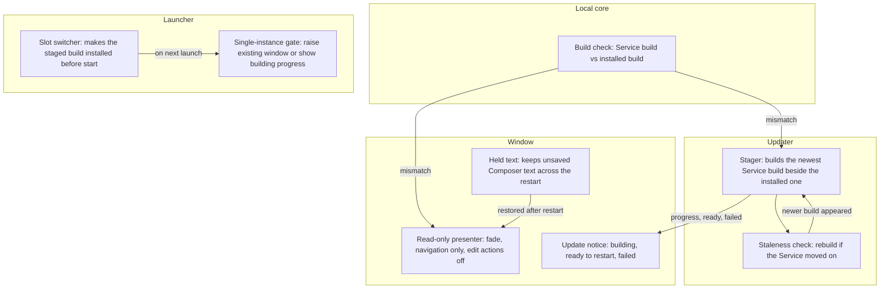

# Discovery: Client autoupdate

## 1. Status

- Current phase: complete — Phase 4 approved. Implemented and shipped through `.agents/prd/2026-11-04-app-update-on-restart.md` (PRs #30–#33).
- Gates: Seed approved 2026-11-04 · Phase 1 approved 2026-11-04 · Phase 2 approved 2026-11-04 (measure 1 revised in Phase 4) · Phase 3 approved 2026-11-04 · Phase 4 approved 2026-11-04.
- Last updated: 2026-11-04 (America/Halifax).

## 2. Context

### Seed (confirmed by Jeremy, 2026-11-04)

- **Topic:** how the client side updates after a push to `main` — the desktop App on Mani and the laptop console — not the Oracle deploy itself.
- **Trigger, in Jeremy's words:** "the autoupdate process is awkward"; it "interrupts my work and sometimes it is confusing the state of the app. sometimes i launch it from my app launcher and nothing happens".
- **Planned document:** this file.

### How it works today (source: `origin/main` at `9850622`)

1. A push to `main` deploys the Service on Oracle (`deploy/github_deploy.py`, runbook §8).
2. The Local core syncs and records the Service's build in `service-build` (`remote.py` `Syncer`, lines ~715–735).
3. A client whose build differs from the Service's turns **read-only** at once: `tui.check_copy` says "Update ready · restart Comms Terminal to load the service's version; read-only." Writes stay off until the client runs the same build.
4. **Laptop console** (`deploy/comms-terminal-local`): the console quits with exit code 75 once no write is pending and no text is held; the launcher loop exports the commit, runs `uv tool install`, and reopens.
5. **Desktop App** (`deploy/comms-terminal-app`, `app/src/window.rs` `prepare_update`): on an `update` event with no pending writes, the App runs the launcher's `--prepare` in the background (uv install of the core plus `cargo build --release` of the App), then quits with 75; the launcher stops the old core and reopens the window. A failed build leaves the App open, read-only, on its old version until the next start. (Changed on 2026-11-03 in `9a60d07`: before, the App quit at once and showed no window for minutes while it built.)
6. **Single launcher guard:** if `launch.pid` names a live process, a new launch prints "Comms Terminal App is already open or updating." to stderr and exits 0. The desktop entry has `Terminal=false`, so that message is invisible.
7. An unmerged branch, `jeremy/app-desktop-entry` (`f72368e`), makes a menu launch say it is building when it must update first.

### Frequency (source: `git log origin/main --first-parent`)

| Day | Pushes to `main` |
|---|---|
| 2026-10-28 | 10 |
| 2026-10-29 | 9 |
| 2026-10-30 | 12 |
| 2026-11-01 | 3 |
| 2026-11-02 | 2 |
| 2026-11-03 | 19 |
| 2026-11-04 (so far) | 4 |

52 of 59 pushes since 2026-10-28 touched code outside `.agents/`, `docs/`, `features/`, `tests/`, `storybook/` and Markdown; every push, including the 7 docs-only ones, produces a new Service build, so every push makes each client read-only, rebuild and restart. (Inference: a docs-only build still differs by commit hash; not yet checked whether the deployer skips such pushes.)

### Pains observed so far

| Pain | Evidence | Frequency |
|---|---|---|
| Work is interrupted: the client goes read-only, then the window closes and reopens | Jeremy, 2026-11-04; mechanism in `check_copy`, `prepare_update` | Once per push, up to ~19 a day |
| The App's state is confusing during an update | Jeremy, 2026-11-04. Related: the 2026-11-03 focus report found the window lost keyboard focus 24 s after an update reopen (`2026-11-03-app-focus-and-keys.md`) | Unknown |
| A launch from the app launcher sometimes does nothing | Jeremy, 2026-11-04. Candidate causes in source (inference, unverified on Mani): live `launch.pid` exits 0 silently; a first-start build runs before any window appears; a reused PID in a stale `launch.pid` blocks every launch | "Sometimes" |
| The read-only window lasts as long as the build | `cargo build --release` took about 10 min on the first build (PRD work log, 2026-11-01); incremental time unknown | Once per push |

### Constraints and prior decisions

- Single user, single Service; client and Service must agree on schema and command contract (ADR 0004 laptop copy, ADR 0012 latest save wins, ADR 0013 App).
- A push to `main` is the only release path; no timer, no polling (deploy `AGENTS.md`).
- Agents ship to `main` often and Jeremy approves each push.
- The desktop App is in Phase 6.2 (acceptance week) of `.agents/prd/2026-10-31-desktop-app.md`; the laptop console still exists.

### Jeremy's answers (2026-11-04)

- **Client in use:** the desktop App on Mani only. The laptop console is out of focus for this discovery.
- **What confuses:** read-only with no reason given; the window vanishes; a launch shows nothing.
- **"Launch does nothing":** the last time, the App appeared later by itself. This fits the source: a launch during an update build hits the live `launch.pid`, exits silently, and the running launcher opens the window when the build ends.

### Analogues

- **Update on next start** (Jeremy's pick): like VS Code or Slack, the new version downloads and builds in the background while he keeps working with writes on; it applies when he restarts or the App is idle.
- Considered and not picked: invisible hot swap (web app), fewer updates (only when client code changes), prompted restart (Chrome-style badge).
- Tension (inference): today a client on an older build cannot write to a newer Service (`check_copy`). "Keep working with writes on" needs the old client and the new Service to agree on what they exchange.

### Open unknowns

- How long an incremental App build takes on Mani (Mani unreachable on 2026-11-04).
- Which pushes actually change what the client and Service exchange (schema, commands, sync format); how often an old client could safely keep writing.

## 3. Problem

### Statement (approved 2026-11-04)

Jeremy, working in the desktop App on Mani, loses writes, sees the window vanish and reappear, and gets no window when he launches it, after every push to `main` (about 8 a day, 19 on 2026-11-03). This happens because the App must run exactly the Service's build, so it rebuilds and restarts itself to match. The result is interrupted triage and doubt about whether the App crashed or an action saved.

Evidence: Phase 1 pains table; `tui.check_copy`, `window.rs` `prepare_update`, `deploy/comms-terminal-app` launch guard.

### Scope (approved 2026-11-04)

- **In scope:** the App on Mani, from "the Service has a new build" to "the App runs the new build": the read-only gate, the background build, the restart, a launch during a build, and what the App shows throughout.
- **Out of scope:** the Oracle deploy pipeline; the Console on the laptop; distribution to other users or macOS.
- **Lever, not problem:** how often agents push to `main` may be an approach in Phase 3.

### Success measures (approved 2026-11-04)

1. ~~A routine push causes 0 minutes of read-only.~~ Revised 2026-11-04 in Phase 4: read-only always looks read-only (the App fades and navigation still works) and says a restart is needed; the window never vanishes on its own.
2. The window never closes on its own while Jeremy uses it; an update applies at the next start or when the App is idle.
3. Every launch shows a window or a visible status within 2 seconds.
4. Whenever writes are off, the App says why and what comes next.
5. Guardrail: an App on an older build never writes something the newer Service misreads.

## 4. Glossary

Existing `GLOSSARY.md` terms used as defined there: **Service**, **Client**, **App**, **Local core**, **Local API**, **Problem** (the bottom-bar state).

- **Service build:** the commit the Service on Oracle runs, reported to the Local core at each sync.
- **App build:** the commit the installed App and Local core were built from; both always come from one commit.
- **Update:** the App and Local core installing a newer Service build and switching to it.
- **Service contract:** what the Local core and the Service exchange: the laptop copy's schema, the write commands, and the sync format. Named "Service contract" because `GLOSSARY.md` already calls the Local API "the Local core's published contract".
- **Contract change:** a push that changes the Service contract.
- **Routine push:** a push to `main` that leaves the Service contract unchanged.

## 5. Approaches

Depth: **deep** (Jeremy, 2026-11-04). A background research agent could not run (auto mode could not review the call), so the survey below was done directly with web search; sources are listed in §12.

### Frameworks

| Framework | Mechanism | Fit here |
|---|---|---|
| **Parallel change (expand, migrate, contract)** — Fowler; Thoughtworks Radar "API expand/contract" | Change an interface in three steps: the server accepts old and new, clients move, then the old form is removed. An alternative to explicit API versions. | Lets an older App keep writing through a Contract change if the Service accepts the old form for a while. |
| **Contract version with a supported range** — Zero `schemaVersions` (min/max), Replicache `schemaVersion`, `pushVersion`, `pullVersion` | The client sends its contract version on every push and pull; the server accepts any version in its range and rejects others with a specific error, which triggers the update path. | Replaces "exact build match" with "Service contract in range". Routine pushes stop gating writes. |
| **Grow-only command set** — Replicache mutator guidance; this repo's Local API ("an OpenRPC document that only grows") | Names of write commands only ever get added; changed meaning gets a new name. | Already the rule for the Local API; not yet for the Local core-to-Service write commands. |
| **Minimum supported client version / forced update** — Firebase Remote Config minimum version; server-side `required_version` pattern | The server holds a floor; clients below it must update before working; everything above works. Practitioners separate "minimum supported" from "latest", so not every release forces an update. | The floor is the Contract change; routine pushes leave the floor alone. |
| **Background download, apply on restart** — VS Code `update.mode`, Zed auto-update, Slack, Chrome | Fetch and stage the new version while the old one runs; switch at the next start or when the user clicks "restart to update". | Jeremy's chosen analogue. |
| **Escalating relaunch notice** — Chrome `RelaunchNotification` (recommended vs required) with `RelaunchNotificationPeriod` | A quiet notice first; after a period, a stronger one or a required relaunch. | Bounds how long an older App lingers. |
| **Version locking / skew protection** — Vercel Skew Protection | Every request carries the deployment ID; the platform keeps serving the old deployment to old clients for a maximum age, then reloads them. Vercel says it does not remove skew for backends. | Needs two Service builds against one live database; heavy for a single-writer Service. |
| **Single-instance handoff** — Electron `requestSingleInstanceLock` and `second-instance` | A second launch hands off to the first, which raises or recreates its window; the second exits. | Fixes "launch does nothing": the second launch shows the running window or the build's progress. |
| **Release train / batching** | Ship on a fixed cadence instead of every merge. | Reduces how often updates happen; does not change what an update does. |
| **Prebuilt artifacts, dual-slot install** | Build once centrally; clients download a binary into an inactive slot and switch atomically. | Shrinks a minutes-long local build to a download. |

### Reference cases

1. **Rocicorp Zero / Replicache (local-first sync engine).** Closest structural match: a local replica with a write queue syncing to one server. The schema carries a version; the server keeps a min/max supported range. Compatible schema changes sync to running clients, which keep working; incompatible ones close the connection with a specific error code. By default the client reloads at once; apps can pass `onUpdateNeeded` to show a banner and reload when ready. Recommended rollout order: expand, deploy client, then contract. Mutator names should only grow; an unknown mutator becomes a no-op. *How it went:* the docs offer `onUpdateNeeded` precisely because the instant reload interrupts users (inference from the API's stated purpose).
2. **Zed (native Rust editor, GPUI — the same UI framework as the App).** Checks and downloads in the background; applies at the next restart; a "restart to update" button sits in the title bar (moved there from the status bar in PR #48467). *How it went:* a regression hid the update status, so users closed the app mid-update without knowing (fix #53552); a user lost unsaved buffers when clicking "restart to update" (discussion #30665); on Windows the restart button sometimes did nothing the first time (#40521).
3. **Vercel Skew Protection (web deployments).** Pins each client to the deployment it loaded; serves old deployments for a configurable maximum age; a mismatch on navigation triggers a full reload; a threshold can cut off bad deployments. *How it went:* Vercel states it does not remove skew for backend services, which still must tolerate older clients.

Also noted: VS Code exposes `update.mode` (`default`, `start`, `manual`, `none`) and a "Restart to Update" item; Slack shows a badge and a restart card; Chrome escalates a relaunch notice over a period (7 days by default). Searches for Linear's desktop version-skew handling and Figma's reload banner found nothing authoritative.

### Stack fit (source: `origin/main`)

- The Service already reports `build` at each sync; the Local core already compares `PRAGMA user_version` to `SCHEMA_VERSION` (35) and the build (`core.py` ~902–908) and publishes an `update` event.
- The Local core already keeps writes in an in-order queue with mutation IDs replayed until confirmed (ADR 0012), and the Service's sync answer is authoritative, so a local copy that applied a write with older logic is corrected by the next sync.
- The Local API already follows grow-only (`GENERATION`, OpenRPC "only grows").
- The App already builds in the background and stays usable (`--prepare`, `9a60d07`); `launch.pid` already detects a running launcher.
- Contract-change rate (inference from file history since 2026-10-20): 12 of 117 pushes bumped `SCHEMA_VERSION`; 25 of 117 touched `writers.py`, `remote.py`, `serve.py` or `schema.sql`. So roughly 10–20% of pushes are plausible Contract changes and 80–90% are routine. Writer signature changes elsewhere are not counted, so the true share may be higher.

### Approach set (rung order, boring first)

| Approach | Rung | Adoption evidence | New moving parts | Extra cost | Measures moved | Assumptions and risks |
|---|---|---|---|---|---|---|
| **A. Release train:** using batching, agents merge to `dev` and `main` moves once or twice a day at a time Jeremy picks | 1 No build | Common release practice | None in code; a habit and a promotion step | Slower delivery of fixes; Jeremy decides when | None fully; cuts frequency of 1, 2, 4 from ~8 to 1–2 a day | Conflicts with ship-on-approve flow; read-only, vanish and silent launch remain on each release |
| **B. Honest lockstep:** using single-instance handoff and Chrome-style notices, keep exact-build matching but fix what Jeremy sees: a second launch raises the window or shows "building"; the bar says why writes are off and how far the build is; the window restarts only when idle or at next start | 2 Stack | Electron/Signal single-instance; Zed title-bar notice | Launcher handoff, idle detector, progress in bar | Small | 2, 3, 4 | Read-only still lasts the whole build (1 fails); idle restart can still surprise |
| **C. Contract range plus apply-on-restart:** using the Zero/Replicache contract version and VS Code/Zed staged update, the Service reports a Service contract version and a supported range; the Local core keeps writing whenever its version is in range; the new build is staged in the background and applied at next start or when idle; only a Contract change outside the range turns writes off, with a clear notice | 3 Popular | Zero, Replicache, Firebase minimum version, VS Code, Zed | Contract version number and range; a check that bumps it when the contract changes; staged install | Discipline to bump the version; a test to catch a missed bump | 1, 2, 3, 4, 5 | A missed bump lets an older App write something the Service misreads (guardrail 5); needs a reliable bump check |
| **D. C plus parallel change:** using expand/contract, Contract changes also keep old commands working for a window, so even they rarely turn writes off | 3 Popular | Fowler, Thoughtworks, Zero's expand-deploy-contract order | Old-and-new handling in the Service per change; a contract step later | Per-change work, often for a single user | 1 even on Contract changes | Effort spent for one App on one machine; a skipped contract step leaves debt |
| **E. Prebuilt App:** using central builds and dual-slot install, each push builds the App once (on Oracle or Workbox) and Mani downloads it into an inactive slot, then switches atomically | 3 Popular | Every commercial desktop updater | A build host and target for Mani's platform; artifact storage and download | Build host time; a second architecture if Oracle stays ARM | Shortens the read-only window in B or the staging in C from minutes to seconds | Oracle is ARM; Mani's architecture must be built somewhere; complements B or C rather than replacing them |
| **F. Skew protection:** using Vercel-style version locking, the Service keeps the previous build answering older clients for a maximum age | 4 Custom | Vercel; uncommon for single-writer databases | Two Service builds against one live database, migration coordination | High | 1 | A schema migration breaks the old build against the new database; lower rungs cover the need |

Early concerns, not eliminations: A does not touch the mechanism; B leaves measure 1 unmet; F fights the single-writer design.

## 6. Deciding questions

Ordered most eliminating first.

| # | Question | Plausible answers and effect | Answer (Jeremy, 2026-11-04) |
|---|---|---|---|
| 1 | Is read-only itself the pain? | Yes: favors keeping writes on across pushes (contract range, expand/contract). No: the pain is how the update looks and behaves; keeping exact-build matching stays viable. | **No.** "its ok to have the app be read-only, that isn't the problem. you could even fade the entire app when a restart is required and only allow navigation". Measure 1 revised. |
| 2 | When should a staged update apply? | Next start plus idle: needs an idle detector and state restore. Next start only: no self-restart at all. A restart button: Zed-style. | **Next start only.** |
| 3 | With exact-build matching and next-start-only, every push fades the App until a restart (~8 a day). Acceptable, or fade only on incompatible pushes? | Every push: keeps exact-build matching; contract range not needed. Only incompatible: needs a Service contract version that agents bump. | **Every push is fine.** Eliminates the contract range and expand/contract approaches. |
| 4 | Keep shipping to `main` on each approval, or batch releases? | Keep: release train dropped. Batch: add it alongside. | **Keep shipping.** Release train dropped. |
| 5 | Add a build host for prebuilt App binaries? | Yes: adds a build host. Not now: local background builds stay. | **Not now.** |

Answered from the environment: Mani's architecture and incremental build time could not be read (Mani unreachable); neither changes the choice now.

## 7. Decision

**Chosen strategy: honest lockstep.** Keep the rule that the App and Local core run exactly the Service build. Change only how the update looks and when it applies:

1. **Build in the background, stage, never self-close.** When the Service reports a new build, the App goes read-only at once and builds the new version in the background. It never quits or restarts on its own; the staged build applies at the next start.
2. **Make read-only obvious.** While read-only, the whole App fades, navigation keeps working, and every edit action is unavailable. The bar says which step it is in: building the update, update ready (restart to edit), or the update failed (with where to look).
3. **Every launch shows something within 2 seconds.** A launch while the App is open raises the existing window. A launch that must build first shows that it is building and how it is going, instead of nothing.
4. **Restart is quick.** Because the build is staged, the next start switches to it without a build wait.

**Rationale.** Jeremy said read-only is acceptable and ~8 restarts a day are fine, so the costlier approaches that keep writes on buy nothing he values. The remaining pains (window vanishes, unclear state, silent launch) are all about presentation and timing, which this strategy targets directly. It keeps measure 5 (an older App never writes something the newer Service misreads) by construction.

**Rejected approaches.**

- *Release train:* Jeremy keeps shipping on each approval (Q4).
- *Service contract range with apply on restart:* its benefit, writes across routine pushes, is not wanted (Q1, Q3); it would add a version number agents must remember to bump.
- *Contract range plus expand/contract:* same reason, with more work per change.
- *Prebuilt App binaries:* not now (Q5); the build runs hidden in the background. Revisit if first-start builds or the build-before-window wait hurt.
- *Skew protection:* two Service builds against one live database; fights the single-writer design.

**Trade-offs accepted.** The App is read-only from each push until Jeremy restarts, possibly several times a day. Edits wait for a restart. A failed build leaves the App read-only until a fixing push lands.

## 8. Validation

### Riskiest assumptions

| Assumption | Evidence now | Evidence missing |
|---|---|---|
| Restarting up to ~8 times a day is acceptable | Jeremy's answer (Q3) | Acceptance-week experience; if it grates, the contract range approach is the fallback |
| A staged restart is fast | The launcher already skips the build when the installed build matches (`deploy/comms-terminal-app` `update`) | App and core start time on Mani (unreachable 2026-11-04) |
| Staging does not disturb the running App and Local core | None. Today `--prepare` reinstalls the core in place (`uv tool install --reinstall`) while the old core still runs, then stops it (`stop_core`). With next-start-only, the old App keeps running on a core that may be stopped or replaced (inference) | Whether the staged build must live beside the running one and switch only at start |
| A second launch can find and raise the running window on Mani's desktop | Single-instance handoff is standard (Electron `second-instance`); `launch.pid` already detects the running launcher | How the App exposes "raise" to a second launch on niri |
| Fading blocks every write path without losing typed text | The Console already holds text it could not save (`tui` `held`) | Same behavior in the App's Composer and Panels |

### Scenario walk-through

| Scenario | How the strategy handles it | Where it bends |
|---|---|---|
| Jeremy is triaging when a push lands | App fades at once; bar says it is building; then "Update ready · restart to edit". Navigation and reading continue. | Between the push and the build ending, a restart does not help yet; the bar must say so. |
| Jeremy is typing a reply when a push lands | The Composer keeps the text; save waits until the restart onto the new build. | Typed text must survive the restart (risk). |
| Jeremy launches from the app launcher while the App is open | The existing window comes forward. | Needs a raise path on niri. |
| Jeremy launches when no window is open and a build is needed | A window or notice appears within 2 s and shows the build's progress; the App opens when ready. | First install still takes the full build (~10 min first time). |
| The build fails | App stays faded; bar says the update failed and where the log is; the old build stays installed. | Read-only lasts until a fixing push. |
| Two pushes land during one build | The first build finishes and is staged; the second push makes the staged build stale. | The stager must notice and build the newest; otherwise the restart builds before opening (bends to the "launch must build" scenario). |
| Jeremy reopens the App next morning | Staged build opens at once; writes on. | — |

## 9. Architecture (abstract)

### L1 Context

### L2 Container

### L3 Component (Updater, Launcher and Window — where the risks sit)

## 10. Open risks and unknowns

| Item | Impact | Next evidence needed |
|---|---|---|
| Staging in place disturbs the running Local core | Old App loses its core or loads mixed code mid-session | Read the core's lazy imports and the launcher's install path; test staging beside the installed build |
| Raising the running window from a second launch on niri | "Launch does nothing" persists | Check what the App and niri support for activation |
| Unsaved Composer text across a fade and restart | Lost reply text | Exercise typing during an update in an isolated App instance |
| Restart frequency grates in practice | Strategy no longer fits | Acceptance-week feel; fallback is the Service contract range approach |
| Startup time of a staged build on Mani | Restart feels slow | Measure on Mani when reachable |
| Two pushes during one build | Restart has to build before opening | Stager re-checks the Service build when it finishes |
| Unmerged `jeremy/app-desktop-entry` (`f72368e`) overlaps the launch-feedback piece | Duplicate or conflicting work | Decide whether to fold it in |

## 11. Decision log

| Date | Request or decision | Source | Status | Supersedes |
|---|---|---|---|---|
| 2026-11-04 | Seed: client-side update (App and laptop console), not the Oracle deploy | Jeremy, structured question | Approved | — |
| 2026-11-04 | Focus on the desktop App on Mani; laptop console out of focus | Jeremy, structured question | Approved | Seed's "App and laptop console" |
| 2026-11-04 | Phase 1 approved | Jeremy, structured question | Approved | — |
| 2026-11-04 | Problem statement, scope, success measures approved; term "Contract" adopted, recorded as "Service contract" to avoid clashing with the Local API's definition | Jeremy, structured question | Approved | — |
| 2026-11-04 | Phase 3 survey depth: deep | Jeremy, structured question | Approved | — |
| 2026-11-04 | Phase 3 approach set approved | Jeremy, structured question | Approved | — |
| 2026-11-04 | Process correction: questions must not refer to approach letters; describe options in plain words | Jeremy: "i don't know the letters, explain context without giving them" | Applied | — |
| 2026-11-04 | Read-only is not the pain; fade the App with navigation only when a restart is required | Jeremy, structured question (free text) | Approved | Success measure 1 |
| 2026-11-04 | Success measure 1 replaced: read-only looks read-only and says a restart is needed; the window never vanishes | Jeremy, structured question | Approved | Measure 1 "0 minutes of read-only" |
| 2026-11-04 | Apply updates at next start only; every push fading the App is fine; keep shipping each approval; no prebuilt binaries now | Jeremy, structured questions | Approved | — |
| 2026-11-04 | Recommended strategy: honest lockstep | Claude, from Q1–Q5 | Approved at Phase 4 gate | — |
| 2026-11-04 | Phase 4 approved: strategy, diagrams, open risks | Jeremy, structured question | Approved | — |
| 2026-11-04 | Prebuilt App binaries reopened and chosen: CI publishes each build of `main`; Mani downloads and compiles nothing ("lets revisit this", "no building, migrate fully to the new system") | Jeremy, after 10-minute builds on Mani | Shipped in PR #33 (see the PRD's Phase 4) | Q5 "Not now"; rejected approach "Prebuilt App binaries" |

## 12. Sources

- `origin/main` at `9850622`: `deploy/comms-terminal-app`, `deploy/comms-terminal-app.desktop`, `deploy/comms-terminal-local`, `app/src/window.rs`, `src/comms_terminal/remote.py`, `src/comms_terminal/tui.py`, `docs/runbook.md` §8.
- Commits `9a60d07`, `4b02e1d`; unmerged `f72368e`.
- `.agents/prd/2026-10-31-desktop-app.md`, `.agents/discovery/2026-11-03-app-focus-and-keys.md`.
- Web (2026-11-04): [Fowler, Parallel Change](https://www.martinfowler.com/bliki/ParallelChange.html); [Thoughtworks Radar, API expand-contract](https://www.thoughtworks.com/en-cl/radar/techniques/api-expand-contract); [Zero migrations](https://zero.rocicorp.dev/docs/migrations); [Replicache class docs](https://doc.replicache.dev/api/classes/Replicache); [Replicache options](https://trunk.doc.replicache.dev/api/interfaces/ReplicacheOptions); [Replicache releases](https://github.com/rocicorp/replicache/releases); [Zed update docs](https://zed.dev/docs/update.md); [Zed title-bar update button #48467](https://git.secluded.site/zed/commit/191b4ccd4fce447bf3fb50030b84ee0308af7548); [Zed status fix #53552](https://git.secluded.site/zed/commit/1fcf9749a6ed384ae346ddf2049ae76e0cc430a9); [Zed buffer loss discussion #30665](https://github.com/zed-industries/zed/discussions/30665); [Zed restart issue #40521](https://github.com/zed-industries/zed/issues/40521); [VS Code enterprise updates](https://code.visualstudio.com/docs/enterprise/updates); [Vercel Skew Protection](https://vercel.com/docs/skew-protection); [Vercel launch post](https://vercel.com/blog/version-skew-protection); [Chrome relaunch policy](https://support.google.com/chrome/a/answer/7679871); [Chromium upgrade detector](https://chromium.googlesource.com/chromium/src/+/HEAD/chrome/browser/upgrade_detector/upgrade_detector.h); [Slack desktop update](https://slack.com/help/articles/360048367814); [Firebase minimum version](https://firebase.google.com/docs/remote-config/use-cases/minimum-version); [Lendable forced update](https://careers.lendable.com/blog/articles/a-better-forced-update-approach); [Electron single instance (browser-use PR 398)](https://github.com/browser-use/desktop/pull/398).
- Searched without an authoritative result: Linear desktop version-skew handling; Figma reload banner; Electron `quitAndInstall` with single-instance lock.
- Mermaid diagrams render with `@mermaid-js/mermaid-cli@11.4.2` (all three OK, 2026-11-04).
- Limit: Mani was unreachable over SSH on 2026-11-04 ("No route to host"), so the App's log, `launch.pid` and install state were not inspected.
