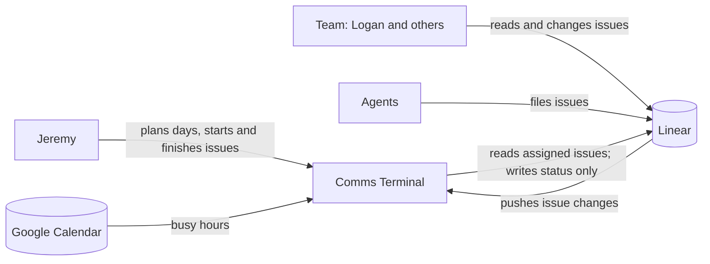
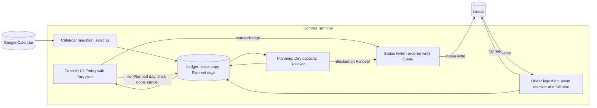
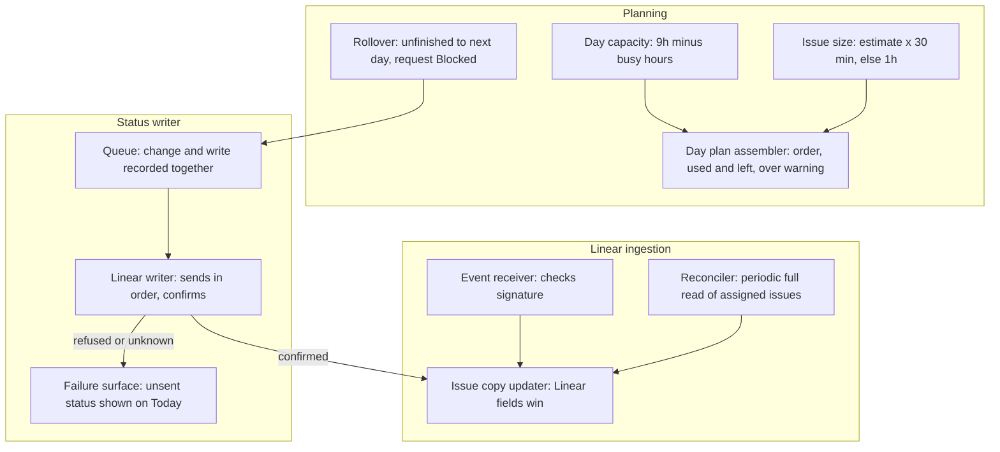

# Discovery — Linear issues in Comms Terminal

Topic reframed 2026-11-07 from "Daily scheduling of Linear issues" (see decision log). File name kept.

## 1. Status

| Phase | Gate | Date |
|---|---|---|
| Seed | approved (with corrections) | 2026-11-07 |
| 1 Context and problem discovery | approved | 2026-11-07 |
| 2 Problem definition | approved | 2026-11-07 |
| 3 Approaches | approved | 2026-11-07 |
| 4 Strategy convergence | approved | 2026-11-07 |

Last updated: 2026-11-07 (America/Halifax).

## 2. Context

### Seed (confirmed 2026-11-07)

- **Topic:** planning which day, and which calendar time block, Jeremy works each Linear issue, kept separate from priority and due date.
- **Trigger:** pasted advice: "Linear handles priority and due dates natively. The missing piece is the planned date." Jeremy's correction: include time blocks; "i want to essentially implement sunsama in comms terminal".
- **Early solution ideas (Phase 3 candidates, not decisions):** Sunsama-style planner inside Comms Terminal (Jeremy); Linear Today label plus weekly cycles; Sunsama or Akiflow; Super Productivity (from the paste).
- **Sibling discovery:** `.agents/discovery/2026-11-07-linear-focus.md` covers focus across all Linear issues. Jeremy chose to gather this topic's context fresh.
- **Document path:** this file.

### Facts from Linear (read 2026-11-07, `list_issues assignee=me`, first 250 results; more pages exist)

- 57 active assigned issues (backlog, unstarted or started).
- **Due date** set on 19 of 57.
- **Estimate** set on 0 of 57. No time-size signal exists today.
- **Priority:** 23 No priority, 3 Urgent, 15 High, 12 Medium, 4 Low.
- **Cycles:** Business team uses none (36 issues, 0 in a cycle); Engineering has 16 of 21 in a cycle.
- **Labels:** only Feature and Bug in use; no scheduling label.
- Linear has no planned-date field on issues (issues have a due date; projects have start and target dates). Inference from Linear's field list; `fields` enum of the MCP shows no planned or start date for issues.

### Facts from Comms Terminal (code at `chore/checkout-paths`, read-only)

- **Calendar page** lays out Calendar Items: Events, Tasks on their day, waking Snoozes, scheduled Drafts, Enrollment starts (`GLOSSARY.md` §Calendar).
- **Block** is an existing concept: a timed Event with no other attendees (focus time, lunch). Every Block already has a Thread that goes to Todo when it ends (`GLOSSARY.md`).
- **Google Calendar reads** come from a secret iCal feed (`src/comms_terminal/calendar.py`); the only write is Respond (`src/comms_terminal/gcal.py:1-2`, ADR 0009). The OAuth scope is full calendar access (`scripts/oauth_google.py:24`, Jeremy 2026-10-27), so event creation would not need a new sign-in (inference).
- **Linear** is a read-only Context source: the client refuses any mutation (`src/comms_terminal/linear.py:42`).
- **Today page** stacks Todo Threads, due Tasks and Drafts on one page (`.agents/prd/2026-10-17-today-view.md`, delivered).
- **Sequence Tasks** already have a day (they appear on the Calendar on their day).

### Facts from memory

- April 2026: calendar focus blocks were mapped to Business Linear issues; Linear owned task state, the calendar owned scheduling (`~/.memory/2026-04-23-[pref]-adhd-workday-structure.md`).
- Missed blocks get moved, not deleted; a repeated slip prompts "what is in the way?" (`~/.memory/2026-04-23-[pref]-morning-slip-detection.md`).
- ADHD structure: at most three immediate items per category; batch by task type; long focus blocks (same file).
- Super Productivity used June–July 2026 with a local REST API; `dueDay` means planned day, `deadlineDay` means deadline (`~/.memory/2026-06-01-[tool]-super-productivity-local-rest-api.md`). Current use unknown.
- Linear writes by agents need an exact approved change set (`~/.memory/IDENTITY.md`, Linear Rules).

### Analogue: Sunsama (public sources, 2026-11-07)

- **Rituals.** Guided daily planning (pick today's work, defer the rest); daily shutdown to review and reflect; unfinished tasks roll over automatically or by prompt, configurable by priority. [Daily Planning](https://help.sunsama.com/docs/daily-planning), [daily planning and shutdown](https://www.sunsama.com/features/daily-planning-and-shutdown), [shutdown changelog](https://roadmap.sunsama.com/changelog/daily-shutdown)
- **Timeboxing.** Dragging a task onto the calendar, or auto-schedule, creates a real event on the underlying calendar; sync is two-way. [Timeboxing: the basics](https://help.sunsama.com/docs/timeboxing-the-basics), [Calendar Integration](https://help.sunsama.com/docs/calendar-integration)
- **Linear.** Browse and import issues as tasks with the issue embedded; optional prompts set Linear status on import (to Doing) and on completion (to Done). [Linear Integration](https://help.sunsama.com/docs/linear-integration), [Interacting with imported issues](https://help.sunsama.com/docs/linear-interacting-with-imported-tasks), [Linear: Sunsama](https://linear.app/integrations/sunsama)
- **Workload.** Planned time and actual time per task; warning when planned time exceeds the day's threshold. Focus Mode shows one task. Secondary sources: [Asian Efficiency review](https://www.asianefficiency.com/schedule-management/sunsama-review/), [Morgen pricing](https://www.morgen.so/blog-posts/sunsama-pricing)
- **Price.** About USD 16–25 a month; sources disagree. [Morgen](https://www.morgen.so/blog-posts/sunsama-pricing), [Super Productivity comparison](https://super-productivity.com/blog/best-sunsama-alternatives-2026/)
- Unverified: whether Sunsama writes a planned date back to Linear (no source found).

### Analogue: Jeremy's own Super Productivity plugins (Mani `~/Workspace`, read 2026-11-07)

Jeremy: "superproductivity has custom plugins by me that i really liked".

- **SuperPlan** (`super-productivity-custom-autoplan`, releases 0.1.0–1.0.7, last commit 2026-08-14). Turns active estimated tasks into a capacity-aware **day** plan. Day capacity is the working day minus fixed Meetings and calendar Events. Ranks by explainable urgency (task order, deadline pressure, feasibility, project and tag weights, start penalty, age). Requires an estimate; missing estimates are warnings. Oversized tasks land on today as attention items. Warns when deadline work lands after its deadline. Preview, apply, undo. Deliberately **day-level**: "no exact time blocks for flexible work". Writes `scheduledDay` and clears `dueWithTime`. Has a Cucumber `provider_tasks.feature`.
- **SuperPlan principles** (`~/.memory/2026-05-02-[tool]-superplan.md`): Jeremy chooses the work, the planner makes it believable; intended plan beside actual state; no silent omission (imported Linear tasks included); capacity before convenience; preview before mutation.
- **Linear in Super Productivity.** SuperPlan once excluded 49 imported Linear/BIZ tasks; Jeremy rejected that default (`~/.memory/2026-06-13-[meta-reasoning]-superplan-provider-default-exclusion.md`). So Linear issues were imported into Super Productivity in June.
- **Other plugins:** Gmail email due provider (Gmail messages become tasks), Lemlist task provider (0.2.0–0.3.6), stale task closer, copy-for-AI hotkey. Comms Terminal now covers Gmail and outreach Tasks (inference).

### From Jeremy (ask-tool, 2026-11-07)

- **Today's workflow:** "Picked from the list" — no plan; he opened Linear and chose in the moment.
- **Sunsama parts wanted:** timebox to calendar; rollover and shutdown; capacity warning. Not chosen: the guided morning plan ritual.
- **Scope of the plan (solution idea, Phase 3 candidate):** "bring superproductivity and sunsama into comms terminal and have linear 2-way sync".
- **Visibility:** only Jeremy sees the plan; the team sees Linear status only.

### From Jeremy (round 2, 2026-11-07)

- **Why Super Productivity stopped:** "Comms Terminal took over". Email and outreach moved to the console, so a second app was not worth keeping.
- **Day versus time:** "Day plan only". This resolves the conflict with SuperPlan's day-level design in SuperPlan's favour and supersedes the seed's "include time blocks" and the round-1 "timebox to calendar".
- **Plugins worth keeping:** SuperPlan. The Gmail and Lemlist providers are already superseded by Comms Terminal.
- **On finish or slip:** status goes back to Linear. "linear issues are like tana or attio - linear stays the source of truth."

### Phase 1 summary

- **Actors.** Jeremy plans and executes. The team reads Linear status only; the plan is private.
- **Current workflow.** No plan. He opens Linear and picks from about 57 issues in the moment.
- **Pains.** No planned day exists anywhere; no estimates (0 of 57), so no capacity check; due dates on 19 of 57 with nothing tying them to a day; Linear status lags.
- **Frequency.** Every time he picks work (daily).
- **Constraints.** Linear is the source of truth for issues. Comms Terminal reads Linear read-only today. Agent writes to Linear need an approved change set. The plan is visible only to Jeremy.
- **Analogues.** SuperPlan (capacity-aware day plan, explainable ranking, preview, apply, undo; dropped only because the console took over Super Productivity's other jobs). Sunsama (rollover, shutdown, capacity warning; timeboxing now out).
- **Open unknowns.** Whether estimates are acceptable this time; what "Status to Linear" covers (started and done only, or more); whether comms Threads and Tasks share the day plan.

## 3. Problem

**Statement (approved 2026-11-07).** Jeremy works comms in Comms Terminal but his ~57 Linear issues only in Linear's list. There he cannot plan which day to do each, see if a day is overloaded, or catch slips, so he picks in the moment and status lags. He wants to manage his issues in the console, as Super Productivity and Sunsama let him, with Linear staying source of truth.

Evidence: §2 Linear facts (0 estimates, 19 due dates, 4 past due, 9 due within a week), Jeremy's answers, SuperPlan and Sunsama analogues.

**Scope (approved 2026-11-07).** Jeremy first answered "not sure"; he approved the recommendation drawn from Sunsama and SuperPlan, which both stop at see, plan and status.

- **In:** Jeremy's assigned Linear issues in the console; a planned day per issue; a capacity warning; rollover of unfinished issues; an end-of-day shutdown; start, done and cancel written back to Linear.
- **Later:** editing fields (priority, due date, project), creating issues, comments.
- **Out:** time blocks; the team's workflow; replacing Linear.
- **Non-goals:** zero issues; automatic choice of what matters (Jeremy chooses; the plan makes it fit).

**Success measures (approved 2026-11-07).**

| # | Measure | Baseline (2026-11-07) |
|---|---|---|
| 1 | Each workday has a day plan within capacity, or a visible warning | No plan |
| 2 | Every issue he intends to do has a planned day; the rest are explicitly unplanned | No planned days |
| 3 | Unfinished work rolls forward; every due date gets do, move or drop before it passes | 4 past due |
| 4 | Linear status true the same day | Completions land in batches |
| 5 | Planning under 10 minutes a day (Shutdown removed 2026-11-07) | Not measured |
| 6 | Still used after 4 weeks | Super Productivity dropped when the console took over its other jobs |

**Capacity (approved 2026-11-07, revised same day).** Jeremy first chose "count items, not hours", then set: "each issue is 1h by default unless an estimate over rides it. my daily capacity is 9h - number of busy blocks on my cal". Read as 9 hours minus busy calendar time (inference; confirm at gate).

**Rollover (Jeremy, 2026-11-07).** "auto to next day, change status to blocked". **Slip** with Linear following outside changes: an issue marked Done in Linear shows done on its day; one reassigned leaves the plan with a note.

**Resolved at Phase 2 (2026-11-07).**

- **Slip sets Linear status Blocked.** I wrongly said no Blocked status existed (from the sibling doc's partial list). Jeremy corrected it; live `list_issue_statuses` confirms **Blocked** (type unstarted) on both Business and Engineering. Accepted trade-offs: the team sees Blocked on a slipped issue; a started issue that slips drops back to an unstarted type. In this doc "Blocked" means the Linear status; `GLOSSARY.md` "Blocked" (an Identity) is a different term.
- **Busy time** subtracts its hours: 3 hours of Meetings leaves 6 hours.
- **Estimate:** 1 Linear point counts as 30 minutes (Jeremy, 2026-11-07, superseding "1 point = 1 hour" the same day). The 1-hour default equals 2 points.

## 4. Glossary

Approved 2026-11-07.

| Term | Definition |
|---|---|
| Issue | A work item assigned to Jeremy in an Issue provider. The provider owns it and every field on it; the console shows it and writes only its status. _Avoid_: Task (a Sequence Task), Case, Ticket. |
| Issue provider | An outside tracker whose Issues the console keeps a copy of and writes status back to, with its own status and estimate mapping: Linear now, Jira later. The provider is the source of truth. _Avoid_: Context source (read-only), Platform (messages). |
| Planned day | The day Jeremy intends to work an Issue. Local only: never sent to any Issue provider and never the provider's due date. |
| Day plan | The Issues with one Planned day, in Jeremy's order. |
| Day capacity | How much a Day plan holds on a workday: 9 hours minus busy calendar hours. Each Issue counts 1 hour unless its estimate overrides it (Linear: 1 point = 30 minutes). Weekends hold none unless Jeremy plans there. |
| Unplanned | An active Issue with no Planned day. |
| Rollover | Automatic move of an unfinished Issue's Planned day to the next workday; the provider's mapped slip status (Linear: Blocked) is written back. |
| ~~Shutdown~~ | Removed 2026-11-07 ("No Shutdown"). |

## 5. Approaches

Depth: **deep** (Jeremy, 2026-11-07).

### 5.1 Frameworks and patterns

| Framework or pattern | Mechanism | Evidence | Fit |
|---|---|---|---|
| Intentional daily planning with shutdown (Sunsama's method) | Choose today's work from all sources; defer the rest; end the day with a review that rolls work forward. | Sunsama's core product and docs. [Daily Planning](https://help.sunsama.com/docs/daily-planning), [daily planning and shutdown](https://www.sunsama.com/features/daily-planning-and-shutdown) | Matches Rollover and Shutdown. Jeremy did not pick the guided morning ritual. |
| Capacity planning with a buffer (planning fallacy) | Plans sit near best case (Kahneman and Tversky); subtract fixed commitments and a reserve; when over, move or drop rather than shrink estimates. | [Big Think on the planning fallacy](https://bigthink.com/the-learning-curve/the-planning-fallacy-and-how-to-get-back-on-track/), [Hubstaff](https://hubstaff.com/blog/planning-fallacy/), [Ellie capacity guide](https://ellieplanner.com/productivity-guides/how-many-tasks-per-day) (practitioner, not validated) | 9 hours minus busy hours, 1-hour default. No buffer chosen yet. |
| Explainable ranking (SuperPlan) | Additive urgency from order, deadline pressure, feasibility, project and tag weights, age. | Jeremy's own plugin, 1.0.7 releases. | Optional; Jeremy chooses the work. |
| System of record with a local read model | The outside system owns the record; the local app keeps a copy for fast views and owns only its own fields. | General sync-engine guidance. [cursa.app sync engine](https://cursa.app/en/page/designing-a-sync-engine-architecture), [Stacksync](https://www.stacksync.com/blog/two-way-sync-definition-implementation-and-best-practices) | Precedent here: ADR 0006 (console owns Stage, no Attio sync); Context sources read Linear, Tana, Attio. |
| Field-level ownership for two-way sync | Each field has one owner; the other side never writes it, so no merge rules are needed. | Same sources; "system priority" and field-level rules. | Linear owns issue fields; the console owns Planned day; status is the one field written back. |
| Outbox (ordered write queue) | Record the local change and the outgoing write together; send in order; confirm after the remote answers; cap retries. | [cursa.app](https://cursa.app/en/page/designing-a-sync-engine-architecture), [Azure two-way sample](https://github.com/bobydo/Azure-2ways-sync) | The laptop console already queues writes in order (`src/comms_terminal/remote.py`, ADR 0012). |
| Event push versus polling | The source pushes changes (signed webhooks) or the reader polls on a cadence. | Linear webhooks are signed (third-party doc, unverified against Linear's page). [linear-motion docs](https://docs.rs/crate/linear-motion/0.2.0/source/docs/linear-api-docs.md) | ADR 0002 chose event-driven ingestion for messages; Linear Context today polls on a five-minute cache (`linear.py:227`). |

### 5.2 Reference cases

1. **Sunsama.** Imports Linear issues as tasks with the issue embedded; prompts to set Linear status on import (Doing) and on completion (Done); workload warning on planned time; rollover automatic or by prompt. No source found that it writes a planned day to Linear. About USD 16–25 a month. Sources in §2.
2. **Akiflow.** Two-way Linear sync of title, due date, priority and done/undone. Lets the user map Linear's due date to Akiflow's plan date, its deadline, or neither, and choose which statuses count as done. Project-level sync is a pending request. [Akiflow Linear guide](https://how-to-use-guide.akiflow.com/integrations/integrations/linear), [Akiflow Linear page](https://akiflow.com/integrations/linear), [feature request](https://akiflow.featurebase.app/p/project-based-syncing-between-akiflow-and-linear)
3. **Super Productivity with SuperPlan (Jeremy).** Super Productivity imported Linear issues (SuperPlan's `provider_tasks.feature` uses BIZ-1158 as a Linear task). SuperPlan planned them into days by capacity with preview, apply, undo. Outcome: Jeremy liked it and dropped Super Productivity only because Comms Terminal took over email and outreach. Public pages name GitHub, GitLab, Jira and Gitea as providers; the Linear provider's current status is unverified. [Super Productivity integrations](https://super-productivity.com/use-cases/integrations/)

Also seen: Motion has no first-party Linear integration; a community tool creates Motion tasks from assigned Linear issues, sizes them from Linear estimates with a default fallback, and tags Linear on completion — the same sizing rule Jeremy chose. [linear-motion](https://docs.rs/crate/linear-motion/latest), [Zapier Linear to Motion](https://zapier.com/apps/linear/integrations/motion/1610266/create-tasks-in-motion-for-new-issues-in-linear)

Searched without a result: a planner that writes a planned day back into Linear; Linear's official webhook page (only a third-party description found).

### 5.3 Stack fit

- **Linear:** Blocked status on both teams (live); estimates (team points; Jeremy: 1 point = 30 minutes); weekly cycles; labels; saved views; GraphQL `issueUpdate` with `stateId` ([Linear GraphQL](https://linear.app/developers/graphql)). No planned-day field.
- **Comms Terminal:** Linear Context source (read-only, `linear.py`); Calendar page with Calendar Items placed on days; Today page; Meetings and Blocks from Jeremy's calendar give busy hours (`calendar.py`); ordered write queue; precedent for console-owned fields (ADR 0006); full-calendar OAuth scope already granted.
- **SuperPlan code** (GPL-3.0, copied from sp-autoplan): ranking and capacity logic exists, licence noted.

### 5.4 Approach set (rung order, boring first)

| # | Approach | Rung | Adoption evidence | New moving parts | Extra cost | Measures moved | Assumptions and risks |
|---|---|---|---|---|---|---|---|
| A | **Using Linear's own cycles, a Today label and a saved view**, Jeremy plans the week by cycle and the day by label, and works from the view. Status stays in Linear. | 1 No build | High (paste's Option 1; Linear Method) | Labels, a view, a habit | None | 2 (weekly only), 4 | No future day, no capacity against the calendar, no automatic Rollover; Business team has no cycles. |
| B | **Using Linear plus a scheduled automation**, a nightly job rolls unfinished Today-labelled issues to Blocked and re-labels; a morning brief reports capacity from the calendar. Jeremy did not propose this. | 2 Stack | Medium (scheduled agents; Linear Loops) | One scheduled job; label convention | None | 1, 3, 4 | Plan still lives as labels the team sees; agent writes to Linear need approved change sets; planning stays in Linear's long list. |
| C | **Using Super Productivity with SuperPlan again**, Linear issues import as tasks; SuperPlan plans them to days by capacity; add Rollover-to-Blocked and status write-back to the plugin. | 2 Stack | Medium (open-source app; Jeremy's own plugin) | A second app beside the console; plugin changes | None | 1, 2, 3, 5 | The reason he left: a second app once the console took over; Linear provider status unverified. |
| D | **Using a tracker-linked daily planner** (paid category), import issues, plan to days, capacity warning, status prompts back to Linear. | 3 Popular | Medium-high (Sunsama, Akiflow) | A new app and subscription | Subscription | 1, 2, 3 | Rollover to Blocked not native; a third surface beside console and Linear; timeboxing-first design he no longer wants. |
| E | **Using a local read model with field-level ownership inside the console**, the console keeps a copy of Jeremy's assigned issues, owns Planned day privately (as it owns Stage, ADR 0006), computes Day capacity from calendar busy hours, rolls unfinished issues forward, and writes only status (start, done, cancel, Blocked) to Linear through the ordered write queue. | 4 Custom | High for the pattern; SuperPlan and Sunsama for the behaviour | Issue copy and refresh; Planned day store; status writer; Day plan view | Build time | 1–6 | Lower rungs fail on "one console" (A, B), the second-app reason (C), cost and extra surface (D). Risk: refresh lag and status write failures. |
| F | **Using full two-way sync inside the console**, as E plus editing fields, creating issues and comments, with field-level conflict rules. | 4 Custom | Akiflow-level sync | E plus edit, create, comment writers and conflict handling | More build time | 1–6, and "manage everything here" | Scope marked these Later; Linear already does them well; more conflict surface. |

Early concerns: B and E both write Blocked on Rollover, which the team sees (accepted in Phase 2). E and F differ only by the Later scope. C is the cheapest path to SuperPlan's behaviour but repeats the reason he left.

## 6. Deciding questions

Ordered most eliminating first.

| # | Question | Plausible answers and effect | Answer |
|---|---|---|---|
| 1 | Must planning happen inside Comms Terminal? | Yes: eliminates A, B (plan lives in Linear) and C, D (other apps). No: A–D stay open. | **Yes.** "i think we want to just be able to manage linear issues in comms terminal" (Jeremy, 2026-11-07); C dropped because "Comms Terminal took over". |
| 2 | Are editing, creating and comments needed now? | Yes: favours F. No: favours E, with F as a later extension. | **No, Later** (Phase 2 scope, approved). |
| 3 | Where does the Planned day live? | In Linear: no field exists, so a label or misuse of due date. In the console only: fits E/F and "only me". | **Console only** (Linear has no field; plan is private). |
| 4 | Where does the Day plan show? | Section on Today, its own page, or on Calendar. Shapes E's view; eliminates nothing. | **Section on Today.** |
| 5 | How fresh must Linear changes appear? | Minutes: a periodic refresh fits. Seconds: needs pushed events and a public ingress path. | **Within seconds.** The service already has public ingress for messages (ADR 0002), so pushed events add a route, not a new ingress. |
| 6 | What does Shutdown do once Rollover is automatic? | Review list; or no Shutdown at all. Shapes E's view. | **No Shutdown.** Removes Shutdown from scope and the glossary. |

## 7. Decision

**Chosen: E, generalized to Issue providers — the console keeps a live copy of Jeremy's assigned Issues from each Issue provider, owns the Planned day locally, and writes only status back. Linear is the first provider; Jira (Serenity Vet SNT) later.** Approved by Jeremy 2026-11-07 (Phase 4 gate).

- **What it is.** Each Issue provider pushes changes to the service within seconds; a periodic full read catches missed events. The provider is the source of truth for every Issue field. The Planned day is local only, never sent to a provider (as the console owns Stage, ADR 0006). Today gains a Day plan section with Day capacity used and left, and SuperPlan's warnings. Unfinished Issues roll to the next workday automatically, and the provider's mapped slip status (Linear: Blocked) is written back. Start, done, cancel and slip go to the provider through the ordered write queue and are confirmed from it.
- **Per-provider mapping.** Which statuses mean started, done, cancelled and slipped; the estimate unit (Linear: 1 point = 30 minutes).
- **Why.** Answer 1 removes A–D; answer 2 defers F; answer 3 puts Planned day in the console; answers 4–6 shape E's view. Popularity and simplicity agree for the pattern (system of record with local copy, field-level ownership), and SuperPlan and Sunsama show the behaviour works for Jeremy and others.
- **What would change it.** If planning may live outside the console after all, C (SuperPlan) is cheapest. If editing is needed now, F.
- **Rejected.** A: no future day, no capacity, Business team has no cycles. B: plan lives as labels the team sees; planning stays in Linear's long list. C: second app, the reason he left. D: subscription, third surface, timeboxing-first. F: deferred by scope, not rejected.
- **Trade-offs accepted.** The team sees Blocked on slipped issues; a started issue that slips drops to an unstarted status type. Capacity has no buffer beyond the 9-hour figure. A public webhook route on the service. No Shutdown, so due-date decisions must surface elsewhere (see §8).

### Copy versus pull on demand (Jeremy asked, 2026-11-07)

| | Copy in the ledger (E as drawn) | Pull from Linear on demand |
|---|---|---|
| Console speed | Today renders from the laptop's local copy (ADR 0004, under 100 ms target) | Every Today render waits on laptop → Oracle → Linear (the Linear token stays in the service) |
| Offline laptop | Day plan still readable | Day plan blank or stale |
| Freshness "within seconds" | Pushed events plus a periodic full read | Fresh at each pull; the screen does not change between pulls |
| Capacity, warnings, Rollover | Read the copy | Each needs a full read of every planned issue |
| Moving parts | Event route, reconciler, copy | Fewer |
| Precedent | Threads, Meetings, Organizations live in the ledger and reach the laptop as Change sets (ADR 0012) | Linear Context beside a Thread, five-minute cache (`linear.py:227`) |

**Decision: keep a copy** (Jeremy, 2026-11-07, on the recommendation). Pull on demand fits read-only context beside a Thread; the Day plan is core state that capacity, warnings and Rollover all read.

### Planning rules added (Jeremy, 2026-11-07)

- **Rollover target:** next workday. Weekends have no capacity unless Jeremy plans an issue there himself.
- **Warnings "like superplan"**, from SuperPlan's code (`src/shell/preview.js:94-143` on Mani, read 2026-11-07):
  - **Deadline miss:** an issue planned after its due date.
  - **Planned too far out:** SuperPlan ranks planned items by urgency score; an item at score percentile _p_ may sit at most 100 − _p_ days out. The top item must be today; a 90th-percentile item may be 10 days out; the median 50. Here the score would come from Linear priority and due-date pressure (translation; the exact score is a requirements decision).
  - **Oversized:** an issue larger than a day's capacity goes on today as an attention item and does not use capacity.
  - SuperPlan's "missing estimate" warning does not apply: the 1-hour default replaces it.

### Generalize to Issue providers? (Jeremy asked at the final gate, 2026-11-07)

Jeremy: "should we generalize this to 'issues' and have 'issue providers' like super productivity?" and "the providers need 2-way sync where the external system is the source of truth".

- **Evidence for.** A real second source exists: Serenity Vet's Jira project SNT, where Jeremy can browse, create, edit, comment and transition (`~/.memory/2026-10-25-[company]-serenity-vet.md`, 2026-10-26). Super Productivity models exactly this (issue providers: GitHub, GitLab, Jira, Gitea, and Linear in Jeremy's install). The console already has the shape: one adapter per Platform (`GLOSSARY.md` Platform; ADR 0002).
- **Evidence for caution.** Rules that hold for Linear differ per provider. Blocked exists in both Linear teams but SNT's workflow is unknown. Estimate units differ. SNT is a customer's system: an automatic Rollover status write lands in their team's board.
- **Recommendation.** Generalize the model now, build one provider at a time. Planned day, Day plan, capacity, Rollover and warnings speak of **Issues**; each **Issue provider** owns its Issues and maps its own statuses (started, done, cancelled, slipped) and estimate unit, as Akiflow lets users choose which statuses count as done. Linear first; Jira second when the Serenity Vet work needs planning. Field ownership unchanged: the provider owns every field; the console owns Planned day and order; status is written back and confirmed from the provider.
- **Glossary impact.** `GLOSSARY.md` lists "Issue" under Case's _Avoid_ list. Making Issue a term keeps it distinct from Case (Case: one goal over Threads; Issue: a work item owned by a provider).

## 8. Validation

### Riskiest assumptions

| # | Assumption | Evidence now | Missing |
|---|---|---|---|
| 1 | Automatic Blocked on every slip helps more than it misleads the team | Jeremy's choice; Blocked exists on both teams (live) | Logan's reading of a Blocked that means "slipped"; a week of slips |
| 2 | Pushed events plus a periodic full read keep the copy true within seconds | Linear signs webhooks (third-party doc); periodic read already runs for Context | Linear's official webhook contract; missed-event rate |
| 3 | 9 hours minus busy hours with a 1-hour default gives a believable day | SuperPlan's capacity model; planning-fallacy research says plans run optimistic | Two weeks of planned versus done |
| 4 | Jeremy plans without a ritual and without Shutdown | He picks daily already; rejected morning ritual and Shutdown | Whether Unplanned grows (measure 2) |
| 5 | Automatic status writes on Jeremy's account are acceptable | Jeremy specified Rollover to Blocked; agent Linear rules cover agents, not his console | His explicit go when built |

### Scenario walk-through

| Scenario | Result |
|---|---|
| Monday, 3 hours of Meetings; five 1-hour issues and one 4-point issue planned | Capacity 6 hours, plan 7 hours: Today warns 1 hour over. Holds. |
| A PR closes an issue in Linear | Event arrives in seconds; the issue shows done on its day. Holds. |
| Issue reassigned to Logan | It leaves the Day plan with a note. Holds. |
| Issue unfinished at day end | Moves to the next day; Linear status Blocked; next day Jeremy starts it and the status moves on. Holds. |
| Friday unfinished issue | Bent; resolved: rolls to the next workday. |
| Issue planned after its due date | Bent; resolved: deadline-miss warning on Today (SuperPlan rule). |
| Unplanned issue due tomorrow | **Still bends:** SuperPlan's warnings cover planned items only; an unplanned issue near its due date raises nothing. Measure 3 partly uncovered. |
| Linear refuses a status write | The write stays queued and Today shows it unsent. Holds, if failures are visible. |
| Laptop offline | The console is read-only offline (`remote.py` `Offline`), so planning waits. Bends; matches every other write today. |
| Agents file 22 issues in one burst | All land Unplanned; the Day plan is unaffected. Holds; Unplanned length remains (sibling doc's inflow problem). |
| A team without a Blocked status | **Breaks:** Rollover cannot set Blocked. Today's teams both have it; a new team would need it. |

## 9. Architecture (abstract)

### L1 Context

### L2 Container

### L3 Component (riskiest: assumptions 1–3)

Generalized (2026-11-07): "Linear ingestion" and "Linear writer" above are the first **Issue provider** adapter. A second provider (Jira) adds its own receiver, reconciler and writer with its status and estimate mapping; Planning and the Day plan read Issues without knowing the provider. Field ownership: each provider owns every Issue field; the console owns Planned day and order (local only); status is written by the console and then confirmed from Linear.

## 10. Open risks and unknowns

| Item | Impact | Next evidence |
|---|---|---|
| Blocked on every slip may mislead the team (a slip is not always a blocker) | Team trust in status (measure 4) | A week of use; Logan's read |
| Linear's webhook contract unverified (only a third-party description found) | Freshness within seconds | Linear's official webhook docs |
| Capacity has no buffer; plans run optimistic | Overbooked days (measure 1) | Two weeks of planned versus done |
| Unplanned issues near their due date raise no warning | Measure 3 | Decide in requirements: extend warnings to Unplanned or accept |
| Score for "too far out" not defined (SuperPlan used its own urgency score) | Warning noise or silence | Requirements decision |
| Automatic Blocked writes run on Jeremy's Linear account | Authority for unattended writes | His explicit go at build time |
| Slip writes land in a customer's tracker (Serenity Vet SNT) where their team sees them | Client relationship; their workflow may lack a blocked-like status | SNT workflow statuses before the Jira provider is built |
| A future team without a Blocked status | Rollover cannot write status | Check team statuses when teams change |
| Linear issues beyond the first 250 results not read | Counts may be slightly low | Later pages |
| Super Productivity's current Linear provider status | Only matters if C is reopened | Not needed now |

## 11. Decision log

| Date | Decision or request | Source | Status | Supersedes |
|---|---|---|---|---|
| 2026-11-07 | Treat daily scheduling as a new topic, separate from "Focus and execution in Linear" | Jeremy, ask-tool | approved | — |
| 2026-11-07 | Seed includes time blocks; "implement Sunsama in Comms Terminal" recorded as a Phase 3 candidate | Jeremy, ask-tool | approved | — |
| 2026-11-07 | Gather Phase 1 context fresh rather than reuse the sibling doc | Jeremy, ask-tool | approved | — |
| 2026-11-07 | Day plan only; no timeboxes | Jeremy, ask-tool round 2 | approved | Seed "include time blocks"; round-1 "timebox to calendar" |
| 2026-11-07 | Linear stays source of truth, like Tana and Attio; status goes back to Linear | Jeremy, ask-tool round 2 | approved | — |
| 2026-11-07 | Phase 1 approved | Jeremy, ask-tool gate | approved | — |
| 2026-11-07 | Reframe: "i think we want to just be able to manage linear issues in comms terminal - similar to sunsama and super productivity". Day scheduling becomes one part of managing issues in the console. Phase 2 drafts withdrawn before answer. | Jeremy, chat | approved | Topic "daily scheduling of Linear issues" as the whole scope |
| 2026-11-07 | Problem, scope (see, plan, status; edit/create/comment Later), six success measures approved | Jeremy, ask-tool | approved | — |
| 2026-11-07 | Capacity counts items | Jeremy, ask-tool | superseded same day | — |
| 2026-11-07 | Capacity: 9h minus busy calendar hours; 1h default; estimate overrides | Jeremy, ask-tool | approved | Capacity counts items |
| 2026-11-07 | Rollover automatic to next day, Linear status Blocked; follow Linear on outside Done or reassignment | Jeremy, ask-tool | approved | — |
| 2026-11-07 | Correction: Blocked exists on both teams (my claim from the sibling doc was wrong; verified live) | Jeremy; Linear `list_issue_statuses` | approved | My "no Blocked status" claim |
| 2026-11-07 | 1 point = 30 minutes | Jeremy, chat | approved | Same-day "1 point = 1 hour" |
| 2026-11-07 | Glossary, Phase 2, deep Phase 3 depth, approach set A–F approved | Jeremy, ask-tool | approved | — |
| 2026-11-07 | Day plan on Today; Linear changes within seconds; no Shutdown | Jeremy, ask-tool | approved | Shutdown in scope and glossary |
| 2026-11-07 | Keep a copy rather than pull on demand | Jeremy, ask-tool, on recommendation | approved | — |
| 2026-11-07 | Rollover to next workday; warnings as SuperPlan does | Jeremy, ask-tool | approved | — |
| 2026-11-07 | Generalize to Issues and Issue providers (provider is source of truth, two-way status sync); model general, build Linear first, Jira later | Jeremy, ask-tool and chat | approved | Linear as the only source in scope |
| 2026-11-07 | "status write yes, but the scheduled field is local-only": slip writes the provider's mapped status; Planned day never leaves the console | Jeremy, ask-tool | approved | — |
| 2026-11-07 | Phase 4 approved: strategy, diagrams, open risks | Jeremy, ask-tool gate | approved | — |

## 12. Sources

- Linear MCP `list_issues` (assignee me, limit 250, fields priority, estimate, dueDate, statusType, team, cycleId, labels). Read-only; later pages not read.
- `GLOSSARY.md`, `src/comms_terminal/gcal.py`, `src/comms_terminal/linear.py`, `scripts/oauth_google.py`, `.agents/prd/2026-10-17-today-view.md` header.
- Memory files named above.
- Web search results on Sunsama (help center, roadmap, reviews). Pages were read through search summaries, not fetched in full.
