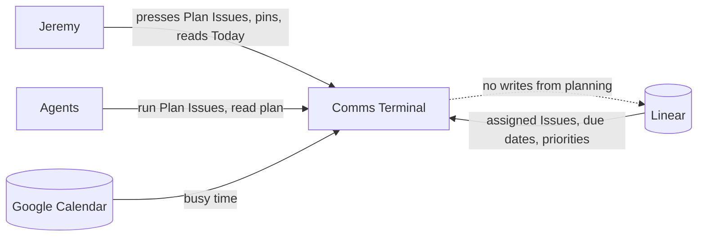
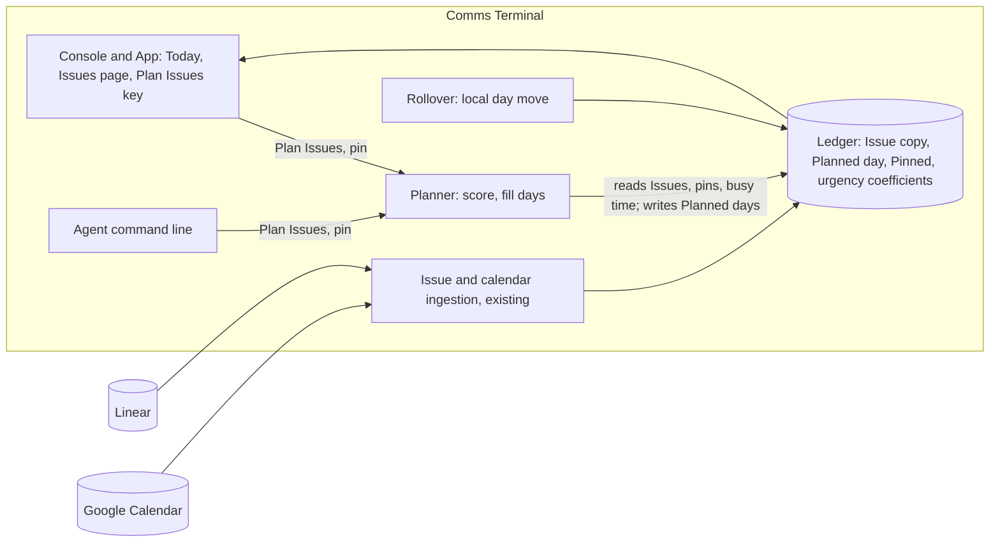
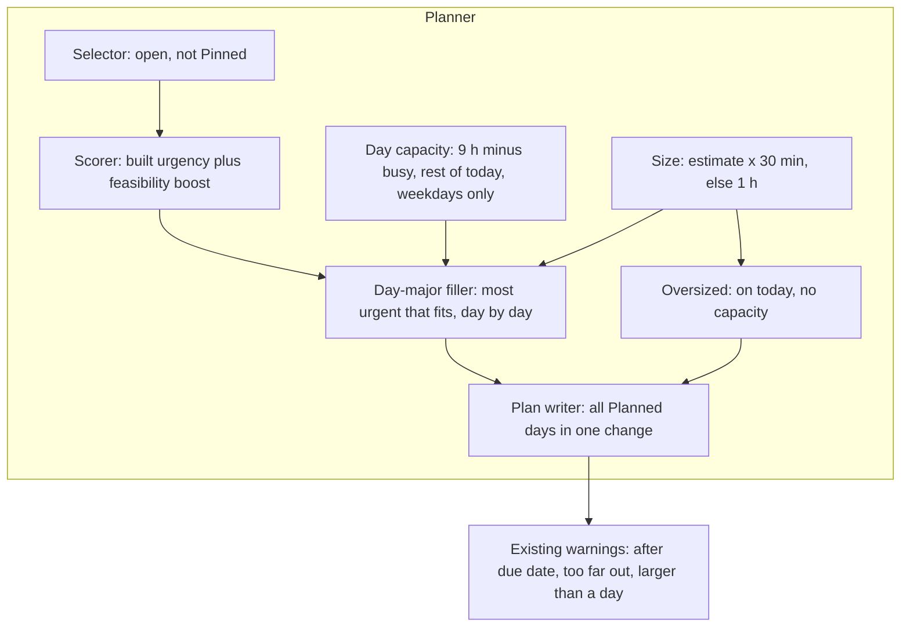

# Discovery — Automatic day planning of Issues

## 1. Status

| Phase | Gate | Date |
|---|---|---|
| Seed | approved ("New doc: auto-planning") | 2026-11-09 |
| 1 Context and problem discovery | approved | 2026-11-09 |
| 2 Problem definition | approved | 2026-11-09 |
| 3 Approaches | approved | 2026-11-09 |
| 4 Strategy convergence | approved | 2026-11-09 |

Last updated: 2026-11-09 (America/Halifax).

## 2. Context

### Seed (confirmed 2026-11-09)

- **Topic:** schedule Issues onto days automatically, as SuperPlan did in Super Productivity, so Issues appear on the Today page.
- **Trigger (Jeremy):** "i want issues to be scheduled similar to superplan on super productivity, and i want issues on the 'today' page".
- **Known:** the earlier discovery `.agents/discovery/2026-11-07-linear-daily-scheduling.md` (all phases approved) and PRD `.agents/prd/2026-11-07-issues-and-action-queue.md` are built and live on `origin/main` `f83eea4`. That discovery listed "automatic choice of what matters" as a non-goal; Planned day is set by hand only.
- **Early solution ideas (Phase 3 candidates):** SuperPlan-style planner inside Comms Terminal (Jeremy).
- **Document path:** this file. Jeremy chose a new document over reopening the 2026-11-07 one.

### Facts from the live system (read 2026-11-09)

- Live deploy: `f83eea4`, phase complete (Oracle `/var/lib/comms-terminal-deploy/status/deployment.json`).
- `comms-terminal issues`: 58 Issues copied from Linear; **0 have a Planned day**.
- Today lists only Issues whose Planned day is today (`tui.py` Issues list with `day_only=issues.today()`), so Today shows no Issues.

### Facts from the code (`origin/main`, `src/comms_terminal/issues.py`)

- Already built, and reusable by a planner: `capacity(day)` (9 h minus busy calendar time, rest-of-day for today, weekends 0 unless planned, busy all-day Event zeroes the day); `size_hours` (estimate × 30 min, else 1 h); `urgency` (priority, due-date ramp, started, blocking, blocked, age; coefficients stored and settable); `warnings` (after due date, too far out for urgency percentile, larger than a day, Unplanned and due within 7 days); `rollover` (unfinished past Planned days move to the next workday and get the Slip status); `plan` (one Issue, one day, undoable through the command journal).
- Missing: anything that assigns Planned days to many Issues at once.

### Analogue: SuperPlan (Jeremy's plugin, Mani `~/Workspace/super-productivity-custom-autoplan`, last commit 2026-08-14, read 2026-11-09)

- Treats every active, non-excluded task as chosen work and allocates each to a **day** by capacity (working day minus Meetings and calendar Events). No time blocks.
- Ranks by an additive urgency score: task order, deadline pressure, schedule feasibility, project and tag weights, start penalty, age.
- Each run replans everything except tasks tagged as fixed (`no-reschedule`), which count as fixed capacity and stay put.
- Oversized tasks go on today as attention items and use no capacity. Large tasks are not split.
- Manual trigger (side-panel button): **preview, apply, undo** of the last run.
- Principles (`~/.memory/2026-05-02-[tool]-superplan.md`): Jeremy chooses the work, the planner makes it believable; no silent omission; capacity before convenience; preview before mutation; plan the original work, no synthetic planning tasks.

### Live Issue statuses (2026-11-09)

34 Todo, 8 Now, 4 Next, 1 Making It Happen, 1 Finishing It Up, 6 In Review, 4 Dev Validated. In Review and Dev Validated wait on someone else.

### From Jeremy (ask-tool round 1, 2026-11-09)

- **Why nothing is planned:** "Too much by hand." Setting a day on 58 Issues one at a time is the barrier.
- **SuperPlan behaviours wanted:** auto-fill days by capacity; replan on each run; pin some Issues. Not chosen: preview, apply, undo.
- **Today shows:** "issues scheduled today or overdue". Meaning of overdue (past due date or past Planned day) to confirm.
- **When planning runs:** first "Automatically each morning", then mid-turn: "maybe on demand for now". On demand holds; a morning run is a later option.

### From Jeremy (round 2, 2026-11-09)

- **Today shows** every open Issue whose due date or Planned day is today or earlier.
- **Planner places every open Issue**, including In Review and Dev Validated (SuperPlan's "active work is chosen work").
- **Pinning** is an explicit toggle, separate from setting a day by hand.
- **Rollover stops writing Blocked.** A slip moves the day locally only; Linear status changes only when Jeremy changes it. Supersedes the 2026-11-07 decision "Rollover writes the Slip status" (old discovery §7, FR-IS-10).

### Phase 1 summary

- **Actor.** Jeremy alone; the plan stays private. The team now sees no automatic status change from slips.
- **Current workflow.** Issues live in the console since 2026-11-08, but planning is one Issue, one day, by hand. He has planned none of 58.
- **Pain.** Too much by hand, so Today shows no Issues and capacity, warnings and Rollover have nothing to act on. Frequency: every workday.
- **Load (inference).** 58 open Issues at the 1-hour default is about 58 hours, roughly 7–10 workdays of capacity; estimates were 0 of 57 on 2026-11-07.
- **Constraints.** Linear stays source of truth; Planned day and pin stay local; planning runs on demand for now; built capacity, size and urgency rules exist.
- **Analogue.** SuperPlan: rank, fill days by capacity, replan each run, fixed items stay, oversized on today.
- **Open unknowns.** Whether waiting Issues (In Review, Dev Validated) should use capacity at full size; what happens to Issues that do not fit within a horizon; whether on-demand replanning gets used daily.

## 3. Problem

**Statement (2026-11-09).** Jeremy has about 58 open Linear Issues in the console and will never schedule them by hand ("i will never manually schedule these"). Today the only way an Issue gets a day is by hand, so no Issue has one, Today shows none, capacity and warnings never engage, and he picks work in the moment. The console must give every open Issue its day itself.

**Scope (2026-11-09).**

- **In:** Plan Issues, one on-demand action (a button, one keypress) that gives every open Issue that is not Pinned a Planned day, most urgent first, filling each workday up to Day capacity and continuing forward until all are placed (no horizon). Pinned Issues are excluded and keep whatever day they have; a Pinned Issue with a day still uses that day's capacity. Today shows open Issues whose due date or Planned day is today or earlier. Rollover moves days locally only. Hand setting of Planned day stays; the next run may move an unpinned Issue.
- **Later:** automatic runs (each morning or on change); preview; project or team weights.
- **Out:** time blocks; sending Planned day or pin to Linear; any Linear status write from planning or Rollover.
- **Non-goal:** deciding what matters. Linear priority and due date still drive urgency.
- Waiting Issues (In Review, Dev Validated) are planned with the same size rule as any Issue.

**Success measures (approved 2026-11-09).**

| # | Measure | Baseline (2026-11-09) |
|---|---|---|
| 1 | One action plans every open, unpinned Issue | 0 of 58 planned |
| 2 | Today shows Issues every workday | None |
| 3 | Each day's planned hours fit its capacity, except Pinned or oversized Issues, which warn | No plan |
| 4 | A Pinned Issue never moves on a run | No pins |
| 5 | Neither planning nor Rollover writes anything to Linear | Rollover writes Blocked |
| 6 | Plan Issues used on most workdays after 2 weeks | Not measured |

## 4. Glossary

Terms from `GLOSSARY.md` (Issue, Planned day, Day capacity, Unplanned) apply unchanged. Approved 2026-11-09:

| Term | Definition |
|---|---|
| Plan Issues | The on-demand action that gives every open, unpinned Issue a Planned day by urgency within Day capacity. |
| Pinned | An Issue that Plan Issues leaves alone; Jeremy pins and unpins it. Local only. |
| Rollover (revised) | Moves an unfinished Issue's Planned day to the next workday, local only; no Slip status. |

## 5. Approaches

Depth: **standard** (Jeremy, 2026-11-09).

### 5.1 Frameworks and patterns

| Framework | Mechanism | Evidence | Fit |
|---|---|---|---|
| Priority list scheduling (greedy fill) | Sort work by a score; place each item in the earliest slot with room. | SuperPlan (Jeremy's plugin); Motion and Reclaim both rank then fill open time. [Motion: how auto-scheduling works](https://www.usemotion.com/help/time-management/auto-scheduling/reference-auto-scheduling/how-auto-scheduling-works-behind-the-scenes), [Reclaim scheduling](https://help.reclaim.ai/en/articles/6207587-how-reclaim-manages-your-schedule-automatically) | Urgency and Day capacity already exist (`issues.py`). |
| Earliest Due Date (EDD) | Order by due date; optimal for minimising the worst lateness on one worker. | [Single-machine scheduling](https://en.wikipedia.org/wiki/Single-machine_scheduling) | Only 19 of 57 Issues had a due date (2026-11-07); needs a fallback order. |
| Weighted shortest job first (WSPT) | Order by weight ÷ duration; optimal for weighted completion time. | Same source; [DTIC on weighted tardiness](https://apps.dtic.mil/sti/pdfs/ADA134880.pdf) | Sizes are mostly the 1-hour default, so it collapses to priority order. |
| Additive urgency score (Taskwarrior, SuperPlan) | Sum of weighted factors: priority, due ramp, started, blocking, age. | Built (FR-IS-8); SuperPlan README. | Already the ranking the warnings use. |
| Re-optimise on change, with pins | Re-run placement when inputs change; pinned items stay fixed and use capacity. | Motion reschedules on new events and past-due work; manual pins "reduce flexibility". SuperPlan `no-reschedule` tag. | Matches "replan each run" and Pinned. |

### 5.2 Reference cases

1. **SuperPlan (Jeremy, 2026).** Rank by additive urgency, fill days by capacity, oversized on today, fixed tasks stay, manual button with preview/apply/undo. Jeremy liked it; left only because the console took over Super Productivity's other jobs.
2. **Motion.** Places tasks into open calendar time by priority, deadline and duration; reshuffles when meetings arrive; moves past-due work to the next slot; flags work that cannot fit before its deadline. Reviews note tasks can move several times and a 1–2 week tuning period. About USD 34–49 a month. [Motion help](https://www.usemotion.com/help/time-management/auto-scheduling/concept-auto-scheduling), [Resolve issues box](https://help.usemotion.com/product-and-feature-guides/calendar/tasks/understanding-the-resolve-issues-box-in-motion)
3. **Reclaim.** Higher priority first; within a priority, soonest due date; a setting lets due date or priority dominate; "Up Next" forces a task to the front. [Reclaim help](https://help.reclaim.ai/en/articles/6207587-how-reclaim-manages-your-schedule-automatically), [Up Next](https://help.reclaim.ai/en/articles/8602291-using-up-next-for-tasks)

Common shape: rank, fill available time, re-run on change, let the user pin or force items. Motion and Reclaim place time blocks; SuperPlan and this scope place days.

### 5.3 Stack fit

- Built: urgency (settable coefficients), Day capacity from calendar busy time, size rule, warnings, Rollover, hand `plan`, command journal with undo, Today and Issues page views (`origin/main` `issues.py`).
- Missing: a bulk placement action, a Pinned flag, Today's "due or planned today or earlier" filter.
- SuperPlan's planning core exists but runs in Super Productivity's plugin runtime, not the console's, and is GPL-3.0.

### 5.4 Approach set (rung order, boring first)

| # | Approach | Rung | Adoption evidence | New moving parts | Extra cost | Measures moved | Assumptions and risks |
|---|---|---|---|---|---|---|---|
| A | **Using Today's filter alone**, Today shows open Issues due today or earlier; nothing gets a day. | 1 No build (filter only) | — | One filter | None | 2 partly | Only due-dated Issues ever appear; 39 of 58 never would. Fails "every open Issue". |
| B | **Using a computed view (Jeremy did not propose this)**, Today shows Issues due today or earlier plus the most urgent open Issues up to today's capacity, computed fresh each render; no stored days, no button. Pinned excludes. | 2 Stack | Reclaim/Motion "Up Next" lists | Today query; Pinned flag | None | 1, 2, 3, 4, 5 | No future days: Calendar and "planned after due date" stay empty; today's list shifts as urgency changes. |
| C | **Using priority list scheduling (SuperPlan's method)**, Plan Issues sorts unpinned open Issues by urgency and puts each on the earliest workday with capacity left; oversized ones go on today; days are stored; Today filter as scoped. | 3 Popular | SuperPlan, Motion, Reclaim | Plan Issues action; Pinned flag; Today filter | None | 1–6 | Due-dated low-urgency work may land after its due date (warned, not prevented). |
| D | **Using deadline-aware list scheduling**, as C, but first place each due-dated Issue on the latest workday before its due date with room (as late as possible), then fill the rest by urgency. | 4 Custom | Motion flags infeasible deadlines; EDD theory | As C plus a two-pass placer | None | 1–6, fewer due-date misses | More rules to explain; leaves due-dated work late by design. Lower rung C fails only if due-date misses prove common. |
| E | **Using SuperPlan's planning core as is**, run the existing plugin code to compute the plan. | 2 Stack | Jeremy's plugin | A second runtime beside the service; licence | None | 1–6 | GPL-3.0 code in the console; ranking differs from the built urgency. |
| F | **Using an off-the-shelf auto-scheduler** (paid category) linked to Linear. | 3 Popular | Motion, Reclaim | A new app and subscription | USD 34–49 a month | 1, 3 | Time blocks, outside the console; repeats why Super Productivity was dropped. |

Early concerns: B and C differ on whether days are stored; D adds value only if due-date misses are common; E and F repeat earlier rejections (second runtime or app).

## 6. Deciding questions

Ordered most eliminating first. Questions 0a–0c are answered from earlier phases.

| # | Question | Plausible answers and effect | Answer |
|---|---|---|---|
| 0a | Must every open Issue be covered? | Yes eliminates A. | **Yes** (Phase 2 scope). |
| 0b | May planning live outside the console or in a second runtime? | No eliminates E and F. | **No** (2026-11-07 decision; Super Productivity dropped for being a second app). |
| 1 | Do you need to see which future day each Issue lands on (Calendar, next week's load, "planned after due date")? | Yes: C or D (stored days). No: B (computed view, no button, nothing stored). | _Ask._ |
| 1 | Do you need to see which future day each Issue lands on (Calendar, next week's load, "planned after due date")? | Yes: C or D (stored days). No: B (computed view, no button, nothing stored). | **Yes, store days.** Eliminates B. |
| 2 | Should due dates be protected by placement or only warned? | Placement: D. Warning: C (warnings already built). | **"i like the superplan approach"**: ranking only, with SuperPlan's feasibility boost (see §7). Favours C over D. |

### What SuperPlan does with due dates (read 2026-11-09, Mani `src/copied-autoplan/core.js:1175-1393`)

- **Feasibility boost.** For a task with a deadline, count days from today to the deadline that still have room for it. 0 such days adds the full feasibility weight (default 5) to its urgency; 1 day adds 75 %; 2–3 days add 40 %; more adds nothing.
- **Day-major fill.** Starting today, for each workday: repeatedly take the most urgent remaining task that fits the day's remaining capacity, until none fits; then go to the next day. Smaller, less urgent tasks fill gaps a larger urgent one cannot.
- **Oversized** tasks (larger than a full workday) go on today after planning and use no capacity.
- **No horizon.** `maxDaysAhead: 3650` is an internal safety cap only; anything past it is reported, not dropped.
- **Deadline misses** are reported after planning; placement does not reserve days before deadlines.

## 7. Decision

**Chosen: C as SuperPlan does it.** Approved by Jeremy 2026-11-09 (Phase 4 gate).

- **Plan Issues** (button, one keypress; CLI command for agents) takes every open, unpinned Issue, scores it with the built urgency plus SuperPlan's feasibility boost (a new coefficient beside the others), and fills workdays from today forward, day by day, each time taking the most urgent Issue that still fits. Today uses the rest of today's capacity. Oversized Issues go on today without using capacity. Weekends get nothing from the planner. No horizon beyond a safety cap. Ties break by identifier, so the same inputs give the same plan.
- **Pinned** Issues are skipped; a Pinned Issue that has a day still uses that day's capacity.
- **Today** lists open Issues whose due date or Planned day is today or earlier, with used of capacity and warnings.
- **Rollover** moves days locally; no Slip status write. Supersedes FR-IS-10's status write.
- **Nothing goes to Linear** from planning, pinning or Rollover.
- **Why.** Q0a removes A; Q0b removes E and F; Q1 removes B; Q2 picks SuperPlan's ranking over D's reserved placement. Popularity and simplicity agree: list scheduling is what SuperPlan, Motion and Reclaim do, and it reuses the built urgency, capacity, size and warnings.
- **What would change it.** If due-date misses keep appearing after two weeks, add D's reserved placement. If Jeremy stops pressing the button, bring the automatic run forward (Later item).
- **Rejected.** A: covers only due-dated Issues. B: no future days. D: more rules; SuperPlan's feasibility boost chosen instead. E: second runtime and GPL code in the console. F: paid, time blocks, outside the console.
- **Trade-offs accepted.** Each press may move unpinned Issues, including ones set by hand. Due dates are warned, not guaranteed. New Issues stay Unplanned until the next press (they appear on Today only if due).

### Design grill (2026-11-09, after Phase 4)

Recorded in ADR 0023 and `GLOSSARY.md` on branch `jeremy/issue-auto-planning`.

- Rollover and the Slip status are removed; an unfinished Issue keeps its passed Planned day and is an Overdue Issue until the next Plan Issues.
- Each run replans every unpinned Issue, including today's (SuperPlan behaviour).
- Today's capacity ends at 18:00.
- One run is one Command; Undo works until a Linear read rewrites one of its Issues (at most 30 minutes). Moving local fields to their own table was rejected for now.
- Console, App and CLI; agents may run it. Keys: `p` Plan Issues, `w` one Issue's Planned day picker (was `p`), `f` Pinned toggle.
- Today lists Overdue Issues (Planned day or due date before today) and today's Issues in one urgency-sorted list, Overdue rows marked; the pane shows today's capacity use and Overdue hours separately.
- A Pinned Overdue Issue uses today's capacity during a run.
- Feasibility boost joins the stored urgency coefficients, default 5; other coefficients unchanged.
- All four warnings kept.

## 8. Validation

### Riskiest assumptions

| # | Assumption | Evidence now | Missing |
|---|---|---|---|
| 1 | Replanning every unpinned Issue on each press does not churn enough to erode trust | SuperPlan replanned all non-fixed tasks and Jeremy liked it; Motion reviews report tasks moving several times | Two weeks of use: how often today's list changes between presses |
| 2 | Linear priority plus due date ranks Issues the way Jeremy would | SuperPlan used a similar score; 23 of 57 Issues had No priority on 2026-11-07 and will sink | Whether No-priority Issues he cares about end up weeks out |
| 3 | 1-hour default gives believable days with almost no estimates | 2026-11-07 discovery risk; planning-fallacy research says plans run optimistic | Planned versus done for two weeks |
| 4 | Jeremy presses Plan Issues often enough that Today stays true | He chose on demand; never schedules by hand | Measure 6; if low, the automatic run moves forward |

### Scenario walk-through

| Scenario | Result |
|---|---|
| Monday 9:00, 3 h of Meetings, 58 Issues at 1 h, press Plan Issues | Today gets about 6 Issues; later workdays about 9 each minus Meetings; all 58 placed within about 7–8 workdays. Holds. |
| Press at 20:00 | Rest-of-today capacity is about 4 h, so 4 Issues land on today for the evening. **Bends**: the built capacity counts hours to midnight. Requirements should decide the end of the working day. |
| Pinned Issue on Wednesday | Stays; Wednesday's capacity shrinks by its size. Holds. |
| Pinned Issue with no day | Stays Unplanned; shows on Today only if due today or earlier; "Due soon and Unplanned" still warns. Holds. |
| Low-priority Issue due tomorrow, tomorrow full | Due ramp and feasibility boost raise it; if it still lands after its due date, "Planned after its due date" warns. Holds (warned, not guaranteed). |
| 40-point Issue (20 h) | Goes on today as an attention item without using capacity; "Larger than a day" warns. Holds. |
| Pinned Issue on a Saturday | Built capacity gives a weekend day capacity once something is planned there; the planner must still skip weekends. **Bends**: rule stated in §7. |
| Agents file 10 Issues after the morning press | They stay Unplanned until the next press; Today shows them only if due. Bends; accepted until the automatic run. |
| Issue closed in Linear | Leaves the open set; its day's capacity frees on the next press. Holds. |
| Issue Jeremy set by hand, not Pinned | Next press may move it. Accepted (Jeremy: "planner overrides"). |
| Press twice with no change | Same plan (deterministic tie-break). Holds. |
| Issue unfinished yesterday, no press today | Rollover moved it to today locally; Linear unchanged. Holds. |

## 9. Architecture (abstract)

### L1 Context

### L2 Container

### L3 Component (riskiest: assumptions 1–3)

## 10. Open risks and unknowns

| Item | Impact | Next evidence |
|---|---|---|
| Churn from replanning every unpinned Issue | Trust in Today (measure 6) | Two weeks of use |
| No-priority Issues sink weeks out | Important work hidden | Count of No-priority Issues placed beyond two weeks after first press |
| Rest-of-today capacity counts to midnight | Evening presses overload today | Resolved: day ends 18:00 (ADR 0023) |
| Planner must skip weekends even when built capacity gives one | Weekend placements | Requirements and a test |
| Undo of a run refuses after a Linear read rewrites any of its Issues | Undo window at most 30 minutes | Refusal count; own table for local fields if it bites |
| On-demand freshness: new Issues wait for the next press | Today misses new work | Measure 6; automatic run (Later) |
| Rollover removal retires FR-IS-10 and its scenarios | PRD edits | PRD revision (glossary and ADR 0023 done) |

## 11. Decision log

| Date | Decision or request | Source | Status | Supersedes |
|---|---|---|---|---|
| 2026-11-09 | New discovery document for automatic planning, linked to the 2026-11-07 one | Jeremy, ask-tool seed | approved | — |
| 2026-11-09 | Round 1 answers: too much by hand; auto-fill, replan each run, pins; Today = scheduled today or overdue | Jeremy, ask-tool | recorded | — |
| 2026-11-09 | Planning runs on demand for now | Jeremy, chat | recorded | Same-round "Automatically each morning" |
| 2026-11-09 | Today = due date or Planned day today or earlier; plan every open Issue; explicit pin toggle | Jeremy, ask-tool | recorded | — |
| 2026-11-09 | Rollover stops writing Blocked to Linear | Jeremy, ask-tool | recorded | 2026-11-07 Rollover Slip status (FR-IS-10) |
| 2026-11-09 | Phase 1 approved | Jeremy, ask-tool gate | approved | — |
| 2026-11-09 | "i will never manually schedule these": the console gives every open Issue its day | Jeremy, ask-tool (answer to scope draft) | recorded | Scope draft framed as reducing hand work |
| 2026-11-09 | Pin makes Plan Issues exclude the Issue; button now, automatic later; hand day setting kept, planner overrides unpinned | Jeremy, ask-tool | recorded | Round-2 pin meaning left open |
| 2026-11-09 | Success measures, glossary (Plan Issues, Pinned, revised Rollover), waiting Issues same size | Jeremy, ask-tool | approved | — |
| 2026-11-09 | Phase 2 approved; Phase 3 depth standard | Jeremy, ask-tool gate | approved | — |
| 2026-11-09 | Phase 3 approach set A–F approved | Jeremy, ask-tool gate | approved | — |
| 2026-11-09 | Store days (eliminates B); "i like the superplan approach" for due dates | Jeremy, ask-tool | approved | — |
| 2026-11-09 | Phase 4 approved: C as SuperPlan does it, diagrams, open risks | Jeremy, ask-tool gate | approved | — |
| 2026-11-09 | Design grill: remove Rollover and Slip status; 18:00 day end; one-Command undo with 30-minute window; keys p/w/f; Overdue Issue; one Today list; feasibility default 5; ADR 0023 | Jeremy, ask-tool rounds | approved | ADR 0019 Rollover and Slip status |

## 12. Sources

- Live CLI `comms-terminal issues` on Oracle (read-only), deploy status file.
- `origin/main` `src/comms_terminal/issues.py`, `tui.py` (Issues list), PRD `.agents/prd/2026-11-07-issues-and-action-queue.md`.
- SuperPlan `README.md`, `src/shell/apply.js` function list, `src/copied-autoplan/core.js` lines 40–50 and 1175–1393 on Mani (read-only).
- Web search summaries for Motion, Reclaim and scheduling theory (pages not fetched in full).
- `~/.memory/2026-05-02-[tool]-superplan.md`.
