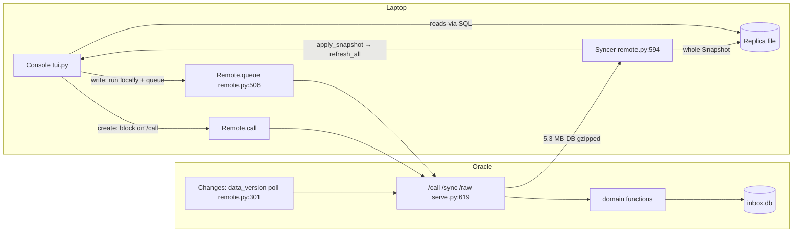
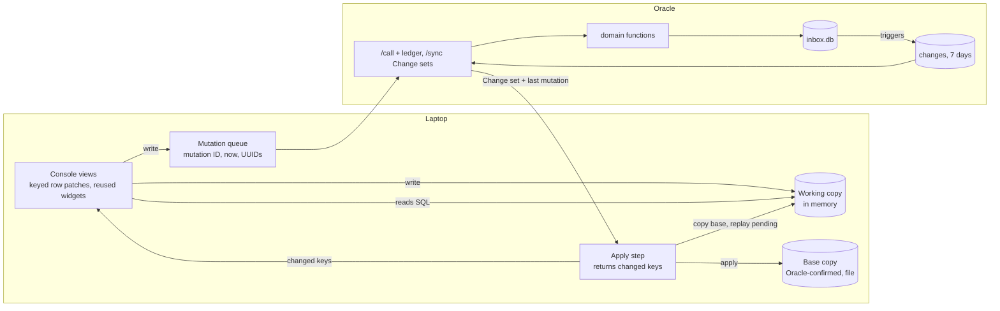

# PRD — Linear-model console sync

## 1. Document control

| Field | Value |
|---|---|
| Status | **Delivered.** Phases 0–6 shipped to `main` and deployed (latest `e3a0f6c`); Phase 7 accepted by Jeremy (D-36) without a laptop measurement. On the laptop Thread moves measure p50 255 / p95 399 ms, so NFR-1 (p95 < 100 ms) is not met for moves; Jeremy accepted the current speed (D-37). |
| Owner / authority | Jeremy. Authority chain: Jeremy's instructions, then `AGENTS.md` (repository), then accepted ADRs in `docs/adr/`, then `.agents/` discovery and PRDs. |
| Created / updated | 2026-10-29T17:37+00:00 / 2026-10-29T18:40+00:00 |
| Topic | Every console action paints in under 100 ms; only changed rows travel and repaint. |
| Sources | `.agents/discovery/2026-10-29-instant-console-writes-and-targeted-refresh.md` (approved); code at `origin/main` `a8f4992`; laptop and Oracle measurements (§9). |
| History limits | The full conversation was available. |
| Implementation authorization | **None.** No code, migration, ADR, deploy or `AGENTS.md` change is authorized by this document. |

## 2. Executive framing

**Problem.** Jeremy, working in the laptop console, waits on Oracle for every action that creates a row. He loses his cursor and focus to whole-screen rebuilds after any Change anywhere, and a Thread move costs 260 ms median and 413 ms p95 on the laptop. The console treats the database as a file it re-reads instead of as live records it updates in place.

**Current behavior (verified)**
- **Instant writes:** writers of kind `write` run locally and are queued (`src/comms_terminal/writers.py:7`, `src/comms_terminal/remote.py:539`).
- **Waiting creates:** any call where `creates()` is true (`remote.py:193`) blocks on `/call`. That covers the 17 `create` writers plus a new Draft, a new reply Draft and a new Case.
- **Whole-database sync:** `/sync` returns the whole database whenever `PRAGMA data_version` moves (`remote.py:301`, `:336`, `:357`). The live database is 5.3 MB; the Snapshot is 1.5 MB gzipped.
- **Snapshot apply:** the console applies a Snapshot only while no write is pending (`remote.py:667`), then calls `refresh_all` (`src/comms_terminal/tui.py:7601`, `:6634`), which rebuilds the current page with `DataTable.clear()`.
- **Row moves:** each move re-renders the Thread (`tui.py:6570` → `ThreadView.retarget` `:2471` → `inbox.thread_view` `src/comms_terminal/inbox.py:2742`). On the laptop the hot spots are `_participants` (`inbox.py:2790`, N+1 `person_view` calls), `paint_status` (`tui.py:2506`) and `message_widgets` (`tui.py:2066`), with Textual layout taking about 47% of busy time.

**Desired outcome**
- Every action paints at once.
- Only changed rows travel over the network.
- Only views showing them repaint.
- Thread moves reuse what is already rendered.

**Audience.** Jeremy (single user). Agents and the CLI on Oracle are writers whose Changes must reach the console.

**Scope**
- Change log and Change sets.
- Mutation IDs, idempotency and passing time into writers.
- Client UUIDs with full UUID foreign keys.
- Base copy plus in-memory working copy, and rebase.
- Keyed row patching; reused Thread widgets; N+1 read fix.
- Latency harness.
- ADR 0012.

**Non-goals**
- Offline writes.
- A separate in-memory object graph or observer framework (D-14).
- Ingestion and send speed; file upload.
- CLI and Workbox console latency.
- Multiple users.
- Replacing SQLite on Oracle.
- Interim fixes to rebuild bugs before Phase 6 (D-23).

**Dependencies**
- The laptop launcher installs the Service's build on mismatch (exit 75), so the Service ships first and the console follows.
- The updater validates migrations against a live backup.
- Laptop access from Workbox goes over reverse SSH that Jeremy starts on Mani (D-19).

**Success measures** (discovery §3, approved)
1. p95 keypress-to-paint under 100 ms on the laptop, with live-size data, for row moves and every write and create.
2. Zero refresh-caused changes to the cursor item, focus, typed text or scroll.
3. No repaint of unchanged panes.
4. A single-record Change costs under 10 KB of sync.
5. A refused write reverts visibly by the next sync, with a toast.
6. Startup to an interactive Today stays under 2 s on the laptop (D-20; baseline 1,616 ms).

## 3. Requirements and coverage

### Functional requirements
| ID | Requirement | Status |
|---|---|---|
| FR-1 | Every console write, including today's creates, applies to the working copy and paints before the Service answers. | Confirmed |
| FR-2 | Each row gets a UUID; laptop-created rows carry a client-generated UUID that the Service keeps. Foreign keys reference UUIDs (D-15). | Confirmed |
| FR-3 | Each write carries a client mutation ID; the Service applies a given ID at most once and reports the highest ID it has applied. | Confirmed |
| FR-4 | The Service records every committed row change (table, row UUID, operation) under a monotonic sequence number and keeps it 7 days (D-21). | Confirmed |
| FR-5 | `/sync` returns the Change set since the client's cursor. It returns the whole Snapshot for a new install, a cursor older than 7 days, or a schema or build mismatch. | Confirmed |
| FR-6 | The laptop keeps a base copy (Oracle-confirmed) and an in-memory working copy (base plus pending writes). On a Change set it applies the set to base, copies base over working, drops confirmed writes, replays the rest, and reveals the result in one step (D-13). | Confirmed |
| FR-7 | A write the Service refuses disappears from the working copy on the next Change set, with a toast naming it. | Confirmed |
| FR-8 | The apply step returns the changed (table, UUID) keys; lists and panes repaint only the rows those keys touch. | Confirmed (D-14) |
| FR-9 | Lists patch rows by UUID and never call `DataTable.clear()`; the cursor item, focus, typed text and scroll survive any Change. | Confirmed |
| FR-10 | The Thread pane reuses message widgets for unchanged Activities and prefetches the neighbouring Threads. | Confirmed (D-14) |
| FR-11 | Thread participants load in one batched query instead of N+1 `person_view` calls. | Confirmed (D-14) |
| FR-12 | Draft saves resolve by latest save time: the save with the later `now` wins, whether it comes from the console or an agent (D-17). | Confirmed |
| FR-13 | A latency harness measures keypress-to-paint for row moves, every writer, sync apply and startup, in CI on seeded data and on the laptop on a live-size copy. | Confirmed |
| FR-14 | Agents' CLI writes and ingestion on Oracle reach the console as Change sets. | Confirmed |

### Non-functional requirements
| ID | Requirement | Status |
|---|---|---|
| NFR-1 | p95 keypress-to-paint under 100 ms (measure 1). | Confirmed |
| NFR-2 | A single-record Change costs under 10 KB (measure 4). | Confirmed |
| NFR-3 | After every apply, the working copy equals base plus replayed pending writes (property-tested). | Confirmed |
| NFR-4 | All 52 writers take `now`; no writer reads the clock or randomness internally, except a UUID passed as an argument (D-18). | Confirmed |
| NFR-5 | Offline and on version mismatch, the console is read-only with a banner (ADR 0004). | Confirmed |
| NFR-6 | ADR 0011 holds: no automatic retry for uncertain effects; the Service is the sole writer; per-operation timeouts. | Confirmed |
| NFR-7 | Startup under 2 s (measure 6). | Confirmed |
| NFR-8 | During rollout, a console without the new protocol still works through the Snapshot path. | Proposed |

### Acceptance scenarios
| ID | Scenario | Expected |
|---|---|---|
| AS-1 | Typing a Task Draft while autosave, new mail and an agent's Thread change arrive | Only the Draft row and the affected Thread row repaint; cursor and focus stay |
| AS-2 | `e` on a Task | The Task leaves and the next Task (client UUID) appears in the same frame; confirmation causes no visible change |
| AS-3 | `e` on a Task whose Enrollment the Service has Paused | The Task returns on the next Change set; a toast says why |
| AS-4 | An agent saves the Draft Jeremy is typing | The later save by time wins; when the agent's is later, Jeremy's editor shows the agent's text (D-17) |
| AS-5 | New mail on the open Thread | One message widget appends; the rest stay mounted |
| AS-6 | `j` through 25 Done Threads on the laptop | p95 under 100 ms (baseline 413 ms) |
| AS-7 | Laptop offline, then back within 7 days | Read-only banner offline; one Change set catches up |
| AS-8 | The Service deploys a new schema | Snapshot, read-only, reinstall via exit 75, as today |
| AS-9 | The same mutation is sent twice (restart mid-send) | The Service applies it once |
| AS-10 | Launching the console | Interactive Today under 2 s |

### Invariants
- The Service is the only writer of authoritative state.
- Change sequence numbers only increase.
- No frame shows Service state without the laptop's pending writes replayed on top.
- Every synced table has Change-log triggers and a UUID primary or unique key (enforced by tests).
- Thread merge order (`threads.merged_into < id`, `schema.sql:55`) is preserved in UUID form (Phase 2 step 1).

### Traceability
| Requirement | Phase | Verification |
|---|---|---|
| FR-13, NFR-7 | 0 | `tests/test_latency.py` (proposed); laptop baseline recorded |
| ADR | 0 | ADR 0012 approved |
| FR-4, FR-5, FR-14, NFR-2, NFR-8 | 1 | `tests/test_changes.py` (proposed), `tests/test_remote.py` |
| FR-2 | 2 | `tests/test_client_ids.py` (proposed), `tests/schema_history.py`, migration rehearsal |
| FR-3, NFR-4, NFR-6, AS-9 | 3 | `tests/test_mutations.py` (proposed), `tests/test_cli_parity.py` |
| FR-1, FR-6, FR-7, FR-12, NFR-3, AS-2–AS-4 | 4 | `tests/test_rebase.py` (proposed) |
| FR-11 | 5 | `tests/test_latency.py`; existing Thread view tests |
| FR-8, FR-9, FR-10, AS-1, AS-5 | 6 | `tests/test_today_ui.py`, `tests/test_console.py`, frame-capture test |
| NFR-1, AS-6–AS-8, AS-10 | 7 | Laptop latency run; deploy smoke |

## 4. Architecture and solution shape

### Current (verified)

### Target (proposed; D-13, D-14)

L1 Context is unchanged from discovery §9.

### Alternatives considered
| Alternative | Outcome | Source |
|---|---|---|
| Staged delivery (change log first; object store only if needed) | Superseded: full model chosen (D-8), then simplified (D-14) | Discovery; Jeremy |
| Separate in-memory object graph with observers (MobX-style) | Rejected for the simple variant: an in-memory SQLite working copy is the record store (D-14) | Jeremy, "i don't want a complex system" |
| Savepoint rewind | Rejected: writers commit internally (59 sites) and a commit drops the savepoint; overriding `commit` does not stop `with db:` (tested 2026-10-29) | Probe |
| Callers own transactions; undo log of originals | Rejected for base plus working copy (D-13) | Jeremy |
| Server-reserved integer IDs; UUIDs translated at the write boundary | Rejected for full UUID foreign keys (D-9, D-15) | Jeremy |
| WARP-to-WARP route to Mani | Declined: needs TUN in the Proxmox LXC, `sudo` and a Zero Trust change; reverse SSH chosen (D-19) | Jeremy |

### Complexity justification
- **Two laptop copies:** the base copy is the minimum needed for rewind without touching 59 commit sites. A full copy costs 5.3 ms in memory on the laptop.
- **Change-log triggers:** needed because the stdlib `sqlite3` has no session extension (Python 3.12, SQLite 3.50.4) and `data_version` says only that something changed.
- **No object graph, no observer framework, no new dependency.** UUIDs come from stdlib `uuid.uuid4`.

### L4 code map (current symbols that phases change)
| Path | Symbols |
|---|---|
| `src/comms_terminal/writers.py` | `KINDS` :7, `writer` :15 |
| `src/comms_terminal/remote.py` | `creates` :193, `encode` :219, `decode` :243, `handle_call` :276, `Changes` :301, `snapshot_bytes` :336, `handle_sync` :357, `Remote.queue` :506, `_send_loop` :515, `proxy` :539, `Syncer` :594, `Syncer.once` :624, `Syncer.apply` :667 |
| `src/comms_terminal/serve.py` | routes :619–621 |
| `src/comms_terminal/inbox.py` | `SCHEMA_VERSION` :28, `MIGRATIONS` :31, `connect` :747, `migrate` :793, `save_draft` :836, `create_case` :2602, `thread_view` :2742, `_participants` :2790, `person_view` :2821 |
| `src/comms_terminal/sequences.py` | `enroll` :705, `materialize` :822, `complete_task` :1061, `skip_task` :1085 |
| `src/comms_terminal/schema.sql` | every `CREATE TABLE`; all `REFERENCES`; `threads.merged_into` CHECK :55 |
| `src/comms_terminal/tui.py` | `Page` :910, `ThreadsPage` :991, `message_widgets` :2066, `ThreadView` :2448, `retarget` :2471, `paint_status` :2506, `DraftsPage` :3063, `repaint_row` :3150, `TasksPage` :4957, `TodayPage` :5846, `show_thread` :6570, `refresh_all` :6634, `minute` :6920, `check_changes` :7584, `apply_snapshot` :7601; 21 `refresh_data` implementations |
| `AGENTS.md` | the rule "the console's save always wins" becomes "the latest save wins" (D-17) |

## 5. Phased execution plan

Every phase needs separate implementation authorization. Each phase ends with `uv run pytest` green, then Jeremy's go for the push to `main`, which deploys to Oracle (D-22).

### Phase 0 — Harness, baseline, ADR
1. **Proposed `tests/test_latency.py` and `scripts/latency_probe.py`.**
   - Change: a pilot harness for row moves, every writer, sync apply and startup. On the laptop it runs on a read-only copy with `raw/` symlinked (method: the scratch probe used on 2026-10-29, see §9).
   - Requirements: FR-13, NFR-7.
   - Verify: `uv run pytest tests/test_latency.py -q`; a laptop run over reverse SSH reproduces the §9 baseline within 20%.
   - Exit: harness merged; baseline in the work log.
2. **Proposed `docs/adr/0012-linear-model-console-sync.md`.**
   - Change: records the change log, Change sets, mutation IDs, full UUID foreign keys, base plus working copy, keyed patching and latest-save-wins. Supersedes ADR 0004's rejection of client IDs and of change feeds, and its whole-Snapshot transport. ADR 0011 stays.
   - Authorization: Jeremy approves the ADR before Phase 1 (D-24).

### Phase 1 — Change log and Change sets (Service)
1. **`inbox.py` `MIGRATIONS`, `SCHEMA_VERSION`; `schema.sql`; `tests/schema_history.py`.**
   - Change: add table `changes(seq INTEGER PRIMARY KEY AUTOINCREMENT, tbl, row_uid, op, at)`, plus AFTER INSERT/UPDATE/DELETE triggers on every synced table. Prune entries older than 7 days on the Service's existing periodic loop.
   - Requirement: FR-4.
   - Verify: proposed `tests/test_changes.py` checks that every table has three triggers, that one write produces one Change, and that pruning keeps 7 days.
   - Rollback: the migration's inverse.
   - Dependency: step 1 of Phase 2 supplies `row_uid`. Order the Phase 1 and Phase 2 migrations so the UUID columns exist first, or record the integer key until Phase 2 lands.
2. **`remote.Changes` :301, `handle_sync` :357.**
   - Change: the token becomes `changes.seq`. With a cursor inside 7 days and a matching schema, return changed rows (full current row, or a deletion marker) and the new cursor; otherwise return the Snapshot.
   - Contract: `{since, changes:[{seq,tbl,op,row}], last_mutation, raw_new, caps_new, build}`, or today's Snapshot body.
   - Requirements: FR-5, NFR-2, NFR-8.
   - Verify: `tests/test_remote.py` unchanged and green; `test_changes.py` checks that a one-row edit is under 10 KB.
3. **`serve.py` :619.**
   - Change: routes stay. Change sets carry only new raw message names and new Attachment capabilities.
   - Verify: `uv run pytest tests/test_remote.py`.

### Phase 2 — UUIDs and UUID foreign keys (D-15)
1. **`schema.sql`, `MIGRATIONS`, `tests/schema_history.py`.**
   - Change: every synced table gets a UUID key, backfilled on the Service. Every `REFERENCES` column moves to the referenced row's UUID. Thread merge order moves from `merged_into < id` to an explicit ordering column, preserving the rule that a merge points to an older Thread.
   - Requirement: FR-2.
   - Verify: proposed `tests/test_client_ids.py`; the full suite; a rehearsal on a live backup through the updater.
   - Rollback: the inverse in `schema_history`.
   - Risk: the largest step (all `REFERENCES` at `schema.sql:18`–`:388`, and every query joining on them).
2. **Domain modules (`inbox.py`, `sequences.py`, `pipeline.py`, `calendar.py`, `files.py`).**
   - Change: queries and joins use UUID keys; create functions accept an optional `uid` per inserted row and keep it.
   - Verify: full suite, including `tests/test_features.py` and `tests/test_cli_parity.py`.
3. **`tui.py` and `agent.py` id handling.**
   - Change: rows, cursors and CLI identifiers use UUIDs. CLI output keeps a short readable form.
   - Verify: console and CLI tests.

### Phase 3 — Mutation IDs, idempotency, time as argument
1. **`schema.sql`, `MIGRATIONS`.**
   - Change: add table `applied_mutations(client_id, mutation_id, outcome, PRIMARY KEY(client_id, mutation_id))`.
   - Requirements: FR-3, AS-9.
2. **`remote.handle_call` :276.**
   - Change: return the recorded outcome for a repeated `(client_id, mutation_id)`; otherwise apply and record it in the same transaction.
   - Verify: proposed `tests/test_mutations.py`.
3. **All 52 writers in `writers.WRITERS`.**
   - Change: each takes `now`. The 13 that read the clock or randomness today (`inbox.act`, `create_case`, `create_sole_proprietorship`, `restore`, `save_draft`, `set_case_description`, `set_membership`, `stage`, `sequences.create_sequence`, `describe_sequence`, `rename_sequence`, `restore_sequence`, `set_connection`) use it instead of `clock.now()`.
   - Requirement: NFR-4.
   - Verify: a test that fails when any writer lacks `now` or calls `clock.now()` (also through helpers it calls).
4. **`remote.Remote.queue` :506, `_send_loop` :515.**
   - Change: assign increasing mutation IDs; pass `now` and UUIDs with each call.
   - Verify: `test_mutations.py`.

### Phase 4 — Base plus working copy, rebase, latest save wins
1. **`remote.Syncer` :594, `Syncer.apply` :667; console start-up.**
   - Change: open the Replica file as the base copy and an in-memory working copy loaded from it. On a Change set: apply it to base, copy base over working, drop confirmed mutations, replay the pending ones on working, return the changed keys. The Snapshot path replaces base and then does the same.
   - Requirements: FR-6, FR-7, NFR-3.
   - Verify: proposed `tests/test_rebase.py` (AS-2, AS-3); a property test that the working copy equals base plus replay.
2. **`remote.proxy` :539, `creates` :193.**
   - Change: remove the create branch; every writer runs on the working copy and is queued.
   - Requirement: FR-1.
   - Verify: `test_rebase.py`: no `/call` on the UI thread for any writer.
3. **`inbox.save_draft` :836 and the reply-Draft writers.**
   - Change: a save applies only if its `now` is later than the stored save time; otherwise it is a no-op and the newer text shows (FR-12).
   - Verify: `test_rebase.py` AS-4; update `tests/test_sequences_ui.py::test_the_latest_edit_to_a_task_draft_wins_over_a_newer_stored_copy` to the new rule.
4. **`AGENTS.md`.**
   - Change: replace "the console's save always wins" with "the latest save wins."
   - Authorization: part of the phase approval.
5. **`tui.Console.apply_snapshot` :7601, `check_changes` :7584, `minute` :6920.**
   - Change: pass the changed keys to the views (Phase 6); `minute` refreshes only time-derived rows.
   - Verify: Phase 6 tests.

### Phase 5 — Read path
1. **`inbox._participants` :2790, `person_view` :2821, `person_thread_ids` :2369.**
   - Change: one batched participants query per Thread.
   - Requirement: FR-11.
   - Verify: existing Thread view tests; the harness shows the participants cost gone.
2. **`tui.paint_status` :2506.**
   - Change: compute from the batched data; no per-person queries.
   - Verify: harness.

### Phase 6 — Keyed views and widget reuse
1. **`tui.Page` :910.**
   - Change: a shared keyed-patch helper (`add_row`, `update_cell`, `remove_row`, `sort`), keyed by UUID; never `clear()`.
   - Requirement: FR-9.
   - Verify: per-list tests modelled on `tests/test_today_ui.py::test_a_refresh_keeps_the_cursor_on_a_later_task`.
2. **All 21 `refresh_data` implementations.**
   - Change: patch the rows named by the changed keys; re-query only when a list's own tables changed.
   - Requirement: FR-8.
   - Verify: `uv run pytest tests/test_today_ui.py tests/test_console.py tests/test_sequences_ui.py`.
3. **`ThreadView` :2448, `message_widgets` :2066.**
   - Change: reuse message widgets keyed by Activity UUID and version; prefetch the next and previous Thread.
   - Requirement: FR-10.
   - Verify: frame-capture test (no blank frames); harness.
4. **`MainScreen.refresh_all` :6634.**
   - Change: used only for explicit refresh and resets.
   - Verify: a test that no sync path calls it.

### Phase 7 — Rollout and acceptance
1. **Deploy order:** Service phases (1–3) before console phases (4–6), each compatible through the Snapshot path. Jeremy's go per push.
   - Verify: Oracle `deployment.json` reads `phase: complete`; laptop reinstalls via exit 75.
2. **Acceptance:** laptop harness over reverse SSH.
   - Verify: NFR-1, NFR-7, AS-6 and AS-10 pass; AS-7 and AS-8 smoke by hand.

## 6. Risks, unknowns and approvals

| Item | Impact | Evidence / status | Mitigation / next evidence | Owner | Blocks |
|---|---|---|---|---|---|
| ADR 0012 approval | Phase 1 | Not written | Draft in Phase 0 | Jeremy | Phase 1 |
| Full UUID foreign-key migration | Largest change; live migration risk | D-15; every `REFERENCES` column | Rehearse on a live backup; updater validation | Implementer | No |
| Thread merge order without integer ids | `merged_into < id` CHECK breaks | `schema.sql:55` | Explicit ordering column (Phase 2 step 1) | Implementer | No |
| Rendering cost (Textual layout about 47% of busy time on the laptop) | Misses NFR-1 | Laptop profile | Widget reuse and prefetch (Phase 6); harness each phase | Implementer | No |
| Indirect clock reads in writers | Replay differs | Shallow audit: 13 direct | Phase 3 test follows helper calls | Implementer | No |
| Latest-save-wins replaces Jeremy's typing with an agent's newer text | Surprise in the editor | D-17 accepted | Toast when the editor text is replaced | Implementer | No |
| Long project with no interim fixes | Rebuild bugs persist until Phase 6 | D-23 | None, by choice | Jeremy | No |
| Laptop access depends on Jeremy starting reverse SSH | Harness runs need him | D-19 | Ask at each laptop run | Jeremy | No |
| Resolved: savepoint rewind | — | Writers commit internally | Base plus working copy (D-13) | — | — |
| Resolved: laptop baseline | — | Measured 2026-10-29 | §9 | — | — |
| Resolved: stash | — | 55 `.agents` files restored | Tracked edits kept in `stash@{0}` | — | — |

## 7. Discussion and decision ledger

| # | Date | Request / decision | Source | Reasoning | Status | Supersedes |
|---|---|---|---|---|---|---|
| D-1 | 2026-10-29 | Report: Today cursor jumps from Evan's Task to Nic's | Jeremy (`/issue`) | — | Resolved by `d5e823d` | — |
| D-2 | 2026-10-29 | "ship the fix" | Jeremy | — | Done; Oracle deploy complete | — |
| D-3 | 2026-10-29 | How do Linear and Plain stay under 100 ms; two gaps named | Jeremy; agent | — | Context | — |
| D-4 | 2026-10-29 | "address gap 1 and 2" | Jeremy | — | Approved | — |
| D-5 | 2026-10-29 | Correction: Gap 1 covers only creates | Agent, `writers.py`, ADR 0004 | Evidence | Accepted | Earlier claim that every write waits |
| D-6 | 2026-10-29 | "i want to probably do all of this" (Linear model) | Jeremy | — | Recorded | — |
| D-7 | 2026-10-29 | Offline read-only; <100 ms p95 every action; budget unlimited | Jeremy | — | Approved | — |
| D-8 | 2026-10-29 | Full Linear model now | Jeremy | One project to the end state | Approved; simplified by D-14 | Staged recommendation |
| D-9 | 2026-10-29 | Create IDs: client UUID column | Jeremy | Proven pattern | Approved | Reserved integer blocks; ADR 0004 (pending ADR 0012) |
| D-10 | 2026-10-29 | Discovery strategy, diagrams and risks approved | Jeremy | — | Approved | — |
| D-11 | 2026-10-29 | Proposal: UUIDs translated at the write boundary, integer foreign keys kept | PRD draft | Smaller migration | **Rejected** (D-15) | — |
| D-12 | 2026-10-29 | Proposal: replayed console Draft save always wins | PRD draft | `AGENTS.md` rule | **Superseded** (D-17) | — |
| D-13 | 2026-10-29 | Rewind with a base copy plus a working copy | Jeremy (asked how Linear does it; picked the option mapped to Linear's confirmed-store and memory split) | Simplest; no domain changes | Approved | Savepoint rewind (failed probe) |
| D-14 | 2026-10-29 | Simple variant: in-memory SQLite working copy is the record store; changed keys drive row patches; fix N+1 reads; no object graph or observers | Jeremy ("i don't want a complex system") | Same outcomes, far less code | Approved | D-8's object store and observers |
| D-15 | 2026-10-29 | Keep full UUID foreign keys | Jeremy (asked twice; kept) | Purest model | Approved | D-11 |
| D-16 | 2026-10-29 | "newest version wins" for Draft clashes | Jeremy | — | Clarified by D-17 | D-12 |
| D-17 | 2026-10-29 | Latest save by time wins (console or agent) | Jeremy | Linear-style last-writer-wins | Approved | D-12; `AGENTS.md` "console's save always wins" (pending edit) |
| D-18 | 2026-10-29 | All 52 writers take `now` | Jeremy | Uniform rule, catches helpers | Approved | — |
| D-19 | 2026-10-29 | Laptop access by reverse SSH only | Jeremy | WARP needs TUN, `sudo`, Zero Trust change | Approved | WARP-to-WARP |
| D-20 | 2026-10-29 | Startup target under 2 s | Jeremy | — | Approved | "no worse than today" proposal |
| D-21 | 2026-10-29 | Change log kept 7 days | Jeremy | — | Approved | — |
| D-22 | 2026-10-29 | Ask before each phase's push to `main` | Jeremy | `AGENTS.md` | Approved | — |
| D-23 | 2026-10-29 | No interim fixes for rebuild bugs | Jeremy | — | Approved | — |
| D-24 | 2026-10-29 | ADR 0012 before Phase 1 | Jeremy | — | Approved | — |
| D-33 | 2026-10-30 | Deterministic ids per queued write (`inbox.minting`) instead of client-passed uid arguments | Agent, in Phase 4 | No domain function changes; same ids on both sides | Implemented, pending push go | Refines D-9 mechanics; UUID keys unchanged |
| D-41 | 2026-10-30 | Housekeeping: drop both universal-inbox stashes; remove the 8 merged worktrees and their branches; commit the planning docs; add sync terms to GLOSSARY; annotate old ids in memory | Jeremy | — | Done (`353f256` docs) | — |
| D-40 | 2026-10-30 | Laptop acceptance run taken (tunnel opened) | Jeremy | — | Done: startup 1,459 ms; moves p50 255 / p95 399 ms | D-36's missing measurement |
| D-39 | 2026-10-30 | Close the ledger crash window now | Jeremy | Writers' commits are held while handle_call runs a laptop write; write and ledger row commit together | Implemented on `jeremy/atomic-ledger` | Phase 3 ponytail note |
| D-37 | 2026-10-30 | Accept current Thread-move speed; no more speed work | Jeremy | — | Accepted | Recommendation to measure then cut widget layout |
| D-36 | 2026-10-30 | Phase 7 "accepted" without the laptop acceptance run | Jeremy | — | Accepted; NFR-1 and AS-6 unverified on the laptop | — |
| D-35 | 2026-10-30 | "execute the entire prd"; then "Push all remaining phases" (after the auto-mode check blocked an unconfirmed push) | Jeremy | — | Approved for Phases 5-7 pushes when green | D-22 per-phase asks |
| D-34 | 2026-10-30 | "execute the prd up to phase 5" | Jeremy | — | Done: `c3daef8` live | — |
| D-32 | 2026-10-30 | "execute the prd up to phase 4"; push approved | Jeremy | — | Done: `ff36dee` live | — |
| D-31 | 2026-10-30 | "execute the prd up to phase 3"; push approved | Jeremy | — | Done: `7c11ac0` live | — |
| D-30 | 2026-10-30 | "ship it" (Phase 2) | Jeremy | — | Done: `195c479` live | — |
| D-29 | 2026-10-30 | Phase 2 shape: the id column itself becomes a UUIDv7; full UUIDs shown and typed everywhere | Jeremy | Least code churn; ordering preserved | Approved | Short-form id proposal |
| D-28 | 2026-10-30 | "execute the prd up to phase 1"; push approved | Jeremy | — | Done: `3f963bf` live | — |
| D-27 | 2026-10-30 | "execute the prd up to phase 0"; ADR 0012 approved; push Phase 0 when green | Jeremy | — | Approved | — |
| D-26 | 2026-10-29 | PRD approved as plan of record; Phase 0 still needs a go | Jeremy (approval question) | — | Approved | Draft status |
| D-25 | 2026-10-29 | "do what you gotta do to get good git state" | Jeremy | — | Done: 55 `.agents` files restored, 2 already present; tracked edits left in `stash@{0}` | — |

## 8. Work log

| Timestamp | Actor | Activity | Result | Evidence | Kind |
|---|---|---|---|---|---|
| 2026-10-29T14:03:15+00:00 | Agent | Tasks cursor fix pushed to `main` | `d5e823d`; deploy complete | `git log`; `deployment.json` | Source-observed |
| 2026-10-29 (undated) | Agent, Jeremy | Discovery gates approved | Discovery complete | Discovery §1 | Source-observed |
| 2026-10-29T17:37:11+00:00 | Agent | First PRD draft | Draft | This file | Source-observed |
| 2026-10-29 (undated, between drafts) | Agent | Probes: writer audit; savepoint rewind; base-copy timing | 13 writers read the clock; savepoint dropped by commit; 5 MB copy about 1 ms (Workbox) | §9 | Source-observed |
| 2026-10-29 (undated, between drafts) | Agent | Laptop baseline over reverse SSH (build `0b00767`, read-only copy, deleted after) | Row move median 260 ms, p95 413 ms, max 1,025 ms; startup 1,616 ms; copy to memory 5.3 ms; Snapshot apply 10.6 ms | §9 | Source-observed |
| 2026-10-29 (undated, between drafts) | Agent | Restored stashed `.agents` files | 55 restored, 2 skipped | `git status` | Source-observed |
| 2026-10-29T18:40:30+00:00 | Agent | PRD revised with D-13 to D-25 | Draft | This file | Source-observed |
| 2026-10-30T14:42:05+00:00 | Agent | Phase 0: `scripts/latency_probe.py`, `tests/test_latency.py`, ADR 0012 (accepted by Jeremy) on branch `jeremy/latency-harness`; laptop harness run (build `0b00767`, read-only copy) | startup 1,491 ms; row move p50 235 / p95 955 / max 1,005 ms (n=25); Thread done (e) p50 529 / p95 604 ms; Task skip (x) 1,680 ms (n=1); new Draft (n) 558 ms; Draft save 229 ms; Snapshot apply + refresh 255 ms. Local mode: Oracle round trip for creates not included | Harness output | Source-observed |
| 2026-10-30T14:52:31+00:00 | Agent | Phase 0 pushed to `main` (full suite 1,657 passed) | `00c548e`; Oracle deploy `phase: complete` | `git push`; `deployment.json` | Source-observed |
| 2026-10-30T15:38:20+00:00 | Agent | Phase 1 built on branch `jeremy/change-log` (`3f963bf`): migration 32 `changes` table; triggers on every table via `inbox.change_triggers` in `migrate`; daily 7-day prune; `/sync` Change sets for callers sending `cursor` + `schema`; snapshot path unchanged plus `cursor`. Full suite 1,661 passed + 2 installed-console errors from a DNS outage (rerun: 2 passed); flaky under load: `test_sequences_ui` Sequences page test (passes alone, also on baseline). Rehearsal on live-data copy in the Oracle container: 31→32 in 8 ms, 75 triggers, FK check clean, quick_check ok | Pushed to `main` after Jeremy's go | `git log`; test output | Source-observed |
| 2026-10-30T15:41:45+00:00 | Agent | Phase 1 deployed | Oracle `phase: complete` at `3f963bf`; live DB `user_version` 32, 75 change triggers, first change rows logged (`connections` probes) | `deployment.json`; read-only live probe | Source-observed |
| 2026-10-30T17:33:35+00:00 | Agent | Phase 2 shipped: `195c479` on `main`. Ids are UUIDv7 text (`inbox.new_id`, `is_id`, `LEGACY_ID`); every foreign key holds UUIDs; frozen `migration_33.sql` rebuilds all tables (old id n → `00000000-0000-7000-8000-<hex n>`); `RETURNING id` replaces `lastrowid`; CLI ids are strings (Jeremy: full UUIDs everywhere). Test updates delegated to an agent and reviewed. Full suite 1,661 passed + 1 allowlist test fixed after + 1 flaky Drafts UI test (passes alone). Live-copy rehearsal: 136 ms, all non-id values identical, FK and integrity clean. Deploy `phase: complete`; live `user_version` 33, 944 Threads, FK clean, CLI prints UUIDs | Interim cost: every laptop create now forces a resync until Phase 4 (local and service ids differ) | `git log`; `deployment.json`; live probe | Source-observed |
| 2026-10-30T17:52:49+00:00 | Agent | Phase 3 built on `jeremy/mutation-ids` (`ab92f8e` + style fix): migration 34 `applied_mutations`; `/call` dedupes on client + mutation (200/409 answers replayed); laptop queue numbers writes per console; all 52 writers take `now`, clock reads reachable from writers are `now or clock.now()` handed down (`tests/test_writer_time.py`); proxy stamps one `now` per write. Full suite 1,668 passed. Live-copy rehearsal 33→34: 5 ms, FK/integrity clean | Pushed to `main` after Jeremy's go; Oracle deploy `phase: complete` at `7c11ac0`; live `user_version` 34 | `git log`; test output; `deployment.json` | Source-observed |
| 2026-10-30T18:19:52+00:00 | Agent | Phase 4 built on `jeremy/rebase` (`ff36dee`): every write runs locally then queues (create branch removed); `inbox.minting` gives a queued write deterministic ids from client + mutation + moment, minted identically on the service; laptop base = Oracle state (snapshot once, then Change sets), persisted as `base.db` + cursor; `/sync` returns `last_mutation`; copy = base + replayed unconfirmed writes; Draft saves latest-save-wins (`overwrite` removed); AGENTS.md and composition feature updated. Full suite 1,665 passed + 2 old-rule tests updated (rerun green). Departure from PRD step 1: base is in memory and the working copy stays the file (console connections open the file path) | Pushed after Jeremy's go; deploy `phase: complete` at `ff36dee`; live-copy probe: snapshot + `last_mutation`, then a 115-byte Change set | `git log`; test output | Source-observed |
| 2026-10-30T19:25+00:00 | Agent | Phase 5 shipped: `c3daef8` (thread_view reads person_thread_ids once; related list reuses it; person_organizations keys domains once). Live-copy (Oracle) 25 moves: median 367→298 ms, p95 1,872→657 ms. Full suite 1,667 passed + 1 install test flaky (passes alone). Push approved with "Push all remaining phases" | Deploy `phase: complete` | `git log`; `deployment.json` | Source-observed |
| 2026-10-30T19:17:41+00:00 | Agent | Phase 6 shipped: `e3a0f6c`. Lists skip rebuild on identical rows (no clear, cursor and scroll kept); Thread pane repaints header/details only on a changed view; nearest Threads read ahead on a reader thread; empty Change set refreshes chrome only; `inbox.queue` aggregates via CTEs + batched senders. Full suite 1,673 passed. Oracle live-copy: unchanged Done refresh 2,599→408 ms; move ≈300 ms (Textual layout dominates). Departure from PRD: rows rebuild (with cursor kept by key) when they change instead of per-cell patching; prefetch does not measurably lower move time while layout dominates | Deploy `phase: complete` | `git log`; `deployment.json`; probe output | Source-observed |
| 2026-10-30T19:20:00+00:00 | Agent | Phase 7: rollout done phase by phase (Service before console, Snapshot path kept for old consoles); ADR 0012 accepted; laptop acceptance run not taken (reverse tunnel closed) | Jeremy answered "accepted" | AskUserQuestion answer | Source-observed |

## 9. Sources and coverage check

| Source | Purpose | Limits |
|---|---|---|
| Discovery document (approved) | Problem, strategy, risks, abstract C4 | — |
| `src/comms_terminal/*` at `origin/main` `a8f4992` | Symbols and lines | Read selectively |
| `docs/adr/0004`, `0011`; `AGENTS.md` | Constraints and rules | — |
| Writer audit (Workbox, `origin/main` source) | 52 writers; 9 take `now`; 13 read the clock or randomness without it; 30 clean at the top level | Shallow: helpers unchecked |
| Savepoint probe (Workbox) | A commit inside a writer drops the savepoint; overriding `commit` does not help | Synthetic table |
| Laptop baseline (Mani via reverse SSH, build `0b00767`) | Row move median 260 ms, p95 413 ms (25 moves, Done, 453 Threads); startup 1,616 ms; copy to memory 5.3 ms; Snapshot apply 10.6 ms; hot spots `_participants`, `person_view`, `paint_status`, `message_widgets`; Textual about 47% of busy time | Headless pilot; profiler shares measured in a separate run |
| Oracle profile (ARM) | Same hot spots | Relative only |
| `git stash` metadata | Restore of `.agents` | Tracked-file edits not inspected |

**Coverage gaps**
- The Phase 3 helper-following clock check is specified but not designed.
- The prefetch part of FR-10 is measured only by the harness.

This `/prd` invocation performed no product implementation. Prior work (`d5e823d`) is source-verified.

## 10. Outcome against success measures (2026-10-30)

| Measure | Result | Evidence |
|---|---|---|
| 1. p95 keypress-to-paint < 100 ms | **Not met for Thread moves**: laptop p50 255 / p95 399 ms (baseline p95 955); `e` 561 ms, new Draft 476 ms, Draft save 251 ms (local mode). Creates and writes no longer wait on Oracle. Accepted as is (D-37). | Laptop probe 2026-10-30, build `e3a0f6c` |
| 2. No refresh-caused cursor/focus/text/scroll changes | Met for Threads, Tasks, Drafts and table pages on identical rows; rows that change still rebuild with the cursor kept by id | `tests/test_keyed_views.py`, `tests/test_today_ui.py` |
| 3. Unchanged panes not repainted | Met for lists and the Thread pane's header and details; empty Change sets repaint chrome only | Phase 6 tests |
| 4. < 10 KB per single-record change | Met (one-row edit Change set < 10 KB; no-news answer 115 bytes) | `tests/test_changes.py`; live probe |
| 5. Refused write reverts with a toast | Met | `tests/test_remote.py` |
| 6. Startup < 2 s | Met: 1,459 ms on the laptop (build `e3a0f6c`) | Laptop probe 2026-10-30 |

**Remaining gap (accepted, D-37):** Thread moves are bound by Textual layout of the new Thread's widgets (≈45% of busy time). A full-database sync plus refresh measured 460 ms on the laptop (255 ms at Phase 0, probe on the Drafts page); not investigated.
