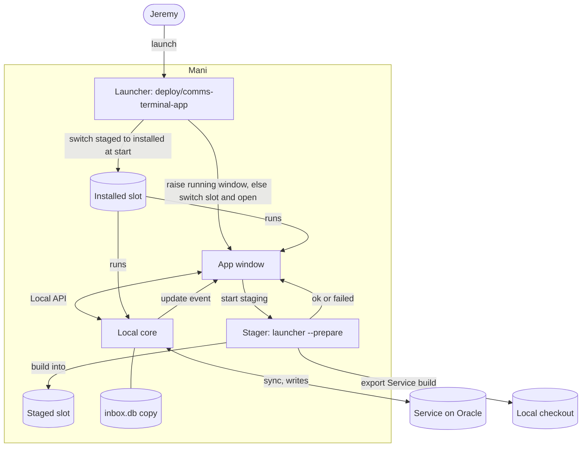

# PRD: App Updates on Restart

## 1. Document control

| Field | Value |
|---|---|
| Title | App Updates on Restart |
| Status | **Implementing.** Strategy approved in discovery 2026-11-04; Jeremy said "execute the prd fully" 2026-11-04. Phases 0–2 and 3.1 built on branch `jeremy/app-update-on-restart`; Phase 3.2 (merge, deploys Oracle) and 3.3 (hands-on check on Mani) pending. |
| Owner / authority | Jeremy. Source-of-truth chain: `AGENTS.md` (project rules) → `.agents/discovery/2026-11-04-autoupdate.md` (approved problem and strategy) → `.agents/prd/2026-10-31-desktop-app.md` (FR-APP-14, FR-APP-15, AS-APP-9, which this PRD amends) → code on `origin/main`. |
| Created / updated | Created 2026-11-04T17:09+00:00 (2026-11-04 13:09 America/Halifax). |
| Topic | How the desktop App on Mani takes a new Service build: stage it in the background, fade while read-only, apply at the next start, and always answer a launch. |
| Code basis | `origin/main` at `7a8b707`, exported read-only to the session scratchpad. Line numbers below refer to that commit. |
| History limits | This session's conversation (seed through Phase 4 of discovery) was available in full. Earlier App work is known only through the desktop App PRD, commit messages and code. Mani was unreachable over SSH on 2026-11-04, so nothing on it was observed. |
| Implementation authorization | Jeremy, 2026-11-04: "execute the prd fully". Merging to `main` deploys to Oracle and replaces the App on Mani at the next start; the merge is confirmed with Jeremy before it runs. |

## 2. Executive framing

**Problem (approved, discovery §3).** Jeremy, working in the desktop App on Mani, loses writes, sees the window vanish and reappear, and gets no window when he launches it, after every push to `main` (about 8 a day, 19 on 2026-11-03). The App must run exactly the Service's build, so it rebuilds and restarts itself to match. The result is interrupted triage and doubt whether the App crashed or an action saved.

**Audience.** Jeremy, the only App user, on Mani (Linux, niri). The Console on the laptop and a teammate's Mac are out of scope.

**Current behavior (Current, `7a8b707`).**

1. At each sync the Local core compares the Service build with its own; on a mismatch it turns read-only with "Update ready · restart Comms Terminal to load the service's version; read-only." and publishes an `update` event (`src/comms_terminal/core.py:901-910`).
2. On that event, once no write is pending, the App runs the launcher's `--prepare` in a background thread; when the build succeeds it quits with exit code 75 (`app/src/window.rs:59-72`, `:162-168`).
3. `--prepare` reinstalls the core in place (`uv tool install --reinstall`), builds the App with cargo, replaces `bin/comms-terminal-app`, replaces the installed launcher, then stops the running core (`deploy/comms-terminal-app:63-85`).
4. The launcher loop runs `--prepare` before every window opening, then reopens the App when it exits 75 (`deploy/comms-terminal-app:101-108`).
5. A launch while a launcher is alive prints "Comms Terminal App is already open or updating." to stderr and exits 0 (`deploy/comms-terminal-app:92-96`). The desktop entry has `Terminal=false`, so nothing is visible. The App binary already brings a running window forward (`app/src/main.rs:50-52`, `app/src/control.rs:51-59`, `app/src/window.rs:253-255`), but the launcher's guard exits before it is reached.
6. The bottom bar shows `Read-only · <problem>` for any read-only state (`app/defaults/views/status/main.js:13-15`). Settings › Service & updates shows both builds, an "Update now" button that toasts "the App restarts when it is ready", and "Restart App" (`app/defaults/views/settings/main.js:126-148`).
7. The Composer autosaves 800 ms after typing (`app/defaults/views/composer.js:152-161`); a refused save keeps the text only in memory and marks `draft_unsaved` (`composer.js:84-89`).

**Desired outcome.** The App never closes by itself. After a push it fades, stays navigable, says what the update is doing, builds the new version beside the running one, and switches to it the next time Jeremy starts it, without a build wait. Every launch answers within 2 seconds.

**Scope.** `deploy/comms-terminal-app`, the App's update handling and restart command, the status and Settings views, the App's raise path, their tests, `features/app.feature`, runbook §10.

**Non-goals.** Keeping writes on across pushes (rejected in discovery: read-only is acceptable); a Service contract version; prebuilt binaries or a build host; changing the Oracle deploy; changing the Console's updater (`deploy/comms-terminal-local`); the macOS install path beyond keeping it working.

**Dependencies.** None external. Overlaps the unmerged branch `jeremy/app-desktop-entry` (`f72368e`, "the App says it is building when a menu launch has to update first"); see §6.

**Success measures (approved, discovery §3, measure 1 revised).**

1. Read-only always looks read-only (the App fades; navigation works) and says a restart is needed; the window never vanishes on its own.
2. The window never closes on its own while Jeremy uses it; an update applies at the next start.
3. Every launch shows a window or a visible status within 2 seconds.
4. Whenever writes are off, the App says why and what comes next.
5. Guardrail: an App on an older build never writes something the newer Service misreads.

## 3. Requirements and coverage

### Functional requirements

| ID | Requirement | Status | Measures |
|---|---|---|---|
| FR-UPD-1 | The App never quits by itself because of an update. An `update` event starts background staging only. `app.restart` stays the one way an update applies while the window is open, and it runs only on Jeremy's action. | Confirmed (discovery Q2: next start only) | 1, 2 |
| FR-UPD-2 | Staging builds the Service build into its own slot beside the installed one. It does not replace, stop or modify the running core, the running App binary or the installed launcher. | Proposed (follows from FR-UPD-1; discovery risk 1) | 2, 5 |
| FR-UPD-3 | One stager at a time. A second request while one runs waits for it or returns. When a staging finishes and the Service build has moved on, it stages the newest build. | Proposed | 2 |
| FR-UPD-4 | At start, the launcher switches to a staged slot that matches the Service build, stops the old core, and opens the App. A launch never builds before the window when an installed build exists; a build happens before the window only on first install (`--install`, run in a terminal). | Proposed (measure 3) | 2, 3 |
| FR-UPD-5 | A launch while the App is open brings its window forward. A launch while the launcher is alive and no window answers yet shows a visible notice that the App is starting. | Proposed (measure 3) | 3 |
| FR-UPD-6 | While the Local core is read-only because of an update, the whole App fades. Navigation, reading, search and the Palette keep working; writes stay refused by the core. Network offline stays as today (bar pill, no fade). | Confirmed (Jeremy: "fade the entire app when a restart is required and only allow navigation") | 1, 4 |
| FR-UPD-7 | The bar names the update step: building ("Updating · read-only"), ready ("Update ready · restart to edit"), failed ("Update failed · read-only · see log"). Settings › Service & updates shows the same step; "Update now" stages without restarting and says so. | Proposed wording; requirement confirmed (measure 4) | 1, 4 |
| FR-UPD-8 | `app.restart` with unsaved Composer text (`draft_unsaved` set) does not restart; it toasts that the text is unsaved and how to keep it. | Proposed (discovery risk: typed text across restart) | 2 |
| FR-UPD-10 | When the staged build is ready, a notice floats above the bottom bar: "Comms Terminal <build> has been installed and the app requires a restart", with Restart, What changed (the repository's compare page between the two builds) and × (hides it until the next update step). | Confirmed (Jeremy, 2026-11-04, herdr-app's update notice as the model) | 2, 4 |
| FR-UPD-9 | A failed staging leaves the installed build untouched and usable read-only, records the failure in the App log, and reports it per FR-UPD-7. | Proposed | 4 |

### Non-functional requirements and invariants

| ID | Requirement | Status |
|---|---|---|
| NFR-UPD-1 | Exact-build matching stays: the core's write gate (`core.py:901-910`) is unchanged. | Confirmed (guardrail 5; discovery decision) |
| NFR-UPD-2 | The App binary and the core always run from the same slot (one commit). | Current invariant (runbook §10), kept |
| NFR-UPD-3 | Disk: keep the installed slot and at most one staged slot; remove older ones after a switch. Cargo's `target/` stays shared so incremental builds stay incremental. | Proposed |
| NFR-UPD-4 | The launcher still works from a bare desktop-entry `PATH` and on macOS (`deploy/comms-terminal-app:26-28`, `:42-49`). | Current, kept |
| NFR-UPD-5 | The installed launcher updates only at a switch, never while the old one runs it. | Proposed (today it is replaced during `--prepare`, `:79-82`) |

### Acceptance scenarios

| ID | Given / When / Then | Requirements |
|---|---|---|
| AS-UPD-1 | Given the App open on build X, when the Service reports build Y, then the App fades, the bar says "Updating · read-only", the window stays open, and staging Y starts. | FR-UPD-1, 2, 6, 7 |
| AS-UPD-2 | Given staging Y succeeded, then the bar says "Update ready · restart to edit", and the running core and App are still on X. | FR-UPD-2, 7 |
| AS-UPD-3 | Given Y staged, when Jeremy restarts (Settings, or close and launch), then the App opens on Y with no build, the old core is stopped, the new core starts, and writes are on. | FR-UPD-4, NFR-UPD-2 |
| AS-UPD-4 | Given the App open, when Jeremy launches it from the app launcher, then the existing window comes forward within 2 s and no second launcher stays running. | FR-UPD-5 |
| AS-UPD-5 | Given staging Y fails, then the bar says "Update failed · read-only · see log", the App stays on X, and the next start opens X. | FR-UPD-9 |
| AS-UPD-6 | Given staging Y is running, when the Service reports Z, then after Y finishes the stager stages Z, and a restart opens Z. | FR-UPD-3 |
| AS-UPD-7 | Given the Composer holds unsaved text, when Jeremy chooses Restart App, then the App stays open and toasts why. | FR-UPD-8 |
| AS-UPD-8 | Given the core cannot reach the Service, then the bar shows the offline Problem and the App does not fade. | FR-UPD-6 |
| AS-UPD-9 | Given the App was closed while staging ran, when Jeremy launches it, then a window opens within 2 s on the installed build (faded if it differs from the Service), and only one stager runs. | FR-UPD-3, 4 |

AS-APP-9 in `features/app.feature:87-91` ("the update installs the Service's build") is replaced by AS-UPD-1 to AS-UPD-3.

### States

```
Current ──(Service build differs)──▶ Updating ──(build ok)──▶ Ready ──(restart)──▶ Current (new build)
                                        │  ▲                    │
                                        │  └─(Service moved on)─┘
                                        └──(build failed)──▶ Failed ──(next push)──▶ Updating
```

The core's read-only gate holds in Updating, Ready and Failed. The App fades in all three.

## 4. Architecture and solution shape

### L1 Context — **Current**, unchanged

Jeremy uses the App on Mani; the Local core syncs with the Service on Oracle; the launcher builds from a local checkout of the code repository. Diagram: discovery §9 L1.

### L2 Container — **Proposed**



### L3 Component — **Proposed**

| Component | Where | Change |
|---|---|---|
| Update gate | `core.py` `check_copy` | None (NFR-UPD-1) |
| Update handler | `window.rs` `prepare_update`, event loop | Stage only; never `exit(UPDATE_EXIT)` on success; record step in a shared `update` key |
| Fade | `window.rs` `render` root | Lower opacity of the page content when `update` is set and the core is read-only |
| Restart command | `window.rs` `run` (`app.restart`) | Refuse while `draft_unsaved` is set |
| Bar and Settings | `views/status/main.js` `problems`, `views/settings/main.js` `service` | Show the update step; new "Update now" text |
| Raise path | `control.rs`, `main.rs` | Add a `raise` client verb that exits 0 when a window came forward, 1 when none |
| Stager, slot switch, launch guard | `deploy/comms-terminal-app` | Slots under `$DATA/builds/`, `flock` stager lock, switch at start, guard calls `raise` |

### L4 Code map — **Current** symbols the phases change

| Path:line | Symbol | Role today |
|---|---|---|
| `deploy/comms-terminal-app:55-57` | `installed()` | Reads `$DATA/installed-build` |
| `deploy/comms-terminal-app:59-61` | `stop_core()` | `pkill` of the core on `$DATA/inbox.db` |
| `deploy/comms-terminal-app:63-85` | `update()` | Builds in place, replaces launcher, stops core |
| `deploy/comms-terminal-app:87-108` | `--prepare`, launch guard, loop | Build before window; silent exit on live `launch.pid` |
| `app/src/window.rs:28-29` | `UPDATE_EXIT` | 75 |
| `app/src/window.rs:56-72` | `prepare_update()` | Runs `--prepare`, exits 75 on success |
| `app/src/window.rs:162-168` | event loop | Logs `update`; calls `prepare_update` when nothing is pending |
| `app/src/window.rs:318-319` | `run`: `app.update`, `app.restart` | Stage; exit 75 |
| `app/src/window.rs:578` | `render` | Root element |
| `app/src/host.rs:99-118` | `shared`, `set_shared`, `status`, `set_status` | Shared state that views read |
| `app/src/control.rs:51-59`, `:61-80` | `raise_running`, `client` | Raise on start; client verbs `shot`, `status`, `do`, `probe` |
| `app/src/main.rs:39`, `:50-52` | verb dispatch, `run` | Client verbs; raise-or-open |
| `app/defaults/views/status/main.js:13-22` | `problems()` | Bar Problems |
| `app/defaults/views/settings/main.js:126-148` | `service()` | Builds, Update now, Restart App |
| `app/defaults/views/composer.js:84-89` | `setUnsaved()` | Sets `draft_unsaved` |
| `tests/test_app_launcher.py:28` | `test_update_builds_while_open_then_reopens` | Launcher stand-in test |
| `tests/test_app_settings.py`, `tests/app_settings_view.mjs`, `tests/test_app_bars.py`, `tests/app_bars_view.mjs` | View tests | Settings and bar rendering |
| `features/app.feature:87-91` | AS-APP-9 | Scenario to replace |
| `docs/runbook.md:303-305` | §10 | Install and update text |

### Alternatives considered

- **Service contract range** (keep writes on across routine pushes): rejected in discovery; Jeremy accepts read-only, and it adds a version agents must bump.
- **Keep building in place, just stop exiting 75:** smaller diff, but `uv tool install --reinstall` rewrites the running core's package and `stop_core` kills the core under the open App (`deploy/comms-terminal-app:76`, `:83`). Slots are the smallest change that keeps the running build intact.
- **Persist unsaved Composer text to disk across restarts:** more code; FR-UPD-8's refusal covers the restart Jeremy triggers. Closing the window with unsaved text loses it today too, and stays out of scope.

### Complexity justification

The only new structure is a slot directory and a `flock`, both in the existing shell launcher, plus one client verb on an existing socket. No new dependency, service or process.

## 5. Phased execution plan

Feature first (`AGENTS.md`): Phase 0 changes the scenarios before code. Each phase is a separate reviewable change on a branch from `origin/main` (the App work is not on `dev`, per `.agents/issues/2026-11-03-app-today-done-feels-slow.md`).

### Phase 0 — Scenarios

| Step | Change | Req | Verify | Exit |
|---|---|---|---|---|
| 0.1 | `features/app.feature:87-91`: replace AS-APP-9 with AS-UPD-1 to AS-UPD-9, tagged `@AS-UPD-n @FR-UPD-n`; mark unbuilt ones `@wip`. | All | `uv run pytest -m wip -q` collects them; `uv run pytest tests/test_app_parity.py -q` still passes | Scenarios reviewed by Jeremy |

### Phase 1 — Launcher: slots, stager lock, switch at start, raise

| Step | Change | Req | Verify | Exit |
|---|---|---|---|---|
| 1.1 | `app/src/control.rs` `client`: add verb `raise` that sends `{"raise": true}` and exits 0 on an answer, 1 when no socket answers. `app/src/main.rs:39`: route `raise`. Update `HELP`. | FR-UPD-5 | `cargo test --manifest-path app/Cargo.toml` passes; manual: `comms-terminal-app raise` with no window exits 1 | Verb exists |
| 1.2 | `deploy/comms-terminal-app` `update()` → staging: build into `$DATA/builds/$short/` (its own `UV_TOOL_DIR`, `UV_TOOL_BIN_DIR`, App binary, launcher copy); write `$DATA/staged-build` last; never call `stop_core`; never replace `$INSTALLED`. Hold `flock $DATA/stage.lock` for the whole staging; after it, if `service-build` changed, stage again. | FR-UPD-2, 3, 9; NFR-UPD-3, 5 | New tests in `tests/test_app_launcher.py`: a staging leaves the installed slot's files and a running stand-in core untouched; two concurrent `--prepare` produce one build; a moved `service-build` is restaged | Tests pass |
| 1.3 | Launch path: before opening, if `staged-build` equals `service-build` (or `service-build` is unknown), stop the old core, point `$DATA/current` at the staged slot, install its launcher copy to `$INSTALLED`, prune other slots. Open the App from `$DATA/current/bin`. Remove the pre-window `--prepare` from the loop. Keep exit code 75 → reopen for `app.restart`. | FR-UPD-4; NFR-UPD-2, 3, 5 | Test: with a staged slot, the stand-in App runs on it and the old stand-in core got stopped; with none, it runs the installed slot at once with no build | Tests pass |
| 1.4 | Launch guard (`:92-96`): when `launch.pid` is alive, run `$DATA/current/bin/comms-terminal-app raise`; when that fails, show a desktop notice ("Comms Terminal App is starting…") with `notify-send` when present, else stderr. | FR-UPD-5 | Test: second launch with a stand-in App that answers `raise` exits 0 and the stand-in records the raise | Test passes; notice tool on Mani is an open unknown (§6) |
| 1.5 | `--install`: migrate an existing flat install (`$DATA/bin`, `$DATA/tools`, `installed-build`) into `$DATA/builds/<installed>/` and point `current` at it, so Mani keeps working without a rebuild. | NFR-UPD-4 | Test: a flat-layout data dir opens after migration with no build | Test passes |

Rollback: revert the launcher; `--install` from the previous `main` restores the flat layout (one rebuild).

### Phase 2 — App: stage only, fade, update step, restart guard

| Step | Change | Req | Verify | Exit |
|---|---|---|---|---|
| 2.1 | `window.rs` `prepare_update` (`:56-72`): on success set shared `update` = `{"step": "ready", "build": …}` and request a refresh instead of `exit(UPDATE_EXIT)`; on failure set `"failed"` and log it (`crate::log::write`). Set `"building"` when it starts. Allow a later `update` event to start a new staging after one finishes (today `STARTED` blocks it). | FR-UPD-1, 3, 7, 9 | `cargo test`; a Rust unit test with a stand-in prepare command that succeeds and one that fails asserts the shared step and that the process did not exit | Tests pass |
| 2.2 | `window.rs` event loop (`:162-168`): keep starting staging on `update`; clear shared `update` when status returns online on the same build. | FR-UPD-1, 6 | Covered by 2.1 tests plus AS-UPD-8 view test | — |
| 2.3 | `window.rs` `render` (`:578`): when shared `update` is set and `status().online` is false, render page content at reduced opacity; top bar and bottom bar stay full. | FR-UPD-6 | `tests/test_app_bars.py` (or a new `tests/test_app_update.py` with an `app_*_view.mjs` driver): screenshot via `comms-terminal-app shot` in an isolated headless instance shows the faded state; navigation key moves the selection | Inspected screenshot |
| 2.4 | `window.rs` `run` `app.restart` (`:319`): if `host::shared("draft_unsaved")` is set, toast and return. | FR-UPD-8 | Test: with `draft_unsaved` set, `do app.restart` leaves the window running | Test passes |
| 2.5 | `views/status/main.js` `problems()` (`:13-22`): when shared `update` is set, show its step text instead of the generic read-only text. `views/settings/main.js` `service()` (`:126-148`): show the step; change the "Update now" toast to "Building the Service's version; it opens the next time you start the App." | FR-UPD-7 | `tests/app_bars_view.mjs`, `tests/app_settings_view.mjs` updated; `uv run pytest tests/test_app_bars.py tests/test_app_settings.py -q` | Tests pass |

### Phase 3 — Docs and acceptance on Mani

| Step | Change | Req | Verify | Exit | Authorization |
|---|---|---|---|---|---|
| 3.1 | `docs/runbook.md` §10 (`:303-305`): slots, staging, switch at start, raise; `deploy/AGENTS.md` table if file roles change. | — | Read-through | Docs match code | — |
| 3.2 | Merge to `main` (deploys to Oracle). | All | `deployment.json` reaches `complete`; no `docker exec` during deploy | Deployed | **Jeremy's go** |
| 3.3 | On Mani: run `--install` once (migration, 1.5); then exercise AS-UPD-1 to AS-UPD-9 by hand with the next push. | All | Screenshots of faded, ready and failed states; launch-while-open raise; restart timing | Jeremy accepts | Jeremy's hands on Mani |

Independent work: Phase 1 (launcher, `control.rs`, `main.rs`) and Phase 2 (`window.rs`, views) touch separate files. Their interface is: the launcher sets `COMMS_TERMINAL_APP_PREPARE` and stages on `--prepare` with exit 0 on success; the App treats exit 0 as "ready". Phase 2.1 depends on 1.2's exit-code contract.

## 6. Risks, unknowns, and approvals

| Item | Impact | Evidence / status | Mitigation or next evidence | Owner | Blocks |
|---|---|---|---|---|---|
| Restarts up to ~8 a day feel heavy | Strategy misfit | Jeremy accepted (discovery Q3) | Acceptance week; fallback is the Service contract range | Jeremy | No |
| Staged-slot restart time on Mani | Slow restart breaks measure 3's spirit | Unmeasured; Mani unreachable | Time AS-UPD-3 in Phase 3.3 | Claude | No |
| Notice tool on Mani for a launch with no window yet | FR-UPD-5 second half invisible | Unknown whether `notify-send` and a notification daemon run under niri | Check on Mani before Phase 1.4 | Claude | No (falls back to stderr) |
| Migration of the flat install | Mani App fails to open after the change | Layout known from runbook §10 | Step 1.5 test; rollback via previous `--install` | Claude | No |
| Unmerged `jeremy/app-desktop-entry` (`f72368e`) | Conflicting launcher edits | Branch adds a "building" message for a menu launch that builds first; this PRD removes that build | Decide: close the branch or fold its desktop-entry validation fix (`75e7814`) in | **Jeremy** | No |
| Closing the window with unsaved Composer text | Text lost | Same as today; FR-UPD-8 covers restart only | Out of scope; revisit if it happens | Jeremy | No |
| PRD approval | Implementation cannot start | Draft | Review this PRD | **Jeremy** | **Yes** |
| Push to `main` | Deploy | Needs explicit go (`AGENTS.md`) | Ask at Phase 3.2 | **Jeremy** | Yes, for 3.2 |

## 7. Discussion and decision ledger

| # | When | Request or decision | Source | Reasoning | Status | Supersedes |
|---|---|---|---|---|---|---|
| 1 | 2026-11-04 | `/discovery the autoupdate process is awkward` | Jeremy | — | Request | — |
| 2 | 2026-11-04 | Seed: client-side update, not the Oracle deploy | Jeremy (question) | Chose "Client update" over Oracle deploy, both, or Claude Code | Approved | — |
| 3 | 2026-11-04 | Trigger: "interrupts my work and sometimes it is confusing the state of the app. sometimes i launch it from my app launcher and nothing happens" | Jeremy | — | Evidence | — |
| 4 | 2026-11-04 | Focus on the App on Mani only | Jeremy (question) | Console out of daily use | Approved | Seed's "App and laptop console" |
| 5 | 2026-11-04 | Confusing states: read-only with no why, window vanishes, launch shows nothing; after a silent launch the App appeared later | Jeremy (question) | Matches the launch guard and build-before-window in source | Evidence | — |
| 6 | 2026-11-04 | Wanted analogue: update on next start (VS Code, Slack) | Jeremy (question) | — | Approved | — |
| 7 | 2026-11-04 | Phase 1 approved; problem, scope, five measures approved; term "Service contract" | Jeremy (questions) | — | Approved | — |
| 8 | 2026-11-04 | Survey depth: deep | Jeremy (question) | — | Approved | — |
| 9 | 2026-11-04 | Six approaches approved as the set to choose from | Jeremy (question) | — | Approved | — |
| 10 | 2026-11-04 | Process correction: no approach letters in questions | Jeremy: "i don't know the letters, explain context without giving them" | — | Applied | — |
| 11 | 2026-11-04 | Read-only is not the pain; fade the App and allow navigation only when a restart is required | Jeremy (free text) | Pain is presentation and timing, not lost writes | Approved | Measure 1 "0 minutes of read-only" |
| 12 | 2026-11-04 | Apply at next start only | Jeremy (question) | No self-restart | Approved | Idle restart, restart button only |
| 13 | 2026-11-04 | Every push fading the App is fine | Jeremy (question) | Removes the need for a contract version | Approved | "Only incompatible pushes fade" |
| 14 | 2026-11-04 | Keep shipping on each approval; no release train | Jeremy (question) | — | Approved | — |
| 15 | 2026-11-04 | No prebuilt binaries now | Jeremy (question) | Build is hidden in the background | Approved | — |
| 16 | 2026-11-04 | Measure 1 replaced: read-only looks read-only and says restart is needed; window never vanishes | Jeremy (question) | Follows #11 | Approved | Original measure 1 |
| 17 | 2026-11-04 | Strategy "honest lockstep" with its diagrams and risks | Jeremy (Phase 4 gate) | Rejected: release train (#14), contract range and expand/contract (#11, #13), prebuilt (#15), skew protection (two Service builds on one database) | Approved | — |
| 18 | 2026-11-04 | `/prd` for the approved strategy | Jeremy | — | Request | — |
| 19 | 2026-11-04 | Stage in slots rather than in place; switch at start; launch guard raises; restart refuses with unsaved Composer text | Claude (this PRD) | In-place install stops and rewrites the running core (`deploy/comms-terminal-app:76`, `:83`); raise already exists in the binary | Built under #20 | — |
| 20 | 2026-11-04 | "execute the prd fully" | Jeremy | — | Implementation authorized | PRD "None" authorization |
| 21 | 2026-11-04 | Show a herdr-style notice: "Comms Terminal x.y.z has been installed and the app requires a restart", with Restart (screenshot of herdr-app's "Herdr 0.1.13 and herdr-core 0.1.18 are ready · Restart · What changed · ×") | Jeremy, mid-implementation | One-click restart where his eyes are | Built as FR-UPD-10; `x.y.z` is the build's short commit, the only version the App has | — |
| 22 | 2026-11-04 | Rust unit tests for `prepare_update` (Phase 2.1) replaced by the macOS CI step that drives the real App: offline core, stand-in `--prepare`, screenshots of the building and ready states, `raise` and `status` | Claude | `prepare_update` needs the window's thread and request channel; the CI step exercises the real path | Applied | Phase 2.1 verification |
| 23 | 2026-11-04 | Feature scenarios cover AS-UPD-1–4 and AS-UPD-9; AS-UPD-5, 6 and 8 are launcher and view tests (`tests/test_app_launcher.py`, `tests/test_app_bars.py`); AS-UPD-7 (restart guard) is checked by hand in Phase 3.3 | Claude | No duplicate bindings | Applied | Phase 0.1 "AS-UPD-1 to 9" |

Earlier App history (undated here): `9a60d07` "the App stays open while an update builds, then reopens" (2026-11-03) introduced `--prepare` and `launch.pid`; `4b02e1d` (2026-10-20) introduced exit code 75 for the Console.

## 8. Work log

| Timestamp | Actor | Activity | Result | Evidence | Kind |
|---|---|---|---|---|---|
| 2026-11-04 (time not recorded) | Claude | Discovery Phases 1–4 for client autoupdate | Approved strategy | `.agents/discovery/2026-11-04-autoupdate.md` | Source-observed |
| 2026-11-04 (time not recorded) | Claude | Rendered discovery diagrams with `@mermaid-js/mermaid-cli@11.4.2` | 3 of 3 OK | Session command output | Source-observed |
| 2026-11-04T17:09+00:00 | Claude | Read `origin/main` `7a8b707` (launcher, `window.rs`, `control.rs`, `main.rs`, `host.rs`, views, `core.py`, tests, `features/app.feature`, runbook §10); wrote this PRD | Draft PRD | This file | Source-observed |
| 2026-11-04T17:14+00:00 | Claude | Worktree `~/workspace/comms-terminal-app-update-20261104`, branch `jeremy/app-update-on-restart` from `7a8b707` | Created | `git worktree list` | Source-observed |
| 2026-11-04 (time not recorded) | Claude | Phases 0–2, 3.1: launcher slots, `raise`, stage-only App, fade, bar and Settings step, restart guard, notice, scenarios, runbook, CI step | Committed `553466e`…`484a264`, pushed | `git log` | Source-observed |
| 2026-11-04 (time not recorded) | Claude | Focused tests: `tests/test_app_launcher.py` (6), `test_app_bars.py`, `test_app_settings.py`, `test_app_parity.py`, `test_core.py`, update scenarios in `test_features.py` | All passed | pytest output | Source-observed |

## 9. Sources and coverage check

| Source | Purpose | Limits |
|---|---|---|
| `.agents/discovery/2026-11-04-autoupdate.md` | Approved problem, measures, strategy, risks | — |
| `.agents/prd/2026-10-31-desktop-app.md` | FR-APP-14/15, AS-APP-9, install history | Read by grep only |
| `deploy/comms-terminal-app`, `.desktop` | Launcher and update | — |
| `app/src/{main,control,window,host}.rs` | Update handler, raise, render, shared state | `window.rs` read in parts |
| `app/defaults/views/{status,settings}/main.js`, `views/composer.js` | Bar, Settings, unsaved text | — |
| `src/comms_terminal/core.py:895-945` | Write gate and status | — |
| `tests/test_app_launcher.py`, test file list | Existing harness | View test drivers not opened |
| `features/app.feature:85-96` | Scenario to replace | — |
| `docs/runbook.md` §10 | Install layout | — |
| Mani | Live install, notice tool, timings | **Unreachable** 2026-11-04 |

**Coverage.** Every FR and NFR maps to a phase step and a check, except: the second half of FR-UPD-5 (notice with no window) depends on the Mani notice-tool unknown; measure 3's 2-second bound and AS-UPD-3 timing are verified only by hand in Phase 3.3. NFR-UPD-4 (macOS) has no automated check; owner Claude, next action: run the launcher tests with `uname` stubbed to Darwin in Phase 1.

This `/prd` invocation performed no implementation: no code, test, configuration, branch, commit or deploy changed.
