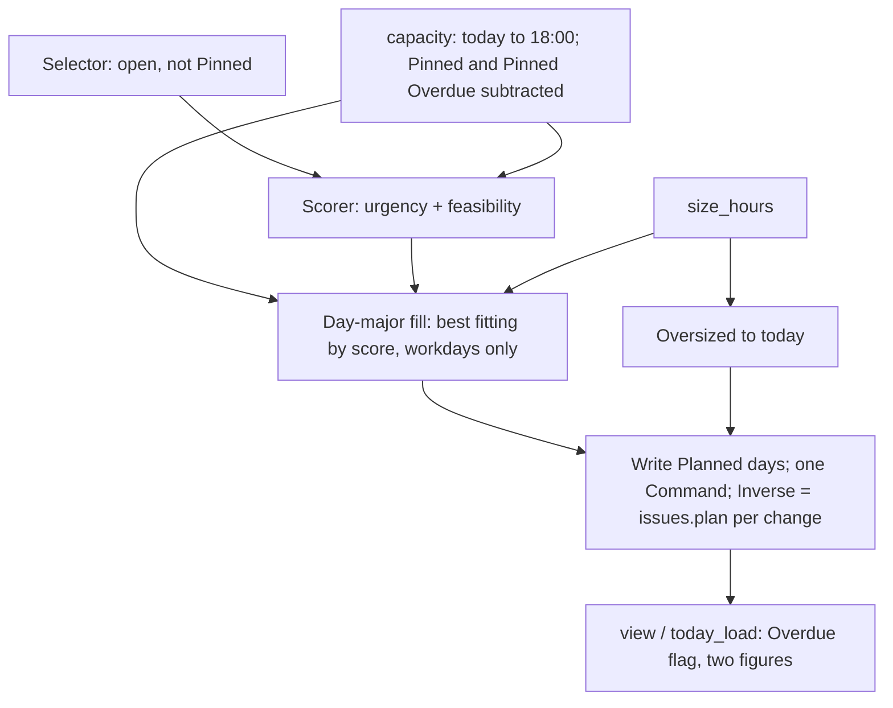

# PRD — Plan Issues

## 1. Document control

| Field | Value |
|---|---|
| Title | Plan Issues: automatic Planned days, Pinned, Overdue Issues on Today; Rollover removed |
| Status | **Approved** by Jeremy 2026-11-09 ("execute the prd"), with the discovery, the design grill and ADR 0023. |
| Owner | Jeremy Legere |
| Created | 2026-11-09T11:35-04:00 (America/Halifax) |
| Updated | 2026-11-09T11:35-04:00 |
| Topic | SuperPlan-style day planning of Issues; Issues on Today |
| Sources | Discovery `.agents/discovery/2026-11-09-issue-auto-planning.md` (approved 2026-11-09, includes the design grill); ADR 0023 (accepted 2026-11-09); `GLOSSARY.md` Issues section (updated 2026-11-09); predecessor PRD `.agents/prd/2026-11-07-issues-and-action-queue.md` (approved, built); code at `origin/main` `f83eea4` (deployed). |
| Branch | `jeremy/issue-auto-planning` from `origin/main` `f83eea4`, worktree `~/workspace/comms-terminal-issue-auto-planning`. Glossary, ADR 0023, ADR 0019 status line and discovery doc are uncommitted there. |
| History limits | This session's conversation is complete from the `/discovery` call on. Earlier Issues history comes from the 2026-11-07 discovery and PRD documents only. |
| Implementation authorization | **P0–P5.2** (Jeremy, 2026-11-09: "execute the prd"). P5.3 push to `main` and P5.4 the first live Plan Issues still need Jeremy's explicit go. |

## 2. Executive framing

**Problem.** Jeremy has 58 open Linear Issues in Comms Terminal and will never schedule them by hand ("i will never manually schedule these"). Today an Issue gets a Planned day only by hand (`issues.plan`, `src/comms_terminal/issues.py:283`), so none of the 58 has one (live `comms-terminal issues`, 2026-11-09). Today lists only Issues planned for exactly today (`tui.py:6390-6391`, `core.py:148`), so it shows no Issues, and capacity and warnings never engage.

**Audience.** Jeremy (Console on the laptop, App); agents through the CLI.

**Desired outcome.** One key gives every open Issue its day, SuperPlan-style, and Today always shows the Issues that are due now.

**Scope.**

- Plan Issues: one action (Console, App, CLI) that gives every open, unpinned Issue a Planned day.
- Pinned: a local flag that makes Plan Issues skip an Issue.
- Today: Overdue Issues and today's Issues in one list, with today's capacity and Overdue hours shown apart.
- Day capacity for today ends at 18:00.
- Rollover and the Slip status are removed.
- Keys: `p` Plan Issues, `w` one Issue's Planned day picker (moved from `p`), `f` Pinned.

**Non-goals.** Automatic runs (morning or on change); a preview of a run; project or team weights; time blocks; any Planned day, Pinned or status write to Linear; moving Planned day and Pinned to their own table.

**Dependencies.** Built Issue copy, urgency, Day capacity, warnings (PRD 2026-11-07 P2–P5); Command log and Undo (ADR 0021); Modules (ADR 0017).

**Success measures** (discovery §3, approved).

| # | Measure | Baseline 2026-11-09 |
|---|---|---|
| S1 | One action plans every open, unpinned Issue | 0 of 58 planned |
| S2 | Today shows Issues every workday | None |
| S3 | Each day's planned hours fit its capacity, except Pinned or oversized Issues, which warn | No plan |
| S4 | A Pinned Issue never moves on a run | No pins |
| S5 | Neither planning nor anything else in planning writes to Linear | Rollover writes Blocked |
| S6 | Plan Issues used on most workdays after 2 weeks | Not measured |

## 3. Requirements and coverage

Status: **C** confirmed by Jeremy (discovery or grill), **P** proposed here.

### Functional

| ID | Requirement | Status | Phase | Verification |
|---|---|---|---|---|
| FR-PL-1 | Plan Issues takes every open Issue that is not Pinned and gives it a Planned day; Pinned Issues keep theirs (or none). | C | P2, P3 | `tests/test_planning.py`, `features/issues.feature` |
| FR-PL-2 | Score = built `urgency` (FR-IS-8) plus a feasibility boost: for an Issue with a due date, count workdays from today to the due date whose capacity left (after Pinned Issues) holds its size; 0 days adds 100 %, 1 day 75 %, 2–3 days 40 % of coefficient `feasibility`, otherwise 0. | C (SuperPlan, grill) | P1, P2 | `tests/test_planning.py` |
| FR-PL-3 | `feasibility` is a stored urgency coefficient, default 5, settable with `urgency set`. Other coefficients unchanged. | C | P1 | `tests/test_planning.py`, `tests/test_schema.py` |
| FR-PL-4 | Fill: from today, for each workday, repeatedly take the highest-scoring remaining Issue whose size fits the day's capacity left, until none fits; then the next workday. Weekends get nothing. No horizon beyond a safety cap of 3650 days; an Issue left at the cap stays Unplanned and is reported. | C | P2 | `tests/test_planning.py` |
| FR-PL-5 | An Issue larger than a whole workday (9 h) goes on today after the fill and uses no capacity. | C | P2 | `tests/test_planning.py` |
| FR-PL-6 | Today's capacity in a run also loses the size of each Pinned Overdue Issue. | C (grill) | P2 | `tests/test_planning.py` |
| FR-PL-7 | Same database and `now` give the same plan: ties break by identifier. | C | P2 | `tests/test_planning.py` (run twice) |
| FR-PL-8 | One run is one Command: label "Planned N Issues", a target per Issue whose Planned day changed, and an Inverse of `issues.plan` calls restoring each old day. A run that changes nothing records nothing. | C (grill) | P2 | `tests/test_undo_roundtrip.py`, `tests/test_planning.py` |
| FR-PL-9 | Pin and unpin an Issue; local only, never sent; undoable. A pin survives Linear reads and webhooks. | C | P1, P2 | `tests/test_planning.py`, `tests/test_issues.py` |
| FR-PL-10 | Day capacity for today counts hours from now to 18:00 (at most 9) less busy time in that window; after 18:00 today's capacity is 0. Other days unchanged (FR-IS-6). | C (grill: 18:00); busy window P | P2 | `tests/test_planning.py` |
| FR-PL-11 | Overdue Issue: open, and Planned day or due date before today. | C | P2 | `tests/test_planning.py` |
| FR-PL-12 | Today lists open Issues with Planned day or due date today or earlier, in one urgency-sorted list; Overdue rows are marked. | C | P2, P4 | `tests/test_today_ui.py`, `tests/app_today_view.mjs` |
| FR-PL-13 | Today's pane shows today's figure (used of capacity: sizes of listed Issues that are not Overdue) and Overdue hours, apart. | C | P2, P4 | `tests/test_today_ui.py`, `tests/app_today_view.mjs` |
| FR-PL-14 | Keys in Console and App, on the Issues page and Today: `p` Plan Issues, `w` the Planned day picker for one Issue, `f` pin/unpin. Pinned rows show a pin mark. | C | P4 | `tests/test_app_parity.py`, `tests/test_issues_ui.py` (Proposed, new), `tests/app_issues_view.mjs` |
| FR-PL-15 | CLI: `comms-terminal issues plan` runs Plan Issues; `comms-terminal issue ID --pin` / `--unpin`. Agents may run both. | C | P3 | `tests/test_cli_parity.py`, `tests/test_planning.py` |
| FR-PL-16 | Rollover and the Slip status are removed: nothing moves Planned days at midnight and nothing writes a status to Linear for a slip. Retires FR-IS-10. | C (grill, ADR 0023) | P2 | `tests/test_planning.py` (rollover tests removed), `features/issues.feature` |
| FR-PL-17 | Warnings unchanged (FR-IS-9, FR-IS-13): after due date, too far out, larger than a day, due soon and Unplanned. | C | — | existing tests stay green |
| FR-PL-18 | Plan Issues and pin are refused while the Issues Module is off (ADR 0017). | P (follows `@writer(module="issues")`) | P2 | `tests/test_planning.py` |

### Non-functional

| ID | Requirement | Status | Phase |
|---|---|---|---|
| NFR-1 | A run over 100 Issues and 30 days finishes in under 1 s on the laptop copy, so the Console stays responsive. | P | P2 |
| NFR-2 | Local API grows only (ADR 0013): `issues.view` and `today` keep their fields and add new ones; `schema/local-api.openrpc.json` regenerated. | C (ADR 0013) | P3 |
| NFR-3 | Every new writer is in `agent.COMMANDS` (`tests/test_cli_parity.py`) and in `tests/test_undo_roundtrip.py`. | C (`AGENTS.md`, ADR 0021) | P2, P3 |
| NFR-4 | Schema change bumps `SCHEMA_VERSION` 44 → 45, adds `MIGRATIONS[45]`, updates `schema.sql` and `tests/schema_history.py`. | C (`AGENTS.md`) | P1 |
| NFR-5 | Console and App ship together (FR-UI-5 of the predecessor PRD). | C | P4 |

### Acceptance scenarios (write first in `features/issues.feature`, tagged `@wip` until built)

- **AS-PL-1** Monday 09:00, 3 h of Meetings, five 1-hour Issues and one 8-point Issue, none planned: Plan Issues puts the most urgent 6 hours on Monday (the 4-hour Issue fits) and the rest on Tuesday.
- **AS-PL-2** A Pinned Issue on Wednesday keeps its day after Plan Issues, and Wednesday holds 1 hour less for others.
- **AS-PL-3** A Pinned Issue with no day stays Unplanned after Plan Issues.
- **AS-PL-4** An Issue due tomorrow with No priority, with tomorrow full, gains the feasibility boost and lands today.
- **AS-PL-5** A 40-point Issue lands on today and uses none of today's capacity; it shows "Larger than a day".
- **AS-PL-6** Plan Issues at 19:00 puts nothing new on today.
- **AS-PL-7** Plan Issues then Undo restores every Planned day; Undo after a Linear full read is refused with "it changed since".
- **AS-PL-8** Friday's unfinished Issue is still planned for Friday on Monday, shows on Today marked Overdue, and nothing was sent to Linear.
- **AS-PL-9** Today lists an Issue due today but planned Thursday, counted in today's figure; an Issue due yesterday and planned Friday is listed as Overdue.
- **AS-PL-10** Running Plan Issues twice with no change records one Command.
- **AS-PL-11** `issues plan` from the CLI gives the same plan as `p`.

### Invariants

- Plan Issues and pin never queue an Action and never write to Linear.
- Linear fields in the copy still change only from Linear (ADR 0019); `upsert` (`issues.py:30`) leaves `planned_day` and `pinned` as they are.
- A Pinned Issue's Planned day changes only by `w` or the CLI `--plan`, never by Plan Issues.

## 4. Architecture and solution shape

### L1 Context — Proposed (unchanged boundary)

```mermaid
flowchart LR
  J[Jeremy] -- p, f, w; reads Today --> CT[Comms Terminal]
  AG[Agents] -- issues plan, --pin --> CT
  L[(Linear)] -- Issues, due dates, priorities --> CT
  GC[(Google Calendar)] -- busy time --> CT
  CT -. no planning writes .-> L
```

### L2 Container — Current → Proposed

- **Current.** Service loop runs `issues.rollover` each pass (`serve.py:959`), which moves passed Planned days and queues a Slip status Action (`issues.py:417-440`). Clients set Planned days one at a time (`issues.plan`).
- **Proposed.** No Service-side planning. Clients call one writer, `issues.plan_all`, which reads the copy (Issues, Pinned, urgency coefficients, calendar busy time) and writes Planned days. The laptop runs it on its working copy and Oracle replays it with the same `now` (ADR 0012); Oracle's result wins if its copy differed.

### L3 Component — Proposed (inside `issues.py`)



### L4 Code map

| Path | Symbol | Current | Change |
|---|---|---|---|
| `src/comms_terminal/schema.sql` | `issues` table `:451`, `urgency` inserts `:498` | `planned_day` only local column | add `pinned INTEGER NOT NULL DEFAULT 0`; insert `('feasibility', 5)` |
| `src/comms_terminal/inbox.py` | `SCHEMA_VERSION` `:30`, `MIGRATIONS[44]` `:914` | 44 | 45 with `MIGRATIONS[45]` |
| `tests/schema_history.py` | inverse migrations | to 44 | add 45 inverse |
| `src/comms_terminal/issues.py` | `SLIP_STATUS` `:262`, `rollover` `:417` | Rollover writes Slip status | delete both |
| same | `_busy_hours` `:302`, `capacity` `:330` | today counts to midnight | today window ends at `DAY_END = time(18)` |
| same | Proposed `overdue(i, day)`, `pin`, `plan_all`, `today_load` | — | new |
| same | `view` `:502` (`day_only`) | one Planned day | add `today: bool` filter (Planned day or due ≤ today), `overdue` per row; keep `day_only` for compatibility only if a caller remains, else remove |
| `src/comms_terminal/serve.py` | `wake_loop` `:938`, call `:959` | calls `issues.rollover` | remove the call |
| `src/comms_terminal/core.py` | Today query `:148-150`; `issues.view` query `:532-543` | `day_only` today, `capacity` | Today filter, add `overdue_hours` and `overdue` per row (fields added only) |
| `src/comms_terminal/agent.py` | `COMMANDS` `:42-45`; `issues` parser `:268`; `issue` parser `:~285`; handlers `:341-351`, `:404` | `issues` lists; `issue --plan` | `issues plan`; `issue --pin/--unpin`; COMMANDS entries |
| `src/comms_terminal/tui.py` | `IssuesPage.BINDINGS` `:6359`, `action_plan` `:6482`, `view` `:6387-6392`, Today capacity `:6427-6430`, `TodayPage.list_changed` `:6199`, `capacity_markup` `:6303` | `p` picker | `p` → `action_plan_all`; `w` → picker; `f` → pin; Overdue mark; two figures |
| `app/defaults/keys.json` | `page:issues` `:296` | `p: issue.plan` | `p: issues.plan_all`, `w: issue.plan`, `f: issue.pin` |
| `app/defaults/views/today/main.js` | issue keys `:42` | `p: issue.plan` | same three keys; two figures; Overdue mark |
| `app/defaults/views/issues/main.js`, `views/issue/main.js:110` | key list `:112`, actions `:155` | plan picker on `p` | new actions call `command.issues.plan_all`, `command.issues.pin` |
| `schema/local-api.openrpc.json` | generated | — | regenerate (adds `command.issues.plan_all`, `command.issues.pin`, new result fields) |
| `features/issues.feature` | Rollover scenarios `:50-62` | FR-IS-10 | remove; add AS-PL-1…11 |
| `features/modules.feature` | "Rollover waits while Issues is off" `:103-108` | — | replace with "Plan Issues is refused while Issues is off" |
| `tests/test_planning.py` | rollover tests `:108-120` | — | remove; add Plan Issues tests |
| `tests/test_undo_roundtrip.py` | writer table `:118-121` | `issues.plan` | add `issues.plan_all`, `issues.pin` |
| `tests/test_app_parity.py` | IssuesPage map `:53-57` | `plan → issue.plan` | `plan_all`, `plan`, `pin` |
| `AGENTS.md`, `GLOSSARY.md`, `docs/design/console.md` | CLI table, keys | `--plan` | add `issues plan`, `--pin`; keys (glossary done) |

### Alternatives (decided in discovery and grill; ADR 0023)

Keep Rollover; reserve a day before each due date; compute Today on render with no stored days; separate table for local fields. Each rejected in ADR 0023 with reasons.

### Complexity justification

No new module, service, dependency or table: one column, one coefficient row, three functions in `issues.py`, and key rebinding. Rollover's code and its Service hook are deleted.

## 5. Phased execution plan

Each phase ends with its focused tests green. Full `uv run pytest` runs once, in P5 (memory: full suite at PRD end).

### P0 — Scenarios first

0.1 `features/issues.feature`: add AS-PL-1…11 tagged `@wip` with `@FR-PL-*` tags; delete the two Rollover scenarios (`:50-62`). `features/modules.feature`: replace `:103-108` with "Plan Issues is refused while Issues is off" (`@wip`). Steps in `tests/steps/issue_steps.py`, `tests/steps/module_steps.py`. Verify: `uv run pytest -m wip -k issues` collects the new scenarios and they fail; `uv run pytest -k "issues and not wip"` passes. Reqs: all FR-PL. Auth: implementation go.

### P1 — Schema

1.1 `schema.sql`: `issues.pinned INTEGER NOT NULL DEFAULT 0`; `INSERT INTO urgency ... ('feasibility', 5)`.
1.2 `inbox.py`: `SCHEMA_VERSION = 45`; `MIGRATIONS[45]` adds the column and the row.
1.3 `tests/schema_history.py`: inverse of 45 (drop column via table rebuild as earlier entries do; delete row).
Verify: `uv run pytest tests/test_schema.py tests/test_schema_equivalence.py -q`. Reqs: FR-PL-3, FR-PL-9, NFR-4. Rollback: inverse in `schema_history.py`; the updater validates migrations against a live backup before it switches (`AGENTS.md`).

### P2 — Planning rules (`issues.py`, `serve.py`)

2.1 Delete `SLIP_STATUS` and `rollover`; delete the `wake_loop` call (`serve.py:959`). Reqs FR-PL-16. Verify: `git grep -n "rollover\|SLIP_STATUS" src` empty.
2.2 `DAY_END = time(18)`. `_busy_hours`: for today, window `[now, 18:00]`. `capacity`: today's hours = max(0, min(9, 18:00 − now)). Reqs FR-PL-10.
2.3 `overdue(i, day) -> bool`: open and (Planned day < day or due < day). Reqs FR-PL-11.
2.4 `pin(db, issue_id, pinned: bool, *, now=None)`: `@writer("write", module="issues")`; label, target, inverse `issues.pin` with old value. Reqs FR-PL-9, FR-PL-18.
2.5 `plan_all(db, *, now=None) -> int`: `@writer("write", module="issues")`. Selector, capacity left per workday after Pinned Issues (and today's after Pinned Overdue), feasibility boost, day-major fill, oversized to today, tie-break by identifier, safety cap 3650 days. Writes changed `planned_day`s in one `inbox._write_snapshot`; `commands.label`, one `commands.target` per changed Issue, `commands.inverse("issues.plan", id, old)` per changed Issue; returns count changed; records nothing when 0. Reqs FR-PL-1…8, FR-PL-18, NFR-1.
2.6 `view(..., today: bool = False)`: today filter (Planned day or due ≤ today, open), `overdue` on each row; `today_load(db, now) -> {"capacity","used","left","overdue"}` where used counts listed Issues that are not Overdue. Remove `day_only` once P3 and P4 callers move. Reqs FR-PL-12, FR-PL-13.
Verify: `uv run pytest tests/test_planning.py tests/test_issues.py tests/test_undo_roundtrip.py -q` and `uv run pytest -m wip -k "plan or overdue"` for domain scenarios. NFR-1: a timing test in `tests/test_planning.py` with 100 Issues asserting under 1 s.

### P3 — CLI and Local API

3.1 `agent.py`: `issues` gains optional `plan` (runs `plan_all`, prints "Planned N Issues" then the list); `issue` gains `--pin` / `--unpin`; `COMMANDS["issues.plan_all"] = "issues plan"`, `COMMANDS["issues.pin"] = "issue ID --pin/--unpin"`; `issue_markdown` shows Pinned. Reqs FR-PL-15, NFR-3.
3.2 `core.py`: Today query (`:148-150`) and `issues.view` query (`:532-543`) use `today=True` and add `overdue_hours` and per-row `overdue`; keep existing fields (NFR-2). Regenerate `schema/local-api.openrpc.json`.
Verify: `uv run pytest tests/test_cli_parity.py tests/test_planning.py tests/test_core_schema.py -q`.

### P4 — Console and App

4.1 `tui.py` `IssuesPage`: bindings `p` → `plan_all` ("plan"), `w` → `plan` ("day"), `f` → `pin` ("pin"); pin mark on rows; Today view uses `issues.view(..., today=True)` and `today_load`; `TodayPage.list_changed` title shows `today used/cap · overdue N h`; Overdue rows marked as Tasks mark overdue (`tui.py:6196`).
4.2 App: `keys.json` `page:issues`; `views/today/main.js:42`; `views/issues/main.js` and `views/issue/main.js` actions for `issues.plan_all` and `issue.pin`; two figures and Overdue mark on Today.
4.3 `tests/test_app_parity.py` map; `tests/app_today_view.mjs`, `tests/app_issues_view.mjs` updated.
4.4 Render with Textual's test driver and check the states in `docs/design/console.md` §5; update that document's key list.
Verify: `uv run pytest tests/test_today_ui.py tests/test_issues_ui.py (new) tests/test_app_parity.py tests/test_app_issues.py -q`; Node view tests as the suite runs them. Reqs FR-PL-12…14, NFR-5.

### P5 — Docs, full suite, release (needs Jeremy)

5.1 `AGENTS.md` CLI table and Rules (`issues plan`, `--pin`; Plan Issues is local, agents may run it); predecessor PRD gets a pointer that FR-IS-10 is retired by ADR 0023.
5.2 `uv run pytest` (full) and `uv run pytest -m wip` empty for this feature.
5.3 Push to `main` only with Jeremy's "ship it"; then no `docker exec` for a few minutes; watch `/var/lib/comms-terminal-deploy/status/deployment.json` on Oracle.
5.4 Read back live: `comms-terminal issues plan` (only with Jeremy's go, since it changes 58 live Planned days), then `comms-terminal issues` shows every open unpinned Issue with a day; Today in the Console shows Issues; Linear shows no new status changes.

## 6. Risks, unknowns and approvals

| Item | Impact | Evidence / status | Mitigation / next evidence | Owner | Blocks build |
|---|---|---|---|---|---|
| Replanning churn | Trust in Today (S6) | Motion reviews report tasks moving; SuperPlan worked for Jeremy | Pin; two weeks of use | Jeremy | No |
| No-priority Issues (≈40 %) sink weeks out | Hidden work | Built coefficient 1.95 | `urgency set priority.none` after real runs | Jeremy | No |
| Undo window ≤ 30 min | A late undo is refused | Undo guard compares whole rows (`commands.py` `undo`); full read rewrites `copied_at` (`issues.py:30-47`) | Accepted; own table later if refusals bite | Jeremy | No |
| Busy time outside 9:00–18:00 still reduces future days | Slight under-capacity on days with evening Events | Built `_busy_hours` counts the whole day | Accept; revisit with data | Jeremy | No |
| Laptop and Oracle copies differ during a run | Oracle's plan replaces the laptop's optimistic one | ADR 0012 replay | None needed | — | No |
| Live first run changes 58 Planned days | Live data change | P5.4 | Jeremy's explicit go; Undo within 30 min | Jeremy | Release only |
| PRD approval | — | Draft | Jeremy approves this PRD | Jeremy | **Yes** |
| Implementation authorization | — | None given | Jeremy's go | Jeremy | **Yes** |

## 7. Discussion and decision ledger

| # | Date | Request / decision | Source | Status | Supersedes |
|---|---|---|---|---|---|
| 1 | 2026-11-07 | Issues copy, local Planned day, capacity, urgency, warnings, Rollover writing Blocked | Predecessor discovery and PRD (approved, built) | built | — |
| 2 | 2026-11-09 | "i want issues to be scheduled similar to superplan on super productivity, and i want issues on the 'today' page" | Jeremy, `/discovery` | recorded | — |
| 3 | 2026-11-09 | New discovery document rather than reopening 2026-11-07 | Jeremy, ask-tool | approved | — |
| 4 | 2026-11-09 | Nothing planned because "too much by hand"; wants auto-fill by capacity, replan each run, pins; not preview/apply/undo | Jeremy, ask-tool | recorded | — |
| 5 | 2026-11-09 | Runs each morning, then "maybe on demand for now" | Jeremy, ask-tool then chat | on demand approved | Morning run (now Later) |
| 6 | 2026-11-09 | Today = due or Planned day today or earlier; plan every open Issue incl. waiting ones; explicit pin toggle | Jeremy, ask-tool | approved | — |
| 7 | 2026-11-09 | Rollover stops writing Blocked | Jeremy, ask-tool | approved; later widened by #13 | 2026-11-07 Slip status write |
| 8 | 2026-11-09 | "i will never manually schedule these" | Jeremy, ask-tool | approved | Scope framed as reducing hand work |
| 9 | 2026-11-09 | Pin makes the planner exclude the Issue; button now, automatic later; hand day setting kept, planner overrides | Jeremy, ask-tool | approved | — |
| 10 | 2026-11-09 | Store days (computed Today rejected); "i like the superplan approach" for due dates (reserved placement rejected) | Jeremy, ask-tool | approved | — |
| 11 | 2026-11-09 | Discovery Phase 4: C as SuperPlan does it | Jeremy, gate | approved | — |
| 12 | 2026-11-09 | SuperPlan detail adopted from code: feasibility boost, day-major fill, oversized on today, 3650-day cap | Mani `core.js:1175-1393`, Jeremy's choice | approved | — |
| 13 | 2026-11-09 | Remove Rollover entirely | Jeremy, grill | approved | #7 (local-only Rollover) and ADR 0019 Rollover |
| 14 | 2026-11-09 | Replan all including today's Issues | Jeremy, grill | approved | — |
| 15 | 2026-11-09 | Day ends 18:00 | Jeremy, grill | approved | Built "to midnight" |
| 16 | 2026-11-09 | One run = one Command, z undoes | Jeremy, grill | approved | — |
| 17 | 2026-11-09 | Console, App, CLI; agents may run it | Jeremy, grill | approved | — |
| 18 | 2026-11-09 | Keys: proposed `P` plus pin in picker; Jeremy: "p runs the planner, pick a different key for planned day picker"; then `w` day, `f` pin | Jeremy, grill | approved | `p` as one-Issue picker |
| 19 | 2026-11-09 | Today figures: "show overdue capacity and today capacity separately"; Overdue = passed Planned day or passed due date | Jeremy, grill | approved | Single "used of capacity" |
| 20 | 2026-11-09 | Ranking question first unclear ("i dont understand"); after plain restatement: add feasibility +5, keep other defaults | Jeremy, grill | approved | — |
| 21 | 2026-11-09 | Accept 30-minute undo window; separate table rejected | Jeremy, grill | approved | — |
| 22 | 2026-11-09 | Pinned Overdue counts against today; keep all four warnings; ADR 0023 | Jeremy, grill | approved | — |
| 23 | 2026-11-09 | Today: one list with Overdue marked (two groups rejected) | Jeremy, grill | approved | — |
| 24 | 2026-11-09 | Design grill shared understanding confirmed | Jeremy, ask-tool | approved | — |

## 8. Work log

| Time | Actor | Activity | Result | Evidence | Kind |
|---|---|---|---|---|---|
| 2026-11-09 (time not recorded) | Claude | Discovery, Phases 1–4 | Approved | discovery doc §1, §11 | source-observed |
| 2026-11-09 (time not recorded) | Claude | Design grill; glossary, ADR 0023, ADR 0019 status edits in worktree | Confirmed by Jeremy; uncommitted | `git status` in worktree | source-observed |
| 2026-11-09T11:35-04:00 | Claude | `/prd`: read code at `f83eea4`, wrote this PRD | Draft | this file | source-observed |
| 2026-11-09T12:10-04:00 (approx.) | Jeremy | "execute the prd" | Approved; P0–P5.2 authorized | conversation | source-observed |
| 2026-11-09T12:10-04:00 (approx.) | Claude | P0–P4 built on `jeremy/issue-auto-planning` (uncommitted): scenarios, migration 45, `issues.plan_all`/`pin`/`overdue`/`today_load`, Rollover removed, CLI, Local API, Console and App keys and marks | Focused tests green (`test_planning`, `test_issues_ui`, `test_features` issues and modules, `test_undo_roundtrip`, `test_cli_parity`, `test_core_schema`, `test_app_issues`, `test_app_parity`, `test_today_ui`) | worktree diff | source-observed |
| 2026-11-09T12:10-04:00 (approx.) | Claude | Rendered Console Today and Issues pages on demo data (Textual screenshot → PNG); fixed a passed-day group showing "4 of 0 h" | Inspected | scratchpad `issues.png`, `today.png` | source-observed |
| 2026-11-09T12:35-04:00 (approx.) | Claude | P5.1 docs (AGENTS.md, runbook, predecessor PRD pointer); P5.2 full `uv run pytest` | 2026 passed, 1 failed: `tests/test_action_runner_sends.py::test_an_unanswered_respond_is_sent_again_by_the_runner`, which fails the same on clean `origin/main` `f83eea4` (pre-existing). Focused rerun after late edits: 340 passed | run output | source-observed |

## 9. Sources and coverage check

| Source | Purpose | Limits |
|---|---|---|
| Discovery `2026-11-09-issue-auto-planning.md` | Problem, decisions, scenarios | — |
| ADR 0019, 0021, 0012, 0023; `GLOSSARY.md` | Contracts and terms | — |
| `src/comms_terminal/issues.py`, `serve.py`, `core.py`, `agent.py`, `tui.py`, `commands.py`, `schema.sql`, `inbox.py` | Current behaviour, line refs | Read at `f83eea4` |
| `app/defaults/keys.json`, `views/today`, `views/issues`, `views/issue` | App keys and calls | Read by grep, not rendered |
| `tests/` names, `test_undo_roundtrip.py`, `test_app_parity.py`, `test_planning.py`; `features/issues.feature`, `features/modules.feature` | Verification targets | No Console Issues page UI test exists; `tests/test_issues_ui.py` is proposed new |
| Live `comms-terminal issues` (read-only, 2026-11-09) | Baseline 58 Issues, 0 planned | — |
| SuperPlan `core.js` on Mani | Algorithm | Read-only |

**Coverage.** Every FR-PL and NFR maps to a phase and a test. Untraced: S6 (usage after 2 weeks) has no automated check; Jeremy reviews after two weeks. This `/prd` invocation implemented nothing.
