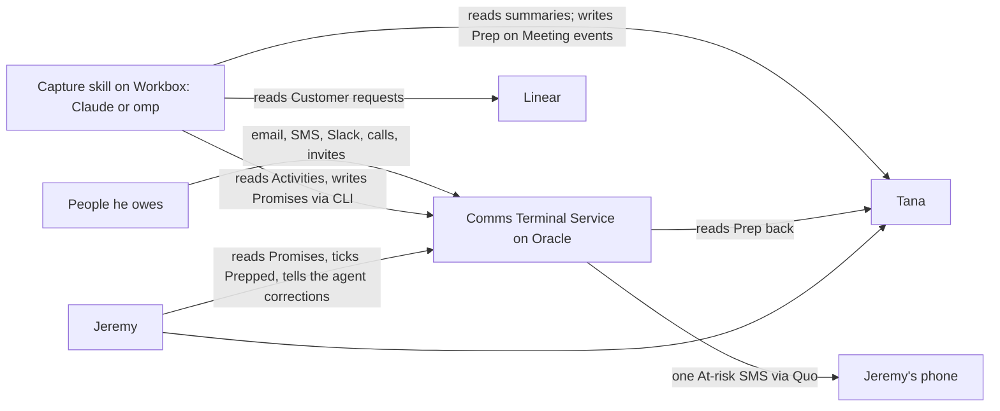
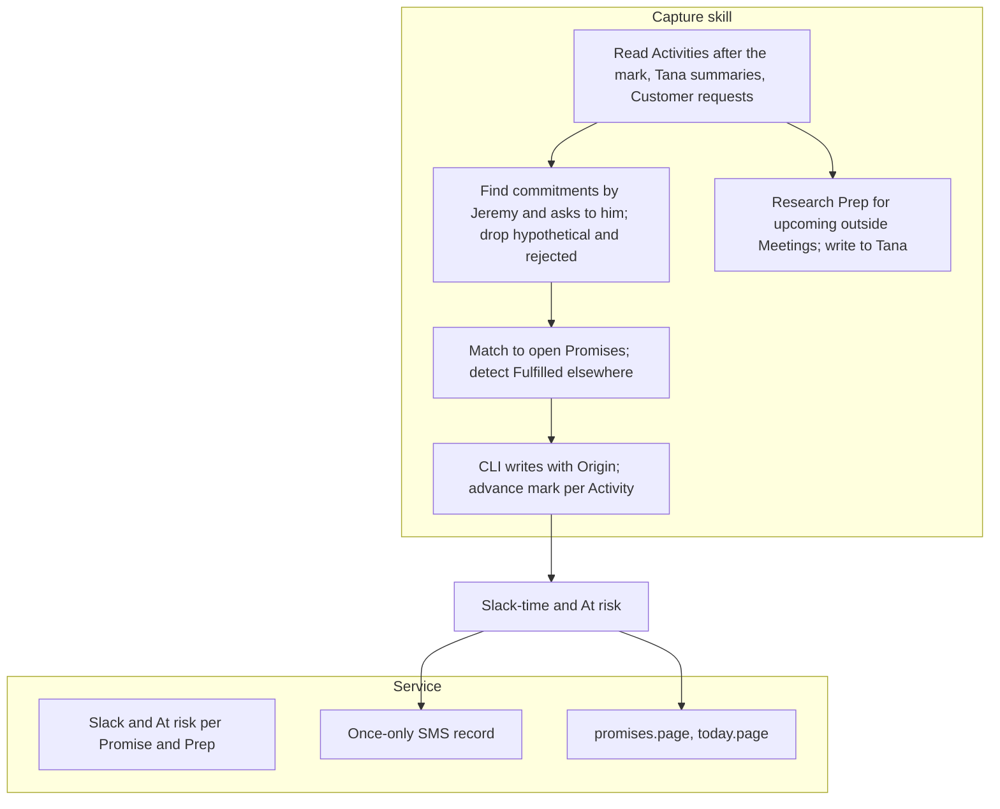

# PRD — Promises

## 1. Document control

| Field | Value |
|---|---|
| Status | **Draft.** Jeremy approved the strategy, domain model and UX decisions through ask rounds on 2026-11-18 (§7). Nobody has approved this PRD as a whole yet. |
| Owner / authority | Jeremy. Authority chain (`AGENTS.md`): Jeremy's instructions, then `AGENTS.md`, then accepted ADRs in `docs/adr/`, then `.agents/` discovery and PRDs. ADRs 0024–0027 are drafted on branch `promises-domain-model`, uncommitted. They say "accepted" because each records a decision Jeremy made in an ask round; they are not merged. |
| Created / updated | 2026-11-18T13:17-04:00 (America/Moncton) |
| Topic | Promises: what specific People expect Jeremy to do by a time, found by an agent, kept current, shown in Comms Terminal, with Prep for Meetings and one SMS when something goes At risk. |
| Sources | `.agents/discovery/2026-11-12-today-orient-fanout.md` (2026-11-18 reopening, Phases 1–4 approved); `GLOSSARY.md` § Promises (branch `promises-domain-model`); ADRs 0024–0027 (same branch); code at `origin/main` `1432eb9`. The discovery doc is in the stale checkout `~/workspace/comms-terminal` and is untracked. |
| History limits | The 2026-11-18 conversation was available in full. 2026-11-12 work is known only from the discovery doc. |
| Implementation authorization | Jeremy, 2026-11-18: "Execute the PRD", answered "One phase at a time": execute a phase, report, then continue. Push to `main`, enabling the timer and turning on the SMS stay separate go-lives. |

## 2. Executive framing

**Problem.** Jeremy's working context resets every few hours. People expect things from him: things to deliver, replies, and being punctual and prepared for Meetings. Those expectations sit across email, SMS, Slack, calls, Meetings and Linear Customer requests. Today shows only Threads where someone else wrote last, plus items with a due date. So a promise he made in his own message (Anna Ciprick's traction update, promised May 12 and unsent on Nov 12), an implied one, and the prep and travel a Meeting needs all stay hidden until he remembers late. On 2026-11-18 he was under-prepared for a meeting because he had not allowed for the drive. The 2026-11-12 fix, `/orient-today`, opened 91 Orient tabs in 6 days, and 67% got no reply (discovery §2).

**Audience.** Jeremy, in the Console and the App. Agents use the CLI. People Jeremy owes are affected but never contacted by the system.

**Current behavior (verified on `1432eb9`).**
- `inbox.today` builds Today from Todo Threads, Due Tasks, Drafts, Paused Enrollments and Unattended Organizations (`src/comms_terminal/inbox.py:3425`). `today.page` adds Issues (`src/comms_terminal/core.py:140`).
- Activities are append-only rows: `MESSAGE`, `EDIT` and `DELETE` (`src/comms_terminal/schema.sql:128`). A Quo Call transcript arrives later as an `EDIT` Activity targeting its call (`src/comms_terminal/quo.py:13`, `:92`).
- Comms Terminal makes no LLM calls. Agents change data only through the CLI. Every writer is in `agent.COMMANDS` or `agent.CONSOLE_ONLY` (`src/comms_terminal/agent.py:20`, `:72`), enforced by `tests/test_cli_parity.py`. Writers declare themselves with `writers.writer` (`src/comms_terminal/writers.py`).
- Tana is a read-only Context source with a 5-minute cache, read when a page opens (`src/comms_terminal/tana.py:1`, `:22`, `meetings` `:47`).
- Issues have due date, estimate, Planned day, capacity, urgency and warnings (`src/comms_terminal/issues.py:339`, `:378`, `:392`, `:440`; ADR 0023).
- `sequences.reschedule` puts a running Enrollment on an agreed date (`src/comms_terminal/sequences.py:1316`). Until now the glossary called that date an "Agreed next step".
- The Service runs a one-minute loop, `serve.wake_loop` (`src/comms_terminal/serve.py:938`). Quo can send SMS through `quo.make_sender` (`src/comms_terminal/quo.py:162`).
- The PRD says "Pull only. No notifications." (`docs/prd.md:226`, NFR-3) and "A single process, the standard library first" (`docs/prd.md:229`, NFR-8).
- `AGENTS.md` says nothing sends from an agent, and live writes need Jeremy's go.

**Desired outcome.** Every Promise Jeremy owes is recorded with its People, time, Origin and Slack. It stays current without his input. Promises show first on Today and on their own page. Jeremy is texted once when one goes At risk. Every outside Meeting has Prep with travel and a brief.

**Scope.** Promise storage and history; agent-only CLI writers; capture by a skill (by hand and an hourly Workbox timer); Slack and At risk; Promises page and Today in the Console and the App; Prep read back from Tana; one At-risk SMS; the Promise date starting a Warm Enrollment; repurposing `/orient-today`.

**Non-goals.** Links and backlinks on every entity page (a separate discovery). Writes to Linear. Sending anything to the People owed. Sharing the Issue planner or Day capacity (Jeremy chose Slack). Personal Goals and Guardrails generating Promises (later; strategy app). Quiet hours or repeated SMS.

**Dependencies.**
- Jeremy's cell number for the SMS.
- A Tana field layout for Prep on calendar events.
- The headless Claude or omp runtime on Workbox for the timer.
- Deploy authorization (a push to `main`).

**Success measures** (discovery §3, approved 2026-11-18; the dismissal measure was revised to corrections the same day).

| Measure | Target |
|---|---|
| Meetings or calls Jeremy is unprepared for | None |
| Promises that pass their time without first showing on Today | None |
| "Any update?" chasers from people | None |
| Promises captured, by monthly audit of sent messages and call notes | 95% or more |
| Promises Jeremy corrects (not a promise, wrong time) | Under 20% of new Promises |
| Cold re-entry to knowing every open Promise | Under 5 minutes |

## 3. Requirements and coverage

Status: **C** = confirmed by Jeremy on 2026-11-18; **P** = proposed by the agent; **U** = unknown.

### Functional

| ID | Requirement | St. | Phase | Verification |
|---|---|---|---|---|
| FR-PR-1 | A Promise records what, one or more People owed, a time (stated or inferred), work minutes, travel minutes, a state, and whether its time was inferred. | C | P1 | `features/promises.feature` "A Promise has People and a time" |
| FR-PR-2 | States: Tentative, Open, Fulfilled (late when after its time), Cancelled. Overdue and At risk are worked out, never stored. | C | P1, P2 | scenarios "States", "Overdue is worked out" |
| FR-PR-3 | Only agent CLI commands create or change Promises. The Console and the App show them read-only. | C | P1, P3 | `tests/test_cli_parity.py` with Promise writers in `COMMANDS`; UI tests show no Promise write controls |
| FR-PR-4 | Every create and every change cites an Origin: an Activity, a Linear Customer request, a Tana meeting summary, or Jeremy's recorded words. A command without one is refused. | C | P1 | scenario "A change without an Origin is refused" |
| FR-PR-5 | Cancelled needs an Origin showing the Person knows: they withdrew, or Jeremy told them. Until then the Promise stays owed. | C | P1 | scenario "Cancelling needs the Person told" |
| FR-PR-6 | A Promise holds any number of Promise links (Thread, Case, Issue, Draft, Tana node, URL). Links never change state. | C | P1 | scenario "Links are context" |
| FR-PR-7 | Slack-time = time left before the Promise's time, less its work and travel minutes. Urgent = time left under 2× its work and travel minutes; At risk = under 12× (a 2-hour task is At risk 24 hours before and Urgent 4 hours before; Jeremy, 2026-11-20). Overdue = past its time and not Fulfilled or Cancelled. | C (Slack), P (threshold) | P2 | `tests/test_promises.py` boundary cases |
| FR-PR-8 | A Promises page lists open Promises by time: Overdue, Urgent, At risk, Today, This week, Later, then Tentative (collapsed). Each row shows People, what, time, Slack, a Draft-ready mark and its links. | C | P3 | `tests/test_promises_ui.py`, `tests/app_promises_view.mjs` |
| FR-PR-9 | Today shows the Promises pane first and omits the Later section, including both Promises and Prep (Jeremy, 2026-11-23). The standalone Promises page still shows Later. | C | P3 | AS-PR-18; `tests/test_promises_ui.py` |
| FR-PR-10 | Comms Terminal keeps a "captured up to" mark over Activities. The agent advances it per Activity after writing that Activity's Promise changes. The Promises page shows the mark's time. | C | P1, P3 | scenario "Capture resumes after a crash" |
| FR-PR-11 | A capture skill reads new Activities (email, SMS, Slack, Quo calls and transcripts, Gemini notes emails), Tana meeting summaries, and Linear Customer requests (read-only). It writes Promises through the CLI. It runs by hand in Claude or omp, and hourly on a Workbox timer. | C | P5 | dry run on a seeded database; a timer run on Workbox |
| FR-PR-12 | A reply owed becomes a Promise only when the agent sees a real ask. Other Todo Threads stay in their own Today section. | C | P5 | skill test set (P0) |
| FR-PR-13 | Only Promises Jeremy must act on. A Person's promise to him stays the Thread's Waiting for them. Sequence Tasks stay Tasks. | C | P5 | skill test set (P0) |
| FR-PR-14 | When Jeremy owns the next step that opens a Warm Sequence, its Promise's time sets the Enrollment start (`sequences.reschedule`). A change of time moves the start. | C | P4 | scenario "A Promise date starts the Enrollment" |
| FR-PR-15 | Every Meeting with someone outside has Prep: a brief, prep minutes and travel minutes written by the agent on the Meeting's Tana event, and a "Prepped" tick by Jeremy. There are no defaults. | C | P5, P6 | skill run on a test Meeting; Tana readback |
| FR-PR-16 | Comms Terminal reads Prep back by calendar event and works out leave-by time, Slack and At risk. Prep moves and disappears with its Meeting. Unreadable or missing Prep counts as not prepared. | C | P6 | `tests/test_prep.py` including a Tana failure |
| FR-PR-17 | Prep rows show on Today and the Promises page beside Promises, marked as Prep. | C | P6 | UI tests as FR-PR-8/9 |
| FR-PR-18 | When a Promise or Prep first goes At risk, and again when it first goes Urgent or Overdue (2026-11-20), the Service sends one SMS from Jeremy's Quo number to his cell: what, for whom, by when, and a link. Never again for the same item. | C | P7 | `tests/test_promise_alerts.py` with a fake sender |
| FR-PR-19 | `/orient-today` opens one Orient tab per Organization (or Person without one) with one or more Overdue, Urgent or At-risk Promises, skipping open tabs. On-track Promises get no tab (Jeremy, 2026-11-20). | C | P8 | a skill run on Workbox and Mani |
| FR-PR-20 | An agent writes, on the Promise's Thread, a Draft for an At-risk Promise: the answer, and a short renegotiation. | C (scenario 5) | P5 | skill test set |
| FR-PR-21 | The capture agent sets work minutes on every Promise, estimated from up to 6 similar kept Promises (their actual minutes when known, else their estimates). On Fulfil it records the actual minutes the work took when the evidence shows it (Draft started to sent, Meeting length, Jeremy's words), so estimates improve over time (Jeremy, 2026-11-20). | C | — | `tests/test_promises.py`, scenario AS-PR-10 |
| FR-PR-23 | App Today shows all rows of each nonempty pane in order. The whole list column scrolls as one; opening Detail does not change the list layout. Arrows and Tab bring the selected row into view. | C (Jeremy, 2026-11-23) | Today column | AS-PR-13 in `features/promises.feature` and native App scroll check |
| FR-PR-25 | On Today and Promises in the App and Console, `y` on a Promise copies a Markdown handoff: obligation, People, time and whether inferred, status, work/travel, links, Origins, read-only refresh commands, and instructions to verify context, resolve only material gaps, and recommend how to keep the Promise. An Activity Origin supplies its Thread even without a Promise link. Prep is not copied; copying runs no agent and changes no records. | C (Jeremy, 2026-11-23) | Promise copy | AS-PR-19 in `features/promises.feature`; App and Console key tests |
| FR-PR-26 | Today follows Case and Thread selection: clicking or moving to a Promise shows its linked Thread cards and available Origin passages while the list keeps focus. Enter moves focus into the same pane. Escape returns to the same row and keeps its cards visible; expanding a card reads only that Thread. Prep and standalone Promises are unchanged. | C (Jeremy, 2026-11-24) | Promise selection parity | AS-PR-24 in `features/promises.feature` |
| FR-PR-27 | Each Promise has one agent-managed Work log: current work status first, then dated entries. The work status does not replace Open, Fulfilled or other Promise states. Promise Detail shows the Work log read-only in the Console and App. Preserve prior entries; identical evidence adds no entry. | C (Jeremy, 2026-11-26) | Promise work log | AS-PR-25, plus Console and App detail checks |
| FR-PR-28 | The existing hourly capture run checks still-owed Promises after processing new Activities, including when there are none. It uses the Promise’s Thread and linked records, checks the exact Calendar event when relevant, and cites each material update. It marks Fulfilled only with evidence the promised action happened, leaves ambiguous cases Open, and sends nothing. | C (Jeremy, 2026-11-26) | Promise work log | `tests/test_promises.py` Calendar fulfillment scenario and staged capture skill dry run |

### Non-functional and invariants

| ID | Requirement | St. | Phase | Verification |
|---|---|---|---|---|
| NFR-PR-1 | Comms Terminal makes no LLM call (NFR-8). The agent runs outside it. | C | all | code review; no new dependency in `pyproject.toml` |
| NFR-PR-2 | Pull only except FR-PR-18 (narrows NFR-3; ADR 0026). | C | P7 | `docs/prd.md` NFR-3 amended; alert test |
| NFR-PR-3 | Nothing is sent to any Person by the agent or the Service. The SMS goes only to Jeremy's own number. | C | P5, P7 | alert test asserts the recipient; skill writes Drafts only |
| NFR-PR-4 | Each Promise change is one Command with its history row (ADR 0021). Changes are append-only, so history is never rewritten. | P | P1 | `tests/test_promises.py` |
| NFR-PR-5 | Capture reads every Activity at most once into Promise changes, and none is skipped, including late `EDIT` transcripts. | C | P1, P5 | scenario "Capture resumes"; a late transcript case |
| NFR-PR-6 | Linear is read only. No Linear write from capture. | C | P5 | the skill uses read tools only |

### States and transitions (Proposed, from FR-PR-2/5)

```
Tentative ──(evidence firms it)──▶ Open ──(Origin shows it kept)──▶ Fulfilled
   │                               │
   └──(evidence drops it)──▶ (removed with Origin)      └──(Person knows)──▶ Cancelled
Open: time changes are history entries; Overdue / At risk are computed from time, work, travel, now.
```

A Tentative Promise that later evidence drops is stored as Cancelled with its Origin (Jeremy, 2026-11-18, D3).

**Out of scope, with reasons.** Shared capacity planning (Jeremy chose Slack). Edits to Promises from the UI (ADR 0024). Backlinks (separate discovery).

## 4. Architecture and solution shape

### L1 Context (Proposed)



### L2 Container (Proposed changes inside the existing Service)

| Container | Current | Change |
|---|---|---|
| Live database (`inbox.db`) | Threads, Activities, Issues… (`schema.sql`) | New tables `promises`, `promise_people`, `promise_links`, `promise_changes`, `promise_capture`, `promise_alerts` (P1, P7). |
| Domain module | `inbox.py`, `issues.py`, `sequences.py` hold rules | **Proposed** `src/comms_terminal/promises.py`: writers, Slack, views. |
| CLI | `agent.py` | `promise` and `promises` subcommands; capture mark commands. |
| Local API / queries | `core.py` `today.page` | `promises.page`; `today.page` gains `promises` and `prep`. |
| Console | `tui.py` | Promises page and Today section. |
| App | `app/defaults/views/today/`, `issues/` | **Proposed** `app/defaults/views/promises/`; Today view gains a section. |
| Loop | `serve.wake_loop` | Prep readback refresh and the At-risk SMS check (P6, P7). |
| Capture skill | none (`tana-meeting-synthesis` is the analogue) | **Proposed** `~/.omp/agent/skills/promise-capture/` with a Claude symlink, plus a Workbox user timer. |

### L3 Components (riskiest: capture and the risk check)



### L4 Code map (Current paths; Proposed symbols)

| Path | Current symbol | Proposed change |
|---|---|---|
| `src/comms_terminal/inbox.py:30` | `SCHEMA_VERSION = 46` | 47 (P1); 48 if P7 needs a separate migration |
| `src/comms_terminal/inbox.py:34` | `MIGRATIONS` | `MIGRATIONS[47]` creates the Promise tables |
| `src/comms_terminal/schema.sql` | table set | same tables |
| `tests/schema_history.py` | inverses | inverse of 47 |
| — | — | **Proposed** `src/comms_terminal/promises.py`: `record`, `firm`, `change_time`, `fulfil`, `cancel`, `link`, `capture_mark`, `advance_capture`, `slack`, `view` |
| `src/comms_terminal/agent.py:20` | `COMMANDS` | add `promises.*` writers |
| `src/comms_terminal/core.py:140` | `today.page` | add `promises`, `prep` |
| `src/comms_terminal/core.py` | queries | **Proposed** `@query("promises.page")` |
| `schema/local-api.openrpc.json` | API document | new query and fields |
| `src/comms_terminal/tui.py` | Today, Issues pages | Promises page; Today section |
| `app/defaults/views/today/main.js` | Today view | Promises section |
| `src/comms_terminal/tana.py:47` | `meetings` | **Proposed** `prep(client, event_ids)` reading Prep fields |
| `src/comms_terminal/serve.py:938` | `wake_loop` | call Prep refresh and the alert check |
| `src/comms_terminal/quo.py:162` | `make_sender` | reused to text Jeremy |
| `src/comms_terminal/sequences.py:1316` | `reschedule` | called from a Promise time change when linked (P4) |
| `docs/prd.md:226` | NFR-3 | amended per ADR 0026 |
| `AGENTS.md` | Rules: live writes need Jeremy's go | add a standing exception for Promise writes (ADR 0024) |
| `~/.omp/agent/skills/orient-today/` | Subject fan-out | per Organization with open Promises |

### Alternatives and complexity

- **Promises as Issues in Linear.** Rejected. Linear is edited by people, and agent writes there need per-change approval (ADR 0027).
- **Promise as a type of Case.** Rejected. A Case's Status rolls up from its Threads (ADR 0027).
- **LLM inside the Service.** Rejected under NFR-8: a new dependency and secret.
- **Shared Issue planner for risk (option C).** The agent's recommendation. Jeremy chose Slack (B). Slack ignores competing work, an accepted risk (§6 R2).
- **Added complexity, and why it earns its cost.** Six tables are the smallest set that covers many People, many links, append-only history, the capture mark and once-only alerts. A JSON column on `promises` could replace `promise_people` and `promise_links`, but at the cost of the indexed lookups that UI rows and Case or Person pages need. **Proposed.** One new module follows the `issues.py` pattern. No new service or dependency.

## 5. Phased execution plan

No phase is authorized. Each step's tests run with `uv run pytest <path>`. Feature first (`features/AGENTS.md`).

### P0 — Validate capture precision (riskiest assumption; read-only)

0.1 **Proposed** a test set built read-only by the agent: 2 weeks of Jeremy's sent messages, Quo transcripts and Gemini notes from the live DB (`file:…?mode=ro`, per `AGENTS.md`), with candidate Promises extracted by a draft prompt. Output: a local Markdown sheet for Jeremy to mark right or wrong. Requirements FR-PR-11–13. Exit: Jeremy has scored it; precision and recall are recorded in the discovery doc. Authorization: Jeremy's go for a read-only live read. No rollback is needed.

**P0 result (Jeremy scored 2026-11-18 by ask tool):** 36 of 37 verdicts right (97%). Promise precision 19/19, Fulfilled 1/1, Prep 4/4, Not 8/8, Tentative 3/4 (the cut-off Nov 6 demo-notes item was wrong). Jeremy reported no missed Promises (recall from his memory only; no Quo call transcripts matched). Corrections 1/37 (3%), under the 20% target. Fix for P5: check who wrote an edit (7 Slack edits by others and bots were excluded by hand); skip notes items that are cut off.

### P1 — Storage, writers, CLI (FR-PR-1–6, 10; NFR-PR-4, 5)

1.1 `features/promises.feature`, **Proposed**: scenarios named in §3. Verify they collect with `uv run pytest -m wip`.
1.2 `inbox.py:30,34`, `schema.sql`, `tests/schema_history.py`: migration 47 with tables `promises` (id, what, due_at, due_inferred, work_minutes, travel_minutes, state, thread_id null), `promise_people` (promise_id, person_id), `promise_links` (promise_id, kind, target), `promise_changes` (id, promise_id, at, change, origin_kind, origin_ref, words), `promise_capture` (single row: last Activity rowid, at). Verify with `tests/test_core_schema.py` and the schema history test. Rollback: the inverse in `schema_history.py`.
1.3 **Proposed** `promises.py` writers, each `@writer("write")`, each refusing a missing Origin. `cancel` requires an Origin. Verify with `tests/test_promises.py`. Depends on 1.2.
1.4 `agent.py:20` `COMMANDS` and parser: `promise new|time|firm|fulfil|cancel|link`, `promises [--json]`, `capture mark|advance`. Verify with `tests/test_cli_parity.py` and `tests/test_promises.py`.
1.5 `AGENTS.md` Rules and table: Promise commands, and a standing exception for Promise writes and capture-mark advances (ADR 0024). Authorization: Jeremy approves the wording.

### P2 — Slack and At risk (FR-PR-2, 7)

2.1 **Proposed** `promises.slack_time(row, now)` and `promises.view(db, now)` returning sections and Slack-time. Verify boundary cases in `tests/test_promises.py`: Slack-time exactly equal to work; an inferred time; Overdue; Fulfilled late.

### P3 — Pages (FR-PR-8, 9, 10, 17)

3.1 `core.py`: `@query("promises.page")`; `today.page` (`core.py:140`) adds `promises`. Update `schema/local-api.openrpc.json`. Verify with `tests/test_core.py`.
3.2 `tui.py`: Promises page and Today section, read-only, showing the "captured up to" time. Render with Textual's driver; check states in `docs/design/console.md` §5. Verify with `tests/test_promises_ui.py` and `tests/test_today_ui.py`.
3.3 `app/defaults/views/promises/` (**Proposed**) and `app/defaults/views/today/main.js`. Verify with `tests/app_promises_view.mjs` and `tests/app_today_view.mjs`; screenshot the App states.

### P4 — Promise date starts the Warm Enrollment (FR-PR-14)

4.1 `promises.link` with kind `enrollment`. `change_time` on a linked open Promise calls `sequences.reschedule` (`sequences.py:1316`) in the same Command. Verify with scenario "A Promise date starts the Enrollment". Rollback: the Command's inverse (ADR 0021).
4.2 `GLOSSARY.md` already replaces Agreed next step. Update `features/` scenario names that use it, if any (**Unverified**: grep in P4).

### P5 — Capture skill (FR-PR-11–13, 15, 20; NFR-PR-3, 5, 6)

5.1 **Proposed** `~/.omp/agent/skills/promise-capture/SKILL.md`, symlinked to `~/.claude/skills/promise-capture` (skills-live-in-omp). Steps:
   - Read the mark and the Activities after it.
   - Read Tana summaries and Linear Customer requests, read-only.
   - Write Promise changes through the CLI, with Origins.
   - Advance the mark per Activity.
   - Write Prep fields on outside Meetings' Tana events for the next 7 days (**Proposed** horizon).
   - Write Drafts for At-risk Promises. It never sends.
   Verify with a run against a seeded demo DB (`scripts/seed_demo.py`), then the P0 set.
5.2 **Proposed** Workbox user units `promise-capture.service` and `.timer` (hourly) running the skill headless. Verify with one timer run and the mark advancing. Authorization: Jeremy's go, because it writes the live DB and Tana unattended.

### P6 — Prep readback (FR-PR-16, 17)

6.1 **Proposed** `tana.prep(client, event_ids)` reading brief link, prep minutes, travel minutes and Prepped for calendar events.
6.2 `serve.wake_loop` (`serve.py:938`) refreshes Prep for outside Meetings in the next 7 days, at most every 5 minutes, and stores a read-only cache. **Proposed:** a cache table or memory, decided in P6 with evidence. Unreadable counts as not prepared.
Verify with `tests/test_prep.py`: a moved Meeting, a cancelled Meeting, Tana down. Requires the Tana field layout (§6 D2).

### P7 — At-risk SMS (FR-PR-18; NFR-PR-2, 3)

7.1 **Proposed** `promise_alerts` (item kind, item id, sent_at). A `wake_loop` check sends through the Quo sender (`quo.py:162`) to Jeremy's cell when an item first turns At risk.
7.2 Amend `docs/prd.md` NFR-3 per ADR 0026.
Verify with `tests/test_promise_alerts.py`: a fake sender, the recipient checked, once-only. Authorization: Jeremy's go and his cell number.

### P8 — Repurpose `/orient-today` (FR-PR-19)

8.1 `~/.omp/agent/skills/orient-today/SKILL.md` and `today_subjects.py`: replace the Subject read with `comms-terminal promises --json`, grouped by Organization (else Person). Verify with one run, and check the Herdr tabs on Mani.

### P9 — Release

9.1 Commit the ADRs, glossary and phases. Push to `main` only with Jeremy's go (`AGENTS.md`: a push deploys). Run no `docker exec` for a few minutes after the push; watch the deploy status. Verify that the live `promises.page` answers and that Today shows the section.

## 6. Risks, unknowns and approvals

| Item | Impact | Evidence / status | Mitigation / next evidence | Owner | Blocks |
|---|---|---|---|---|---|
| R1 False Promises from hypothetical or rejected statements | Correction rate over 20% | Meeting tools: ~1 in 5 false (discovery §5) | P0 precision test before P5 | Agent; Jeremy scores | P5 |
| R2 Slack-time ignores competing work | A crowded day surprises | Jeremy chose Slack-time over capacity fit | Revisit after a month of data | Jeremy | No |
| R3 Tana outage | Noisy At-risk Prep and SMS | ADR 0025 fail-safe | Accepted | — | No |
| R4 Standing agent writes to the live DB | Conflicts with the `AGENTS.md` "Live writes need Jeremy's go" rule | ADR 0024 | Jeremy approves the exception wording (step 1.5) | Jeremy | P1.5, P5.2 |
| R5 Video and in-person Meetings with no notes | Promises said there are missed | Gemini notes arrive as email; voxtype and tl;dv in Tana | Capture reads both | — | No |
| R6 Event locations missing | Travel minutes guessed | Calendar not checked (connector needs re-authorization) | The agent researches per Meeting (no defaults) | Agent | No |
| D1 PRD approval | — | Draft | Jeremy approves or revises | Jeremy | All |
| D2 Tana Prep field layout | — | **Decided (#39):** a pinned "Prep · <Meeting>" doc. Earlier proposal: an event-only Tana type `Prep` (fields Brief, Prep minutes, Travel minutes, Prepped) set with `updateEvent`; the skill writes it with `autoApprove` (Tana writes are otherwise proposals). Read-back built against it | Jeremy approves creating the type and unreviewed Prep writes | Jeremy | P5.2 (Prep step) |
| D3 A Tentative Promise later dropped | The state model | **Decided:** stored as Cancelled with its Origin | — | Jeremy | No |
| D4 At-risk threshold | SMS volume | **Decided (revised 2026-11-20):** two levels: Urgent when time left < 2× work and travel (the old At risk); At risk when < 12×. One SMS on first At risk, one more on first Urgent or Overdue. Originally: At risk when Slack-time < remaining work and travel | — | Jeremy | No |
| D5 SMS recipient | P7 | **Decided:** Jeremy's personal mobile (from `~/.memory/IDENTITY.md`), from his Quo number | Go-live still gated by D6 | Jeremy | No |
| D6 Phase authorizations, the live read in P0, the timer and the push | — | None given | Jeremy | Jeremy | each phase |

## 7. Discussion and decision ledger

All entries are 2026-11-18 unless dated. Source: Jeremy in the ask tool unless noted.

| # | Request or decision | Reasoning | Status | Supersedes |
|---|---|---|---|---|
| 1 | Reopen `/orient-today` discovery: "it does the wrong job and solves the wrong problem" | 67% of 91 tabs went unused | Recorded | 2026-11-12 approvals |
| 2 | Job: know which current expectations would be disappointed; success: Today empty and nobody sees him as forgetful | — | Approved (Phase 1) | Cold-return framing |
| 3 | "Ahead of every ball … my brain is an ai agent that wipes its context every 4 hours" (chat) | The system holds state, not his memory | Recorded | — |
| 4 | Sources: email/SMS, calls and meetings, Slack; Linear only tracks work | — | Recorded | — |
| 5 | Term "Promise" | Replaces "Expectation" | Approved | Expectation |
| 6 | Meeting readiness in scope: under-prepared because of driving; "never any synchronous interactions that I'm unprepared for" | — | Approved | Draft problem v1 |
| 7 | A Meeting is not a Promise; punctual, prepared and reliable are standing promises (Guardrails, strategy app) | Personal Objectives deferred | Recorded | — |
| 8 | Strategy C (Promise ledger in Comms Terminal), simplest form | Occam's razor criterion (chat) | Approved (Phase 4) | 2026-11-12 strategy B |
| 9 | Agent-only writer: "humans are read only?" | One writer, evidence on every change | Approved; ADR 0024 | Confirm-each step |
| 10 | NFR-3 exception for At risk only | — | Approved; ADR 0026 | Pull only (narrowed) |
| 11 | Agent outside Comms Terminal via the CLI | NFR-8 | Approved | — |
| 12 | Run as a skill like `tana-meeting-synthesis`, plus an hourly Workbox timer | Avoid "remembered late" | Approved | — |
| 13 | Track only things that need Jeremy's action; Tasks stay Tasks | — | Approved | — |
| 14 | States named "Draft, on track, at risk, filled, unfulfilled" | — | Revised by #15–17 | — |
| 15 | First state is Tentative (Draft clashes with the Draft term) | Agent challenge accepted | Approved | "Draft" state |
| 16 | At risk computed per Promise | — | Approved | — |
| 17 | Late Promises stay Overdue until Fulfilled late; "Promises can be cancelled"; "can't drop a promise without counterparty communication" | — | Approved | "Unfulfilled" |
| 18 | The agent decides real asks (a third of Todo Threads are noise) | Live Todo sample on Oracle | Approved | Every Todo Thread |
| 19 | Prep: the agent researches; no defaults | — | Approved | Defaults |
| 20 | Prep is part of the Meeting and follows it; "brief ready + you said so" | — | Approved | Prep as a Promise |
| 21 | Prep in Tana, read back into Comms Terminal | — | Approved; ADR 0025 | Brief in Tana, timing in CT |
| 22 | Inputs: everything; SMS once only | — | Approved | — |
| 23 | Own Promises page by time; Today shows all open Promises | — | Approved | Top of Today only |
| 24 | Every Promise links to a source; Jeremy's recorded words count | — | Approved | — |
| 25 | Capture mark stored in Comms Terminal (scenario answer) | — | Approved | — |
| 26 | `/orient-today` retired | — | Superseded by #28 | — |
| 27 | Risk: "need to measure risk … similar to issue due date" (chat) | — | Recorded; refined by #31–33 | Computed time-left |
| 28 | Repurpose `/orient-today`: every company with an open Promise | — | Approved | #26 |
| 29 | A Promise is its own entity, not an Issue or a Case; Customer requests are read-only input; links are context | — | Approved; ADR 0027 | — |
| 30 | Agreed next step replaced by Promise; its date starts the Enrollment | — | Approved | Agreed next step |
| 31 | Links and backlinks on every entity page: separate discovery | — | Deferred | — |
| 32 | Deep survey on risk measurement | Done (discovery doc) | Done | — |
| 33 | Risk = Slack (B) | Agent recommended C | Approved | C, A, D |
| 34 | ADRs 0024–0027; glossary moved to fresh `origin/main` branch | Defaults approved | Drafted, uncommitted | Stale-checkout edits |
| 36 | D3 Cancelled; D4 threshold kept; D5 personal mobile; execution one phase at a time | Jeremy, ask tool | Approved | — |
| 37 | Rename Slack to Slack-time (the word Slack names the Platform) | Jeremy, chat | Approved | Slack (term) |
| 35 | Not ticked: "Promises show on Case pages"; Jeremy instead asked for Notion-style links and backlinks everywhere | — | Becomes #31 | — |
| 38 | Release: "Push and deploy now"; SMS "Turn on"; timer "Start now" | Jeremy, ask tool | Done | D6 |
| 39 | Prep in Tana: "It should just use the existing Tana tooling", then (agenda docs cannot be created through Tana's MCP) a "Prep · <Meeting>" doc pinned to the Meeting, applied without review | Jeremy, ask tool | Built | D2 proposal (a Prep event type) |
| 40 | Travel starts from the previous Meeting's location that day, else Hampton, NB | Jeremy, ask tool | In the capture skill | Hampton always (agent assumption) |
| 41 | Valley View site return: "Owe it by Dec 2" (firmed, travel 3 h) | Jeremy, ask tool | Done | Tentative |
| 42 | Capture backlog: keep 50 Activities per run; At-risk SMS any time, no quiet hours | Jeremy, ask tool | Kept | — |
| 43 | Defaults kept: merge one Meeting seen on two calendars; agent checks live screens; log here | Jeremy, ask tool | Done | — |
| 44 | SMS during capture catch-up (backlog Promises can look Overdue before later evidence is read): "Keep texting" | Jeremy, ask tool | Kept | — |

Earlier history (2026-11-12, from the discovery doc): `/orient-today` was built as a per-Subject fan-out (strategy B, instructions only). Exact times are not proven, so those entries are undated.

## 8. Work log

| Time | Actor | Activity | Result | Evidence | Observed / reconstructed |
|---|---|---|---|---|---|
| 2026-11-12 (time unproven) | Agent and Jeremy | Today orient fan-out discovery and `/orient-today` skill built | Shipped skill | discovery doc §11 | Reconstructed |
| 2026-11-18 (session) | Agent and Jeremy | Discovery reopened, Phases 1–4 approved; grilling; risk survey | Decisions §7 | discovery doc | Observed |
| 2026-11-18 (session) | Agent | Glossary § Promises and ADRs 0024–0027 written on branch `promises-domain-model` | Uncommitted | `git status` in the worktree | Observed |
| 2026-11-18T13:17-04:00 | Agent | Wrote this PRD | Draft | this file | Observed |
| 2026-11-18 (session) | Agent | P0: read-only live extraction (14 days, ~435 Activities, 50 candidates); 37-row scoring sheet written to Workbox `~/promise-p0/sheet.md` (private, not committed) | Scored by Jeremy: 36/37 right | sheet; ask-tool answers | Observed |
| 2026-11-18 (session) | Agent | P1, P2, P4: migration 47, `promises.py` (writers refuse a missing Origin and any Console or App Source), `promise`/`promises`/`capture` CLI, Slack and At risk, Enrollment start from a Promise's time; `features/promises.feature` (9 scenarios), `tests/test_promises.py`; AGENTS.md rule and commands | Passing locally | commit on `promises-domain-model` | Observed |
| 2026-11-18 (session) | Agent | P3: `promises.page` query, `today.page` promises, `today.side` kind promise, shell count; Console PromisesPage, Today's promises list first, rail entry under work; App `views/promises`, Today pane, layout, keys, rail; OpenRPC regenerated; `tests/test_promises_ui.py`, `tests/test_app_promises.py` | Passing locally; App views pass `comms-terminal-app check` on Mani (installed build 1432eb9). Not yet seen in a running App build: needs a branch build | commit on `promises-domain-model` | Observed |
| 2026-11-18 (session) | Agent | P7: `promise_alerts`, `promises.alert` in the wake pass through the Quo Connection's sender (at most once: recorded before the send), `comms-terminal alerts --mobile/--off`; NFR-3 and ADR 0026 amended; `tests/test_promise_alerts.py` | Passing locally; off until the mobile is set | commit 6b5b6fb | Observed |
| 2026-11-18 (session) | Agent | P6: `prep.py` reads the next 7 days of Meetings (someone outside, or in person) and Prep fields from Tana every 5 minutes into `preps` (`serve.prep_loop`); fail safe; Prep rows beside Promises in Console and App, marked Prep; At-risk Prep SMS; `tests/test_prep.py` | Passing locally against a fake Tana; the Tana type `Prep` does not exist yet (D2) | commit a27604e | Observed |
| 2026-11-18 (session) | Agent | P8: `~/.omp/agent/skills/orient-today` rewritten: one tab per Organization (else Person) with owed Promises, most urgent first | Script verified on a seeded local DB; live run needs the release | skill files (not in this repo) | Observed |
| 2026-11-18 (session) | Agent | P5: `~/.omp/agent/skills/promise-capture/SKILL.md` (symlinked into Claude) and unattended units in its `units/` folder, not installed | CLI steps smoke-tested on a seeded local DB; no LLM run yet; timer not enabled | skill files | Observed |
| 2026-11-18 (session) | Agent | P9: Jeremy chose "Push and deploy now", "Turn on" SMS, timer "Start now"; on Prep he answered "It should just use the existing Tana tooling". Pushed 06eec3b to `main`, deploy complete; live Prep read failed ("Forbidden ICU TimeZone"), fixed in 6b355b2, deploy complete; capture mark set 14 days back (P0 window, 1921 Activities after it); `alerts --mobile` set; `promise-capture.timer` enabled on Workbox with the Prep step on hold | Live: `promises` answers, 7 coming Meetings listed as Prep, no read errors | `comms-terminal promises --json`, service log | Observed |
| 2026-11-18 (session) | Agent | First capture run (headless service): 2 Promises, 5 Prep docs pinned; fixes deployed: Prepped tick read from editable blocks (cac6048), declined Meetings skipped (3797fb9), one Meeting on two calendars merged | Live Promises and Prep read back with minutes; 0 SMS sent | run log; `comms-terminal promises --json` | Observed |
| 2026-11-18 (session) | Agent | Deploy of 483caf1 failed staging: the hourly capture run's `docker exec` was open when the updater quiesced. The Workbox `comms-terminal` wrapper now waits while a deploy is staging. Second capture run recorded backlog Promises already Overdue: 7 SMS sent; Jeremy chose "Keep texting" through catch-up (#44) | Redeployed after the run | deploy status; `promise_alerts` | Observed |

## 9. Sources and coverage

| Source | Purpose | Limits |
|---|---|---|
| `.agents/discovery/2026-11-12-today-orient-fanout.md` | Problem, decisions, survey | Untracked, in the stale checkout |
| `GLOSSARY.md` (branch) | Terms | Uncommitted |
| `docs/adr/0023`, `0024–0027` | Planning precedent; new decisions | 0024–0027 uncommitted |
| Code at `1432eb9`: `inbox.py`, `schema.sql`, `core.py`, `agent.py`, `writers.py`, `tana.py`, `quo.py`, `sequences.py`, `serve.py`, `issues.py` | Current behavior, L4 map | Read at the cited lines only |
| `AGENTS.md`, `docs/prd.md` NFR-3 and NFR-8 | Rules | — |
| Live Todo list on Oracle (read-only CLI) | Noise share of Todo Threads | A one-time sample |
| Linear Customer requests (read-only MCP) | Input shape | The first 25 only |

**Coverage gaps.**
- FR-PR-20 (At-risk Drafts) has no Service-side test: the skill owns it. The owner is P5.
- Scenario names for P4.2 are **Unverified**.
- The P6 cache shape is undecided.

This `/prd` invocation performed no implementation. It changed no product code, tests, configuration or live data, and created no tracker items.
