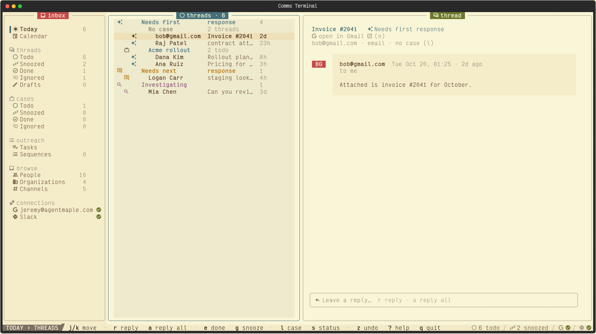
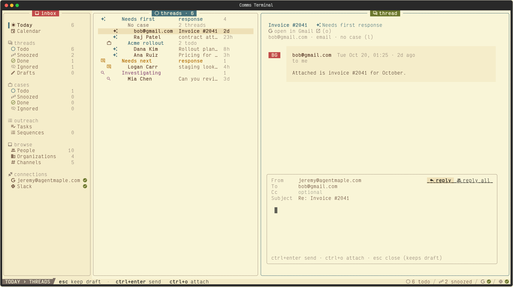
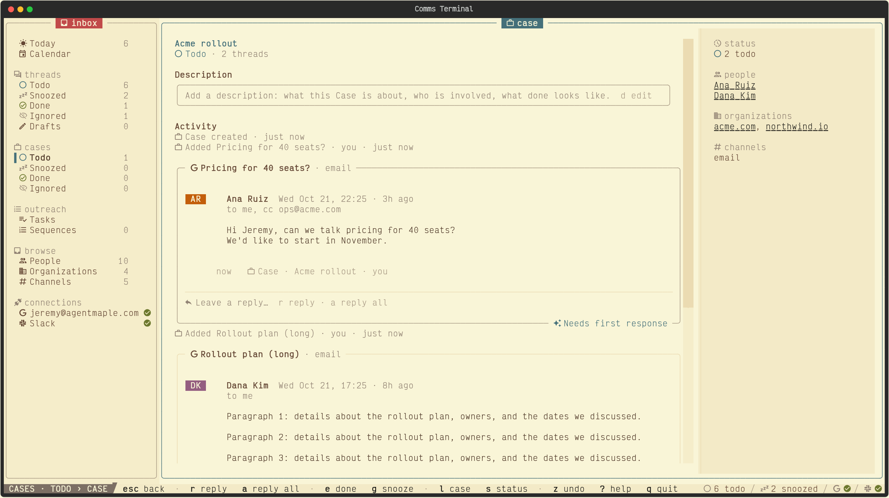

<h1 align="center">Comms Terminal</h1>

<p align="center">
  <strong>Every conversation you owe a reply, in one keyboard-driven terminal.</strong>
</p>

<p align="center">
  <a href="https://www.python.org"></a>
  <a href="https://textual.textualize.io"></a>
  <a href="https://docs.astral.sh/uv/"></a>
  <a href="https://www.sqlite.org"></a>
  <a href="features/"></a>
</p>

<p align="center">
  
</p>

Email, Slack, and SMS land as Threads in one queue. Each Thread shows who owes the next reply. Reply, triage, and run outreach without leaving the keyboard. Status model follows [Plain](https://plain.com).

**4** channels · **4** context sources · **1** SQLite file · **0** tokens in the console.

## Install

### Agent-assisted setup

Use the [setup guide](docs/setup.md). For real use, reuse an existing authorized backend first. Otherwise, use one persistent, always-on compatible Linux host with systemd and one authoritative database. Choose console access from your actual environment.

Copy this prompt into your assistant:

```text
Help me set up Comms Terminal. Read and follow:
https://github.com/JMLegere/comms-terminal/blob/main/docs/setup.md
(or docs/setup.md in the local checkout).
Inspect my environment starting read-only. Recommend the simplest complete route,
then guide me one verified step at a time.
```

### Manual package and demo

Needs Python 3.11+, [uv](https://docs.astral.sh/uv/), and a [Nerd Font](https://www.nerdfonts.com/) in your terminal.

```sh
git clone https://github.com/JMLegere/comms-terminal.git && cd comms-terminal
uv sync
```

Opt-in demo on a compatible Linux host, in a POSIX shell: try synthetic data with a fresh disposable database and isolated socket.

```sh
demo_dir="$(mktemp -d)" &&
uv run python scripts/seed_demo.py --db "$demo_dir/inbox.db" &&
uv run comms-terminal --db "$demo_dir/inbox.db" --socket "$demo_dir/inbox.sock"
```

`?` lists every key. `q` quits.

## What's in the box

### 01 · One queue for every channel

Gmail, Fastmail, Slack DMs and mentions, and Quo SMS become Threads. Statuses follow Plain: Needs first response, Needs next response, Investigating, Reply Draft, Snoozed, Done. Nothing drops silently: each Connection shows its sync health in the rail.

### 02 · Reply in place



`r` replies, `a` replies all. Email sends through Resend, Slack as you, SMS through Quo. Drafts save as you type and survive restarts. `ctrl+o` attaches files.

### 03 · Cases, like Linear issues



Group Threads into a Case. Activity shows each Thread added or removed and each description edit, with the Thread cards woven in.

### 04 · People and Organizations

Identities across channels merge into one Person. Each Thread shows the sender's other Threads and their Organization's.

### 05 · Context beside every Thread

Attio, Tana, and Linear records appear next to the conversation. Google Calendar shows what's next.

### 06 · Outreach Sequences

Multi-step Sequences, one Enrollment per Person, Due Tasks on a Tasks page. Choose which address each Sequence sends from.

### 07 · Agent-friendly

`y` copies a Thread or Draft as Markdown for a terminal agent. The CLI prints the same: `comms-terminal threads`, `comms-terminal thread ID`, `comms-terminal drafts`.

`--remote SSH_ARGS` is console-only and cannot be combined with a CLI command. On Workbox, use the installed `comms-terminal` wrapper for agent commands; it runs them on Oracle, not against the laptop copy.

## Your day

The console opens on **Today** (`1`): Todo Threads grouped by Case, Due Tasks, Drafts, Paused Enrollments, and Unattended Organizations. Work it top to bottom until it says All clear.

1. **Start with the Calendar.** The bottom bar shows the meeting now and next; the rail's Calendar shows the week. Press `i` on an invite, then `y`, `m`, or `n`, to answer it.
2. **Triage the Todo Threads.** For each one, pick one move:
   - Reply: `r` (sender) or `a` (all), write, `ctrl+enter`. The Thread waits for them and comes back when they reply, or in 4 days to follow up.
   - Done: `e`. Snooze until a time: `g`. Working on it: `s`, then Investigating.
   - Noise: `m` ignores the Thread; `b` blocks the sender.
   - Part of a bigger goal: `l` adds it to a Case.
   - Wrong move: `z` undoes it.
3. **Work the Due Tasks.** An email Task comes with its Draft. Rewrite any marked `edit me`, then send it. Mark other Tasks done with `e`, skip with `x`, and answer a Step's question with `1` or `2`.
4. **Send the Reply Drafts.** Todo ends with the Threads whose Reply Draft is written, often by an agent. Read each, edit, and send it with `ctrl+enter`. Then clear the New Thread Drafts on Drafts (`6`) the same way, or delete one with `x`.
5. **Settle Paused Enrollments.** Someone replied, so the Sequence waits for you: `r` resumes it, `f` finishes it (Goal met, Not Right Now, Lost, …).
6. **Bring back Unattended Organizations.** Open one, then enroll a Person in a Sequence (`s` on their page) or set the Organization's Stage (`s`).
7. **After each meeting**, its Thread returns to Todo. Write the follow-up there.

Hand work to an agent. Press `y` on a Thread or Draft to copy it as Markdown, or let the agent read it with `comms-terminal thread ID`. The agent writes Drafts through the CLI and never sends. Drafts it prepares appear on Today and Drafts (`6`). An open Draft with no unsaved typing shows the agent's change; if you were typing, your save is the most recent and wins. Review it, then send.

Once a week, open each Pipeline in the rail. Do its **This week** actions, and set Stages (`s`) and Values (`v`) on the board.

## Keys

| Key | Action | Key | Action |
|---|---|---|---|
| `←` `→` | Move between panes | `e` | Done |
| `j` `k` | Move in list | `g` | Snooze |
| `r` | Reply | `m` | Ignore |
| `a` | Reply all | `l` | Add to Case |
| `ctrl+enter` | Send | `b` | Block sender |
| `y` | Copy as Markdown | `z` | Undo |

## How it works

```
Gmail / Fastmail ─▶ Cloudflare Email Worker ─┐
Slack · Quo · Resend webhooks ───────────────┼─▶ comms-terminal serve ─▶ SQLite (WAL)
                                             │    /hooks/*  reply socket  wake timer
                     comms-terminal console ─┘    reads the DB, sends through the socket
```

- `serve` holds every credential as an encrypted systemd credential. The console holds none.
- Hooks verify each signature. Only `/hooks/*` is public.
- The console refreshes when the DB changes.

| Path | What |
|---|---|
| `src/comms_terminal/inbox.py` | Thread ledger: ingest, status, Cases, People. Schema in `schema.sql` |
| `src/comms_terminal/tui.py` | Console |
| `src/comms_terminal/remote.py` | Private-socket/SSH client, remote writes, and laptop copy |
| `src/comms_terminal/serve.py` | Hooks server, reply socket, wake timer |
| `src/comms_terminal/{email,fastmail,slack,quo}.py` | Channels |
| `src/comms_terminal/{attio,tana,linear,calendar}.py` | Context sources |
| `src/comms_terminal/sequences.py` | Sequences |
| `deploy/` | systemd units, Docker runtime, auto-updater, Email Worker |

## Run your own

One instance per person. A new backend needs a persistent Linux host with systemd and a domain on Cloudflare.

Follow the [setup guide](docs/setup.md) to choose a route, then the [runbook](docs/runbook.md) for Connection setup and operations. The deployment files document the owner's installations; adapting them to a new host requires review and verification.

## Philosophy

- **Own the ledger.** A narrow model (Thread, Status, Case, Person) beats bolting trust onto a support desk. [ADR 0001](docs/adr/0001-purpose-built-thread-ledger.md)
- **Prove completeness.** Every Connection shows sync health. A silent gap is a bug.
- **Keys never wait.** Target: keypress to paint under 100 ms. The console can run on your laptop against a synced copy. [ADR 0004](docs/adr/0004-local-console-over-server-replica.md)
- **One process holds secrets.** The console asks the service to send.

## Development

```sh
uv run pytest            # unit + BDD scenarios in features/
uv run pytest -m wip     # scenarios not built yet
.venv/bin/watchfiles --filter python '.venv/bin/comms-terminal --db /tmp/demo.db' src/comms_terminal   # hot reload
```

- Branch from `main`. Pushes to `main` deploy.
- Use the terms in [`GLOSSARY.md`](GLOSSARY.md) exactly.
- UI changes: check renders with Textual's test driver ([`docs/design/console.md`](docs/design/console.md)).

### Deploy

A signed GitHub webhook triggers the updater on the production host. It builds an immutable Docker image, validates it against a database backup, then swaps versions while open consoles save their drafts. [Runbook §8](docs/runbook.md#8-oracle-automatic-updates).

## Docs

| Doc | For |
|---|---|
| [`docs/setup.md`](docs/setup.md) | Agent-assisted installation and route selection |
| [`AGENTS.md`](AGENTS.md) | Concepts and rules for coding and terminal agents |
| [`docs/prd.md`](docs/prd.md) | Requirements and decisions |
| [`docs/adr/`](docs/adr) | Architecture decisions |
| [`docs/design/`](docs/design) | Console, API, and database design |
| [`docs/runbook.md`](docs/runbook.md) | Connect, operate, roll back |
