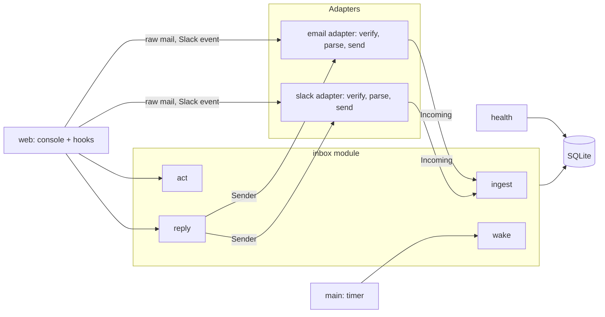
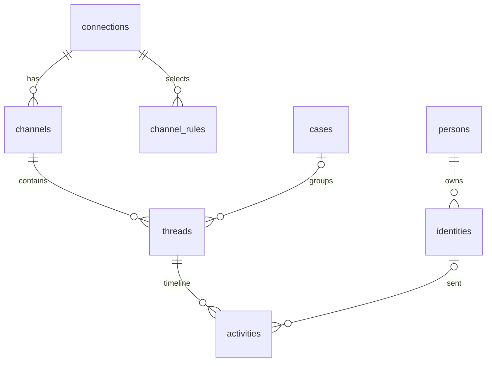

# API and database design

Status: **Approved** by Jeremy, 2026-10-12 (decisions #58–#68). Implements PRD revision 3 (`docs/prd.md` §3–§4). Blocked with the PRD on D1.

Design rule: keep only what a requirement reads. Status values follow Plain's public GraphQL API (`https://core-api.uk.plain.com/graphql/v1/schema.graphql`, read 2026-10-12). **[D]** marks a deviation from Plain; **[C]** marks a rule Jeremy confirmed where Plain states none (decision #68).

## 1. Shape

One deep module, `inbox`, owns the domain: Threads, Status, Activities, Persons, Organizations, Blocks, and Cases. Its interface has four calls. Everything platform-specific sits behind two adapters, `email` and `slack`, that translate in both directions.



- **Seam: incoming.** Each adapter turns a platform payload into an `Incoming` value, or `None` when it is filtered (auto-reply, unselected channel, bad signature). `inbox.ingest` never sees platform formats.
- **Seam: sending.** `inbox.reply` calls a `Sender` (`send(thread, text, to, cc) -> native_id`). Email and Slack are the two adapters, so the seam is real.
- **Tests run against the four calls** with a fake `Sender`. The feature files bind to them.

## 2. The `inbox` interface

```python
def ingest(db, incoming: Incoming) -> Thread | None
    # Store one message, edit, or deletion; create or find its Thread;
    # resolve the sender's Person and Organization; apply Status rules.
    # Returns None for a duplicate (same native_id).

def act(db, thread_id: int, action: Action) -> Thread
    # Jeremy's keys: Done, Snooze, Wait, Investigate, Ignore, Unignore, SetCase.

def reply(db, thread_id: int, text: str, sender: Sender,
          to: list[str] = (), cc: list[str] = ()) -> Thread
    # Send through the adapter; on success store the outbound Activity and
    # move the Thread to Waiting for them. On failure raise SendFailed;
    # nothing is stored.

def wake(db, now: datetime) -> int
    # End snoozes whose time has passed (Snoozed -> Todo). Run every minute.
```

People operations, used from Person pages:

```python
def block(db, kind: str, value: str, blocked: bool = True) -> None
    # Blocks or unblocks one Identity (an email address or a Slack user).
def add_identity(db, person_id: int, kind: str, value: str) -> None
    # Adds an email address or Slack user to a Person.
    # Raises IdentityTaken if it already belongs to another Person (I-6).
def remove_identity(db, identity_id: int) -> None
    # Detaches an Identity from its Person (person_id becomes NULL); its Activities stay.
    # To move an address: remove_identity, then add_identity on the other Person.
    # A later message from a detached Identity creates a new Person, as for a first-time sender.
```

### Values

```python
@dataclass(frozen=True)
class Identity:          # who sent an Incoming; None in Incoming.sender means Jeremy
    kind: str            # "email" or "slack_user"
    value: str           # lower-cased address, or Slack user ID
    display_name: str | None = None
    profile_email: str | None = None   # Slack user's profile email (FR-10)

@dataclass(frozen=True)
class Incoming:
    connection_id: int
    channel: str             # Slack C…/G…/D… ID, or the mailbox address
    channel_kind: str        # mailbox, channel, private, im, mpim
    kind: str                # MESSAGE, EDIT, DELETE
    native_id: str           # Message-ID, or "<channel>:<ts>" (EDIT adds ":<edited ts>")
    sender: Identity | None  # None = Jeremy
    occurred_at: datetime
    content: str | None
    thread_ref: list[str]    # email In-Reply-To + References; Slack ["<channel>:<thread_ts>"]
    title: str | None = None # email Subject
    data: dict = field(default_factory=dict)   # email to/cc; Slack ts/thread_ts

Action = Done | Snooze(until: datetime | None) | Wait | Investigate
       | Ignore | Unignore | SetCase(case_id: int | None, new_title: str | None)
```

## 3. Adapters

```python
# email.py
def verify(headers, body: bytes, secret: bytes, now: datetime) -> bool
def parse(raw: bytes, connection) -> Incoming | None   # None for an auto-reply (FR-3a)
class EmailSender:  # Sender over the outbound provider's REST API
    def send(self, thread, text, to, cc) -> str        # returns the Message-ID

# slack.py
def verify(headers, body: bytes, signing_secret: bytes, now: datetime) -> bool
def parse(event: dict, connection, rules) -> Incoming | None   # None if not selected
class SlackSender:  # Sender over chat.postMessage with Jeremy's user token
    def send(self, thread, text, to, cc) -> str        # returns "<channel>:<ts>"
```

```python
# health.py
def connection_health(connection) -> Literal["OK", "BROKEN"]
    # BROKEN: auth_ok = 0 (Slack tokens_revoked / app_uninstalled) or last_error set
    # (failed send, rejected inbound request). Otherwise OK.
```

## 4. Status

Stored values are Plain's enum names. The console shows the product label.

- `TODO`
  - `CREATED`: Needs first response
  - `NEW_REPLY`: Needs next response
  - `IN_PROGRESS`: Investigating
- `SNOOZED`
  - `WAITING_FOR_CUSTOMER`: Waiting for them
  - `WAITING_FOR_DURATION`: Paused for later (until a time)
  - `WAITING_INDEFINITELY`: Paused for later (no time)
- `DONE`
  - `DONE_MANUALLY_SET`: Done
  - `IGNORED`: Ignored

### Rules (inside `inbox`)

**`ingest`**
- New Thread from another person, sender not blocked → `TODO` / `CREATED` (FR-6a).
- New Thread from another person, sender blocked → `DONE` / `IGNORED` (FR-7a).
- New Thread from Jeremy (his own top-level Slack post) → `SNOOZED` / `WAITING_FOR_CUSTOMER` **[D]** (decision #61).
- Another person's message, edit, or deletion on an existing Thread (FR-6c):
  - from `SNOOZED` or `DONE_MANUALLY_SET` → `TODO` / `NEW_REPLY`.
  - from `TODO` / `CREATED` → unchanged **[C]**: the first response is still owed.
  - from `TODO` / `NEW_REPLY` or `IN_PROGRESS` → `TODO` / `NEW_REPLY` **[C]**.
  - from `IGNORED` → unchanged (FR-6e).
- Jeremy's message on an existing Thread → `SNOOZED` / `WAITING_FOR_CUSTOMER` (FR-6b), except `IGNORED` → unchanged.
- Jeremy's own edit or deletion → unchanged (not a reply).

**`reply`** → same as Jeremy's message.

**`wake`** → `WAITING_FOR_DURATION` past `snoozed_until` → `TODO` with the detail it had when Jeremy snoozed it (`detail_before_snooze`); if it was not in `TODO` then, `NEW_REPLY` if Jeremy has replied on the Thread, else `CREATED` **[C]** (FR-6d).

**`act`** (key, Plain mutation)
- `Done` (E, `markThreadAsDone`) → `DONE` / `DONE_MANUALLY_SET`.
- `Snooze(until)` (Z, `snoozeThread`) → `SNOOZED` / `WAITING_FOR_DURATION`, or `WAITING_INDEFINITELY` when `until` is None. Records `detail_before_snooze` when the Thread was in `TODO`.
- `Wait` (W, `snoozeThread`) → `SNOOZED` / `WAITING_FOR_CUSTOMER`.
- `Investigate` (S, `markThreadAsTodo`) → `TODO` / `IN_PROGRESS`.
- `Ignore` (I) → `DONE` / `IGNORED`.
- `Unignore` (I on an Ignored Thread) → `TODO` / `NEW_REPLY` if Jeremy has replied on the Thread, else `TODO` / `CREATED` **[C]**.
- `SetCase` (C) → Status unchanged.

### Threading (inside `inbox`)

- **Email**: a message joins the Thread that holds any Message-ID in its `thread_ref`; otherwise it starts one.
- **Slack**:
  - A message whose `thread_ref` names a stored message joins that message's Thread (reply-threads).
  - Otherwise it joins the Channel's latest Thread when it is from the same sender within 2 hours, or a different sender within 1 hour, of that Thread's last Activity (FR-4b); otherwise it starts one.
- An `EDIT` or `DELETE` joins the Thread of the message it targets. A `DELETE` also clears the stored content of that message and its edits (FR-2a).

## 5. Database

SQLite, one file. `PRAGMA foreign_keys = ON`, `PRAGMA journal_mode = WAL`. Tables are `STRICT`; times are UTC ISO 8601 text; the schema version is `PRAGMA user_version`.



```sql
CREATE TABLE connections (
  id                INTEGER PRIMARY KEY,
  platform          TEXT NOT NULL CHECK (platform IN ('email', 'slack')),
  external_id       TEXT NOT NULL UNIQUE,  -- email address or Slack team ID
  self_id           TEXT NOT NULL,         -- Jeremy's address or Slack user ID
  label             TEXT NOT NULL,
  connected_at      TEXT NOT NULL,
  auth_ok           INTEGER NOT NULL DEFAULT 1 CHECK (auth_ok IN (0, 1)),
  last_error        TEXT
) STRICT;

CREATE TABLE channels (
  id            INTEGER PRIMARY KEY,
  connection_id INTEGER NOT NULL REFERENCES connections (id),
  native_id     TEXT NOT NULL,
  name          TEXT,
  kind          TEXT NOT NULL
    CHECK (kind IN ('mailbox', 'channel', 'private', 'im', 'mpim')),
  UNIQUE (connection_id, native_id)
) STRICT;

CREATE TABLE channel_rules (
  id            INTEGER PRIMARY KEY,
  connection_id INTEGER NOT NULL REFERENCES connections (id),
  kind          TEXT NOT NULL CHECK (kind IN ('channel', 'prefix', 'suffix')),
  value         TEXT NOT NULL,
  UNIQUE (connection_id, kind, value)
) STRICT;

CREATE TABLE cases (
  id         INTEGER PRIMARY KEY,
  title      TEXT NOT NULL,
  created_at TEXT NOT NULL
) STRICT;

CREATE TABLE threads (
  id                INTEGER PRIMARY KEY,
  channel_id        INTEGER NOT NULL REFERENCES channels (id),
  native_thread_id  TEXT NOT NULL,   -- first message's native_id
  title             TEXT NOT NULL,
  status            TEXT NOT NULL,
  status_detail     TEXT NOT NULL,
  status_changed_at TEXT NOT NULL,
  snoozed_until     TEXT,
  detail_before_snooze TEXT
    CHECK (detail_before_snooze IN ('CREATED', 'NEW_REPLY', 'IN_PROGRESS')),
  case_id           INTEGER REFERENCES cases (id),
  created_at        TEXT NOT NULL,
  UNIQUE (channel_id, native_thread_id),
  CHECK (
    (status = 'TODO'
      AND status_detail IN ('CREATED', 'NEW_REPLY', 'IN_PROGRESS'))
    OR (status = 'SNOOZED'
      AND status_detail IN ('WAITING_FOR_CUSTOMER',
                            'WAITING_FOR_DURATION',
                            'WAITING_INDEFINITELY'))
    OR (status = 'DONE'
      AND status_detail IN ('DONE_MANUALLY_SET', 'IGNORED'))
  ),
  CHECK ((status_detail = 'WAITING_FOR_DURATION') = (snoozed_until IS NOT NULL))
) STRICT;
CREATE INDEX threads_queue ON threads (status, status_changed_at);
CREATE INDEX threads_case ON threads (case_id);

CREATE TABLE persons (
  id           INTEGER PRIMARY KEY,
  display_name TEXT NOT NULL,
  created_at   TEXT NOT NULL
) STRICT;

CREATE TABLE identities (
  id           INTEGER PRIMARY KEY,
  person_id    INTEGER REFERENCES persons (id),  -- NULL = detached
  kind         TEXT NOT NULL CHECK (kind IN ('email', 'slack_user')),
  value        TEXT NOT NULL,
  blocked      INTEGER NOT NULL DEFAULT 0 CHECK (blocked IN (0, 1)),
  UNIQUE (kind, value)
) STRICT;
CREATE INDEX identities_person ON identities (person_id);

CREATE TABLE organizations (
  id         INTEGER PRIMARY KEY,
  domain     TEXT NOT NULL UNIQUE,
  name       TEXT NOT NULL,
  created_at TEXT NOT NULL
) STRICT;

CREATE TABLE activities (
  id          INTEGER PRIMARY KEY,
  thread_id   INTEGER NOT NULL REFERENCES threads (id),
  kind        TEXT NOT NULL CHECK (kind IN ('MESSAGE', 'EDIT', 'DELETE')),
  occurred_at TEXT NOT NULL,
  identity_id INTEGER REFERENCES identities (id),  -- NULL = Jeremy
  native_id   TEXT NOT NULL,
  target_id   INTEGER REFERENCES activities (id),
  content     TEXT,
  data        TEXT NOT NULL DEFAULT '{}' CHECK (json_valid(data)),
  UNIQUE (kind, native_id),
  CHECK ((kind = 'MESSAGE') = (target_id IS NULL))
) STRICT;
CREATE INDEX activities_thread ON activities (thread_id, occurred_at);
CREATE INDEX activities_identity ON activities (identity_id);

CREATE TRIGGER activities_no_delete BEFORE DELETE ON activities
BEGIN
  SELECT RAISE(ABORT, 'activities are append-only');
END;

CREATE TRIGGER activities_no_update BEFORE UPDATE ON activities
WHEN NOT (
  NEW.content IS NULL
  AND NEW.id IS OLD.id AND NEW.thread_id IS OLD.thread_id
  AND NEW.kind IS OLD.kind AND NEW.occurred_at IS OLD.occurred_at
  AND NEW.identity_id IS OLD.identity_id
  AND NEW.native_id IS OLD.native_id AND NEW.target_id IS OLD.target_id
  AND NEW.data IS OLD.data
  AND EXISTS (
    SELECT 1 FROM activities d
    WHERE d.kind = 'DELETE'
      AND d.target_id = COALESCE(OLD.target_id, OLD.id)
  )
)
BEGIN
  SELECT RAISE(ABORT, 'activities are append-only');
END;
```

**What the schema enforces**
- I-1: `activities.thread_id` is required.
- I-2: each Thread has one Status and one matching Status detail.
- I-3: one `case_id` per Thread.
- I-6: `identities (kind, value)` is unique.
- FR-2 and FR-2a: Activities cannot be deleted or rewritten; only content may be cleared, after a `DELETE` targets the message.
- Idempotency: `(kind, native_id)` is unique, so a retried event or a re-sent message is stored once.

**What is computed, not stored**
- A Thread's last activity, last sender, and preview: from its latest Activity.
- Direction: `identity_id IS NULL` is Jeremy (outbound); otherwise inbound.
- A Person's Threads: Threads with an Activity from any of the Person's identities.
- A Person's Organizations: Organizations whose `domain` matches one of the Person's email addresses. Free-mail domains never get an Organization row (FR-11).
- Slack channel selection: `channel_rules` against the Channel name; `im` and `mpim` are always selected.

## 6. HTTP API

Two listeners in one process.

### Public hooks listener

Only these two routes exist on it (NFR-4).

- **`POST /hooks/email`**: one forwarded message as raw RFC 5322 (`Content-Type: message/rfc822`).
  - Auth: `X-Inbox-Timestamp` and `X-Inbox-Signature: sha256=<hex>`, HMAC-SHA256 over `timestamp + "." + body` with the shared secret; 5-minute window.
  - `204` stored, duplicate, or filtered; `401` bad signature (sets `connections.last_error`); `400` unparseable.
- **`POST /hooks/slack`**: the Slack Events API Request URL.
  - Auth: Slack's `X-Slack-Signature` (`v0`) over `v0:<X-Slack-Request-Timestamp>:<body>` with the signing secret; 5-minute window.
  - `url_verification` echoes `challenge`. `event_callback` handles `message`, `message_changed`, `message_deleted`, and `tokens_revoked` / `app_uninstalled` (set `auth_ok = 0`).
  - `200` within Slack's 3-second limit; `401` bad signature. Retries are harmless because `ingest` is idempotent.

### Private console listener

Bound per D2. Server-rendered HTML. Actions are `POST` from forms or `keys.js`; each checks that `Origin` is the console's own, then redirects (`303`).

**Pages (`GET`)**
- `/` Todo; `/snoozed`; `/done`; `/done?detail=IGNORED` (the Ignored filter).
- `/t/{id}` Thread timeline and reply box; `/p/{id}` Person; `/o/{id}` Organization; `/c/{id}` Case.
- `/channels` Channel rules; `/health` Connection health.

**Actions (`POST`)**
- `/t/{id}/act` with `action` = `done`, `snooze` (+ `until`, empty for indefinitely), `wait`, `investigate`, `ignore`, `unignore`, or `case` (+ `case_id`, `new_case_title`, or neither to remove).
- `/t/{id}/reply` with `text`, and for email `to` and `cc` (prefilled reply-all). On `SendFailed`, re-renders the Thread with the error and the typed text kept.
- `/identities/{id}/block`, `/identities/{id}/unblock`, and `/identities/{id}/remove`; `/p/{id}/identities` with `kind` and `value`.
- `/channels/rules` with `kind`, `value`; `/channels/rules/{id}/delete`.

## 7. Decisions and open points

- **#59, cut to what requirements read**: no actor types, no status-change Activities, no send status, no filtered-mail table, no person–organization link table, no stored Thread summaries.
  - Accepted gap: if the process crashes after an email is sent but before it is stored, the reply is not recorded. Slack replies come back as events and are recorded anyway.
- **#60, one deep `inbox` module** with `ingest`, `act`, `reply`, and `wake`; email and Slack as adapters behind two seams.
- **#66, no reconciliation** (Plain): completeness relies on event delivery; health is OK or BROKEN.
- **#62, Block applies to one Identity only**: no Person-level block.
- **#64, `remove_identity`**: refusing a taken Identity stays; Jeremy moves one by removing it from the other Person first.
- **#63, `add_identity`** replaces `add_address`: it adds an email address or a Slack user, matching the `identities` table.
- **#61, Jeremy's own top-level Slack post** starts a Thread in Waiting for them **[D]**: the inbox shows he is waiting on an answer. Replaces the Plain-inferred "no Thread until someone else posts".
- **#68, rules Plain does not state, confirmed by Jeremy**: Inbound on `CREATED` stays `CREATED`; Inbound on `IN_PROGRESS` becomes `NEW_REPLY`; Unignore goes to `NEW_REPLY` or `CREATED` by reply history; a timed snooze returns to the detail it had before.
