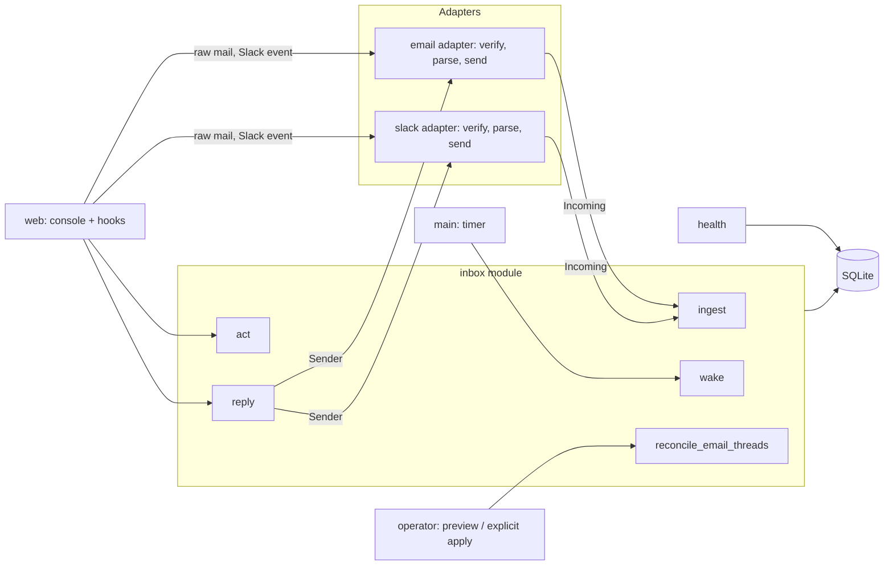
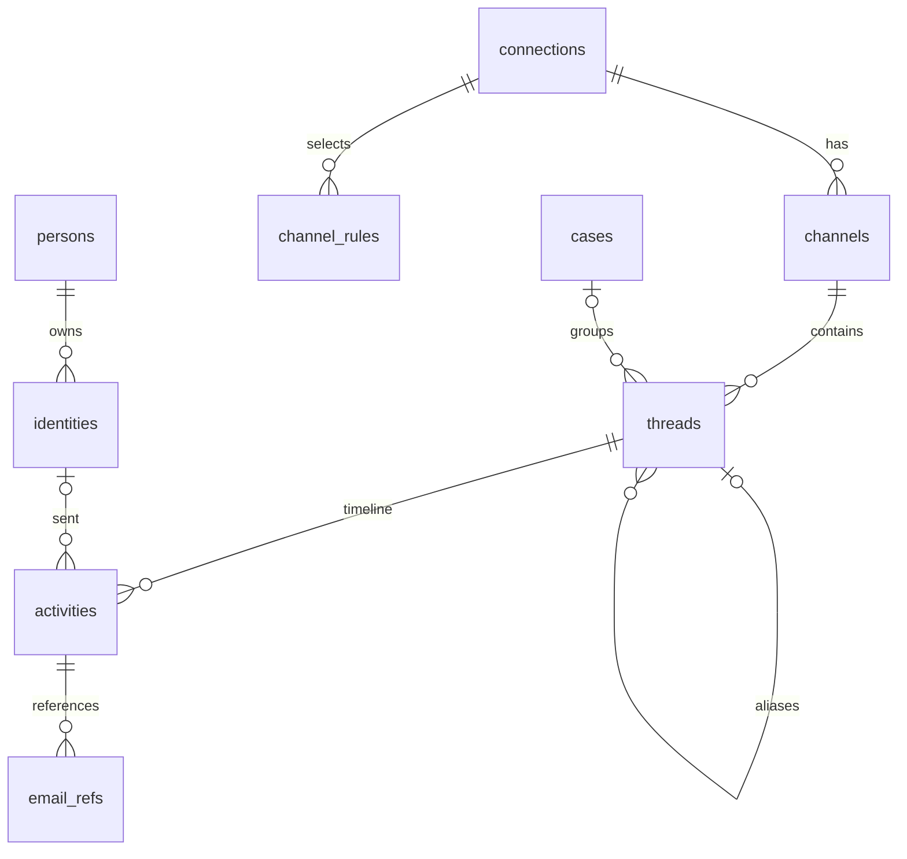

# API and database design

Status: **Approved** by Jeremy, 2026-10-12 (decisions #58–#68). Implements PRD revision 3 (`docs/prd.md` §3–§4). Blocked with the PRD on D1.

Design rule: keep only what a requirement reads. Status values follow Plain's public GraphQL API (`https://core-api.uk.plain.com/graphql/v1/schema.graphql`, read 2026-10-12). **[D]** marks a deviation from Plain; **[C]** marks a rule Jeremy confirmed where Plain states none (decision #68).

## 1. Shape

One deep module, `inbox`, owns the domain: Threads, Status, Activities, Persons, Organizations, Blocks, and Cases. Its operational interface is `ingest`, `act`, `reply`, `wake`, and `reconcile_email_threads`. Platform adapters translate incoming messages and send replies.



- **Seam: incoming.** Each adapter turns a platform payload into an `Incoming` value, or `None` when it is filtered (auto-reply, unselected channel, bad signature). `inbox.ingest` never sees platform formats.
- **Seam: sending.** `inbox.reply` calls a `Sender` (`send(thread, text, to, cc, history) -> native_id`; `history` is the Thread's messages, oldest first, as `native_id` and `data`, so email can set `In-Reply-To` / `References` and Slack can find `thread_ts`). Email and Slack are the two adapters, so the seam is real.
- **Tests exercise public calls** with synthetic messages and a fake `Sender`. The feature files bind to them.

## 2. The `inbox` interface

```python
def ingest(db, incoming: Incoming) -> Thread | None
    # Store one message, edit, or deletion; create or find its Thread;
    # resolve the sender's Person and Organization; apply Status rules.
    # Returns None for a duplicate (same native_id).

def act(db, thread_id: int, action: Action) -> Thread
    # Jeremy's keys: Done, Snooze, Wait, Investigate, Ignore, Unignore, SetCase.

def reply(db, thread_id: int, text: str, sender: Sender,
          to: list[str] = (), cc: list[str] = ()) -> Thread
    # Send through the adapter; on success store the outbound Activity and
    # move the Thread to Waiting for them. On failure raise SendFailed;
    # nothing is stored.

def wake(db, now: datetime) -> int
    # End snoozes whose time has passed (Snoozed -> Todo). Run every minute.

def reconcile_email_threads(db, apply: bool = False, channel_id: int | None = None) -> dict
    # Preview exact-reference email groups; explicit apply persists references and stable aliases.
```

### Drafts-first interface

The authorized Drafts-first expansion persists unsent compositions independently of Threads. It adds no send route or provider call; reply behavior is unchanged.

- **Save Draft** (`inbox.save_draft(db, values, *, draft_id=None, expected_revision=None)`): save the complete explicit `connection_id`, `kind`, `sender`, `to`, `cc`, `subject`, and `body` fields. Creation uses no ID/revision; replacement requires the exact positive Draft ID and expected Draft revision. **Draft Conflict** (`inbox.DraftConflict`) rejects a stale save without overwriting stored work.
- **Get Draft** (`inbox.get_draft(db, draft_id)`): read one Draft, or raise `KeyError` if absent.
- **List Drafts** (`inbox.list_drafts(db)`): read Drafts newest updated first.
- **Recipient History** (`inbox.recipient_threads(db, kind, value)`): read canonical, deduplicated captured Threads for an exact normalized `email` or `phone` destination, without creating or merging a Person.

Draft reads return a dictionary containing integer `id` and `revision`, the complete fields above, and UTC `created_at`/`updated_at`. Incomplete fields are allowed. Connection is optional until selected; a selected Connection must support the Draft's message format. Email subject is an explicit string, including empty; SMS subject is `None` and Cc is empty. Saving creates no Thread or Activity. The additive Draft table has no Thread relation or send attempts. Existing rows and append-only invariants remain.


### Exact-reference reconciliation

`channel_id=None` covers every mailbox independently. A supplied Channel ID must be an integer naming an existing `kind='mailbox'` Channel, otherwise the operation raises `ValueError`. `apply` must be a boolean. The default preview reads persisted evidence and recovers validated raw headers in memory under a read-only SAVEPOINT, keeping its reads coherent while preserving the caller's existing transaction. SQL rows and raw files remain unchanged.

```python
{
    "groups": [{"keep": 1, "merge": [2, 3], "status_source": 3, "case_id": None}],
    "conflicts": [[4, 5]],
    "merged": 0,
    "references_added": 0,
    "messages": 5,
    "raw_headers": 3,
    "raw_missing": 2,
    "raw_invalid": 0,
    "held_references": 0,
}
```

- `groups`: eligible connected components, with the lowest original Thread ID as `keep`; `merge` contains the other active IDs. `status_source` identifies the latest complete triage state by `status_changed_at`, with lower Thread ID breaking ties. `case_id` is the component's sole non-null Case, or `None`.
- `conflicts`: complete components with multiple distinct non-null Cases. Apply skips their aliases and triage changes; clearing or aligning their Cases allows a later reconciliation.
- `merged` and `references_added`: actual retired Thread and newly indexed reference counts. Both are zero in preview. Repeated apply is idempotent.
- Coverage counters: `messages` counts scoped MESSAGE Activities; `raw_headers` counts verified raw headers; `raw_missing` covers absent pointers/files; `raw_invalid` covers unsafe pointers, unreadable/hash-mismatched files, and mismatched or ambiguous raw Message-IDs. `held_references` counts reference edges naming Message-IDs known on another mailbox.

`apply=True` acquires a write transaction before reading the plan and commits derived references, complete triage state, Case association, and flattened aliases atomically. Original Activity columns, physical `thread_id`, and raw bytes remain unchanged. The canonical Thread keeps its title, creation time, and native Thread ID. Its status, detail, change time, snooze time, pre-snooze detail, and follow-up timer come together from `status_source`.

`get_thread(db, old_id)` returns the canonical Thread and its current `id`. `act`, `reply`, `snapshot`, and `thread_view` resolve old IDs. Replies capture the Thread, combined `thread_activities` history, and Connection under one read-only SAVEPOINT, released before calling the Sender. They resolve again after sending, so an in-flight merge routes the outbound Activity to the current canonical Thread. Queue, Case, Person, Organization, status counts, and wake operations count active Threads.

Canonical-dependent Thread, Person, Case, and Organization read models use one coherent read snapshot, including nested record lookups. `thread_view` includes `_members` from that same snapshot, keeping cached membership aligned with its canonical Thread and message history.

Fastmail sync results resolve to canonical IDs at completion. Recent imports deduplicate those canonical IDs before triage, count logical Threads, and use combined `thread_activities` history to detect prior replies.

Undo snapshots capture the complete triage state, including `follow_up_at`, the current canonical `id`, and `_members`: a sorted list of that canonical ID plus all retired alias IDs. One SQL read captures the state and membership together; requesting a snapshot through an old ID returns the current canonical snapshot.

`restore` acquires a write transaction, compares the saved canonical ID and membership with their current values, and raises `StaleThreadSnapshot(ValueError)` before changing state when either differs. This rejects pre-merge snapshots of both the survivor and a retired Thread, preserving the merged triage and Case. A snapshot from the current membership restores its saved state through any alias used to obtain it. Legacy snapshots lacking `_members` remain valid only for an unmerged singleton. Membership is derived from aliases; it needs no schema generation field.

Case operations (#120), used from the Cases views and grouped Thread views:

```python
def case_status(details: list[str]) -> str
    # The earliest of the Threads' views in the order Todo, Snoozed, Done, Ignored; "Todo" with no Threads.
def create_case(db, title: str) -> int        # a Case with no Threads yet
def case_queue(db, view: str | None = None) -> list[dict]
    # Cases with their rolled-up status and Thread counts per view; filtered to one view when given.
```

People operations, used from Person pages:

```python
def block(db, kind: str, value: str, blocked: bool = True) -> None
    # Blocks or unblocks one Identity (an email address or a Slack user).
def set_connection_error(db, connection_id: int, error: str | None) -> None   # health input
def set_auth(db, connection_id: int, ok: bool) -> None                         # health input
def set_probe(db, connection_id: int, error: str | None) -> None              # health input: a Health Check
def add_identity(db, person_id: int, kind: str, value: str) -> None
    # Adds an email address or Slack user to a Person.
    # Raises IdentityTaken if it already belongs to another Person (I-6).
def remove_identity(db, identity_id: int) -> None
    # Detaches an Identity from its Person (person_id becomes NULL); its Activities stay.
    # To move an address: remove_identity, then add_identity on the other Person.
    # A later message from a detached Identity creates a new Person, as for a first-time sender.
```

### Values

```python
@dataclass(frozen=True)
class Identity:          # who sent an Incoming; None in Incoming.sender means Jeremy
    kind: str            # "email" or "slack_user"
    value: str           # lower-cased address, or Slack user ID
    display_name: str | None = None
    profile_email: str | None = None   # Slack user's profile email (FR-10)

@dataclass(frozen=True)
class Incoming:
    connection_id: int
    channel: str             # Slack C…/G…/D… ID, or the mailbox address
    channel_kind: str        # mailbox, channel, private, im, mpim
    kind: str                # MESSAGE, EDIT, DELETE
    native_id: str           # Message-ID, or "<channel>:<ts>" (EDIT adds ":<edited ts>")
    sender: Identity | None  # None = Jeremy
    occurred_at: datetime
    content: str | None
    thread_ref: list[str]    # email In-Reply-To + References; Slack ["<channel>:<thread_ts>"]
    title: str | None = None # email Subject
    data: dict = field(default_factory=dict)   # email to/cc; Slack ts/thread_ts

Action = Done | Snooze(until: datetime | None) | Wait | Investigate
       | Ignore | Unignore | SetCase(case_id: int | None, new_title: str | None)
```

## 3. Adapters

```python
# email.py
def verify(headers, body: bytes, secret: bytes, now: datetime) -> bool
def parse(raw: bytes, connection) -> Incoming | None   # None for an auto-reply (FR-3a)
def handle_hook(db, connection_id, headers, body, secret, now) -> int  # POST /hooks/email status
class EmailSender:  # Sender over Resend's REST API (decision #70); reply-all when to is empty
    def send(self, thread, text, to, cc, history) -> str   # returns the Message-ID

# slack.py
def verify(headers, body: bytes, signing_secret: bytes, now: datetime) -> bool
def parse(event: dict, connection, rules) -> Incoming | None   # None if not selected
def handle_hook(db, connection_id, headers, body, signing_secret, now, client) -> tuple[int, str]
class SlackClient:  # conversations.info / users.info reads, cached (channel names, profile emails)
class SlackSender:  # Sender over chat.postMessage with Jeremy's user token
    def send(self, thread, text, to, cc, history) -> str   # returns "<channel>:<ts>"
```

```python
# health.py
def connection_health(connection, now=None) -> Literal["OK", "BROKEN"]
    # BROKEN: auth_ok = 0 (Slack tokens_revoked / app_uninstalled), probe_error set (failed Health Check),
    # last_error set (failed send, rejected inbound request), or probed_at over 65 minutes old. Otherwise OK.
def problem(connection, now=None) -> str | None   # the reason shown on the Connection page
```

## 4. Status

Stored values are Plain's enum names. The console shows the product label.

- `TODO`
  - `CREATED`: Needs first response
  - `NEW_REPLY`: Needs next response
  - `IN_PROGRESS`: Investigating
- `SNOOZED`
  - `WAITING_FOR_CUSTOMER`: Waiting for them
  - `WAITING_FOR_DURATION`: Paused for later (until a time)
  - `WAITING_INDEFINITELY`: Paused for later (no time)
- `DONE`
  - `DONE_MANUALLY_SET`: Done
  - `IGNORED`: Ignored

### Rules (inside `inbox`)

**`ingest`**
- New Thread from another person, sender not blocked → `TODO` / `CREATED` (FR-6a).
- New Thread from another person, sender blocked → `DONE` / `IGNORED` (FR-7a).
- New Thread from Jeremy (his own top-level Slack post) → `SNOOZED` / `WAITING_FOR_CUSTOMER` **[D]** (decision #61).
- Another person's message, edit, or deletion on an existing Thread (FR-6c):
  - from `SNOOZED` or `DONE_MANUALLY_SET` → `TODO` / `NEW_REPLY`.
  - from `TODO` / `CREATED` → unchanged **[C]**: the first response is still owed.
  - from `TODO` / `NEW_REPLY` or `IN_PROGRESS` → `TODO` / `NEW_REPLY` **[C]**.
  - from `IGNORED` → unchanged (FR-6e).
- Jeremy's message on an existing Thread → `SNOOZED` / `WAITING_FOR_CUSTOMER` (FR-6b), except `IGNORED` → unchanged.
- Jeremy's own edit or deletion → unchanged (not a reply).

**`reply`** → same as Jeremy's message.

**`wake`** → `WAITING_FOR_DURATION` past `snoozed_until` → `TODO` with the detail it had when Jeremy snoozed it (`detail_before_snooze`); if it was not in `TODO` then, `NEW_REPLY` if Jeremy has replied on the Thread, else `CREATED` **[C]** (FR-6d).

`WAITING_FOR_CUSTOMER` records `follow_up_at` five days after entering that detail (#116). At that time, `wake` returns the active Thread to `TODO` / `NEW_REPLY` for follow-up. Reconciliation preserves the selected triage state's existing timer.

**`act`** (key, Plain mutation)
- `Done` (E, `markThreadAsDone`) → `DONE` / `DONE_MANUALLY_SET`.
- `Snooze(until)` (Z, `snoozeThread`) → `SNOOZED` / `WAITING_FOR_DURATION`, or `WAITING_INDEFINITELY` when `until` is None. Records `detail_before_snooze` when the Thread was in `TODO`.
- `Wait` (W, `snoozeThread`) → `SNOOZED` / `WAITING_FOR_CUSTOMER`.
- `Investigate` (S, `markThreadAsTodo`) → `TODO` / `IN_PROGRESS`.
- `Ignore` (I) → `DONE` / `IGNORED`.
- `Unignore` (I on an Ignored Thread) → `TODO` / `NEW_REPLY` if Jeremy has replied on the Thread, else `TODO` / `CREATED` **[C]**.
- `SetCase` (C) → Status unchanged.

### Threading (inside `inbox`)

- **Email**: MESSAGE Activities form connected components within one mailbox using exact, case-preserved Message-ID tokens from their own `native_id` and explicit `Incoming.thread_ref`. `email_refs` persists declared reference edges; normal ingest reconciles that mailbox inside its ingestion transaction. A late parent, a bridge naming separate parents, and messages sharing an explicit missing ancestor all heal the same graph. IDs known on another mailbox are held rather than used as shared virtual ancestors. Duplicate Activities still return `None`; additional explicit references may strengthen the index and heal aliases only when the duplicate belongs to the incoming mailbox, without replaying status rules.
- **Initial email parent**: a new message first attaches to the earliest valid, stored same-mailbox parent in `Incoming.thread_ref` order (`In-Reply-To` precedes `References`). Shared-ancestor and native-ID intersections are the fallback. Eligible reconciliation still chooses the lowest canonical ID afterward; a Case-conflicting bridge stays attached to its explicit parent while the component remains separate.
- **Identifier syntax**: bracketed ASCII dot-atom Message-IDs and domain literals; nested RFC comments and quoted prose are skipped with their escapes, and identifier case stays exact. The remaining field must be a sequence of valid Message-IDs and whitespace; adjacent IDs are accepted. Unstructured residual text, bare IDs, whitespace/control characters inside IDs, malformed IDs, and ambiguous own IDs supply no identity evidence. Subjects, senders, bodies, dates, and `fm_thread` alone never create reconciliation edges. Provider-supplied explicit member Message-IDs retain their existing behavior; reconciliation makes no provider calls.
- **Raw recovery**: explicit preview/apply reads `data.raw` only as a lowercase 64-hex SHA256 pointer to `raw/<sha>.eml` beside the database. It rejects symlinks, verifies the complete byte hash, parses headers only, and requires the raw Message-ID to agree with the stored normalized identity. Mail lacking a Message-ID may instead prove the existing `<sha256-<verified hash>@inbox>` fallback. Recovery indexes `In-Reply-To` and `References`; missing or invalid evidence remains a coverage gap.
- **Triage during ingest**: reconciliation first selects the latest complete existing triage state, then the new Activity follows the ordinary inbound/outbound status rules. Duplicate evidence never repeats those rules. Existing sent-echo deduplication remains a separate operation.
- **Slack**:
  - A reply whose `thread_ref` names an earlier stored reply of the same Slack reply-thread joins that reply's Thread. The first reply to a top-level message starts a Thread (#124).
  - A top-level message in a channel or private channel joins the Channel's latest top-level Thread unless the Channel has had no message for 1 hour; otherwise it starts one (#124). A DM or group DM joins its Channel's latest Thread for the same sender within 2 hours, or a different sender within 1 hour, of the last message (FR-4b); otherwise it starts one.
- An `EDIT` or `DELETE` joins the Thread of the message it targets. A `DELETE` also clears the stored content of that message and its edits (FR-2a).

## 5. Database

SQLite, one file. The DDL below is copied in `src/universal_inbox/schema.sql`, which `inbox.migrate` runs; change both together. `PRAGMA foreign_keys = ON`, `PRAGMA journal_mode = WAL`. Tables are `STRICT`; times are UTC ISO 8601 text; the schema version is `PRAGMA user_version`. Version 4 adds `threads.merged_into`, `email_refs`, alias guards, and `thread_activities` to version 3, preserving Case descriptions, five-day follow-ups, and append-only Activity triggers. Migration commits the schema/version together and rejects databases newer than the build.



```sql
CREATE TABLE connections (
  id                INTEGER PRIMARY KEY,
  platform          TEXT NOT NULL CHECK (platform IN ('email', 'slack')),
  external_id       TEXT NOT NULL UNIQUE,  -- email address or Slack team ID
  self_id           TEXT NOT NULL,         -- Jeremy's address or Slack user ID
  label             TEXT NOT NULL,
  connected_at      TEXT NOT NULL,
  auth_ok           INTEGER NOT NULL DEFAULT 1 CHECK (auth_ok IN (0, 1)),
  last_error        TEXT
) STRICT;

CREATE TABLE channels (
  id            INTEGER PRIMARY KEY,
  connection_id INTEGER NOT NULL REFERENCES connections (id),
  native_id     TEXT NOT NULL,
  name          TEXT,
  kind          TEXT NOT NULL
    CHECK (kind IN ('mailbox', 'channel', 'private', 'im', 'mpim')),
  UNIQUE (connection_id, native_id)
) STRICT;

CREATE TABLE channel_rules (
  id            INTEGER PRIMARY KEY,
  connection_id INTEGER NOT NULL REFERENCES connections (id),
  kind          TEXT NOT NULL CHECK (kind IN ('channel', 'prefix', 'suffix')),
  value         TEXT NOT NULL,
  UNIQUE (connection_id, kind, value)
) STRICT;

CREATE TABLE cases (
  id          INTEGER PRIMARY KEY,
  title       TEXT NOT NULL,
  description TEXT NOT NULL DEFAULT '',  -- shown above the Case's activity (decision #98; schema version 2)
  created_at  TEXT NOT NULL
) STRICT;

CREATE TABLE threads (
  id                INTEGER PRIMARY KEY,
  channel_id        INTEGER NOT NULL REFERENCES channels (id),
  native_thread_id  TEXT NOT NULL,   -- first message's native_id
  title             TEXT NOT NULL,
  status            TEXT NOT NULL,
  status_detail     TEXT NOT NULL,
  status_changed_at TEXT NOT NULL,
  snoozed_until     TEXT,
  detail_before_snooze TEXT
    CHECK (detail_before_snooze IN ('CREATED', 'NEW_REPLY', 'IN_PROGRESS')),
  case_id           INTEGER REFERENCES cases (id),
  created_at        TEXT NOT NULL,
  follow_up_at      TEXT,            -- Waiting for them: back to Todo at this time with no reply (#116)
  merged_into       INTEGER REFERENCES threads (id) CHECK (merged_into < id), -- stable alias, NULL = active
  UNIQUE (channel_id, native_thread_id),
  CHECK (
    (status = 'TODO'
      AND status_detail IN ('CREATED', 'NEW_REPLY', 'IN_PROGRESS'))
    OR (status = 'SNOOZED'
      AND status_detail IN ('WAITING_FOR_CUSTOMER',
                            'WAITING_FOR_DURATION',
                            'WAITING_INDEFINITELY'))
    OR (status = 'DONE'
      AND status_detail IN ('DONE_MANUALLY_SET', 'IGNORED'))
  ),
  CHECK ((status_detail = 'WAITING_FOR_DURATION') = (snoozed_until IS NOT NULL))
) STRICT;
CREATE INDEX threads_queue ON threads (status, status_changed_at);
CREATE INDEX threads_case ON threads (case_id);

CREATE TRIGGER threads_alias_insert BEFORE INSERT ON threads
WHEN NEW.merged_into IS NOT NULL AND NOT EXISTS (
  SELECT 1 FROM threads t JOIN channels ch ON ch.id = t.channel_id
  WHERE t.id = NEW.merged_into AND t.merged_into IS NULL
    AND t.channel_id = NEW.channel_id AND ch.kind = 'mailbox'
)
BEGIN
  SELECT RAISE(ABORT, 'thread aliases require an active older thread in the same mailbox');
END;

CREATE TRIGGER threads_alias_update BEFORE UPDATE OF merged_into, channel_id ON threads
WHEN (NEW.merged_into IS NOT NULL AND NOT EXISTS (
  SELECT 1 FROM threads t JOIN channels ch ON ch.id = t.channel_id
  WHERE t.id = NEW.merged_into AND t.merged_into IS NULL
    AND t.channel_id = NEW.channel_id AND ch.kind = 'mailbox'
)) OR (EXISTS (SELECT 1 FROM threads t WHERE t.merged_into = OLD.id)
       AND (NEW.merged_into IS NOT NULL OR NEW.channel_id IS NOT OLD.channel_id))
BEGIN
  SELECT RAISE(ABORT, 'thread aliases require an active older thread in the same mailbox');
END;

CREATE TABLE persons (
  id           INTEGER PRIMARY KEY,
  display_name TEXT NOT NULL,
  created_at   TEXT NOT NULL
) STRICT;

CREATE TABLE identities (
  id           INTEGER PRIMARY KEY,
  person_id    INTEGER REFERENCES persons (id),  -- NULL = detached
  kind         TEXT NOT NULL CHECK (kind IN ('email', 'slack_user')),
  value        TEXT NOT NULL,
  blocked      INTEGER NOT NULL DEFAULT 0 CHECK (blocked IN (0, 1)),
  UNIQUE (kind, value)
) STRICT;
CREATE INDEX identities_person ON identities (person_id);

CREATE TABLE organizations (
  id         INTEGER PRIMARY KEY,
  domain     TEXT NOT NULL UNIQUE,
  name       TEXT NOT NULL,
  created_at TEXT NOT NULL
) STRICT;

CREATE TABLE activities (
  id          INTEGER PRIMARY KEY,
  thread_id   INTEGER NOT NULL REFERENCES threads (id),
  kind        TEXT NOT NULL CHECK (kind IN ('MESSAGE', 'EDIT', 'DELETE')),
  occurred_at TEXT NOT NULL,
  identity_id INTEGER REFERENCES identities (id),  -- NULL = Jeremy
  native_id   TEXT NOT NULL,
  target_id   INTEGER REFERENCES activities (id),
  content     TEXT,
  data        TEXT NOT NULL DEFAULT '{}' CHECK (json_valid(data)),
  UNIQUE (kind, native_id),
  CHECK ((kind = 'MESSAGE') = (target_id IS NULL))
) STRICT;
CREATE INDEX activities_thread ON activities (thread_id, occurred_at);
CREATE INDEX activities_identity ON activities (identity_id);

CREATE TABLE email_refs (
  activity_id INTEGER NOT NULL REFERENCES activities (id),
  native_id   TEXT NOT NULL,
  PRIMARY KEY (activity_id, native_id)
) STRICT;
CREATE INDEX email_refs_native ON email_refs (native_id);

CREATE VIEW thread_activities AS
SELECT a.id, COALESCE(t.merged_into, a.thread_id) AS thread_id,
       a.kind, a.occurred_at, a.identity_id, a.native_id, a.target_id, a.content, a.data
FROM activities a JOIN threads t ON t.id = a.thread_id;

CREATE TRIGGER activities_no_delete BEFORE DELETE ON activities
BEGIN
  SELECT RAISE(ABORT, 'activities are append-only');
END;

CREATE TRIGGER activities_no_update BEFORE UPDATE ON activities
WHEN NOT (
  NEW.content IS NULL
  AND NEW.id IS OLD.id AND NEW.thread_id IS OLD.thread_id
  AND NEW.kind IS OLD.kind AND NEW.occurred_at IS OLD.occurred_at
  AND NEW.identity_id IS OLD.identity_id
  AND NEW.native_id IS OLD.native_id AND NEW.target_id IS OLD.target_id
  AND NEW.data IS OLD.data
  AND EXISTS (
    SELECT 1 FROM activities d
    WHERE d.kind = 'DELETE'
      AND d.target_id = COALESCE(OLD.target_id, OLD.id)
  )
)
BEGIN
  SELECT RAISE(ABORT, 'activities are append-only');
END;
```

**What the schema enforces**
- I-1: `activities.thread_id` is required.
- I-2: each Thread has one Status and one matching Status detail.
- I-3: one `case_id` per Thread.
- I-6: `identities (kind, value)` is unique.
- FR-2 and FR-2a: Activities cannot be deleted or rewritten; only content may be cleared, after a `DELETE` targets the message.
- Idempotency: `(kind, native_id)` is unique, so a retried event or a re-sent message is stored once.
- Stable aliases: `merged_into` targets an older, active Thread in the same mailbox. Guards require aliases to be flattened before their target retires. The physical Activity foreign key continues to reference its original Thread; `thread_activities` projects canonical IDs for logical reads.
- Reference idempotency: `(activity_id, native_id)` is unique in `email_refs`.

**What is computed, not stored**
- A Thread's last activity, last sender, and preview: from its latest logical Activity in `thread_activities`.
- Undo snapshot membership: sorted canonical and alias Thread IDs from `threads`, captured with the triage state and compared before restore.
- Direction: `identity_id IS NULL` is Jeremy (outbound); otherwise inbound.
- A Person's Threads: distinct canonical Threads with an Activity from any of the Person's identities, through `thread_activities`.
- A Person's Organizations: Organizations whose `domain` matches one of the Person's email addresses. Free-mail domains never get an Organization row (FR-11).
- Slack channel selection: `channel_rules` against the Channel name; `im` and `mpim` are always selected.

## 6. HTTP API

Two listeners in one process.

### Public hooks listener

Only these two routes exist on it (NFR-4).

- **`POST /hooks/email`**: one forwarded message as raw RFC 5322 (`Content-Type: message/rfc822`).
  - Auth: `X-Inbox-Timestamp` and `X-Inbox-Signature: sha256=<hex>`, HMAC-SHA256 over `timestamp + "." + body` with the shared secret; 5-minute window.
  - `204` stored, duplicate, or filtered; `401` bad signature (sets `connections.last_error`); `400` unparseable.
- **`POST /hooks/slack`**: the Slack Events API Request URL.
  - Auth: Slack's `X-Slack-Signature` (`v0`) over `v0:<X-Slack-Request-Timestamp>:<body>` with the signing secret; 5-minute window.
  - `url_verification` echoes `challenge`. `event_callback` handles `message`, `message_changed`, `message_deleted`, and `tokens_revoked` / `app_uninstalled` (set `auth_ok = 0`).
  - `200` within Slack's 3-second limit; `401` bad signature. Retries are harmless because `ingest` is idempotent.

### Local reply socket (console)

The console is a terminal app (`docs/design/console.md`, decisions #71–#75). It calls `inbox` directly for everything except sending.

- **`POST /reply`** on the service's Unix socket `$XDG_RUNTIME_DIR/universal-inbox.sock` (mode 0600, owned by `jerry`).
  - Body: JSON `{"thread_id", "text", "to", "cc"}`.
  - `200 {"status", "status_detail"}` after `inbox.reply` succeeds; `502 {"error"}` on `SendFailed`; `404` for an unknown Thread.
  - Only the service holds the Resend key and Slack token (NFR-5).

## 7. Decisions and open points

- **#59, cut to what requirements read**: no actor types, no status-change Activities, no send status, no filtered-mail table, no person–organization link table, no stored Thread summaries.
  - Accepted gap: if the process crashes after an email is sent but before it is stored, the reply is not recorded. Slack replies come back as events and are recorded anyway.
- **#60, one deep `inbox` module** with `ingest`, `act`, `reply`, and `wake`; email and Slack as adapters behind two seams.
- **#66, event-driven completeness** (Plain): delivery and health remain event-driven. Jeremy's 2026-10-12 exact-reference reconciliation approval adds logical email repair over stored evidence, independently of provider delivery or history polling.
- **#119, Health Checks** (Jeremy, 2026-10-13): event-driven health stayed green while a source went quiet. Every 30 minutes `serve.probe_all` calls each adapter's `probe` (Resend `/domains`, Slack `auth.test`, Quo `/webhooks`); Fastmail's Sent poll is its check. Results live in `probe_error`/`probed_at`, apart from `last_error`, so a passing message cannot hide a failed check. Forwarded Gmail and Slack event delivery still cannot be checked.
- **#62, Block applies to one Identity only**: no Person-level block.
- **#64, `remove_identity`**: refusing a taken Identity stays; Jeremy moves one by removing it from the other Person first.
- **#63, `add_identity`** replaces `add_address`: it adds an email address or a Slack user, matching the `identities` table.
- **#61, Jeremy's own top-level Slack post** starts a Thread in Waiting for them **[D]**: the inbox shows he is waiting on an answer. Replaces the Plain-inferred "no Thread until someone else posts".
- **#68, rules Plain does not state, confirmed by Jeremy**: Inbound on `CREATED` stays `CREATED`; Inbound on `IN_PROGRESS` becomes `NEW_REPLY`; Unignore goes to `NEW_REPLY` or `CREATED` by reply history; a timed snooze returns to the detail it had before.
