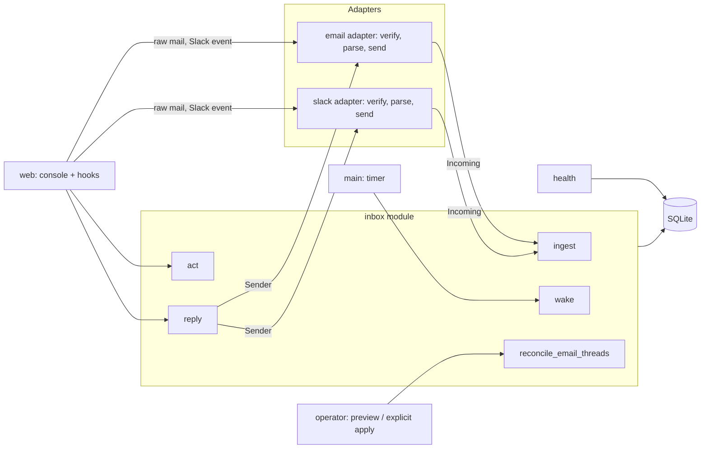
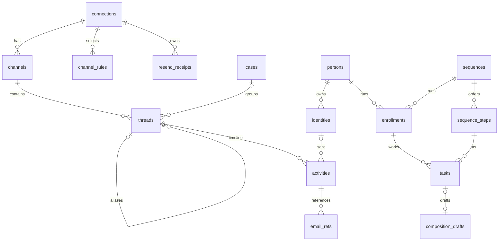

# API and database design

Status: **Approved** by Jeremy, 2026-10-12 (decisions #58–#68). Implements PRD revision 3 (`docs/prd.md` §3–§4). Blocked with the PRD on D1.

Design rule: keep only what a requirement reads. Status values follow Plain's public GraphQL API (`https://core-api.uk.plain.com/graphql/v1/schema.graphql`, read 2026-10-12). **[D]** marks a deviation from Plain; **[C]** marks a rule Jeremy confirmed where Plain states none (decision #68).

## 1. Shape

One deep module, `inbox`, owns the domain: Threads, Status, Activities, Persons, Organizations, Blocks, and Cases. Its operational interface is `ingest`, `act`, `reply`, `wake`, and `reconcile_email_threads`. Platform adapters translate incoming messages and send replies.



- **Seam: incoming.** Each adapter turns a platform payload into an `Incoming` value, or `None` when it is filtered (auto-reply, unselected channel, bad signature). `inbox.ingest` never sees platform formats.
- **Seam: sending.** `inbox.reply` calls a `Sender` (`send(thread, text, to, cc, history) -> native_id`; `history` is the Thread's messages, oldest first, as `native_id` and `data`, so email can set `In-Reply-To` / `References` and Slack can find `thread_ts`). Email and Slack are the two adapters, so the seam is real.
- **Tests exercise public calls** with synthetic messages and a fake `Sender`. The feature files bind to them.

## 2. The `inbox` interface

```python
def ingest(db, incoming: Incoming) -> Thread | None
    # Store one message, edit, or deletion; create or find its Thread;
    # resolve the sender's Person and Organization; apply Status rules.
    # Returns None for a duplicate (same native_id).

def act(db, thread_id: int, action: Action) -> Thread
    # Jeremy's keys: Done, Snooze, Wait, Investigate, Ignore, Unignore, SetCase.

def reply(db, thread_id: int, text: str, sender: Sender,
          to: list[str] = (), cc: list[str] = ()) -> Thread
    # Send through the adapter; on success store the outbound Activity and
    # move the Thread to Waiting for them. On failure raise SendFailed;
    # nothing is stored.

def wake(db, now: datetime) -> int
    # End snoozes whose time has passed (Snoozed -> Todo). Run every minute.

def reconcile_email_threads(db, apply: bool = False, channel_id: int | None = None) -> dict
    # Preview exact-reference email groups; explicit apply persists references and stable aliases.
```

### Drafts-first interface

The authorized Drafts-first expansion persists unsent compositions independently of Threads. It adds no send route or provider call; reply behavior is unchanged.

- **Save Draft** (`inbox.save_draft(db, values, *, draft_id=None, expected_revision=None)`): save the complete explicit `connection_id`, `kind`, `sender`, `to`, `cc`, `subject`, and `body` fields. Creation uses no ID/revision; replacement requires the exact positive Draft ID and expected Draft revision. **Draft Conflict** (`inbox.DraftConflict`) rejects a stale save without overwriting stored work.
- **Get Draft** (`inbox.get_draft(db, draft_id)`): read one Draft, or raise `KeyError` if absent.
- **Save Reply Draft** (`inbox.save_reply_draft(db, thread_id, body)`): a reply box's text is its Thread's **Reply Draft** (schema 14: `composition_drafts.thread_id`, at most one per Thread id). Text replaces the Draft, and empty text deletes it. The envelope is filled from the Thread as the reply box shows it (email: reply-all To/Cc and `Re:` subject). **Reply Drafts** (`inbox.reply_drafts(db)`) maps Thread id to text. `send_draft` refuses a Reply Draft, since it sends from the reply box; a reply that goes through deletes it in the same transaction (`.agents/prd/2026-10-16-sequencing.md` P1). A Reply Draft's files are its Thread's reply files: `stage` and `staged` with a Reply Draft's `draft_id` use its Thread id, so every file goes out with the reply (schema 18 moved any staged on the Draft itself).
- **Send later** (schema 19: `composition_drafts.send_at`, `send_error`): ctrl+enter in a reply box or Draft editor offers Send now, Send tomorrow, or Send next Monday; a later choice is a random minute from 7 to 9 am in Jeremy's time (`inbox.send_time`). `inbox.schedule_draft(db, draft_id, send_at)` sets or clears the time; `inbox.schedule_reply` saves a reply box as its Reply Draft with the box's To and Cc, which later edits keep. Each minute the service's wake loop sends the due Drafts (`serve.send_due`): a Reply Draft through `reply`, any other through `send_draft`, always with the latest saved text. It clears `send_at` before sending, so a send is tried once; a refusal or unknown outcome stays on the Draft as `send_error`, and the Drafts list shows it as failed.
- **List Drafts** (`inbox.list_drafts(db)`): read Drafts newest updated first.
- **Recipient History** (`inbox.recipient_threads(db, kind, value)`): read canonical, deduplicated captured Threads for an exact normalized `email` or `phone` destination, without creating or merging a Person.

Draft reads return a dictionary containing integer `id` and `revision`, the complete fields above, and UTC `created_at`/`updated_at`. Incomplete fields are allowed. Connection is optional until selected; a selected Connection must support the Draft's message format. Email subject is an explicit string, including empty; SMS subject is `None` and Cc is empty. Saving creates no Thread or Activity. New-Thread Drafts have no Thread; a Reply Draft names one. The table holds no send attempts. Existing rows and append-only invariants remain.


### Sequences interface

`src/comms_terminal/sequences.py` owns Sequences (`GLOSSARY.md` Outreach); `inbox` calls it from Wake, Ingest, Send Draft, Reply, and the Draft delete and restore calls. Nothing in it sends. Sequence flow (FR-SEQ-26–46, `.agents/prd/2026-10-26-sequence-flow.md`, ADR 0008) makes a Sequence a tree of Steps: On start, the body, where an If ends its path and opens a true and a false path, and each body path's own On completion; paths never rejoin.

- **Create Sequence** (`sequences.create_sequence(db, name, connection_id=None)`), **Add Step** (`add_step(db, sequence_id, kind, after=None, *, section, parent_step_id, branch, action_kind, condition)`: after the Step at position `after` on its path, else last on the named path), **Save Step** (`save_step(db, step_id, **fields)`), **Move Step** (`move_step`, within its path), **Delete Step** (`delete_step`, live: Enrollments on it move to the next Step; an If goes with its paths; `restore_step` undoes), **Archive Sequence** (`archive_sequence(db, sequence_id, cancel_live)`; a used Sequence is archived, never deleted), and **Validate** (`validate`: unknown fill-ins, reply targets, misplaced Ifs, missing Action and If fields, a repeat that is not the last Step of an On completion). **Outline** (`outline(steps)`) gives the console's rows; `path_of`, `on_path`, `completion_of` name paths.
- **Kinds**: touches (`email`, `call`, `linkedin`, `letter`) Jeremy does; **Action** (`action_kind`: `set_stage`, `enroll`, `end_for_others`, `set_value`) and **If** (`condition`: `end_reason`, `has_channel` email or phone, `stage`, `jeremy_picks`) the console does when due. A LinkedIn Step's move is `linkedin_move`.
- **Enroll** (`sequences.enroll(db, person_id, sequence_id, now, start=None, organization_id=None)`): one Person into one Sequence, for one Organization (default: their only one, `default_organization`; choices: `organization_choices`); refused (`sequences.Refused`) for an Unsubscribed Person, an archived or empty Sequence, a live Enrollment in it, or a Start date before today. On start runs first. A Sole proprietorship (`inbox.create_sole_proprietorship`, key `person-<id>.sole`) stands for an angel or a candidate.
- **Materialize** (`sequences.materialize(db, now)`, run by Wake): each Active or Finishing Enrollment's next Task (the next Step on its path, else the path's On completion), due its Step's gap in business days (Mon–Fri, Halifax); the Actions and Ifs whose time has come; and the Draft of each email Task whose day has come. An Action that cannot run (no Organization; an enroll into a Sequence they went through) waits for Jeremy with a flag. Idempotent: one Task per Enrollment and Step, one Draft per Task.
- **Due Tasks** (`sequences.tasks_due(db, now)`): Active and Finishing Enrollments' Tasks whose day has come, grouped Overdue, Today, and Later today. **Paused** (`sequences.paused(db)`): Today's Paused list.
- **Complete Task** (`complete_task`), **Skip Task** (`skip_task`), and **Pick** (`pick(db, task_id, choice)`: 1 an If's true path, 0 its false path), undone by `undo_task`. An email Task completes when its Draft sends; deleting its Draft skips it.
- **Pause** (`pause_person`, inside Ingest): any message or call from one of the Person's Identities, or a connected outbound call, pauses their Active and Finishing Enrollments; a Finishing one keeps its end reason. **Resume** (`resume`) makes the next Task due at once, back to Finishing when it was. **Reschedule** (`reschedule(db, enrollment_id, start)`) puts a running Enrollment on an agreed date: its Due Task comes due that day, and before any touch is done its Start date moves too (G1). **Finish** (`finish(db, enrollment_id, reason)`): `GOAL_MET`, `NOT_RIGHT_NOW`, `LOST`, or `COMPLETED` make it Finishing and run the On completion of the path it was on, then Finished; `CANCELED` and `UNSUBSCRIBED` finish at once with no On completion, and Unsubscribed marks the Person (`persons.unsubscribed_at`) and finishes every live Enrollment. Unsent Task Drafts go. `restore_finish` undoes, including what the On completion did.
- Send Draft and Reply refuse a Task Draft with a fill-in marker left, and Send Draft refuses one whose Enrollment is Paused (`sequences.send_problem`).
- **Markdown** (`src/comms_terminal/sequence_md.py`): `render(db, sequence_id)`, `parse(text)`, and `apply(db, text, dry_run=False)` (on an in-memory copy first; refused with the problems when it does not validate). CLI: `comms-terminal sequence list|show|apply|new|rename|archive`, `step add|set|move|delete`, `enroll --org`, and `enrollment list|resume|start|finish` (Jeremy, 2026-10-26: agents may resume and finish; they still never send or complete a Task).

### Exact-reference reconciliation

`channel_id=None` covers every mailbox independently. A supplied Channel ID must be an integer naming an existing `kind='mailbox'` Channel, otherwise the operation raises `ValueError`. `apply` must be a boolean. The default preview reads persisted evidence and recovers validated raw headers in memory under a read-only SAVEPOINT, keeping its reads coherent while preserving the caller's existing transaction. SQL rows and raw files remain unchanged.

```python
{
    "groups": [{"keep": 1, "merge": [2, 3], "status_source": 3, "case_id": None}],
    "conflicts": [[4, 5]],
    "merged": 0,
    "references_added": 0,
    "messages": 5,
    "raw_headers": 3,
    "raw_missing": 2,
    "raw_invalid": 0,
    "held_references": 0,
}
```

- `groups`: eligible connected components, with the lowest original Thread ID as `keep`; `merge` contains the other active IDs. `status_source` identifies the latest complete triage state by `status_changed_at`, with lower Thread ID breaking ties. `case_id` is the component's sole non-null Case, or `None`.
- `conflicts`: complete components with multiple distinct non-null Cases. Apply skips their aliases and triage changes; clearing or aligning their Cases allows a later reconciliation.
- `merged` and `references_added`: actual retired Thread and newly indexed reference counts. Both are zero in preview. Repeated apply is idempotent.
- Coverage counters: `messages` counts scoped MESSAGE Activities; `raw_headers` counts verified raw headers; `raw_missing` covers absent pointers/files; `raw_invalid` covers unsafe pointers, unreadable/hash-mismatched files, and mismatched or ambiguous raw Message-IDs. `held_references` counts reference edges naming Message-IDs known on another mailbox.

`apply=True` acquires a write transaction before reading the plan and commits derived references, complete triage state, Case association, and flattened aliases atomically. Original Activity columns, physical `thread_id`, and raw bytes remain unchanged. The canonical Thread keeps its title, creation time, and native Thread ID. Its status, detail, change time, snooze time, pre-snooze detail, and follow-up timer come together from `status_source`.

`get_thread(db, old_id)` returns the canonical Thread and its current `id`. `act`, `reply`, `snapshot`, and `thread_view` resolve old IDs. Replies capture the Thread, combined `thread_activities` history, and Connection under one read-only SAVEPOINT, released before calling the Sender. They resolve again after sending, so an in-flight merge routes the outbound Activity to the current canonical Thread. Queue, Case, Person, Organization, status counts, and wake operations count active Threads.

Canonical-dependent Thread, Person, Case, and Organization read models use one coherent read snapshot, including nested record lookups. `thread_view` includes `_members` from that same snapshot, keeping cached membership aligned with its canonical Thread and message history.

**Message revision** (`inbox.thread_view`, reaction execution in progress): every reduced message keeps `id` as its original MESSAGE Activity ID and adds `revision`, initially that ID and then the latest applicable EDIT/DELETE Activity ID. This read-only value comes from the existing immutable ledger; it adds no database column, migration, or reaction Activity. A reaction change supplies the displayed/checked revision so a known edit requires review and a deletion prevents a write.

Fastmail sync results resolve to canonical IDs at completion. Recent imports deduplicate those canonical IDs before triage, count logical Threads, and use combined `thread_activities` history to detect prior replies.

Undo snapshots capture the complete triage state, including `follow_up_at`, the current canonical `id`, and `_members`: a sorted list of that canonical ID plus all retired alias IDs. One SQL read captures the state and membership together; requesting a snapshot through an old ID returns the current canonical snapshot.

`restore` acquires a write transaction, compares the saved canonical ID and membership with their current values, and raises `StaleThreadSnapshot(ValueError)` before changing state when either differs. This rejects pre-merge snapshots of both the survivor and a retired Thread, preserving the merged triage and Case. A snapshot from the current membership restores its saved state through any alias used to obtain it. Legacy snapshots lacking `_members` remain valid only for an unmerged singleton. Membership is derived from aliases; it needs no schema generation field.

Case operations (#120), used from the Cases views and grouped Thread views:

```python
def rollup(details, order=CASE_VIEWS, empty="Todo") -> str
    # The earliest of the Threads' views in `order` (a Case: Todo, Snoozed, Done, Ignored); `empty` with none.
    # An Organization's roll-up uses Todo, Snoozed, Done and "Done" when empty: Ignored Threads hold nothing open.
def create_case(db, title: str) -> int        # a Case with no Threads yet
def case_queue(db, view: str | None = None) -> list[dict]
    # Cases with their rolled-up status and Thread counts per view; filtered to one view when given.
```

People operations, used from Person pages:

```python
def block(db, kind: str, value: str, blocked: bool = True) -> None
    # Blocks or unblocks one Identity (an email address or a Slack user).
def set_connection_error(db, connection_id: int, error: str | None) -> None   # health input
def set_auth(db, connection_id: int, ok: bool) -> None                         # health input
def set_probe(db, connection_id: int, error: str | None) -> None              # health input: a Health Check
def add_identity(db, person_id: int, kind: str, value: str) -> None
    # Adds an email address or Slack user to a Person.
    # Raises IdentityTaken if it already belongs to another Person (I-6).
def remove_identity(db, identity_id: int) -> None
    # Detaches an Identity from its Person (person_id becomes NULL); its Activities stay.
    # To move an address: remove_identity, then add_identity on the other Person.
    # A later message from a detached Identity creates a new Person, as for a first-time sender.
```

### Values

```python
@dataclass(frozen=True)
class Identity:          # who sent an Incoming; None in Incoming.sender means Jeremy
    kind: str            # "email" or "slack_user"
    value: str           # lower-cased address, or Slack user ID
    display_name: str | None = None
    profile_email: str | None = None   # Slack user's profile email (FR-10)

@dataclass(frozen=True)
class Incoming:
    connection_id: int
    channel: str             # Slack C…/G…/D… ID, or the mailbox address
    channel_kind: str        # mailbox, channel, private, im, mpim
    kind: str                # MESSAGE, EDIT, DELETE
    native_id: str           # Message-ID, or "<channel>:<ts>" (EDIT adds ":<edited ts>")
    sender: Identity | None  # None = Jeremy
    occurred_at: datetime
    content: str | None
    thread_ref: list[str]    # email In-Reply-To + References; Slack ["<channel>:<thread_ts>"]
    title: str | None = None # email Subject
    data: dict = field(default_factory=dict)   # email to/cc; Slack ts/thread_ts

Action = Done | Snooze(until: datetime | None) | Wait | Investigate
       | Ignore | Unignore | SetCase(case_id: int | None, new_title: str | None)
```

## 3. Adapters

```python
# email.py
def verify(headers, body: bytes, secret: bytes, now: datetime) -> bool
def parse(raw: bytes, connection) -> Incoming | None   # None for an auto-reply (FR-3a)
def handle_hook(db, connection, headers, body, secret, now) -> int  # POST /hooks/email status
def handle_resend_hook(db, connection_id: int, body: bytes) -> tuple[int, bool]  # verified payload only
class EmailSender:  # Sender over Resend's REST API (decision #70); reply-all when to is empty
    def send(self, thread, text, to, cc, history) -> str   # accepted <uuid@resend>, identity pending receipt

# slack.py
def verify(headers, body: bytes, signing_secret: bytes, now: datetime) -> bool
def parse(event: dict, connection, rules) -> Incoming | None   # None if not selected
def handle_hook(db, connection, headers, body, signing_secret, now, client) -> tuple[int, str]
class SlackClient:  # conversations.info / users.info reads, cached (channel names, profile emails)
class SlackSender:  # Sender over chat.postMessage with Jeremy's user token
    def send(self, thread, text, to, cc, history) -> str   # returns "<channel>:<ts>"
```

```python
# health.py
def connection_health(connection, now=None) -> Literal["OK", "BROKEN"]
    # BROKEN: auth_ok = 0 (Slack tokens_revoked / app_uninstalled), probe_error set (failed Health Check),
    # last_error set (failed send, rejected inbound request), or probed_at over 65 minutes old. Otherwise OK.
def problem(connection, now=None) -> str | None   # the reason shown on the Connection page
```

## 4. Status

Stored values are Plain's enum names. The console shows the product label.

- `TODO`
  - `CREATED`: Needs first response
  - `NEW_REPLY`: Needs next response
  - `IN_PROGRESS`: Investigating
- `SNOOZED`
  - `WAITING_FOR_CUSTOMER`: Waiting for them
  - `WAITING_FOR_DURATION`: Paused for later (until a time)
  - `WAITING_INDEFINITELY`: Paused for later (no time)
- `DONE`
  - `DONE_MANUALLY_SET`: Done
  - `IGNORED`: Ignored

### Rules (inside `inbox`)

Ingestion checks arrival eligibility first. Eligible arrivals and the other writers' events pass to the pure `inbox.transition`; each writer persists its result.

**Existing-Thread arrival eligibility** **[D]** (FR-7a; decision #138, approved 2026-10-20): `_ingest` stores the Activity and Attachments and reconciles email before checking whether the arrival may apply Status rules. On an existing or reconciled Thread, a blocked inbound Identity's ordinary `MESSAGE`, `EDIT`, or `DELETE` skips `transition` and `_set_status`. The selected `status`, `status_detail`, `status_changed_at`, `snoozed_until`, `detail_before_snooze`, and `follow_up_at` stay unchanged by that arrival, with no arrival-driven Status audit entry.

Deletion content clearing and Sequence pause hooks still run. A Phone call (`MESSAGE` carrying `data.call`) keeps its existing eligibility and rules, including Thread creation and sticky Ignored behavior. Independent timers, Jeremy's own activity, explicit actions, and unblocked participants retain their rules. Email reconciliation can select another existing complete triage state before this guard; the guard preserves that selected state. Unblocking restores normal eligibility for future arrivals while Ignored remains sticky.

**`ingest`**
- New Thread from another person, sender not blocked → `TODO` / `CREATED` (FR-6a).
- New Thread from another person, sender blocked → `DONE` / `IGNORED` (FR-7a).
- New Thread from Jeremy (his own top-level Slack post) → `SNOOZED` / `WAITING_FOR_CUSTOMER` **[D]** (decision #61).
- Another person's eligible message, edit, or deletion on an existing Thread (FR-6c):
  - from `SNOOZED` or `DONE_MANUALLY_SET` → `TODO` / `NEW_REPLY`.
  - from `TODO` / `CREATED` → unchanged **[C]**: the first response is still owed.
  - from `TODO` / `NEW_REPLY` or `IN_PROGRESS` → `TODO` / `NEW_REPLY` **[C]**.
  - from `IGNORED` → unchanged (FR-6e).
- Jeremy's message on an existing Thread → `SNOOZED` / `WAITING_FOR_CUSTOMER` (FR-6b), except `IGNORED` → unchanged.
- Jeremy's own edit or deletion → unchanged (not a reply).

**`reply`** → same as Jeremy's message.

**`wake`** → `WAITING_FOR_DURATION` past `snoozed_until` → `TODO` with the detail it had when Jeremy snoozed it (`detail_before_snooze`); if it was not in `TODO` then, `NEW_REPLY` if Jeremy has replied on the Thread, else `CREATED` **[C]** (FR-6d).

`WAITING_FOR_CUSTOMER` records `follow_up_at` four days after entering that detail (#116). At that time, `wake` returns the active Thread to `TODO` / `NEW_REPLY` for follow-up. Reconciliation preserves the selected triage state's existing timer.

**`act`** (key, Plain mutation)
- `Done` (E, `markThreadAsDone`) → `DONE` / `DONE_MANUALLY_SET`.
- `Snooze(until)` (Z, `snoozeThread`) → `SNOOZED` / `WAITING_FOR_DURATION`, or `WAITING_INDEFINITELY` when `until` is None. Records `detail_before_snooze` when the Thread was in `TODO`.
- `Wait` (W, `snoozeThread`) → `SNOOZED` / `WAITING_FOR_CUSTOMER`.
- `Investigate` (S, `markThreadAsTodo`) → `TODO` / `IN_PROGRESS`.
- `Ignore` (I) → `DONE` / `IGNORED`.
- `Unignore` (I on an Ignored Thread) → `TODO` / `NEW_REPLY` if Jeremy has replied on the Thread, else `TODO` / `CREATED` **[C]**.
- `SetCase` (C) → Status unchanged.

**Audit log**: every writer that changes a Thread's Status detail, or its Case, appends one `audit_log` entry with its cause: `action` (Jeremy's key), `reply` (Jeremy's own message), `message` / `edit` / `delete` / `call` (the other side's Activity), `woke`, `reopen` (import), `blocked` (Block, at Thread creation), or `undo`. A rule that leaves the detail as it was writes nothing; a Snooze to a new time does. A new Thread's first Status is not an entry, except a Blocked sender's `IGNORED`. Reconciliation merges write none; a merged Thread's entries show on the surviving Thread. Entries never move Status and are not Activities, so queue times and Status rules ignore them. `thread_view` returns them as `audit`, and the console shows each between the messages by time. A CASE entry's `data.from` names the Case the Thread left. `set_case_description` appends a `case_log` entry with the previous text when the text changes. `case_feed(db, case_id)` returns a Case's Activity oldest first: created, each Thread added or removed (with its cause), and each description edit.

### Threading (inside `inbox`)

- **Email**: MESSAGE Activities form connected components within one mailbox using exact, case-preserved Message-ID tokens from their own `native_id` and explicit `Incoming.thread_ref`. `email_refs` persists declared reference edges; normal ingest reconciles that mailbox inside its ingestion transaction. A late parent, a bridge naming separate parents, and messages sharing an explicit missing ancestor all heal the same graph. IDs known on another mailbox are held rather than used as shared virtual ancestors. Duplicate Activities still return `None`; additional explicit references may strengthen the index and heal aliases only when the duplicate belongs to the incoming mailbox, without replaying status rules.
- **Resend receipts (Gmail only)**: `resend_receipts` stores canonical provider UUID, explicit Gmail Connection FK, and one strict, case-preserved SMTP Message-ID. Only an exact UUID marker on an outbound-self Gmail MESSAGE Activity in that Connection contributes the SMTP alias to its own-ID evidence. Foreign-mailbox detection includes aliases too. Receipt-only evidence synthesizes no mail; duplicates do not replay Status. Receipt-before-record, reply-before-receipt, and restart all converge through the existing guarded reconciler with raw recovery disabled.
- **Receipt persistence**: `resend_native_id(email_id) -> str` validates the UUID and returns `<uuid@resend>`. `record_resend_receipt(db, connection_id, email_id, message_id) -> bool` requires an idle connection and commits its own serialized transaction: new tuple True, identical tuple False, conflict `ResendReceiptConflict` without overwrite, invalid input ValueError. No Activity FK is required because a receipt can arrive before local outbound recording. `reconcile_resend_receipts(db) -> None` retries relevant mailbox mappings on periodic/kicked wake before downloads and after outbound insertion.
- **Gmail reply projection**: a coherent read snapshot may add resolved `wire_id` to history while preserving stored `native_id`; the Gmail adapter prefers `wire_id`. Pending intended parent raises an actionable ValueError before sender invocation; earlier pending markers may be omitted from References. Provider markers never become threading headers. Other adapters and ordinary history dictionaries keep their existing contract.
- **Initial email parent**: a new message first attaches to the earliest valid, stored same-mailbox parent in `Incoming.thread_ref` order (`In-Reply-To` precedes `References`). Shared-ancestor and native-ID intersections are the fallback. Eligible reconciliation still chooses the lowest canonical ID afterward; a Case-conflicting bridge stays attached to its explicit parent while the component remains separate.
- **Identifier syntax**: bracketed ASCII dot-atom Message-IDs and domain literals; nested RFC comments and quoted prose are skipped with their escapes, and identifier case stays exact. The remaining field must be a sequence of valid Message-IDs and whitespace; adjacent IDs are accepted. Unstructured residual text, bare IDs, whitespace/control characters inside IDs, malformed IDs, and ambiguous own IDs supply no identity evidence. Subjects, senders, bodies, dates, and `fm_thread` alone never create reconciliation edges. Provider-supplied explicit member Message-IDs retain their existing behavior; reconciliation makes no provider calls.
- **Raw recovery**: explicit preview/apply reads `data.raw` only as a lowercase 64-hex SHA256 pointer to `raw/<sha>.eml` beside the database. It rejects symlinks, verifies the complete byte hash, parses headers only, and requires the raw Message-ID to agree with the original stored native-ID singleton, independently of any receipt aliases. Mail lacking a Message-ID may instead prove the existing `<sha256-<verified hash>@inbox>` fallback. Recovery indexes `In-Reply-To` and `References`; missing or invalid evidence remains a coverage gap.
- **Triage during ingest**: reconciliation first selects the latest complete existing triage state, then the new Activity follows the arrival eligibility check and inbound/outbound status rules in §4. A blocked ordinary arrival preserves the selected state. Duplicate evidence never repeats those rules. Existing sent-echo deduplication remains a separate operation.
- **Triage during sending**: capture pre-provider attempt time, Activity high-water mark, and complete triage state. Outbound persistence resolves the canonical Thread without overwriting newer inbound work or user triage. Selected original reply draft ID remains the staging owner; alias reconciliation never unions staged files from different drafts.
- **Durable send boundary**: new outgoing Gmail Activities may persist `data.seen_through_activity_id`, the global Activity high-water mark captured in the coherent pre-provider snapshot. The latest logical own send's valid integer checkpoint lets a Case-compatible exact component with an actual receipt-derived alias/reference link retain its complete current Todo/Investigating state when inbound Activity IDs exceed that boundary, instead of hiding unseen inbound work under ordinary Waiting. A later own send whose snapshot included that inbound and newer Done/Paused/Ignored triage retain normal precedence. This internal metadata is written only at Activity insertion; legacy latest-own rows without a valid checkpoint keep ordinary reducer/manual-repair limits. No user configuration, schema change, or old Activity rewrite is involved.
- **Slack**:
  - A reply whose `thread_ref` names an earlier stored reply of the same Slack reply-thread joins that reply's Thread. The first reply to a top-level message starts a Thread (#124).
  - A top-level message in a channel or private channel joins the Channel's latest top-level Thread unless the Channel has had no message for 1 hour; otherwise it starts one (#124). A DM or group DM joins its Channel's latest Thread for the same sender within 2 hours, or a different sender within 1 hour, of the last message (FR-4b); otherwise it starts one.
- An `EDIT` or `DELETE` joins the Thread of the message it targets. A `DELETE` also clears the stored content of that message and its edits (FR-2a).

## 5. Database

SQLite, one file. The DDL below describes the core model; `src/comms_terminal/schema.sql` is the complete current schema, applied by `inbox.migrate`. `PRAGMA foreign_keys = ON`, `PRAGMA journal_mode = WAL`. Tables are `STRICT`; times are UTC ISO 8601 text; the schema version is `PRAGMA user_version`. Version 4 adds `threads.merged_into`, `email_refs`, alias guards, and `thread_activities` to version 3, preserving Case descriptions, five-day follow-ups, and append-only Activity triggers. Version 13 adds `resend_receipts` to version 12 without changing earlier migrations or immutable Activity/raw records. Version 14 adds `composition_drafts.thread_id` (Reply Drafts). Version 15 adds the append-only `audit_log`; earlier changes have no entries. Version 16 adds the append-only `case_log`. Version 17 adds the Sequences tables (`sequences`, `sequence_steps`, `enrollments`, `tasks`), `composition_drafts.task_id`, and `persons.unsubscribed_at`. Version 19 adds `composition_drafts.send_at` and `send_error` (send later). Version 20 adds `enrollments.starts_at` (Start date). Migration commits schema/version together and rejects databases newer than the build. Rollback must use a schema-17-compatible build or a separately approved consistent backup; never lower the version or discard mappings/history to start old code (`docs/runbook.md` §2a).



```sql
CREATE TABLE connections (
  id                INTEGER PRIMARY KEY,
  platform          TEXT NOT NULL CHECK (platform IN ('email', 'slack')),
  external_id       TEXT NOT NULL UNIQUE,  -- email address or Slack team ID
  self_id           TEXT NOT NULL,         -- Jeremy's address or Slack user ID
  label             TEXT NOT NULL,
  connected_at      TEXT NOT NULL,
  auth_ok           INTEGER NOT NULL DEFAULT 1 CHECK (auth_ok IN (0, 1)),
  last_error        TEXT
) STRICT;

CREATE TABLE channels (
  id            INTEGER PRIMARY KEY,
  connection_id INTEGER NOT NULL REFERENCES connections (id),
  native_id     TEXT NOT NULL,
  name          TEXT,
  kind          TEXT NOT NULL
    CHECK (kind IN ('mailbox', 'channel', 'private', 'im', 'mpim')),
  UNIQUE (connection_id, native_id)
) STRICT;

CREATE TABLE channel_rules (
  id            INTEGER PRIMARY KEY,
  connection_id INTEGER NOT NULL REFERENCES connections (id),
  kind          TEXT NOT NULL CHECK (kind IN ('channel', 'prefix', 'suffix')),
  value         TEXT NOT NULL,
  UNIQUE (connection_id, kind, value)
) STRICT;

CREATE TABLE cases (
  id          INTEGER PRIMARY KEY,
  title       TEXT NOT NULL,
  description TEXT NOT NULL DEFAULT '',  -- shown above the Case's activity (decision #98; schema version 2)
  created_at  TEXT NOT NULL
) STRICT;

CREATE TABLE threads (
  id                INTEGER PRIMARY KEY,
  channel_id        INTEGER NOT NULL REFERENCES channels (id),
  native_thread_id  TEXT NOT NULL,   -- first message's native_id
  title             TEXT NOT NULL,
  status            TEXT NOT NULL,
  status_detail     TEXT NOT NULL,
  status_changed_at TEXT NOT NULL,
  snoozed_until     TEXT,
  detail_before_snooze TEXT
    CHECK (detail_before_snooze IN ('CREATED', 'NEW_REPLY', 'IN_PROGRESS')),
  case_id           INTEGER REFERENCES cases (id),
  created_at        TEXT NOT NULL,
  follow_up_at      TEXT,            -- Waiting for them: back to Todo at this time with no reply (#116)
  merged_into       INTEGER REFERENCES threads (id) CHECK (merged_into < id), -- stable alias, NULL = active
  UNIQUE (channel_id, native_thread_id),
  CHECK (
    (status = 'TODO'
      AND status_detail IN ('CREATED', 'NEW_REPLY', 'IN_PROGRESS'))
    OR (status = 'SNOOZED'
      AND status_detail IN ('WAITING_FOR_CUSTOMER',
                            'WAITING_FOR_DURATION',
                            'WAITING_INDEFINITELY'))
    OR (status = 'DONE'
      AND status_detail IN ('DONE_MANUALLY_SET', 'IGNORED'))
  ),
  CHECK ((status_detail = 'WAITING_FOR_DURATION') = (snoozed_until IS NOT NULL))
) STRICT;
CREATE INDEX threads_queue ON threads (status, status_changed_at);
CREATE INDEX threads_case ON threads (case_id);

CREATE TRIGGER threads_alias_insert BEFORE INSERT ON threads
WHEN NEW.merged_into IS NOT NULL AND NOT EXISTS (
  SELECT 1 FROM threads t JOIN channels ch ON ch.id = t.channel_id
  WHERE t.id = NEW.merged_into AND t.merged_into IS NULL
    AND t.channel_id = NEW.channel_id AND ch.kind = 'mailbox'
)
BEGIN
  SELECT RAISE(ABORT, 'thread aliases require an active older thread in the same mailbox');
END;

CREATE TRIGGER threads_alias_update BEFORE UPDATE OF merged_into, channel_id ON threads
WHEN (NEW.merged_into IS NOT NULL AND NOT EXISTS (
  SELECT 1 FROM threads t JOIN channels ch ON ch.id = t.channel_id
  WHERE t.id = NEW.merged_into AND t.merged_into IS NULL
    AND t.channel_id = NEW.channel_id AND ch.kind = 'mailbox'
)) OR (EXISTS (SELECT 1 FROM threads t WHERE t.merged_into = OLD.id)
       AND (NEW.merged_into IS NOT NULL OR NEW.channel_id IS NOT OLD.channel_id))
BEGIN
  SELECT RAISE(ABORT, 'thread aliases require an active older thread in the same mailbox');
END;

CREATE TABLE persons (
  id           INTEGER PRIMARY KEY,
  display_name TEXT NOT NULL,
  created_at   TEXT NOT NULL
) STRICT;

CREATE TABLE identities (
  id           INTEGER PRIMARY KEY,
  person_id    INTEGER REFERENCES persons (id),  -- NULL = detached
  kind         TEXT NOT NULL CHECK (kind IN ('email', 'slack_user')),
  value        TEXT NOT NULL,
  blocked      INTEGER NOT NULL DEFAULT 0 CHECK (blocked IN (0, 1)),
  UNIQUE (kind, value)
) STRICT;
CREATE INDEX identities_person ON identities (person_id);

CREATE TABLE organizations (
  id         INTEGER PRIMARY KEY,
  domain     TEXT NOT NULL UNIQUE,
  name       TEXT NOT NULL,
  created_at TEXT NOT NULL
) STRICT;

CREATE TABLE activities (
  id          INTEGER PRIMARY KEY,
  thread_id   INTEGER NOT NULL REFERENCES threads (id),
  kind        TEXT NOT NULL CHECK (kind IN ('MESSAGE', 'EDIT', 'DELETE')),
  occurred_at TEXT NOT NULL,
  identity_id INTEGER REFERENCES identities (id),  -- NULL = Jeremy
  native_id   TEXT NOT NULL,
  target_id   INTEGER REFERENCES activities (id),
  content     TEXT,
  data        TEXT NOT NULL DEFAULT '{}' CHECK (json_valid(data)),
  UNIQUE (kind, native_id),
  CHECK ((kind = 'MESSAGE') = (target_id IS NULL))
) STRICT;
CREATE INDEX activities_thread ON activities (thread_id, occurred_at);
CREATE INDEX activities_identity ON activities (identity_id);

CREATE TABLE email_refs (
  activity_id INTEGER NOT NULL REFERENCES activities (id),
  native_id   TEXT NOT NULL,
  PRIMARY KEY (activity_id, native_id)
) STRICT;
CREATE INDEX email_refs_native ON email_refs (native_id);

CREATE TABLE resend_receipts (
  email_id      TEXT PRIMARY KEY,
  connection_id INTEGER NOT NULL REFERENCES connections (id),
  message_id    TEXT NOT NULL
) STRICT;

CREATE TABLE audit_log (  -- append-only, like activities
  id          INTEGER PRIMARY KEY,
  thread_id   INTEGER NOT NULL REFERENCES threads (id),
  occurred_at TEXT NOT NULL,
  kind        TEXT NOT NULL CHECK (kind IN ('STATUS', 'CASE')),
  cause       TEXT NOT NULL CHECK (cause IN ('action', 'reply', 'message', 'edit', 'delete', 'call',
                                             'woke', 'reopen', 'blocked', 'undo')),
  old_detail  TEXT,                           -- Status detail before; NULL for a new Thread
  new_detail  TEXT,                           -- Status detail after
  case_id     INTEGER REFERENCES cases (id),  -- CASE: the Case joined, NULL = removed
  data        TEXT NOT NULL DEFAULT '{}' CHECK (json_valid(data)),  -- {"until": ...} for a timed snooze
  CHECK ((kind = 'STATUS') = (new_detail IS NOT NULL))
) STRICT;

CREATE TABLE case_log (  -- append-only: changes to a Case itself, for its Activity feed
  id          INTEGER PRIMARY KEY,
  case_id     INTEGER NOT NULL REFERENCES cases (id),
  occurred_at TEXT NOT NULL,
  kind        TEXT NOT NULL CHECK (kind IN ('DESCRIPTION')),
  old         TEXT NOT NULL  -- the description before the edit
) STRICT;

CREATE VIEW thread_activities AS
SELECT a.id, COALESCE(t.merged_into, a.thread_id) AS thread_id,
       a.kind, a.occurred_at, a.identity_id, a.native_id, a.target_id, a.content, a.data
FROM activities a JOIN threads t ON t.id = a.thread_id;

CREATE TRIGGER activities_no_delete BEFORE DELETE ON activities
BEGIN
  SELECT RAISE(ABORT, 'activities are append-only');
END;

CREATE TRIGGER activities_no_update BEFORE UPDATE ON activities
WHEN NOT (
  NEW.content IS NULL
  AND NEW.id IS OLD.id AND NEW.thread_id IS OLD.thread_id
  AND NEW.kind IS OLD.kind AND NEW.occurred_at IS OLD.occurred_at
  AND NEW.identity_id IS OLD.identity_id
  AND NEW.native_id IS OLD.native_id AND NEW.target_id IS OLD.target_id
  AND NEW.data IS OLD.data
  AND EXISTS (
    SELECT 1 FROM activities d
    WHERE d.kind = 'DELETE'
      AND d.target_id = COALESCE(OLD.target_id, OLD.id)
  )
)
BEGIN
  SELECT RAISE(ABORT, 'activities are append-only');
END;
```

**What the schema enforces**
- I-1: `activities.thread_id` is required.
- I-2: each Thread has one Status and one matching Status detail.
- I-3: one `case_id` per Thread.
- I-6: `identities (kind, value)` is unique.
- FR-2 and FR-2a: Activities cannot be deleted or rewritten; only content may be cleared, after a `DELETE` targets the message.
- Idempotency: `(kind, native_id)` is unique, so a retried event or a re-sent message is stored once.
- Stable aliases: `merged_into` targets an older, active Thread in the same mailbox. Guards require aliases to be flattened before their target retires. The physical Activity foreign key continues to reference its original Thread; `thread_activities` projects canonical IDs for logical reads.
- Reference idempotency: `(activity_id, native_id)` is unique in `email_refs`.
- Receipt identity: the provider UUID is unique and its Connection is required. Domain persistence validates Gmail ownership and exact SMTP-ID syntax, serializes duplicate/conflict handling, and commits before HTTP acknowledgement; conflicting values never replace the first tuple.

**What is computed, not stored**
- A Thread's last activity, last sender, and preview: from its latest logical Activity in `thread_activities`.
- Undo snapshot membership: sorted canonical and alias Thread IDs from `threads`, captured with the triage state and compared before restore.
- Direction: `identity_id IS NULL` is Jeremy (outbound); otherwise inbound.
- A Person's Threads: distinct canonical Threads with an Activity from any of the Person's identities, through `thread_activities`.
- A Person's Organizations: Organizations whose `domain` matches one of the Person's email addresses. Free-mail domains never get an Organization row (FR-11).
- Slack channel selection: `channel_rules` against the Channel name; `im` and `mpim` are always selected.

## 6. HTTP API

Two listeners in one process.

### Public hooks listener

Four exact hook routes compose this listener; absent optional credentials return 503 for their route while siblings remain available (NFR-4). The source tunnel allowlist is `^/hooks/(email|slack|quo|resend)$`; private routes are excluded. `serve.HOOKS` maps the email, Slack, and Quo paths to their Platform; `serve.intake` finds the Connection (`503` when none), calls the adapter's `handle_hook`, and records `connections.last_error` on any `401`. `/hooks/resend` carries Resend receipts for the Gmail Connection and stays separate.

- **`POST /hooks/email`**: one forwarded message as raw RFC 5322 (`Content-Type: message/rfc822`).
  - Auth: `X-Inbox-Timestamp` and `X-Inbox-Signature: sha256=<hex>`, HMAC-SHA256 over `timestamp + "." + body` with the shared secret; 5-minute window.
  - `204` stored, duplicate, or filtered; `401` bad signature (sets `connections.last_error`); `400` unparseable.
- **`POST /hooks/slack`**: the Slack Events API Request URL.
  - Auth: Slack's `X-Slack-Signature` (`v0`) over `v0:<X-Slack-Request-Timestamp>:<body>` with the signing secret; 5-minute window.
  - `url_verification` echoes `challenge`. `event_callback` handles `message`, `message_changed`, `message_deleted`, and `tokens_revoked` / `app_uninstalled` (set `auth_ok = 0`).
  - `200` within Slack's 3-second limit; `401` bad signature (sets `connections.last_error`). Retries are harmless because `ingest` is idempotent.

- **`POST /hooks/quo`**: Quo's existing Standard Webhooks events and separate credential; unchanged by receipt support.
- **`POST /hooks/resend`**: signed Resend `email.sent` receipt, separate optional `resend-webhook-secret` (`whsec_` plus canonical nonempty Base64). Existing `quo.verify` owns HMAC-SHA256, constant-time signature comparison, and the 300-second timestamp window; strict adaptation supplies single `svix-id`, `svix-timestamp`, `svix-signature` headers under the Standard Webhooks names. Verify original raw bytes before JSON parsing or database access. Duplicate/malformed headers and unsupported signatures reject safely. No forwarding-secret fallback or address-derived ownership.
  - The receipt binds to a usable Gmail Connection (self/external identity): the only one, or, with several sharing the one Resend account, the one whose address is the receipt's `from`. Ownership still comes from the local Connections: `from` only picks among them, and no match, no Gmail Connection, or an invalid binding returns 503. Payload handler accepts a JSON object and `email.sent` data with provider UUID plus one SMTP Message-ID, discards all other fields, and stores only the mapping. Unrelated authenticated event types return 204 without a write.
  - Reader requires one decimal Content-Length, rejects Transfer-Encoding, caps raw bytes at 64 KiB, and bounds total body read to five seconds. Missing length 411; malformed/duplicate/truncated framing 400; oversized 413; timeout 408. Limits apply only to this route; existing hooks and private uploads retain their previous defaults.
  - Bad signature 401 with no writes/health change; missing/invalid config or storage failure 503; invalid authenticated payload 400; conflict 409 preserves first mapping; committed new/identical tuple 204. Only newly committed mappings set existing wake `kick`; periodic wake also retries after restart/lost kick. Expensive graph work stays outside HTTP acknowledgement. Fixed responses exclude receipt data; no payload/signature/credential logging.
  - **Implementation/release boundary (2026-10-16):** local source and optional installer/drop-in support exist. Configured provider endpoint, signed live delivery/replay, exact scoped tunnel change, secret provisioning, database migration, service/package release, and real-email smoke checks remain separately authorized gates. Keep sender API access sending-only. Recovery requires authoritative exact-ID evidence and bounded repair approval; see `docs/runbook.md` §2a.

### Local reply socket (console)

The console is a terminal app (`docs/design/console.md`, decisions #71–#75). Sending, Context source reads, and Slack reaction requests use the credential-owning service's private socket, directly or through the existing SSH relay. Provider credentials stay in the service.

- **`POST /reply`** on the service's Unix socket `$XDG_RUNTIME_DIR/comms-terminal.sock` (mode 0600, owned by `jerry`).
  - Body: JSON `{"thread_id", "text", "to", "cc"}`.
  - `200 {"status", "status_detail"}` after `inbox.reply` succeeds; `504 {"error"}` on `SendUnknown` before its `SendFailed` base class maps to 502; `400 {"error"}` for a pre-send pending parent/Attachment problem; `404` for an unknown Thread. Failed/pending/unknown sends retain work; no automatic retry.
  - Only the service holds the Resend key and Slack token (NFR-5).

### Slack reaction interface

**Settled local execution contract, 2026-10-25: implementation in progress; integrated behavior is not yet verified.** These exact interface titles are used by Slack acceptance steps:

- **Slack Identity** (`SlackClient.identity()`): read the authenticated Slack workspace/user. Both must match the intended Connection's `external_id`/`self_id` before reaction reads or writes. The existing global user token supplies no per-Connection identity proof; missing/mismatched identity fails closed.
- **Slack Reaction Snapshot** (`SlackClient.reaction_snapshot(channel, ts, self_id)`): read one source message and return groups `{name, count, mine}`. `count` is Slack's all-participant total, never the length of its partial `users` list; `mine` is authenticated-user membership. A valid matching message with omitted optional `reactions` or an empty list is empty success; explicit null, malformed data, or an invalid/missing item is unavailable. Preserve all returned emoji names as escaped data, with shortcode fallback.
- **Slack Reaction Change** (`SlackSender.change_reaction(channel, ts, name, op)`): one explicit `add` or `remove` for `+1` (Like), `pray` (Thanks), or `eyes` (Looking). A documented already-present/already-absent response confirms desired membership with `changed=false`; it does not claim this request caused a change. No mutation retry.
- **Slack Reactions** (`serve.handle_slack_reactions(db, body, senders)`): private `POST /slack-reactions` on the existing 0600 Unix socket/SSH relay. It derives channel/timestamp from captured message ownership, validates identity/revision, and performs no ledger or work-state mutation. It remains outside public ingress and the remote optimistic `/call` queue.

Request examples (synthetic IDs):

```json
{"op":"read","thread_id":7,"message_id":11,"connection_id":3}
{"op":"add","thread_id":7,"message_id":11,"connection_id":3,"name":"+1","expected_revision":11}
```

`remove` uses the same change shape. Every request is a JSON object with explicit supported `op` and positive integer IDs; `message_id` means the original MESSAGE Activity ID, never Slack's timestamp or an edit ID. Changes additionally require supported `name` and positive integer `expected_revision`; reads omit both change-only keys. Reject omitted, null, boolean, string, zero/negative or malformed IDs/revision, unsupported values, and extra fields, including caller-supplied channel, timestamp or user. There is no newest-message, default-Connection or implicit-toggle resolution.

Resolve the canonical Thread and require that the original non-deleted Slack message belongs to it and its Channel/Connection. Derive the exact Slack channel/ts server-side; compare authenticated team/user to that Connection. Recheck the derived revision immediately before a change. Known changes require review; captured revision checks cannot prevent an unseen concurrent source change.

Success results echo the validated target and revision:

```json
{"outcome":"ready","thread_id":7,"message_id":11,"connection_id":3,"revision":11,"groups":[{"name":"+1","count":7,"mine":true}]}
{"outcome":"confirmed","op":"add","name":"+1","thread_id":7,"message_id":11,"connection_id":3,"revision":11,"mine":true,"changed":true}
```

For a confirmed remove, `mine=false`. Failure results contain `outcome` (`unavailable`, `refused`, `unknown`, or `review_required`), safe `error` text, and validated target fields when available. Never return credentials, message bodies, private reactor lists, or raw provider errors.

| HTTP | Typed outcome | Meaning |
|---|---|---|
| 200 | `ready` / `confirmed` | Successful snapshot / definitive desired membership |
| 400 | `refused` | Invalid request; no change dispatched |
| 409 | `review_required` | Captured revision changed; review before a fresh gesture |
| 502 | `refused` | Definitive source rejection |
| 503 | `unavailable` | Read/service capability unavailable; unknown membership is not absence |
| 504 | `unknown` | Mutation may have reached Slack; preserve uncertainty |

The UI injects blocking `reactions(payload) -> dict` through `socket_slack_reactions` and invokes it off the event loop. It checks echoed target/revision and operation generation; typed outcome, rather than HTTP status alone, drives feedback. A missing route in an older service disables the capability. Relay failure after possible dispatch remains unknown; no response replays a key or a write.

Snapshots and pending/results are session-only, bound to the original source-message/Connection. Coalesce duplicate reads, bound background work, and prevent overlapping changes to the same target. Recovery reads that original pair; a read of another default target cannot resolve it. A successful recovery proves current membership, not causality. After a confirmed change, failed count refresh leaves the write confirmed and totals unavailable/stale. Restart requires a fresh source check and new explicit gesture, with no durable reaction mirror, attempt table, queue, or polling loop.

## 7. Decisions and open points

- **#59, cut to what requirements read**: no actor types, no status-change Activities, no send status, no filtered-mail table, no person–organization link table, no stored Thread summaries.
  - Accepted gap: if the process crashes after an email is sent but before it is stored, the reply is not recorded. Slack replies come back as events and are recorded anyway.
  - 2026-10-16: a reply whose provider call times out or loses its response reports Send outcome unknown (504), like a Draft; replies still have no stored send status and no lock.
- **#60, one deep `inbox` module** with `ingest`, `act`, `reply`, and `wake`; email and Slack as adapters behind two seams.
  - 2026-10-16: file storage and capabilities live in `files` (raw and Attachment bytes, the link secret, file and upload links, download policy); `inbox` keeps Attachment and staged-Attachment records.
- **#66, event-driven completeness** (Plain): delivery and health remain event-driven. Jeremy's 2026-10-12 exact-reference reconciliation approval adds logical email repair over stored evidence, independently of provider delivery or history polling.
- **#119, Health Checks** (Jeremy, 2026-10-13): event-driven health stayed green while a source went quiet. Every 30 minutes `serve.probe_all` calls each adapter's `probe` (Resend `/domains`, Slack `auth.test`, Quo `/webhooks`); Fastmail's Sent poll is its check. Results live in `probe_error`/`probed_at`, apart from `last_error`, so a passing message cannot hide a failed check. Forwarded Gmail and Slack event delivery still cannot be checked.
- **#62, Block applies to one Identity only**: no Person-level block.
- **#64, `remove_identity`**: refusing a taken Identity stays; Jeremy moves one by removing it from the other Person first.
- **#63, `add_identity`** replaces `add_address`: it adds an email address or a Slack user, matching the `identities` table.
- **#61, Jeremy's own top-level Slack post** starts a Thread in Waiting for them **[D]**: the inbox shows he is waiting on an answer. Replaces the Plain-inferred "no Thread until someone else posts".
- **#68, rules Plain does not state, confirmed by Jeremy**: Inbound on `CREATED` stays `CREATED`; Inbound on `IN_PROGRESS` becomes `NEW_REPLY`; Unignore goes to `NEW_REPLY` or `CREATED` by reply history; a timed snooze returns to the detail it had before.
