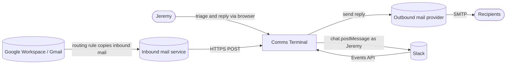
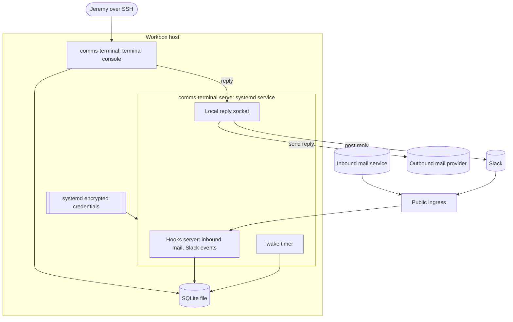
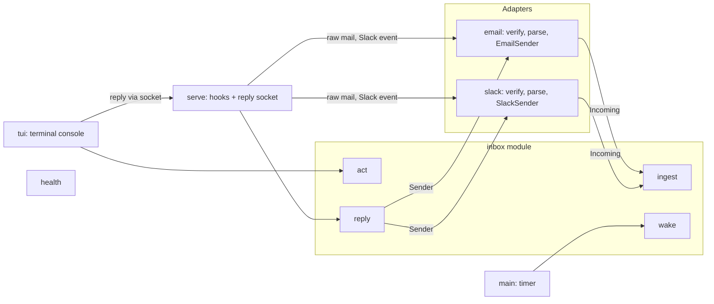

# Comms Terminal MVP — PRD

## 1. Document control

- **Title**: Comms Terminal MVP (Gmail + Slack)
- **Status**: **Draft (revision 3; updated 2026-10-15).** Revision 3 adopted Plain's status model and integration architecture and added replying from the console (decisions #51–#56). Behavior follows Plain unless a deviation is stated with its reason. The technical design in §4–§5 is **Approved** (D1, decision #67). Each phase needs its own implementation authorization. D2 is resolved (SSH, #71); D3 is resolved (Cloudflare Tunnel, Email Routing with an Email Worker, Resend; #102). Phases 0–5 and the 6.1 and 6.3 builds are done; 6.2 and 6.4 are Jeremy's connect steps in `docs/runbook.md`. Linear context (FR-13c, #125) was built under Jeremy's "execute the plan"; under his subsequent "ship it", release `38e196e` is published to `main`/`dev` and deployed to the existing Workbox package/service. Linear was connected on 2026-10-16 with a Read-only key covering both workspace teams; see the connection receipt in `docs/design/linear-context.md`. Attachments (#127–#137) are built on `dev` (P1–P6) and their release (P7) is authorized; plan: `.agents/prd/2026-10-15-attachments.md`.
- **Owner / authority**: Jeremy Legere (single user and product owner)
- **Created**: 2026-10-10T20:04+00:00
- **Updated**: 2026-10-20
- **Topic**: MVP of a single-user, Plain-style Thread queue across Gmail and Slack
- **Authority chain**:
  - `.agents/discovery/2026-10-10-comms-terminal.md`: validated problem and strategy.
  - `GLOSSARY.md`: terms.
  - `docs/requirements.md`: MVP scope.
  - `docs/adr/0001-purpose-built-thread-ledger.md`: strategy.
  - Jeremy's review annotations on this PRD (2026-10-10): anchor every behavior on Plain.
  - Plain behavior evidence: Plain docs and GraphQL schema, read 2026-10-10 (cited in §9).
- **Implementation authorization**: Phase 0 (done) and the BDD setup. Phases 1–6, external accounts, DNS changes, and installing services each need separate explicit approval. Connecting real accounts is Jeremy's own step after the build (FR-1).
- **History limits**: Built from the full 2026-10-10 session plus the artifacts above. Exact times exist only for observed clock readings or file modification times.

## 2. Executive framing

**Problem (approved).** Jeremy, a founder with ADHD, handles 30–60 professional conversations a day across email, Slack, LinkedIn, phone messaging, and tool comments. He loses track of conversations he has already seen and owes a reply on. Who owes whom what lives only in his head and in per-app read markers, and no system he trusts holds it. The result is dropped or late replies.

**Current behavior (evidence).**
- The latest drop was an email he saw and then lost.
- Workarounds are Gmail unread/star and agent reminders.
- Donna's ball-in-court tracking misses threads.
- A Super Productivity Gmail plugin was abandoned after silent sync failures.

Source: discovery doc §Context.

**Desired outcome.** One pull-only console that works like Plain for one person. Every connected email and Slack Thread has a Status, Jeremy replies from the console, and eligible replies bring a Thread back under the Ignore and Block rules.

**Audience.** Jeremy only.

**MVP scope.**
- An Email channel and a Slack channel built on Plain's integration architecture (decisions #53, #55, #56). Jeremy connects `jeremy@agentmaple.com` and the Agent Maple workspace himself after the build.
- Ingestion is event-driven and forward from connect, as in Plain.
- Replying from the console on both channels (decision #51).
- Plain status logic: Status plus Status detail (decision #52).
- Ignore and Block.
- Cases.
- Person and Organization records.
- Sync health (as in Plain: a Connection shows broken when it fails).
- Plain keyboard, plus reply keys.
- No notifications.

**Non-goals.** Task management (Linear), a CRM (Attio stays the CRM; Organization Stage moved here, ADR 0006), meeting notes (Tana), and auto-replies.

**Deferred.**
- Tool comments, WhatsApp, LinkedIn.
- Other mailboxes and workspaces.
- Domain, category, or content rules.
- Sending new conversations (new email, new DM), rich text, undo-send, signatures. Persistent unsent Drafts are authorized separately in the Drafts-first expansion below.
- Cmd+K.
- Additional Context sources beyond Tana, Attio, and the Linear contract in FR-13c.
- Plain's "Close the loop" (needs linked issues).
- Auto-resolution.

**Out of scope for now.** SMS and iMessage.

**Drafts-first expansion.**

The new-thread composition design is approved for a local Drafts-first release: create, edit, save and resume email/SMS Drafts with captured recipient history. Drafts is an ordinary page under Threads and replaces visible All; existing status pages and backend All query remain. Drafts are not Threads or Activities. Saves use expected Draft revisions to avoid overwriting concurrent edits. New-message sending and attempt/recovery work remain gated; existing replies are unchanged. This expansion preserves the existing single-console/SQLite architecture and adds no provider or service endpoint.

**Attachments expansion.**

Received Attachments and Inline images on Gmail, Slack, and SMS are copied on arrival into one store on Workbox, open on Mani through LAN links, and show in the console; `y` gives agents their paths. Email and Slack replies and Drafts send Attachments (#127–#137).

**Success measures.**
1. **Zero silent drops.** Every connected Thread ends Done, Snoozed, or Ignored; none sits unhandled. (Jeremy's review: "every connected thread, not just ones needing my reply.")
2. **One place to work.** Daily triage and replies happen in one console.

**Measurable proxy (Proposed).** For 14 days after Jeremy connects:
- No Connection stays broken unseen for more than 15 minutes.
- Jeremy reports no dropped Thread from a covered Connection.

**Dependencies.**
- For building: none external. Every integration is exercised with synthetic payloads.
- For connecting, after the build, by Jeremy (D3):
  - A Google Workspace routing rule that copies mail for `jeremy@agentmaple.com` to the inbound address, keeping delivery to Gmail.
  - An inbound mail service and an outbound mail provider, with SPF/DKIM DNS records on `agentmaple.com`.
  - A public HTTPS ingress for the inbound mail and Slack event endpoints.
  - A Slack app with a bot (selected channels) and Jeremy's user token (DMs and replies).
  - A host (Workbox proposed, D1).

## 3. Requirements and coverage

Status key in brackets:
- **C**: confirmed by Jeremy.
- **PL**: copied from Plain's documented behavior, per Jeremy's "same as Plain" decisions.
- **P**: proposed here.
- **D**: a deliberate deviation from Plain, with its reason.

### Connections and ingestion

- **FR-1** [C]: Build an Email channel and a Slack channel. Connecting real accounts is not part of the build; Jeremy connects them afterwards.
- **FR-2** [C]: Mirror each ingested native message as one Activity with its native ID. An edit becomes an Edit Activity carrying the new content; a deletion becomes a Delete Activity. Activities are never rewritten, except for the content removal in FR-2a.
  - **FR-2a** [PL]: When a Slack message is deleted, the Delete Activity references the deleted message's native ID and carries no content; it is the audit record. The content of the deleted message's earlier Activities (the message and any edits) is cleared, as in Plain's Slack data retention.
- **FR-3** [PL]: **Email receiving.** Mail is forwarded in, as in Plain: a Google Workspace routing rule copies every message for `jeremy@agentmaple.com` to the inbound address and still delivers it to Gmail. The system never reads the Gmail mailbox.
  - Every new inbound email creates a Thread; a reply that references an earlier message (`In-Reply-To` / `References`) joins its Thread.
  - [D] Reconcile stored email Threads within one mailbox using exact Message-ID references, including late parents and shared referenced ancestors outside stored history (decision #118). Subject, body, sender, time-window, fuzzy, and AI matching are excluded.
  - Activity records and raw messages remain immutable. Old Thread IDs resolve to the retained Thread; the latest complete triage state and one Case association are preserved. Conflicting Case associations keep their Threads separate for review.
  - Gmail accepted sends retain an immutable Resend UUID marker. Signed `email.sent` receipts bind that UUID to one exact SMTP Message-ID, scoped to exactly one eligible Gmail Connection. Minimal receipt metadata commits before acknowledgement; periodic wake reuses mailbox reconciliation, including reordered receipt/message arrival and restart. Receipt records create no mail Activity; reconciliation selects an existing complete triage state without replaying an Activity-driven transition.
  - Mail Jeremy sends from Gmail directly is never seen (Plain assumes replies happen in Plain). Accepted in decision #55.
- **FR-3a** [PL]: **Auto-reply filter.** An inbound email is an auto-reply when it carries one of Plain's header signals: `Auto-Submitted` (other than `no`), `Precedence: auto_reply` or `bulk`, `X-AutoReply`, `X-Autorespond`, `X-Amazon-Auto-Reply`, `X-amzn-vacation`, `X-SFDC-AutoResponse`, `X-ServiceNow-Generated`, `X-Front-Autoreply`, `X-CodeTwo-AutoResponse` / `X-C2AutoRespond`, `X-MDAutoResponse`, `X-QQ-Auto-Reply`, `X-MS-Exchange-Generated-Message-Source`. A matching subject prefix ("Automatic reply:", "Out of office:", and others) counts only together with a header signal.
  - A filtered auto-reply is not stored, creates no Thread, and never moves one.
- **FR-3b** [PL + D]: **Email sending.** A reply written in the console is sent through the outbound mail provider from `jeremy@agentmaple.com`, with `In-Reply-To` and `References` set so the recipient's client threads it.
  - [D] Recipients default to reply-all (the original From, To, and CC, minus Jeremy), editable before sending. Reason: Plain drops CC'd recipients; Jeremy's conversations often include several people.
  - Gmail reply headers use resolved SMTP IDs while timeline `native_id` stays immutable. An unresolved intended parent refuses dispatch with a pending-confirmation error, preserving text/files; earlier unresolved markers are omitted from References. Accepted responses without a usable UUID remain unknown outcomes and must never trigger an automatic resend.
  - Outgoing recording preserves inbound activity and user triage arriving during the provider call. Alias-aware reply sends/clears only the selected original draft's text/files; canonical destination does not change attachment ownership.
  - [P] Console replies do not appear in Gmail's Sent folder unless BCC is configured (Plain's BCC addresses). Open item in §6.
- **FR-4** [PL]: **Slack channels.** A bot joins the channels Jeremy selects, and their messages arrive as Slack events, as in Plain.
  - Jeremy selects channels by hand, or by name prefix/suffix rules (Plain's auto-join rules).
  - Unselected channels are not ingested (Plain's "disabled").
- **FR-4a** [D]: **Slack DMs and group DMs** arrive as events on Jeremy's behalf (his user token), following the same Thread rules. Reason: DMs carry most of Jeremy's Slack comms, and a Plain bot cannot read them.
- **FR-4b** [PL + D]: **Slack grouping is time-based** (Plain's default ingestion mode):
  - [D] In a channel or private channel, a new top-level message joins the channel's latest top-level Thread unless the channel has had no message for 24 hours; then it starts a new Thread (decisions #124, #126).
  - [D] In a DM or group DM, a new top-level message joins the conversation's latest Thread when its last message was within 24 hours, whoever sent it. Otherwise it starts a new Thread (decision #126).
  - [D] SMS groups the same way with a 7-day window (decision #126). Messages Jeremy sends, including sent Drafts, group by these same rules.
  - [D] The first reply to a top-level message starts its own Thread; later replies in that Slack reply-thread join it (decision #124).
  - [D] A top-level message Jeremy posts starts a Thread in Snoozed / Waiting for them. Reason: it shows he is waiting on an answer (decision #61); replaces the Plain-inferred rule that his own post makes no Thread until someone else posts.
- **FR-4c** [PL]: **Slack sending.** A reply written in the console posts to the Thread's conversation from Jeremy's Slack profile, "as if you typed it there". [D] In a channel the reply always goes inside a Slack reply-thread, never top-level: a Thread made of replies gets it in that reply-thread, and a Thread of top-level messages gets it under its latest top-level message. In a DM or group DM it goes top-level unless the Thread is made of replies (decision #124).
- **FR-5** [PL]: **No history backfill.** Ingestion starts when a Connection is connected (Plain is forward-only).

### Status (Plain logic)

- **FR-6** [PL]: Every Thread has a Status and a Status detail (decision #52):
  - **Todo**:
    - *Needs first response*: a new Thread Jeremy has not replied to.
    - *Needs next response*: the other side replied after Jeremy.
    - *Investigating*: set manually.
  - **Snoozed**:
    - *Waiting for them*: Plain's "Waiting for customer".
    - *Paused for later*: until a date. A Snooze always has one (FR-OA-10); `Snooze` with no date is refused.
  - **Done**:
    - *Done*.
    - *Ignored*.
- **FR-6a** [PL]: A new Thread starts in Todo / Needs first response.
- **FR-6b** [PL]: Jeremy's reply moves the Thread to Snoozed / Waiting for them. A reply sent from the console is recorded as an outbound Activity when it is sent.
- **FR-6c** [PL + D]: Eligible activity from the other side moves a Snoozed or Done Thread to Todo / Needs next response. This includes messages, and [C] edits and deletions; Plain: "When any activity happens in a thread, it will move back to Todo." [D] Blocked ordinary activity on existing Threads is excluded by FR-7a (decision #138).
- **FR-6d** [PL + D]: A snooze ends at its time, or on the other side's next eligible activity (FR-7a), and the Thread returns to Todo.
- **FR-6e** [PL]: An Ignored Thread does not move Status on new activity until Jeremy un-ignores it.

### Ignore and Block

- **FR-7** [C/PL]: **Ignore** is the Done / Ignored Status detail, set by Jeremy on a Thread. The Ignored view is a filter over Threads with that Status detail.
- **FR-7a** [C/PL + D]: **Block** applies to one sending Identity: an email address, Slack user, or phone number. Its scope stays at that Identity, independent of its Person or domain.
  - A new Thread from a blocked Identity is created directly as Done / Ignored. This mirrors Plain's spam customers, whose threads "are automatically closed as ignored".
  - [D] On an existing Thread, blocked ordinary inbound messages, edits, and deletions remain stored but skip arrival-driven Status application (decision #138). This keeps a blocked participant from reopening a useful mixed conversation; other participants follow their normal rules.
  - [C] Unblocking applies normal rules to future activity and new Threads. It leaves current triage unchanged; an existing Ignored Thread stays Ignored until Jeremy un-ignores it.
  - Phone call rules, independent snooze/follow-up timers, exact-reference email reconciliation, Jeremy's own messages, explicit actions, and Sequence pause hooks retain their current behavior. Reconciliation may select another existing complete triage state before arrival eligibility is checked.
- **FR-8** [C]: Every new sender reaches the queue by default.

### People

- **FR-10** [C]: A **Person** is a Slack user and/or a set of email addresses. Persons are created automatically when they first message Jeremy (Plain: "Customers that reach out to you will automatically be created"). An email address belongs to one Person.
  - [P] A Slack user joins the Person holding the email address in their Slack profile. Jeremy can add an Identity (an email address or a Slack user) to a Person by hand, and remove one; an Identity that belongs to another Person is refused until he removes it there.
- **FR-11** [C/PL]: **Organizations** are created automatically from email domains (Plain tenants match by domain).
  - [D] Free-mail domains (gmail.com, outlook.com, and similar) never form an Organization. Reason: Jeremy approved this in AS-12; Plain does not state a rule.
- **FR-12** [C]: A Case is one goal with an end that Jeremy drives through Threads (a support issue, a deal or onboarding, getting someone to respond). A Thread is in at most one Case. A Case's Status is the earliest of its Threads' Statuses in the order Todo, Snoozed, Done, Ignored; with no Threads it is Todo; Jeremy never sets it (decision #120).
  - [D] The rail has a Cases section with Todo, Snoozed, Done, and Ignored views; `n` there creates a Case with no Threads yet. Thread views group Threads under Case header rows (title and Thread counts per Status), "No case" first, then by each Case's oldest Thread. Reason: Jeremy works Cases to completion (2026-10-13); Plain has no Case.
  - [D] A Case may match one CRM record, such as an Attio deal, but holds none of its data; a link goes in its description. A Case whose Threads are all Done shows Done even if its goal is still open (accepted).
- **FR-13** [C]: Person and Organization records list their Threads (with Status) and Cases.
- **FR-13a** [D]: Tana is a read-only Context source (decision #122). Thread, Person, Organization, and Case pages show a Tana section in their details column, fetched live from Tana's MCP server when the page opens: the matching Tana People (by email Identity) and Organizations (by domain), the Organization's Deals, its unresolved Threats (Active, Mitigating) and Opportunities (Exploring, Validated), open Tana tasks that mention the Person or Organization, and Meetings (the next upcoming and the last three whose attendees include the Person's email or the Organization's domain), each with its summary and linked documents by type. Teammates match like everyone else. A Google Calendar Meeting with someone outside Agent Maple is a Thread (FR-OA, ADR 0007), and this section shows its Tana summary there. If Tana fails, the section says why and the bottom bar shows Tana broken, apart from Connection health. Reason: Jeremy's meeting context lives in Tana (2026-10-13); Plain shows CRM context beside threads the same way.
- **FR-13b** [D]: Attio is a read-only Context source (decision #123). The same pages show an Attio section above Tana's, fetched live from Attio's REST API: the matching Attio People (by email Identity) and Companies (by domain), each with every filled field less a short list of noise (identifiers, images, audit stamps, social handles, first and per-channel interactions), the lists each is on with that entry's fields, and the open tasks on any of them. Attio has had no Deals object since 2026-10-22 (Jeremy moved to account-level tracking), so the section shows no deals. The rail's context section and the bottom bar show Attio's health beside Tana's. Reason: Agent Maple's CRM is Attio (2026-10-14); Jeremy wants its structured data and open tasks beside each Person and Organization.
- **FR-13c** [D]: Linear is a read-only Context source, never a message Platform (decision #125). Thread, Person, Organization, and Case pages show a separate Linear section alongside Attio and Tana. Linear issues never become Threads or Activities.
  - Automatically match People and Organizations using exact email addresses/domains and exact full-name/company-name phrases across issue title and description and Linear Customer (external company) fields. Inspect Customer Request text and relations only within matched Customer/issue candidates; no global search over unassociated Requests. Name-only matches must be unique among local People/Organizations; ignore ambiguous names. Names/text if straightforward, exact-key fallback otherwise. No fuzzy or semantic matching.
  - Show every matching issue except **Done, Completed, Canceled, or Archived**, including backlog, triage, and other nonterminal states. Each compact card shows identifier, title, state, priority, assignee, project, updated time, relevant bounded Customer Request excerpts, why-matched evidence, and a link to open in Linear. No issue comments or closed-history feed.
  - Preserve existing Person/Organization context inheritance on all four page types. Cases inherit context only through their People/Organizations; no explicit Case↔issue relation, copied data, sync, or new Case fields. Inbox Status stays unchanged.
  - Fetch through Linear's GraphQL API on page open, using a Jeremy-owned personal API key restricted to **Read** and only required teams. Store the key as an encrypted service credential; the console never holds it. Use the same five-minute service cache as other Context sources. The section reports errors; the rail and bottom bar show Linear source health separately from Connection health. No Linear writes, issue/task creation, comments, notifications, or webhooks. Reason: Jeremy wants active issue context beside conversations while task management stays in Linear (2026-10-15). Capability is published and deployed under "ship it"; Linear was connected on 2026-10-16 with a Read-only key covering both workspace teams; see the [connection receipt](design/linear-context.md#connection-receipt--2026-10-16).
  - **Review accepted** (2026-10-15): Jeremy's annotations on the focused [spike findings and phased plan](design/linear-context.md#spike-findings) accept the issue exclusions, bounded Customer Request text inspection, and inherited context/match reasons. Auth remains settled as "Read-only API key". Jeremy subsequently authorized local Phases 1–4 with "execute the plan", then code publication and existing Workbox package/service deployment with "ship it"; both release steps are complete. The plan records implementation, regression-suite limitations, deployment receipt, and installed fixture UI evidence. Account/credential and workspace/team-access changes remain separately gated; human acceptance remains separate.

- **FR-13d** [D]: The Calendar shows Jeremy's work calendar, read-only, beside the inbox's own dated items (decision #139, ADR 0005). The service reads Google Calendar's secret iCal address every 30 seconds and keeps every Event it has seen; an Event that leaves Google becomes a Deleted Event, kept and struck through. Repeating Events expand for any range, with no horizon.
  - [D] Calendar sits in the rail under Today: one month grid of week rows that scrolls without pages, a separator row where each month starts, opening on two weeks before through two weeks after this week. A day cell lists its Events (declined dimmed, unanswered marked `?`, Deleted struck through) and one count line for Tasks, Snoozed Threads, scheduled Drafts, and Enrollment starts. The right pane lists every Calendar Item of the cursor's day; Enter opens an Event's details (attendees linked to People, Threads, Cases, and Organizations; join link; Context sources) or the Thread, Task, Draft, or Person.
  - [D] The bottom bar shows the Event in progress with the time left, then the next timed Event on any day; Declined, All-day, and Deleted Events do not count. After three failed fetches the Calendar shows its last copy with "as of" and the bottom bar shows Google Calendar broken.
  - [D] Agents read Events with `comms-terminal events` (expanded, local time, `--json`). Reason: Jeremy leaves the terminal for a browser to see his schedule (2026-10-20, `.agents/discovery/2026-10-20-calendar.md`).

### Console

- **FR-14** [PL + D]: **Keyboard**:
  - [PL] Plain's keys: J / K next and previous; E Done; Z Pause for later; W Wait for them; S change status (for example, Investigating).
  - [P] R opens the inline reply box on the Thread; Ctrl+S sends (decision #75; terminals cannot tell Ctrl+Enter from Enter).
  - [D] I Ignore; C add to Case. Reason: Plain ignores through status changes and workflows, and has no Case.
  - [D] Enter opens the Thread in the console; O shows a Ctrl-clickable link to it in Gmail or Slack. Reason: reading full context in the native app; Attachments open from their chips (#130). Other console keys: `docs/design/console.md` §4.
- **FR-14b** [C]: **Today** is where the console opens: one page stacking Todo Threads (grouped by Case), Due Tasks, and the Drafts not shown through them (Today (`inbox.today`) lists a Task's Draft only through its due Task, and a reply Draft only when its Thread is not Todo). Key `1` opens it. Requirements FR-T1–16 and acceptance scenarios AS-T1–10 are in the Today PRD (`.agents/prd/2026-10-17-today-view.md`).
- **FR-15** [C]: The console sends only replies Jeremy writes. It never edits, deletes, archives, or marks read anything in Gmail or Slack.

### Sequences

- **FR-SEQ** [C]: Outreach Sequences run inside Comms Terminal (ADR 0003): Jeremy edits Sequences of Steps, enrolls one Person at a time, and works each Enrollment's Due Tasks on the Tasks page; anything inbound from the Person pauses their Enrollments. Requirements FR-SEQ-1–24 and acceptance scenarios AS-SEQ-1–17 are in the Sequencing PRD (`.agents/prd/2026-10-16-sequencing.md`); FR-SEQ-25 and AS-SEQ-18 (Start date) are in `.agents/prd/2026-10-19-enrollment-start-date.md`; the interface names (Enroll, Due Tasks, Complete Task, Skip Task, Pause, Resume, Finish) are in `docs/design/api-and-database.md` §2.

### Pipeline

- **FR-PL** [C]: Each Organization holds a Stage and a Value in the Revenue and Fundraising Pipelines, set by Jeremy in the console (`s`, `v`) or the `pipeline` CLI and kept in an append-only log (ADR 0006). A Pipeline page per Pipeline works Winning by Design's Bowtie Standard v1.0 backwards from its Target over the last 12 months: Conversion rate, Time in Stage, Conversion to Impact, Retention rate (GRR), Expansion rate, Net retention, Required volume, Pace, and the Constraint (the measured rate furthest below its benchmark), with the standard's Table 6.2 benchmarks only where no rate is measured. It sets no Tasks and does not read or write Attio. Detail: `.agents/prd/2026-10-23-pipeline.md` (FR-PL-1..40); design: `docs/design/console.md` § Pipeline.

### Organization actions

- **FR-OA** [C]: Threads do the work and an Organization only reads them (ADR 0007). A Person belongs to the Organizations of their company email domains, plus Jeremy's own additions and less his removals (Membership: `o` on a Person, `p` on an Organization). An Organization's roll-up is the earliest of Todo, Snoozed, and Done over the Threads its People wrote in or were addressed in, with an unfinished Enrollment counting as Snoozed; in an open or paying Stage and Done, it is Unattended, and Today, the Pipeline board, and the Organization page show it. A Snooze always has a date. Google Calendar is a read-only Platform: each Event with someone outside Agent Maple, first seen after go-live, is one Thread in Todo, and each held, cancelled, or declined occurrence is a Meeting Activity that puts it back in Todo. Detail: `.agents/prd/2026-10-24-organization-actions.md` (FR-OA-1..16); design: `docs/design/console.md` § Today, § Pipeline, § Meetings.

### Non-functional

- **NFR-1** [PL]: **Completeness** relies on event delivery, as in Plain (decisions #55, #66). Reference-based reconciliation repairs stored Thread membership; it does not establish source completeness. See R7 and R12.
- **NFR-2** [C / P]: **Sync health.**
  - Slack: Broken when Slack reports the token revoked or the app uninstalled (`tokens_revoked`, `app_uninstalled` events), or a reply fails to post.
  - Email: Broken on an inbound request that fails verification or a send failure.
  - The separate Resend receipt endpoint rejects unsigned traffic without changing Connection health. Sender acceptance/health does not establish signed receipt delivery or SMTP identity resolution.
  - Every Connection: Broken when its Health Check fails or none has run for over an hour (decision #119). Every 30 minutes the service checks that Resend, Slack, and Quo accept their keys and that Quo's webhook is enabled; Fastmail's 10-minute Sent poll is its check.
  - Silence on any channel cannot be told apart from a quiet inbox (R7, R12).
- **NFR-3** [C]: **Pull only.** No notifications.
- **NFR-4** [C]: **Single user.** The console is a terminal app reachable only by SSH to Workbox (D2, decision #71); the reply socket is owned by `jerry` with mode 0600. The source tunnel allowlist is exactly `^/hooks/(email|slack|quo|resend)$`; each route verifies its own protocol/secret. Private reply, context, file, and upload routes stay outside public ingress. Live tunnel changes require separately approved, scoped preservation of current configuration.
- **NFR-5** [P]: **Secrets.** Tokens and keys are never logged or printed, and are never stored as plaintext user-service credentials (Ledgere precedent).
- **NFR-8** [P]: **Simplicity.** A single process, the standard library first, and no added service without evidence that it is needed. The inbound mail service, outbound provider, and ingress are needed by Plain's architecture (decision #55).

### Invariants

- **I-1**: every stored Activity belongs to exactly one Thread.
- **I-2**: every Thread has exactly one Status and one Status detail.
- **I-3**: a Thread is in at most one Case.
- **I-4**: Status changes only through:
  - Jeremy's action
  - Jeremy's own message, from the console or Slack (to Waiting for them)
  - a snooze expiring
  - the other side's eligible activity (FR-7a)
  - Block, at Thread creation
  - exact-reference email reconciliation selecting an existing complete triage state (FR-3)
- **I-5**: Ignored does not move on new activity.
- **I-6**: an email address belongs to at most one Person.

### Acceptance scenarios

Executable form: `features/<domain>.feature` (Gherkin via pytest-bdd), each scenario tagged `@AS-n` plus its requirement IDs (decision #49).

- **AS-1**: Jeremy reads an email in Gmail and forgets it. → The Thread stays Todo / Needs first response.
- **AS-2**: Logan emails, then pings in a DM. → Two Todo Threads on Logan's Person record (via his Slack profile email). C groups them into a Case.
- **AS-3**: Jeremy replies to an email Thread from the console. → The reply is sent with `In-Reply-To`; the Thread is Snoozed / Waiting for them.
- **AS-4**: The other side then replies. → Todo / Needs next response in the same Thread. Exact references reconcile eligible split email Threads even when a parent arrives later or a reply bridges stored branches; Activities remain unchanged.
- **AS-5**: A Done Slack Thread's message is edited by its author. → Todo / Needs next response.
- **AS-6**: Jeremy blocks `alerts@signoz.io`, and a new alert arrives. → A new Thread is created as Done / Ignored and is visible under the Ignored filter. A blocked Slack user replies in an existing Waiting for them Thread. → The reply is retained in that same Thread; it stays Snoozed / Waiting for them.
- **AS-7**: A new prospect emails for the first time. → Todo / Needs first response; a Person is auto-created.
- **AS-8**: The Slack token is revoked. → Slack sends `tokens_revoked`; health shows broken.
- **AS-9**: Removed (decision #66: no reconciliation).
- **AS-10**: Removed (decision #66: no reconciliation).
- **AS-11**: An out-of-office reply arrives with `Auto-Submitted: auto-replied` on a Waiting Thread. → It is filtered and not stored; the Thread stays Snoozed / Waiting for them.
- **AS-12** [approved in review]: An email from `ana@acme.com`. → Person and Organization "acme.com" are formed. An email from `bob@gmail.com` forms no Organization.
- **AS-13**: In a DM, Logan sends a message, then another 30 minutes later. → One Thread (within 24 hours). Logan writes again 25 hours later → a new Thread.
- **AS-14**: Jeremy posts top-level in a selected channel. → A Thread in Snoozed / Waiting for them. Someone replies 40 minutes later → Todo / Needs next response.
- **AS-15**: A message in an unselected channel. → Not ingested; no Thread.
- **AS-16**: A Snooze with no date is refused, and the Thread stays as it was (FR-OA-10; superseded the earlier "indefinitely" scenario).
- **AS-17**: Jeremy replies to a Slack Thread from the console. → The reply posts from his Slack profile in the Thread's conversation; the Thread is Snoozed / Waiting for them.
- **AS-18**: Jeremy replies to an email directly in Gmail. → Not seen; the Thread stays Todo (accepted Plain limitation, decision #55).
- **AS-19**: An inbound mail request arrives without the shared secret. → Rejected; nothing stored; email health shows broken.
- **AS-20**: Logan deletes a Slack message on a Thread. → A Delete Activity is added; the message's stored content is cleared; the Thread moves to Todo / Needs next response (FR-6c).

### Traceability

- **FR-2, FR-2a, FR-4b, FR-6–FR-8, FR-10–FR-12, I-1..I-6, AS-2, AS-4..AS-7, AS-12..AS-14, AS-16, AS-20**: steps 1.2–1.4 → `features/threads.feature`, `people.feature`, `organizations.feature`, `cases.feature`, and the Ingest scenarios in `email.feature` and `slack.feature`.
- **FR-1, FR-3–FR-3b, FR-5, AS-3, AS-11, AS-19**: steps 2.1–2.2 → `features/email.feature`.
- **FR-1, FR-4, FR-4a, FR-4c, AS-15, AS-17**: steps 3.1–3.4 → `features/slack.feature`.
- **NFR-2, AS-8**: step 4.1 → `features/sync.feature`.
- **FR-13, FR-14**: steps 5.1–5.5 → console tests; build demo in step 6.3 on synthetic data.
- **FR-13c**: decision #125 → `tests/test_linear.py`, `tests/test_linear_service.py`, and `tests/test_linear_console.py`; synthetic provider, actual private Unix route, matching/cache, and rendered page checks. See the [local implementation evidence](design/linear-context.md#local-implementation-evidence--2026-10-15) for results and regression-suite limitations. Live connection evidence is in the [connection receipt](design/linear-context.md#connection-receipt--2026-10-16).
- **NFR-4, NFR-5**: steps 6.1–6.3 → service and ingress inspection; secret scan of logs.
- **Success measures**: after Jeremy connects → 14-day observation by Jeremy (a product measure, not an agent-held gate).

## 4. Architecture and solution shape

**Current: N/A.** `comms-terminal/` holds documents and the BDD setup. There is no product code or runtime.

**Target: Approved (D1 re-approved 2026-10-12, decision #67).**
- Strategy C (ADR 0001), with Plain's integration architecture (ADR 0002).
- One process with an embedded database. Two private surfaces and one public one:
  - **Public ingress** (two verified endpoints only): inbound mail, and Slack events.
  - **Terminal console** over SSH (decision #71), reading the same database; replies go through the service's local socket (#73).
  - **Outbound calls**: the mail provider's send API, and Slack's Web API.

### Alternatives considered

- **Email ingestion**: Plain-style forwarding (chosen, #55) rather than Gmail push via Pub/Sub or Gmail polling. Cost: Gmail-native replies are invisible and email completeness cannot be proven.
- **Email sending**: outbound mail provider with SPF/DKIM on `agentmaple.com` (chosen, Plain) rather than the Gmail API. Cost: console replies are missing from Gmail Sent unless BCC'd.
- **Slack delivery**: Events API over the public ingress (Proposed) rather than Socket Mode. The ingress exists anyway for email, and HTTP keeps the standard library; Socket Mode needs a WebSocket client dependency.
- **Store**: SQLite (stdlib), rather than Postgres. One user and nothing to operate.
- **Runtime**: Python 3.11+ with `uv`, rather than Node 22. The stdlib covers HTTP, JSON, MIME parsing (`email`), SQLite, and serving.
- **Console**: server-rendered HTML through stdlib `http.server` plus one small key-binding script, rather than an SPA.
- **APIs**: raw REST over `urllib`, rather than vendor SDKs.
- **Acceptance tests**: Cucumber-style Gherkin run by `pytest-bdd`, rather than `behave`.
- **Host**: Workbox as a root-managed systemd system service with `LoadCredentialEncrypted=`. Ingress, inbound mail service, and outbound provider: D3 (candidates: Cloudflare Tunnel, Cloudflare Email Routing with an Email Worker, Amazon SES or Resend), within the $10/month ceiling.

**Complexity justification.** One process and one SQLite file. The ingress and two mail services are what Plain's architecture requires; nothing else is added.

### L1 Context (Proposed)

### L2 Containers (Proposed)

### L3 Components (Proposed)

One deep module, `inbox`, behind four calls; email and Slack are adapters behind two seams (decision #60). Detail: `docs/design/api-and-database.md`.

### L4 Code map (Proposed unless marked Current)

- **`pyproject.toml`**: Python ≥3.11, no runtime dependencies, `pytest` and `pytest-bdd` for development. **Current** (decision #49).
- **`features/<domain>.feature`**: acceptance scenarios in Gherkin, one file per product domain, written against the four `inbox` calls and the adapters; `@wip` until steps pass. **Current.**
- **`tests/test_features.py`**: binds every feature; step definitions go in `tests/steps/`. **Current.**
- **`src/comms_terminal/inbox.py`** and **`schema.sql`** (**Current**, Phase 1): the domain module. Public: `connect`, `migrate`, `ingest`, `act`, `reply`, `wake`, `block`, `add_identity`, `remove_identity`. Private: threading and Slack time grouping, Status rules, Person and Organization resolution, FR-2a content clearing.
- **`src/comms_terminal/email.py`**: `verify`, `parse` (stdlib `email`; returns nothing for an auto-reply, FR-3a), `EmailSender`.
- **`src/comms_terminal/slack.py`**: `verify`, `parse` (applies Channel selection), `SlackSender`, `user_email`.
- **`src/comms_terminal/health.py`**: `connection_health(connection, now)`.
- **`src/comms_terminal/tui.py`** (**Current**): the Textual console (`docs/design/console.md`).
- **`src/comms_terminal/main.py`** (**Current**): the `comms-terminal` command: console (default), `serve`, `init`.
- **`scripts/seed_demo.py`** (**Current**): synthetic data for visual QA and the 6.3 demo.
- **`src/comms_terminal/serve.py`** (**Current**): public `/hooks/email`, `/hooks/slack`, `/hooks/quo`, and optional signed `/hooks/resend`; sending/context APIs on the private Unix socket; periodic receipt reconciliation and deferred downloads.
- **`src/comms_terminal/main.py`**: both listeners and `wake` every minute; reads credentials from `$CREDENTIALS_DIRECTORY`.
- **`scripts/oauth_slack.py`**: consent helper for Jeremy's post-build connect.
- **`deploy/comms-terminal.service`**: systemd system unit. Ingress and mail-service configuration per D3.

**Schema and API.** `docs/design/api-and-database.md` (decisions #58–#61): 9 tables with constraints and append-only triggers, Plain Status enum values, Status rules, the `inbox` interface, adapters, and HTTP routes.

## 5. Phased execution plan

Every path is **Proposed** unless marked Current. D1 is approved (#67); each phase needs its own implementation authorization.

### Phase 0 — Decision and repository (done 2026-10-11)

- **0.1 Resolve D1.** Done (#47); reopened by #53 and #55; re-approved 2026-10-12 (#67).
- **0.2 Repository.** Done: `JMLegere/comms-terminal`, `main` and `dev`.

### Phase 1 — Inbox module

- **Status: done 2026-10-12.** `src/comms_terminal/inbox.py`, `schema.sql`; `tests/steps/inbox_steps.py`, `tests/test_schema.py`. 27 tests pass; 25 later-phase scenarios stay `@wip`.
- **1.1 `pyproject.toml`.** Current (BDD setup).
- **1.2 `inbox.connect` and `inbox.migrate`**: the schema in the design doc.
  - Requirements: FR-2, FR-2a, I-1, I-2, I-3, I-6.
  - Verify: the schema's constraints and triggers (duplicate `native_id` stored once; Activities cannot be rewritten; content clears only after a deletion).
- **1.3 `inbox.ingest`**: threading, Slack time grouping, Status rules on incoming activity, Person and Organization resolution.
  - Requirements: FR-2, FR-2a, FR-4b, FR-6a, FR-6c, FR-6e, FR-7a, FR-8, FR-10, FR-11.
  - Verify: `features/threads.feature`, `features/people.feature`, `features/organizations.feature`, and the Ingest scenarios in `features/email.feature` and `features/slack.feature`, with synthetic Incoming values.
- **1.4 `inbox.act`, `inbox.reply`, `inbox.wake`, `inbox.block`, `inbox.add_identity`, `inbox.remove_identity`.**
  - Requirements: FR-6b, FR-6d, FR-7, FR-7a, FR-10, FR-12, FR-14 (actions).
  - Verify: `features/threads.feature`, `features/cases.feature`, `features/people.feature`, with a fake Sender.

### Phase 2 — Email adapter

- **Status: done 2026-10-12.** `src/comms_terminal/email.py` (verify, parse, `EmailSender` over Resend, `handle_hook`).

- **2.1 `email.verify` and `email.parse`.**
  - Requirements: FR-3, FR-3a, FR-5, AS-11, AS-19.
  - Verify: `features/email.feature` with synthetic MIME messages.
- **2.2 `email.EmailSender`.**
  - Requirements: FR-3b, AS-3.
  - Verify: against a fake provider endpoint: `In-Reply-To` / `References` and reply-all recipients.

- **Sent-receipt follow-up — implemented in local source, 2026-10-16.** Migration 13 stores provider UUID/Connection/SMTP-ID mappings; accepted initial sends and ordinary replies retain the UUID without provider GET polling. `/hooks/resend` authenticates bounded raw bodies through the existing Standard Webhooks verifier with strict Svix header adaptation and a separate optional encrypted secret. Config/ownership/storage failures return 503; bad signature 401; malformed authenticated payload 400; mapping conflict 409; committed new/identical or unrelated authenticated event 204. Other transports and existing hook configuration remain independent.
  - Verification/release status must be recorded separately; this source change establishes no configured/live endpoint. Keep Resend's API key sending-only. Provider endpoint creation/replay, credential provisioning, exact tunnel update, backup/migration, package/service changes, and real email need separate authorization (`docs/runbook.md` §2a).
  - Live admission must prove actual signed payload/delivery, provider retry/replay timing, durable acknowledgement/restart recovery, exact outbound threading headers, and rendered conversation/draft ownership. Missing historical identity requires authoritative UUID↔SMTP-ID proof plus an approved current-state repair; no subject/body inference or automatic resend/unmerge.

### Phase 3 — Slack adapter

- **Status: done 2026-10-12.** `src/comms_terminal/slack.py` (verify, parse, `SlackClient`, `SlackSender`, `handle_hook`); `scripts/oauth_slack.py`.

- **3.1 `scripts/oauth_slack.py`**: bot scopes for selected channels, plus Jeremy's user scopes for DM history and events, `chat:write`, `users:read`, and `users:read.email`.
- **3.2 `slack.verify` and `slack.parse`.**
  - Requirements: FR-4, FR-4a, NFR-4, AS-15.
  - Verify: `features/slack.feature` with synthetic events.
- **3.3 `slack.SlackSender`.**
  - Requirements: FR-4c, AS-17.
  - Verify: against a fake Web API: Jeremy's user token and `thread_ts`.
- **3.4 `slack.user_email`.**
  - Requirements: FR-10.

### Phase 4 — Trust monitor

- **Status: done 2026-10-12.** `src/comms_terminal/health.py`; `inbox.set_connection_error`, `inbox.set_auth`.

- **4.1 `health.connection_health`.**
  - Requirements: NFR-2, AS-8.
  - Verify: `features/sync.feature`: a `tokens_revoked` or `app_uninstalled` event, a failed Slack post, a failed email send, and a rejected inbound request each make health BROKEN.

### Phase 5 — Console (terminal)

- **Status: done 2026-10-12.** `serve.py`, `tui.py`, `main.py` (`comms-terminal`, `serve`, `init`), `scripts/seed_demo.py`; `tests/test_console.py`, `tests/test_serve.py`. 60 tests pass; 12 visual-QA screenshots reviewed; real-terminal run in herdr; service smoke-tested over HTTP and the Unix socket.

Design: `docs/design/console.md` (approved). Verify each step with Textual's test driver (`run_test`) and the visual-QA states in console.md §5.

- **5.1 `serve.py`**: hooks on the public listener (wrapping `email.handle_hook`, `slack.handle_hook`), `POST /reply` on the local socket, `wake` every minute.
  - Requirements: NFR-4, NFR-5, FR-3b, FR-4c.
- **5.2 `tui.py` queue**: sidebar views and counts, health lines, rows with glyphs, ordering, refresh on `PRAGMA data_version`.
  - Requirements: FR-6, FR-7, NFR-2, NFR-3.
- **5.3 Thread screen and keys** (j/k, enter, esc, e, z, w, s, i, c, o, p).
  - Requirements: FR-12, FR-13, FR-14.
- **5.4 Inline reply box**: reply-all To/Cc for email, Ctrl+S send through the socket, errors kept in the box.
  - Requirements: FR-3b, FR-4c, FR-6b.
- **5.5 Person, Cases, Channels screens**: Identities with block/add/remove, Case list, Slack Channel rules.
  - Requirements: FR-4, FR-7a, FR-10, FR-12, FR-13.

### Phase 6 — Package and demo

- **6.1 `deploy/comms-terminal.service` plus a credential runbook.** **Built** 2026-10-12: unit (`systemd-analyze verify` clean), `docs/runbook.md`, package installed with `uv tool install`.
  - Authorization: point-of-risk approval to install the system unit. Installing needs `sudo`; Jeremy runs runbook §3–§4.
- **6.2 Set up the ingress and mail services per D3.** The console needs only SSH (D2). **Built** 2026-10-12: `scripts/cloudflare_setup.py` (remotely managed tunnel, DNS, Email Routing, Worker, routing rule; plan then `--apply`), `deploy/email-worker/` (checked against the real hook by `tests/test_email_worker.py`), `deploy/install.sh`, `deploy/slack-app-manifest.yml`, runbook §2–§3. The service runs email-only until Slack is connected (Slack secrets in a unit drop-in).
  - Authorization: point-of-risk approval for each external account, DNS record, and routing rule. Jeremy performs them (runbook §6); none has been made.
- **6.3 Build demo on synthetic data.** **Built** 2026-10-12: `scripts/demo.py` runs the real hooks server and reply socket with demo credentials, signed fixture requests over HTTP, and fake Resend and Slack endpoints; 7/7 scenarios pass (`tests/test_demo.py`).
  - Walk AS-1, AS-3, AS-4, AS-6, AS-11, AS-13, and AS-17 using fixture-fed channels and fake send endpoints.
  - Exit: Jeremy accepts (`uv run python scripts/demo.py --step --keep`, runbook §6). **Accepted** by Jeremy 2026-10-12.
- **6.4 After the build, Jeremy connects real accounts** (FR-1), then checks health on live data. **Email connected and checked live** 2026-10-12 (decision #103). **Slack deferred** by Jeremy; runbook §3 when wanted.
- **Rollback.** Stop the service and remove the Workspace routing rule. Gmail keeps every message; Slack keeps every message.

## 6. Risks, unknowns, and approvals

- **D1: Technical shape in §4.**
  - Approved 2026-10-11 (#47); reopened by #53 and #55; re-approved 2026-10-12 (#67).
  - Owner: Jeremy. Blocks: no.
- **D2: Console access path.** **Resolved** 2026-10-12: SSH to Workbox (decision #71).
- **D3: Ingress, inbound mail service, and outbound mail provider.** **Resolved** 2026-10-12 (decision #102): Cloudflare Tunnel at `hooks.agentmaple.com`; Cloudflare Email Routing for `inbox.agentmaple.com` with an Email Worker (`deploy/email-worker/`); Resend for sending (#70). All free tiers, within $10/month.
- **Open: BCC console replies to Jeremy's own address** so Gmail Sent stays complete (Plain's BCC feature). The copy arrives back through forwarding and is deduplicated by `Message-ID`.
  - Owner: Jeremy. Blocks: no.
- **R1: Triage load with time-based grouping and DMs is unmeasured.**
  - Mitigation: measure after Jeremy connects.
- **R13: Credentials at rest depend on Workbox's disk.** `systemd-creds` encrypts with `/var/lib/systemd/credential.secret`, which is not on encrypted media (warning at install, 2026-10-12) and Workbox has no TPM in use. The encryption stops casual reads of `/etc/credstore.encrypted`, not someone with root or the disk.
  - Mitigation: none in the MVP; disk encryption or a TPM-bound credential would close it. Owner: Jeremy. Blocks: no.
- **R12: Slack events missed while the host is down are lost.** Slack retries a failed delivery a few times over several minutes, then gives up, and can turn off event delivery after sustained failures (Slack Events API docs, not re-read this session). Plain runs on always-on cloud infrastructure; this inbox runs on Workbox. Accepted in decision #66.
  - Mitigation: none in the MVP; host uptime.
- **R5: Inferred Plain rules.** Slack reply-thread attachment, own-post groups, and unblock behavior are not stated in Plain's docs.
  - Mitigation: confirm in the 6.3 demo.
- **R6: Slack OAuth consent on a headless host.**
  - Mitigation: run consent from Jeremy's machine and pass tokens through the credential runbook.
- **R7: Email completeness cannot be proven.** Forwarded mail has no source to reconcile against, and a broken routing rule looks like a quiet inbox. This weakens the discovery trust core ("provable completeness") for email. Accepted in #55.
  - Mitigation (Proposed, needs approval): none in the MVP.
- **R8: Replies sent from Gmail directly are invisible** (AS-18). The Thread stays Todo until Jeremy marks it.
  - Mitigation: reply from the console.
- **R9: Sending as `jeremy@agentmaple.com` through a third-party provider changes SPF/DKIM on `agentmaple.com`.** A wrong record can hurt company mail delivery.
  - Mitigation: Jeremy approves each DNS change (Phase 6.2).
- **R10: The public ingress is an attack surface.**
  - Mitigation: two endpoints only, each request verified (NFR-4); console on a separate private listener.
- **R11: Workspace routing may copy spam** that Gmail would file in Spam (unverified). Plain has the same exposure.
  - Mitigation: Block and Ignore.

## 7. Discussion and decision ledger

All entries are dated 2026-10-10; exact times are unproven unless noted. Full detail is in the discovery doc's decision log.

- **1**
  - Request / decision: Start a new project; asked for the best setup process
  - Source: Jeremy
  - Status: Recorded
- **2**
  - Request / decision: Agent proposed grilling: triage-to-zero, single user, Gmail first, thread as unit, Gmail archive write-back
  - Source: Agent
  - Status: Partly superseded
- **3**
  - Request / decision: Single user; Gmail and Slack first
  - Source: Jeremy
  - Status: Accepted
- **4**
  - Request / decision: Item-unit question deferred; phased discovery required, encoded as `/discovery` for Claude and omp
  - Source: Jeremy
  - Status: Accepted
  - Supersedes: Round-1 unit question
- **5**
  - Request / decision: `/discovery` design: user-approved gates, one living doc, ask-tool rounds, ends at a validated problem and strategy with abstract C4, standalone
  - Source: Jeremy
  - Status: Accepted
  - Supersedes: Agent's "hand to /prd" end point
- **6**
  - Request / decision: `/discovery` infers and validates a seed before Phase 1
  - Source: Jeremy
  - Status: Accepted
  - Supersedes: Topic-as-argument
- **7**
  - Request / decision: Seed confirmed: one console for professional comms, Plain-style
  - Source: Jeremy
  - Status: Approved
- **8**
  - Request / decision: Context: ADHD; dropped replies; no per-person view; trust means nothing dropped; $10/month maximum; open source; build complete over half-baked; narrow tool that integrates with Tana, Slack, Linear
  - Source: Jeremy
  - Status: Recorded
- **9**
  - Request / decision: Phase 1 approved
  - Source: Jeremy
  - Status: Approved
- **10**
  - Request / decision: Problem statement accepted; track state and reply anywhere; success measures: zero silent drops and one place to check
  - Source: Jeremy
  - Status: Accepted
  - Supersedes: Seed's "manage from one console" (narrowed)
- **11**
  - Request / decision: Adopted the shape of Jeremy's B2B support model (Case, Activity, Channel, Person, Organization); Issue excluded; separate system
  - Source: Jeremy
  - Status: Accepted, later revised
  - Supersedes: Agent's "Loop"
- **12**
  - Request / decision: Statuses Todo / Snoozed / Done; waiting is a snooze
  - Source: Jeremy
  - Status: Accepted
  - Supersedes: Agent's "Waiting"
- **13**
  - Request / decision: "Connection" term; coverage of everything inbound; outbound-started items; non-goals
  - Source: Jeremy
  - Status: Accepted
  - Supersedes: Agent's "Source", "human messages only"
- **14**
  - Request / decision: Plain-style ignore; own reply leaves Status unchanged; mirror native structure
  - Source: Jeremy
  - Status: Accepted
- **15**
  - Request / decision: Native grouping term introduced, then renamed Conversation → Thread
  - Source: Jeremy
  - Status: Accepted
  - Supersedes: "Conversation"
- **16**
  - Request / decision: Phase 2 approved after a delineated summary
  - Source: Jeremy
  - Status: Approved, then reopened
- **17**
  - Request / decision: Reopened: "every message is an Activity on a Case" judged wrong; Jeremy proposed Thread as the unit
  - Source: Jeremy
  - Status: Reopened
  - Supersedes: Case-as-unit entries
- **18**
  - Request / decision: Agent's Status-on-Case model rejected; anchor on Plain; every deviation needs a reason
  - Source: Jeremy
  - Status: Accepted principle
  - Supersedes: Agent model
- **19**
  - Request / decision: Medium renamed Platform; Channel means a container
  - Source: Jeremy
  - Status: Accepted
  - Supersedes: Agent's "Space"
- **20**
  - Request / decision: Case kept as optional grouping; one Thread per chat; Slack DMs Plain channel-style; Thread in at most one Case; Case has no Status
  - Source: Jeremy
  - Status: Accepted
  - Supersedes: Agent's "drop Case", "DM = one Thread", many-to-many
- **21**
  - Request / decision: Phase 2 re-approved (Plain-anchored)
  - Source: Jeremy
  - Status: Approved
  - Supersedes: #16
- **22**
  - Request / decision: Option set A–F approved; strategy C chosen
  - Source: Jeremy
  - Status: Approved
  - Supersedes: A, B, D, E, F
- **23**
  - Request / decision: Ignored never reopens; a Thread Jeremy starts begins in Todo; no always-on device
  - Source: Jeremy
  - Status: Accepted
  - Supersedes: Agent's recommendations
- **24**
  - Request / decision: SMS and iMessage dropped for now; edits wake Threads; chatty DMs stay channel-style
  - Source: Jeremy
  - Status: Accepted
  - Supersedes: Phase 2 "every Platform"
- **25**
  - Request / decision: Phase 4 approved; discovery complete
  - Source: Jeremy
  - Status: Approved
- **26**
  - Request / decision: Requirements: Gmail only first; 7-day backfill; Persons by exact match; pull only
  - Source: Jeremy
  - Status: Accepted, later amended
- **27**
  - Request / decision: Backfill → Todo; `.com` only; all mail except Spam and Trash; Plain keys
  - Source: Jeremy
  - Status: Accepted
- **28**
  - Request / decision: `.ai` out of scope; 15-minute stale warning; read-only mirror for MVP; ignore rules deferred; "a lot of these things don't need to be in the mvp"
  - Source: Jeremy
  - Status: Accepted
  - Supersedes: Agent's `.ai` gap handling
- **29**
  - Request / decision: MVP extras: Cases, Person records, Organization records, manual Ignore
  - Source: Jeremy
  - Status: Accepted
  - Supersedes: Agent's "defer all extras"
- **30**
  - Request / decision: Organizations by domain; records show Threads and Cases only
  - Source: Jeremy
  - Status: Accepted
- **31**
  - Request / decision: Allowlist proposal: "only sync threads from persons, auto-ignore the rest"; a flag on the Person named "Screened in"
  - Source: Jeremy
  - Status: Superseded by #32
  - Supersedes: Phase 2 coverage
- **32**
  - Request / decision: Correction: blocklist — every new sender is screened in by default; ignore a Person or address
  - Source: Jeremy
  - Status: Accepted
  - Supersedes: #31
- **33**
  - Request / decision: MVP confirmed complete; ADR 0001 written
  - Source: Jeremy
  - Status: Accepted
- **34**
  - Request / decision: Slack added to the MVP to embed multi-platform from the start; per-channel watch/ignore in MVP
  - Source: Jeremy
  - Status: Accepted
  - Supersedes: #26 "Gmail only first"
- **35**
  - Request / decision: Technical shape, FR-9a, FR-14a, FR-16, NFR-5, NFR-7, NFR-8
  - Source: This PRD
  - Status: **Proposed** — needs approval
- **36**
  - Request / decision: PRD review: success means every connected Thread ends handled, not only ones needing a reply
  - Source: Jeremy's annotation 1
  - Status: Accepted
  - Supersedes: success measure wording "every Thread needing Jeremy's reply"
- **37**
  - Request / decision: Build connectors without connecting; Jeremy connects after the build
  - Source: Annotation 2
  - Status: Accepted
  - Supersedes: D5 and D6 as build blockers
- **38**
  - Request / decision: Email, Slack, backfill, status logic, channels, and snooze follow Plain's behavior
  - Source: Annotations 3, 4, 5, 6, 8, 10
  - Status: Accepted
  - Supersedes: 7-day backfill; Todo for threads Jeremy starts; own reply leaving Status unchanged; per-channel watch/ignore prompt; one Thread per Slack top-level message
- **39**
  - Request / decision: Ignore is separate from Block. Block an email address; blocking a Person blocks all their addresses
  - Source: Annotation 7
  - Status: Accepted
  - Supersedes: "ignore a Person / address / channel"
- **40**
  - Request / decision: A Person is a user or a set of emails; Organizations are auto-created from email domains
  - Source: Annotation 9
  - Status: Accepted
  - Supersedes: "exact match only, manual merge" wording
- **41**
  - Request / decision: Removed snooze presets (FR-14a), body rendering (FR-16, D3), the cost requirement (NFR-6), data minimization (NFR-7), and the new-channel prompt scenario (AS-11, FR-9a)
  - Source: Annotations 11–14, 16
  - Status: Accepted
- **42**
  - Request / decision: The Ignored list is a filter on Threads with Status Ignored
  - Source: Annotation 15
  - Status: Accepted
- **43**
  - Request / decision: AS-12 (domain-based Organizations, no free-mail Organizations) looks good
  - Source: Annotation 17
  - Status: Approved
- **44**
  - Request / decision: Plain research found that Plain never ingests Slack DMs; Jeremy chose to deviate and include DMs
  - Source: Jeremy, ask tool answer
  - Status: Accepted (D)
- **45**
  - Request / decision: Slack grouping follows Plain's default time-based mode (agent recommended one-to-one)
  - Source: Jeremy, ask tool answer
  - Status: Accepted
  - Supersedes: one-to-one (decision #20 and #34 wording)
- **46**
  - Request / decision: Keep W, as in Plain (annotation 10 suggested removing it; Plain has W)
  - Source: Jeremy, ask tool answer
  - Status: Accepted
- **47**
  - Request / decision: D1 approved as written: Python 3.11+ with `uv` and stdlib only, 60-second polling with 15-minute reconcile, SQLite, server-rendered console, raw REST, systemd service on Workbox
  - Source: Jeremy, ask tool answer during Phase 0
  - Status: Approved
  - Supersedes: D1 open
- **48**
  - Request / decision: Execute Phase 0; the repository remote is `JMLegere/comms-terminal`, public (agent recommended private)
  - Source: Jeremy, "execute phase 0" and ask tool answer
  - Status: Accepted
- **49**
  - Request / decision: Adopt Cucumber BDD. Acceptance scenarios become Gherkin features run by `pytest-bdd` (agent's choice over `behave`: one runner with the planned `pytest`)
  - Source: Jeremy, "i want to adopt cucumber bdd for this project"
  - Status: Accepted
- **50**
  - Request / decision: Organize feature files by product domain (threads, people, organizations, cases, slack, gmail, sync) instead of by job to be done. AS-2 splits into a people scenario and a cases scenario
  - Source: Jeremy
  - Status: Accepted
  - Supersedes: one job to be done per feature file (#49 setup)
- **51**
  - Request / decision: Reply from inside the inbox, as in Plain, on both Gmail and Slack, in the MVP. Plain text replies; email defaults to reply-all; R opens the reply box. New conversations, attachments, rich text, drafts, and undo-send deferred
  - Source: Jeremy, "i want to reply from inside this inbox similar to how plain works", and ask tool answer
  - Status: Accepted; attachments deferral superseded by #127
  - Supersedes: read-only mirror (FR-15 rev 2), write-back deferral, `gmail.readonly` only
- **52**
  - Request / decision: Status follows Plain's architecture exactly: Status (Todo, Snoozed, Done) plus Status detail
  - Source: Jeremy, "i want the same architecture as plain for status and integrations", and ask tool answer
  - Status: Accepted
  - Supersedes: feature-review annotations 1–2 (flatten Status, no Detail, Ignored as a Status)
- **53**
  - Request / decision: Ingestion is event-driven, as in Plain (email by forwarding, Slack by events), instead of polling. Slack reconciliation stays as the completeness backstop
  - Source: Jeremy, "same architecture as plain ... integrations" (answers feature-review annotation 3)
  - Status: Accepted
  - Supersedes: 60-second polling (#47, D1)
- **54**
  - Request / decision: Keep Plain's auto-reply filter exactly: Plain's header list; a subject prefix counts only with a header
  - Source: Jeremy, "same architecture as plain" (answers feature-review annotation 4, after the agent explained the filter's job)
  - Status: Accepted
- **55**
  - Request / decision: Email follows Plain exactly: a Workspace routing rule forwards inbound mail to an inbound address, and replies are sent through an outbound mail provider with DNS records. The agent recommended Gmail push plus Gmail API sending; Jeremy chose Plain's model, accepting that Gmail-native replies are invisible and email completeness cannot be reconciled
  - Source: Jeremy, ask tool answer
  - Status: Accepted (trade-offs R7, R8, R9)
  - Supersedes: Gmail API ingestion and `gmail.readonly` (#47); email part of NFR-1
- **56**
  - Request / decision: Slack follows Plain's bot model for selected channels (events) and posts replies from Jeremy's profile; DMs and group DMs stay, through events on Jeremy's behalf
  - Source: Jeremy, ask tool answer
  - Status: Accepted
  - Supersedes: Slack polling (#47)
- **57**
  - Request / decision: A Slack deletion is itself an Activity (Delete Activity, no content), and it is the audit record; the deleted message's stored content is cleared (Plain retention). Removes FR-2's contradiction between "deletion becomes a new Activity" and "a minimal audit record is kept"
  - Source: Jeremy, "shouldn't this also be an activity?", then "keep it, same as plain"
  - Status: Accepted. Plain: "if a message is deleted in Slack, Plain deletes the message content. A minimal audit trail is kept, recording that a message existed and was deleted, without the content." (https://www.plain.com/docs/product/security/slack-data-retention.md, read 2026-10-12)
- **58**
  - Request / decision: API and database design in `docs/design/api-and-database.md`, shaped on Plain's GraphQL API (status enums, timeline entries, `replyToThread`). Closes the six open names (Case assignment, edit actor, filter reason, Group result, held Slack posts, Person–Organization link)
  - Source: Jeremy, "create an api and database design"
  - Status: Approved (#65)
- **59**
  - Request / decision: Cut the design to what requirements read (Occam's razor): no actor types, status-change Activities, send status, filtered-mail table, person–organization link table, or stored Thread summaries. Accepted gap: an email sent just before a crash may go unrecorded
  - Source: Jeremy, "do we need these? what's the occam's razor design?" then "yes"
  - Status: Accepted
- **60**
  - Request / decision: One deep `inbox` module with four calls (`ingest`, `act`, `reply`, `wake`); email and Slack as adapters behind an incoming seam and a sending seam; features bind to these calls
  - Source: Jeremy, "yes" to the agent's deep-module proposal (from /mattpocock-skills:improve-codebase-architecture vocabulary)
  - Status: Accepted
- **61**
  - Request / decision: Jeremy's own top-level Slack post starts a Thread in Snoozed / Waiting for them (deviation), replacing the Plain-inferred "no Thread until someone else posts"
  - Source: Jeremy, ask tool answer
  - Status: Accepted
  - Supersedes: FR-4b own-post rule (rev 2–3), `held_messages`
- **62**
  - Request / decision: Remove `block_person`; Block applies to one Identity (an email address or a Slack user) only
  - Source: Jeremy, design annotation 1, "I don't want this."
  - Status: Accepted
  - Supersedes: FR-7a "Blocking a Person blocks all of that Person's addresses" (#39)
- **63**
  - Request / decision: Rename `add_address` to `add_identity`; it adds an email address or a Slack user to a Person and refuses one that belongs to another Person (I-6)
  - Source: Jeremy, design annotation 2, "should this be 'add_identity'?"
  - Status: Accepted
- **64**
  - Request / decision: `add_identity` refuses an Identity owned by another Person; to move it, Jeremy first removes it from that Person (`remove_identity`, which detaches it and keeps its Activities)
  - Source: Jeremy, "refuse is fine. we can do that by first removing from the other user"
  - Status: Accepted
- **65**
  - Request / decision: API and database design approved (`docs/design/api-and-database.md`, decisions #58–#64)
  - Source: Jeremy, "approved design"
  - Status: Approved
- **66**
  - Request / decision: Follow Plain: no Slack reconciliation or polling. Completeness relies on event delivery on both channels; Slack health is Broken on `tokens_revoked` / `app_uninstalled` or a failed post. The agent recommended keeping reconciliation as a deviation for the discovery trust requirement; Jeremy chose Plain
  - Source: Jeremy, "i want to follow plain, since ive used their platform and never encountered dropped messages"
  - Status: Accepted (trade-off R12)
  - Supersedes: NFR-1 Slack reconciliation, the 15-minute warning, AS-9, AS-10, R2, R4
- **67**
  - Request / decision: D1 re-approved: the technical shape in §4 and the approved design (Python stdlib, SQLite, one process with the `inbox` module, event-driven hooks on a public ingress, private console, Workbox)
  - Source: Jeremy, "1 approved"
  - Status: Approved
  - Supersedes: D1 reopened
- **68**
  - Request / decision: Status rules Plain does not state: (1) the other side writing again before Jeremy's first reply keeps Needs first response; (2) the other side writing on Investigating gives Needs next response; (3) Unignore gives Needs next response if Jeremy has replied, else Needs first response; (4) a timed snooze ending returns the Thread to the Todo detail it had before (new column `detail_before_snooze`)
  - Source: Jeremy, ask tool answers
  - Status: Accepted
- **69**
  - Request / decision: Commit and push the docs, design, and BDD setup to `dev`
  - Source: Jeremy, "3 approved"
  - Status: Accepted
- **70**
  - Request / decision: Outbound mail provider is Resend (JSON API over `urllib`, free tier 3,000/month), part of D3
  - Source: Jeremy, ask tool answer during Phase 2
  - Status: Accepted
- **71–75**
  - Request / decision: Console as a terminal app over SSH (#71), built with Textual (#72), replies through a jerry-only local socket on the service so the app holds no token (#73), dark matcha-like look with Plain status glyphs (#74), inline reply box with `ctrl+s` to send (#75). Detail: `docs/design/console.md`
  - Source: Jeremy, "we need to agree on console design first", the matcha/pimalaya suggestion, ask tool answers, and "i like the inline mode better" after trying a mock of both reply styles
  - Status: Approved (2026-10-12, "approved.")
  - Supersedes: web console (`web.py`, `keys.js`, console routes); D2 open; D1's stdlib-only rule (Textual added)
- **76–80**
  - Request / decision: Console revision from Jeremy's review on Mani: herdr-style bordered panels with titles (#76); Plain-style rail sections, with Todo/Snoozed/Done/Ignored/All nested under "threads" instead of tabs, and browsing People, Organizations, Cases, Channels (#77); mouse support everywhere (#78); single click previews a Thread in a pane on the right, a second click or double click opens it in its own pane, with details in their own container (#79); a Nerd Font icon mapper for all entities, actions, and terms (#80)
  - Source: Jeremy, review messages with herdr and Plain screenshots
  - Status: Accepted
- **81**
  - Request / decision: Set COLORTERM=truecolor for known truecolor terminals when it is missing, because SSH does not forward it and Textual otherwise drops to a reduced palette (Mani showed broken colors)
  - Source: Jeremy, "colors are completely broken on mani"; agent diagnosis from the session's TERM/COLORTERM
  - Status: Accepted
- **82**
  - Request / decision: Console styling follows NvChad (base46 onedark palette, Telescope-style pill titles, statusline blocks, subtle cursorline), styling only
  - Source: Jeremy, "can we take some inspiration from https://nvchad.com/? … only for styling"
  - Status: Accepted
- **83–87**
  - Request / decision: UX pass over every page and component against the UX Fundamentals guide Jeremy supplied. One-level undo (`u`) for Thread actions, block, identity removal, and rule deletion (#83). Every action toast states its consequence (#84). A `?` key overlay; the footer shows only frequent keys (#85). Lists show waiting age and the timeline shows exact times (#86). Goal-oriented empty states, table headers, and explanations on the Channels and Connection pages, including recovery steps when a Connection is broken (#87). Detail: `docs/design/console.md` §7
  - Source: Jeremy, "can you do a pass on every page and component to revise the ux in terms of the following?"
  - Status: Accepted
- **88–92**
  - Request / decision: Colours from gruvbox-material light, hard background (#88; supersedes #74 dark only and #82's onedark palette). The thread pane is the thread view: list beside the selected Thread, with properties in the same panel; no full-page Thread (#89; supersedes #79). One cohesive view: focus stays on the list, no focus-highlighted borders (#90). Cases laid out like Linear issues, with each Thread as a card that keeps its messages together, ordered by start time, as Linear does for synced Slack threads (#91). Reply composer like Plain's email reply: editable To and Cc, Reply / Reply all, Slack destination shown read-only; Bcc deferred (#92). The footer goes back to listing every action. Detail: `docs/design/console.md` §2–§3
  - Source: Jeremy, Linear issue screenshot ("cases should be laid out like linear issues … the preview should be the main view for threads … i also don't like that the selected pane gets highlighted"), "are activities weaved or are they all kept within their threads?", "i should be able to reply to 'x' or reply to 'all'", "i liked the styling of the bottom bar better", gruvbox-material screenshot and palette
  - Status: Accepted
- **93–96**
  - Request / decision: Gmail-style keys: `r` reply, `a` reply all, `e` Done, `b` snooze, `m` Ignore, `l` Case, `z` undo, `u` back (#93). Flat statusline and footer, plain text with no blocks or icons except a red block for a broken Connection (#94). Channels page: rules on the left, channels seen in the right pane (#94). Thread properties list other Threads with the same Person and Organization (#95). Snooze has no indefinite option (#96). Detail: `docs/design/console.md` §2–§4
  - Source: Jeremy, "switch to gmail-esque keybinds", "the bottom bar is still a mess", channels screenshot, "thread detail pane should have a new section below…", "remove 'pause for indefinitely' option"
  - Status: Accepted
- **97–100**
  - Request / decision: One bottom bar: mode, grouped clickable keys, counts and health on a single line (#97). Cases have an editable description (schema version 2: `cases.description`, migrated with `ALTER TABLE`), under a "Description" heading with its box always shown (#98). The reply composer is always visible, shows the saved draft, opens on click, and is a separate region from the properties column; in Case cards it is a footer row (#99). Send and save with `ctrl+enter` (#100); Ghostty's default `ctrl+enter=toggle_fullscreen` is unbound on Mani (`keybind = ctrl+enter=unbind`, backup `config.bak-ctrl-enter`), and `ctrl+s` remains a hidden fallback
  - Source: Jeremy, "this should all be on one line and reorganized", "cases should have an editable description above the activity", "the reply box should always be visible…", "the case description should have 'Description' header…", "i want send to be ctrl+enter. but we need to remove it as the fullscreen bind first"
  - Status: Accepted
- **101**
  - Request / decision: Bcc on email replies is deferred. It needs the reply contract changed end to end (socket `POST /reply`, `inbox.reply`, the `Sender` protocol, `EmailSender`, `SlackSender`)
  - Source: Jeremy, "defer bcc, approved" (2026-10-12), which also approved decisions #88–#100
  - Status: Deferred
- **102**
  - Request / decision: D3 resolved: Cloudflare Tunnel publishes only `/hooks/email` and `/hooks/slack` at `hooks.agentmaple.com`; Cloudflare Email Routing receives `inbox.agentmaple.com` (apex MX stays Google) and an Email Worker signs and posts each raw message; Gmail forwards a copy there. Resend sends (#70)
  - Source: Jeremy, ask tool answers 2026-10-12 (Cloudflare Tunnel; CF Email Routing + Worker; hooks. + inbox.)
  - Status: Accepted
- **103**
  - Request / decision: Email connected live (Phase 6.4, email): Gmail forwards a copy to `jeremy@inbox.agentmaple.com`; Resend sends from `agentmaple.com` (DKIM and return-path records added in Cloudflare). Fixes found on live data: a `User-Agent` on outbound requests (Cloudflare in front of Resend rejected Python's default with 403/1010); provider error messages shown in the console; a copy of Jeremy's own reply coming back in is dropped by matching its text in the Thread, because Amazon SES (behind Resend) rewrites the Message-ID. Slack is deferred by Jeremy; the service runs email-only until its drop-in is installed
  - Source: Jeremy, "finish phase 6", "skip Slack for now", live test email and reply 2026-10-12
  - Status: Accepted
- **104**
  - Request / decision: Phase 6.3 demo accepted; Phase 6 complete for email. Slack connection stays open (runbook §3)
  - Source: Jeremy, "accepted" (2026-10-12)
  - Status: Approved
- **105–109**
  - Request / decision: Gmail-like Thread rendering, text-first (reopens FR-16 body rendering, removed in #635, and rich text and attachments, deferred in #678). No images in the console: omp turns terminal images off under Herdr, Herdr has open Kitty-graphics bugs (#3697, #4858), and terminal mail clients (aerc, neomutt, meli) render HTML as text with a key to open visual mail elsewhere; visual mail opens in Gmail (`o`) (#105). Each inbound email's raw RFC 822 bytes are kept, content-addressed on Workbox, forever; older messages stay text-only. The HTML part is rendered, converted to terminal text; plain is the fallback. Links show their label and real domain (known tracking redirects unwrapped for the domain shown) and open the original link; images show as `[image: alt]`; Attachments show as chips (name, type, size) that open the message in Gmail, since Gmail's per-attachment link needs Gmail's internal message ID, which a forwarded copy lacks (#106). Messages after Jeremy's last reply and the newest are expanded, the rest collapse to one line; Trimmed content (quoted text, signatures, boilerplate footers) folds behind `•••`; each message header shows name, absolute and relative time (relative within 7 days), and to/cc, with full addresses on expand; no clipping of long messages; newsletters follow the same rules (#107). Calendar invites render as an event card (RSVP stays in Gmail); forwarded mail renders as a nested message card, untrimmed (#108). Replies quote the earlier message Gmail-style (`On … wrote:`, HTML with `gmail_quote` plus plain text) and still target the latest inbound message; Slack rendering follows when Slack connects (#109). The HTML-to-text converter is chosen by a bake-off on real mail between a stdlib converter and `w3m -dump`
  - Source: Jeremy, "i want the thread rendering to be like gmail, images, rendering things smartly, etc", "do discovery on this - not sure the best way to do this in a tui, or if this is even a good idea", the Attio notification screenshot ("it should be smart about things like this"), "aerc, neomutt and meli all render HTML through w3m or lynx as text. should we try this?", ask tool answers 2026-10-12
  - Status: Accepted; #105's no-images rule superseded by #133, #106's chips by #130
- **110**
  - Request / decision: The HTML-to-text converter is our own, on the standard library (`render.py`). Bake-off on six real messages exported from Gmail (Attio notification, Tana newsletter, Gmail reply chain, CDL reply, RBC Zoom invite, Outlook reply with inline images) against `lynx -dump` (`w3m` is not installed; `lynx` is the same family): lynx printed every image as its file name, numbered every link as a footnote, kept quoted history, and leaked spacer characters; ours read like Gmail. Gaps found and fixed: Outlook `From:/Sent:` quote blocks, markup inside link labels, Proofpoint `urldefense` links
  - Source: Jeremy, "aerc, neomutt and meli all render HTML through w3m or lynx as text. should we try this?", ask tool answer "Bake-off first" (2026-10-12)
  - Status: Accepted
- **111**
  - Request / decision: Fastmail joins as a second email Connection (`legere@fastmail.com`). The Basic plan refuses JMAP OAuth (`access_denied`, twice), JMAP API tokens, and IMAP, so Comms Terminal signs in like omp: OAuth with dynamic client registration and PKCE against Fastmail's MCP server (`scripts/oauth_fastmail.py`; scopes `mcp-read mcp-action mcp-send`). The service polls the Inbox and Sent every minute (`fastmail.poll_loop`), threads by Fastmail's thread ID, and replies with `send_email` (mode reply), which sets threading headers, quotes the original, and files the copy in Sent. MCP returns text bodies with quotes already stripped and no raw source or Auto-Submitted header, so Fastmail mail renders from text and only mailer-daemon bounces are filtered. Senders are keyed by Connection for Fastmail; the Gmail forward stays the hook-fed email Connection. One-time import of the last 30 days of Inbox and Sent, every Thread left in Todo (11 messages, 5 Threads). Refresh tokens rotate and reuse revokes the grant (seen live), so one process holds the token and persists each new one
  - Source: Jeremy, "i want to link my fastmail to universal inbox", "connected app like omp", "Yes, through Fastmail", "last 30 days, all in todo", "Yes, try JMAP first" (2026-10-12)
  - Status: Accepted
- **112**
  - Request / decision: The one-time Gmail import (30 days, all in Todo) goes through a Google Takeout export of Inbox and Sent; deferred until Jeremy has the export
  - Source: Jeremy, "also can you do the same one-time import for my gmail", ask tool answer "Google Takeout", "defer that for now" (2026-10-12)
  - Status: Completed (2026-10-12). Imported 95 messages into 32 Todo Threads from Inbox and Sent for the 30-day window ending `2026-10-12T16:11:29Z`; skipped 36 duplicates and one auto-reply, and held one invalid date. Existing Thread states preserved. Persisted dates, sender attribution, Todo queue visibility, and all 95 raw-message hashes verified; 118 tests passed.
- **113**
  - Request / decision: Fastmail incoming mail is event-driven, like Gmail: a Fastmail rule ("Comms Terminal": all messages → send a copy to `fastmail@inbox.agentmaple.com`, continue other rules, first in the list) feeds a second Email Routing rule and the same Worker, which now sends the envelope recipient as `X-Inbox-To` inside the signature; the hook files the copy under the Connection that address names, with its raw source (full rendering, real threading headers, automated-mail filtering). The service accepts both signature forms. MCP stays for sending (the Fastmail ID of a forwarded copy is found by sender and Message-ID) and for a 10-minute poll of Sent that catches replies written in Fastmail itself. Jeremy chose to copy everything, screened mail included; contact mail also still reaches Gmail through his older forward, and the first copy by Message-ID wins
  - Source: Jeremy, "is it possible to make the fastmail connection event driven instead of polling - like gmail?", "Yes + slow Sent poll", "connect to chrome on mani and configure fastmail for me", "Everything, screened too" (2026-10-12)
  - Status: Accepted
- **114**
  - Request / decision: Slack, before connecting: besides DMs, group DMs, and ruled channels, the user token also receives messages from every channel Jeremy belongs to (`message.channels`, `message.groups`; user scopes `channels:history`, `groups:history`), kept only when they mention him, reply in a thread already in the inbox, or reply in a thread he has posted in (`conversations.replies`, cached). Slack formatting renders like email: mentions as names (resolved at ingest), links as label plus domain, bold, italic, strike, code, quotes; files as Attachment chips. Links in the console open with Ctrl+Shift+click in Ghostty (Jeremy's choice over an in-app opener)
  - Source: Jeremy, "what's the best way to use universal inbox to manage slack as well?", "Build 3+4, then connect", "Use Ghostty's modifier-click" (2026-10-12)
  - Status: Accepted
- **115**
  - Request / decision: Slack channels mirror Slack threads one to one (Plain's "one-to-one" ingestion mode): a top-level message starts a Thread, its replies join it, and a reply from the console posts inside that Slack thread, rooted at the Thread's first message. DMs and group DMs keep Plain's default time-based grouping (same sender 2 hours, others 1 hour), since they have no threads to mirror; a Slack thread inside a DM is still followed. Slack Thread titles come from the rendered text. Found live: a reply went top-level into #dev because the Thread's first message carried no thread_ts; Jeremy deleted it. Also: Slack Persons are named first and last (`real_name`), Persons still named by an address or user ID take the real name when one arrives, channels keep friendly names (`#dev`, `DM · Logan`), and a one-time 7-day Slack import left 32 Threads in Todo
  - Source: Jeremy, "this reply sent my message straight into #dev without replying in the slack thread. Slack has native threads that we should respect and normalize into our thread structure", "how does plain reply in slack", "the person should be the First Name last name", "import all messages … from the past 7 days", "into todo" (2026-10-12); Plain, https://www.plain.com/docs/product/channels/slack-ingestion-modes.md
  - Status: Accepted
- **116**
  - Request / decision: Waiting for them only follows Jeremy's own message (a reply, or a Thread he starts); the `w` key is removed. Waiting ends after 5 days without a reply: the Thread returns to Todo as Needs next response, to follow up (Plain's Waiting for customer has no end; Gmail nudges and Superhuman reminders do). Stored in `threads.follow_up_at` (schema version 3, since `snoozed_until` is reserved for timed snoozes by a CHECK); existing Waiting Threads get 5 days from when they began waiting; the wake loop checks both every minute. The thread properties show "until <time>" for any Snoozed Thread
  - Source: Jeremy, "how does 'waiting' work?", "i think we should remove the ability to press w. also it should have a default end time of 5 days" (2026-10-12)
  - Status: Accepted
- **117**
  - Request / decision: People merge smartly. A new sender joins an existing Person when the full name (two words or more, compared without accents, "(via …)", or Outlook's "Last, First" order) matches and they share a company domain; never on free-mail domains or automated and relay senders (noreply, service@, notifications, relay addresses), where a shared name proves nothing. `inbox.merge_persons` joins two Persons (Identities move, the fuller name stays); `inbox.merge_duplicates` applies the rule to what is stored. Person names read First Last. Jeremy's own address on any email Connection is "You", whichever Connection the mail came through. Applied live: Hope Scheller's two addresses merged; Marc and Marc Savoie merged on Jeremy's word; "Last, First" names turned around; Jeremy's two addresses detached from the Person "Jeremy Legere" (stored Activities cannot be relabelled). Left apart on purpose: Tony Sheehan's TidyCal relay, the two Google Takeout senders. Backup before the change: `inbox.before-people-merge.db`
  - Source: Jeremy, "can you smartly merge the people in the app", ask tool answers "Same person, merge" and "Yes, go" (2026-10-12)
  - Status: Accepted

- **118**
  - Request / decision: Email Thread reconciliation uses exact Message-ID references only; fuzzy and AI matching are excluded. Reconcile same-mailbox reference-linked branches, late parents, and shared referenced ancestors. Preserve immutable Activities and raw mail through logical Thread aliases; old IDs remain usable. Retain the latest complete triage state, carry a single Case association, and hold conflicting Cases for review. Preserve saved drafts through alias-aware selection.
  - Source: Jeremy, "no fuzzy or ai matching, but yes to ref-based reconciliation" (2026-10-12).
  - Status: Completed (2026-10-12; code commit `902fd0a`). All 191 tests passed; rendered draft chooser/composer and reviewed reconciliation artifacts verified. Privileged restart succeeded; live schema 4 and the 0600 reply socket were verified. Prepared live audit: 126 mailbox messages, 106 verified raw headers, 20 missing raw sources held, zero eligible groups or Case conflicts. Added 204 derived references; all nine existing tables and 106 raw files remained unchanged, and repeat apply was a no-op. Existing console retained to protect drafts. A concurrent unrelated package upgrade was left untouched; live indexing used the exact reviewed schema-4 operator.

- **119**
  - Request / decision: Health Checks every 30 minutes: Resend, Slack, and Quo accept their keys and Quo's webhook is enabled; Fastmail's 10-minute Sent poll is its check. A failed check, or none for over 65 minutes, makes Connection Health BROKEN. Results are kept apart from Last Error.
  - Source: Jeremy, "can we add a 30min health check to each?" (2026-10-13).
  - Status: Completed (2026-10-13; commit `351394d`). Live: schema 8, all four checks passed.

- **120**
  - Request / decision: Work Cases to completion through their Threads. A Case is one goal with an end. Its Status rolls up as the earliest of its Threads' Statuses (Todo, Snoozed, Done, Ignored); an empty Case is Todo; no manual Case status and no recorded outcome. A Cases rail section with four views replaces the browse entry; Thread views group by Case, "No case" first, then by oldest Thread. A Case may match one Attio record with no field or integration. One Case per Thread stays. Starting a Thread from a Case is out of scope.
  - Source: Jeremy's grilling answers (2026-10-13); `.agents/discovery/2026-10-13-case-work.md`. Supersedes FR-12's "a Case has no Status".
  - Status: Built (2026-10-13). 216 tests passed, including the roll-up scenarios and a console test; Todo, Cases, Case, and All views checked in rendered screenshots. Not yet installed.

- **121**
  - Request / decision: Merge People by dragging one onto another in the People list (`g` from the keyboard). A preview shows the result (`inbox.merge_preview`, same name rule as `merge_persons`); Accept merges, Cancel changes nothing. The Person dropped onto is kept. No undo: the preview is the safeguard. Also fixed: a Person with two addresses in one Organization listed it twice.
  - Source: Jeremy, "merge people by dragging one onto the other, it should show me the result and i click accept or cancel"; "bug: same org listed twice" (2026-10-13).
  - Status: Built (2026-10-13).

- **122**
  - Request / decision: Integrate Tana as a read-only Context source (FR-13a). Meetings come from Tana only: no Google Calendar Connection, no meeting Threads, no backfill. Matching: email Identity to Tana People Email, Organization domain to Tana Organizations Domain, attendee emails for Meetings; teammates included. The service holds the Tana sign-in (OAuth with dynamic client registration and PKCE, like Fastmail, signed in on Mani) and answers the console over the reply socket (`POST /tana`), caching each answer for five minutes. No writes to Tana; a later write path goes in as Tana proposals. Considered and dropped in the same session: meetings as Threads (from Google Calendar, one Thread per series, admitted when an attendee is outside agentmaple.com), Tana comments as Threads, and sending Observations to Tana.
  - Source: Jeremy's grilling answers (2026-10-13): "maybe meetings aren't threads, but meetings and their linked docs/types are fetched live on threads of connected people and orgs", "Tana only, no Calendar", "person, org, case thread", "No writes now".
  - Status: Built (2026-10-13): `tana.py`, `POST /tana`, the console's Tana section and bottom-bar health, `mcp.py` (the MCP client moved out of `fastmail.py`; `FastmailError` is now `McpError`), `scripts/oauth_mcp.py --resource tana` (renamed from `oauth_fastmail.py`), `deploy/comms-terminal.service.d/tana.conf`, runbook §3c. Full suite: 227 passed after the move to `mcp.py`; Thread and Person pages checked in rendered screenshots with sample Tana data. Connected 2026-10-13: the live NBIF Thread (Laïla Thériault) shows her Tana person, NBIF, the Breakthru deal, six active threats, two open tasks, and the next and past meetings; first fetch 9.8 s, then cached.

  - Superseded in part (2026-10-24) by #140: Meetings with someone outside Agent Maple are now Threads, from Google Calendar.

- **123**
  - Request / decision: Integrate Attio as a second read-only Context source (FR-13b), shaped like Tana (#122): same pages, same five-minute service cache, same socket route pattern (`POST /attio`), its own section above Tana's (Jeremy, 2026-10-14). Auth is a read-only workspace access token (Records, Object configuration, List entries, List configuration, Tasks, User management: read), stored as the `attio-token` credential, over Attio's REST API; Attio's MCP server (OAuth, rotating tokens) was the alternative. Shows every filled field of the Person and Company, their list entries, open deals (stage not Lost) with stage, value, owner, and list, and open tasks on the Person, Company, or those deals (most tasks hang off a deal). Teammates match like everyone else.
  - Source: Jeremy's answers (2026-10-14): "can we do a similar attio integration like tana?", "it should summarize the structured data and open tasks for the person and org", "Access token", "Every filled field", "Yes, open deals too", "Same pages as Tana".
  - Status: Built (2026-10-14): `attio.py`, `POST /attio`, the console's Attio section, the rail's context section and bottom-bar health for both sources (`ContextSection` replaces `TanaSection`), `deploy/comms-terminal.service.d/attio.conf`, runbook §3d. The token was created in Attio ("Comms Terminal") on 2026-10-14.
- **124**
  - Request / decision: Slack channels group top-level messages by time again, replacing #115's one Thread per top-level message: a top-level message joins the channel's latest top-level Thread until the channel has been quiet for 1 hour (any message, replies included, counts as activity). The first reply to a top-level message starts its own Thread, and later replies in that Slack reply-thread join it. A console reply always goes inside a Slack reply-thread, never top-level ("replies should never be a top-level message"): the Thread's reply-thread when it is made of replies, otherwise under its latest top-level message. DMs and group DMs answer top-level unless the Thread is made of replies ("dms stay top-level"). DMs keep FR-4b's sender windows. Found live: #dev talks top-level, so each message became its own Thread, and console replies went into a Slack reply-thread under the first message.
  - Source: Jeremy, "my console should reply in the replies of any top-level message, replies should never be a top-level message", "the slack threads are not combining and my replies are not replying to the thread. can you only start a new slack thread once 1h has been passed in the channel with no activity? also start a new thread when someone replies to a top-level comment." (2026-10-14)
  - Status: Built (2026-10-14): `inbox._thread_for_message`, `slack.stored_member`, `SlackSender.send`. Threads stored before stay as they are.

- **125**
  - Request / decision: Specify Linear as a read-only Context source (FR-13c), alongside Attio and Tana on Thread, Person, Organization, and Case pages. Match exact emails/domains and exact full-name/company-name phrases across issue title/description and Linear Customer fields; inspect Customer Request text/relations only within matched Customer/issue candidates, with no global search over unassociated Requests. Name-only matches must be unique locally, and ambiguous names are ignored. Names/text if straightforward, exact-key fallback otherwise. Show every matching issue except **Done, Completed, Canceled, or Archived**, including backlog, triage, and other nonterminal states, with compact issue metadata, relevant bounded Customer Request excerpts, why-matched evidence, and an open-in-Linear link. Preserve existing Person/Organization inheritance; Cases inherit through People/Organizations only, with no direct Case↔issue relation or copied data. Inbox Status stays unchanged. Auth uses a Jeremy-owned personal API key restricted to **Read** and only required teams, stored as an encrypted service credential; the console never holds the key. Page-open fetch, five-minute service cache, and separate source health. No fuzzy/semantic matching, comments/history feed, Linear writes, issue/task creation, notifications, or webhooks. Task management (Linear) remains a non-goal.
  - Source: Jeremy's grilling answers and final confirmation, "Yes — record in docs" (2026-10-15). The earlier OAuth selection was superseded by the latest interactive selection, "Read-only API key", after correcting the agent's false claim that personal API keys could not be read-only (2026-10-15). Subsequent focused review annotations (2026-10-15): "all issues that are not done, completed, canceled, or archived"; "Looks good" on inspecting Request text only within matched Customer/issue candidates; and "Looks good" on preserving Person/Organization inheritance and showing why each issue matched. Official Linear docs: [API-key permissions](https://linear.app/docs/api-and-webhooks) (Read permission and specific-team restrictions), [OAuth 2.0](https://linear.app/developers/oauth-2-0-authentication) (`read` scope, 24-hour access tokens, refresh-token rotation), [GraphQL](https://linear.app/developers/graphql) (issue title/description), [Managing Customers](https://linear.app/developers/managing-customers) (Customer companies/domains and CustomerNeed issue relations), and [Customer Requests](https://linear.app/docs/customer-requests) (request text and linked companies/issues), read 2026-10-15.
  - Status: Contract/annotations approved; local Phases 1–4 subsequently authorized with "execute the plan" and implemented (2026-10-15). Earlier local verification results and full-suite limitations are in the [focused plan](design/linear-context.md#local-implementation-evidence--2026-10-15). Under Jeremy's subsequent "ship it", release `38e196e` is published to `main`/`dev` and deployed to the existing Workbox package/service after real sudo authentication. The [deployment receipt](design/linear-context.md#deployment-receipt--2026-10-15) separates installed capability and fixture UI evidence from the provider connection. Linear was connected on 2026-10-16 with a Read-only key covering both workspace teams; see the [connection receipt](design/linear-context.md#connection-receipt--2026-10-16). No Linear/provider write occurred. Human acceptance remains separate.
- **126**
  - Request / decision: Slack Drafts and one grouping rule. A Draft may be Slack: plain text posted as Jeremy into one existing conversation he is in (channel, private channel, DM, or group DM; no new DMs, so no new OAuth scope), picked from his live Slack conversations. Grouping windows change for every message: Slack DMs, group DMs, and channels group until quiet for 24 hours, SMS until quiet for 7 days, one window whoever sent last. A sent SMS or Slack Draft groups like any other message Jeremy sends (replacing always-new-Thread for SMS Drafts); email Drafts still start a new Thread. Existing Threads are not regrouped.
  - Source: Jeremy, "i want to add slack as a connection type for drafts", "channel or existing dm", "i think we should not start a new thread and just use the existing timing behaviour", "sms should be 7 days with no activity to start a new thread, slack should be 24h", and "go ahead once we have agreement" (2026-10-15). Plan: `.agents/prd/2026-10-15-slack-drafts.md`.
  - Status: Built (2026-10-15): schema 11, `inbox.send_draft` through `_ingest`, `SLACK_QUIET` / `SMS_QUIET`, `SlackSender.start` / `conversations`, `POST /slack-conversations`, the console's Slack Draft picker.
- **127**
  - Request / decision: Attachments in both directions. Received Attachments and Inline images on Gmail, Slack, and SMS are copied on arrival into one content-addressed store beside the database (`files/<sha256>`, 0600), recorded in their own table because `activities.data` is immutable (option S1 of S0–S4). Gmail parts are stored at ingest; Slack and Quo files download after the hook answers, on the service's wake loop (up to 5 tries); `comms-terminal attachments-backfill` copies those in already-stored raw emails. Email and Slack replies and Drafts send staged Attachments: Gmail through Resend `attachments`, Slack through the files upload flow, with `files.info`'s share `ts` recorded so the echo is a duplicate. Forward makes an email Draft with the message's Attachments. Supersedes #51's attachments deferral and the Deferred list entry. Slack user scopes add `files:read` and `files:write` (re-consented 2026-10-15)
  - Source: Jeremy, "i want to add support for attachments", grilling round 1 (both directions), discovery Phases 1–4 (2026-10-15); `.agents/discovery/2026-10-15-attachments.md`; `.agents/prd/2026-10-15-attachments.md`
  - Status: Built (2026-10-15): `53f565d` (P1, migration 12), `b39b0aa` (P2), `6e1ea2c` (P3), `c16cdad` (P6), `f1cad01`, `f1a9876`, `37e48fd` (P4–P5)
- **128**
  - Request / decision: Attachments non-goals: Fastmail Attachments in either direction (its MCP server has no attachment access), sending by SMS (Quo's send API has no media field), file handling for Drive files (sent as links), rich text, and links reachable away from home
  - Source: Jeremy via the ask tool and chat (2026-10-15); `.agents/discovery/2026-10-15-attachments.md`; `.agents/prd/2026-10-15-attachments.md` §6–§7.
  - Status: Accepted
- **129**
  - Request / decision: Everything stays inside the inbox app; nothing is installed on Mani. Mani files reach a reply or Draft through an upload link from the inbox; pasted images arrive through Herdr's clipboard-image bridge. A Mani helper and reach-back over SSH from Workbox to Mani were rejected
  - Source: Jeremy, "everything should be contained in the inbox app. i don't think anything should be installed on mani extra" (2026-10-15)
  - Status: Accepted
- **130**
  - Request / decision: LAN links now, public later. A file server binds Workbox's LAN address only (`serve --files-host 192.168.0.107 --files-port 8789`); the tunnel stays limited to the hook paths. A stored Attachment's chip links to its file there and opens on Mani with Ctrl+Shift+click; an Attachment not yet copied keeps its Platform link and says "not copied". Supersedes #106's chips that open the message in Gmail. Fastmail chips are unchanged
  - Source: Jeremy, "LAN now, public later" (2026-10-15)
  - Status: Built (2026-10-15)
- **131**
  - Request / decision: D-A1: remote images in an email body are never fetched (tracking pixels, privacy); only Attachments and cid Inline images display
  - Source: Jeremy, "Never fetch" (2026-10-15)
  - Status: Approved
- **132**
  - Request / decision: D-A2: file links are permanent, unguessable capability URLs, `/f/<sha>.<HMAC>/<name>` keyed by `files-secret` (0600) beside the database; upload links (`/up/…`) expire after 1 hour
  - Source: Jeremy, "Permanent, unguessable" (2026-10-15)
  - Status: Approved
- **133**
  - Request / decision: D-A3: images render in the terminal through `textual-image` with Pillow: Kitty graphics where the terminal paints them (Herdr does), half-block otherwise. Reopens #105
  - Source: Jeremy, images in the terminal with a fallback (discovery Phase 1), "Add both", P0.2 result "1 and 3 look great, 2 is blocky" (2026-10-15)
  - Status: Approved
- **134**
  - Request / decision: D-A4: keys `ctrl+o` attach (a file on Workbox or an upload from Mani), `delete` removes a staged file, `f` forwards; pasting an image path (Herdr Ctrl+V) stages the image. No attach on SMS or Fastmail
  - Source: Jeremy, "Use them" (2026-10-15)
  - Status: Approved
- **135**
  - Request / decision: D-A5: an email whose staged Attachments total more than 25 MB is refused before sending, naming the total and the limit (Resend accepts 40 MB after Base64)
  - Source: Jeremy, "Block over 25 MB" (2026-10-15)
  - Status: Approved
- **136**
  - Request / decision: D-A6: a stored file expires a year after its newest Attachment, unless it is staged; its chips fall back to the Platform link
  - Source: Jeremy, "Expire after a year", replacing the proposed "forever" (2026-10-15)
  - Status: Approved
- **137**
  - Request / decision: D-A7: each phase needs its own go. P1 first, then P2–P6 together, then the release (P7: deploy, live migration, backfill, live checks)
  - Source: Jeremy, "P1 only", "Build P2 through P6", release go (2026-10-15)
  - Status: Approved; P1–P6 built, release authorized
- **138**
  - Request / decision: On a Thread, `b` blocks or unblocks the sender, and snooze moves from `b` to `g` (amends #93). One sender: block it and Ignore the Thread. Several: pick one, latest first, and block only. Block stays per Identity (#62); one `z` undoes it all.
  - Source: Jeremy, "i want the ability to block a sender from the thread detail", "replace b, b should be block, make snooze g" (2026-10-20)
  - Status: Accepted

- **138**
  - Request / decision: Retain blocked ordinary inbound messages, edits, and deletions while suppressing their arrival-driven Status application on existing Threads. New blocked Threads still start Ignored. Keep per-Identity scope, other participants, Phone calls, timers, explicit actions, complete email merge triage, and Sequence pause hooks under their existing rules. Unblocking restores normal eligibility for future activity while existing Ignored Threads remain sticky.
  - Source: Jeremy, "ship it" (2026-10-20), approving the bounded blocked-reply policy and implementation.
  - Status: Approved; implementation authorized. Verification and release outcomes are recorded separately.

- **139**
  - Request / decision: A read-only Calendar in the console, like renCal, from Jeremy's Google work calendar (FR-13d, ADR 0005). The service polls the secret iCal address every 30 seconds, stores Events as Google gives them, keeps Deleted Events forever, and expands repeats on read. Supersedes #122's "no Google Calendar Connection" for the Calendar; the Tana section's Meetings are unchanged. Considered: Google Calendar API with push (needs a sign-in; the path for later writes), Tana's sync (timing unknown), vdirsyncer/khal beside the console, invite-derived Events.
  - Source: Jeremy's discovery and grilling answers (2026-10-20), spike (Google changes reached the feed in 8–13 s), "implement and ship".
  - Status: Built and shipped (2026-10-20).

- **140**
  - Request / decision: Organization actions (FR-OA, ADR 0007): Membership, the Unattended roll-up, Snoozes always dated, and Meetings as Activities on Threads from Google Calendar (one Thread per Event UID; booked, held, cancelled, and declined Meeting Activities; future Events only). Reverses #122's "no meeting Threads"; Tana's Meetings stay context. Considered: a Task or "next step" on an Organization or Event (removed by the deletion test), a Sequence per Stage, each meeting tool as a Platform, and meetings joining the attendees' email Thread.
  - Source: Jeremy's discovery, C4 review, and grilling (2026-10-24, `.agents/discovery/2026-10-24-pipeline-account-actions.md`); PRD approved 2026-10-25; "execute everything up to phase 5 of the prd".
  - Status: Built and shipped (2026-10-25): Phases 1 to 5 of `.agents/prd/2026-10-24-organization-actions.md`.

## 8. Work log

- **2026-10-10T18:20:22+00:00**
  - Actor: Agent
  - Activity: Created the omp `/discovery` command
  - Result: File created (later edited)
  - Evidence: `~/.omp/agent/commands/discovery.md` birth time
  - Basis: Source-observed
- **2026-10-10T18:21:17+00:00**
  - Actor: Agent
  - Activity: Created the Claude `/discovery` skill
  - Result: File created (later edited)
  - Evidence: `~/.claude/skills/discovery/SKILL.md` birth time
  - Basis: Source-observed
- **2026-10-10T18:22:23+00:00**
  - Actor: Agent
  - Activity: Discovery started; living doc created
  - Result: Phase 1 opened
  - Evidence: Session clock reading
  - Basis: Source-observed
- **2026-10-10T19:46:21+00:00**
  - Actor: Agent
  - Activity: Discovery marked complete after the Phase 4 gate
  - Result: All gates approved
  - Evidence: Session clock; discovery doc Status
  - Basis: Source-observed
- **2026-10-10 (time unproven)**
  - Actor: Agent
  - Activity: `GLOSSARY.md`, `docs/requirements.md`, ADR 0001 written during the requirements session
  - Result: Last modified 20:01–20:03 UTC
  - Evidence: File modification times
  - Basis: Source-observed (mtime only)
- **2026-10-10T20:04:36+00:00**
  - Actor: Agent
  - Activity: `/prd` invocation: inspected artifacts, sibling repository stacks, local runtimes, and the memory credential precedent; wrote this PRD
  - Result: Draft PRD
  - Evidence: This file
  - Basis: Source-observed
- **2026-10-10T20:23:08+00:00**
  - Actor: Agent
  - Activity: Applied 17 review annotations; read Plain docs and schema through a sub-agent; asked 3 conflict questions; rewrote §1–§6 and §9
  - Result: Draft revision 2
  - Evidence: This file
  - Basis: Source-observed
- **2026-10-11T23:48:49+00:00**
  - Actor: Agent
  - Activity: Phase 0.1: recorded D1 approval; Phase 0.2 started (repository)
  - Result: D1 resolved
  - Evidence: This file, decisions #47–#48
  - Basis: Source-observed
- **2026-10-11T23:50:41+00:00**
  - Actor: Agent
  - Activity: Phase 0.2: `git init`, first commit `1838513` (docs), public remote `JMLegere/comms-terminal`, `main` and `dev` pushed
  - Result: Phase 0 complete
  - Evidence: https://github.com/JMLegere/comms-terminal; `git ls-remote --heads origin`
  - Basis: Source-observed
- **2026-10-11T23:54:38+00:00**
  - Actor: Agent
  - Activity: BDD setup: `pyproject.toml`, `uv.lock`, `.gitignore`, five feature files covering AS-1–AS-16, `tests/test_features.py`, `features/AGENTS.md`
  - Result: 17 scenarios collected, all `@wip`; `uv run pytest -m wip` fails on missing step definitions, as expected
  - Evidence: `uv run pytest -m wip --collect-only -q`
  - Basis: Source-observed
- **2026-10-12T00:38:20+00:00**
  - Actor: Agent
  - Activity: Read Plain's status, email, auto-reply, and Slack docs; recorded decisions #51–#56; rewrote §1–§6 as revision 3; added ADR 0002
  - Result: Draft revision 3; D1 reopened; D3 opened
  - Evidence: This file; revision 2 backup in the session scratchpad
  - Basis: Source-observed
- **2026-10-12 (time unproven)**
  - Actor: Agent
  - Activity: Decision #57: Slack deletion is a Delete Activity (the audit record); FR-2a; AS-20
  - Result: FR-2 internal contradiction removed
  - Evidence: This file
  - Basis: Source-observed
- **2026-10-12T01:24:39+00:00**
  - Actor: Agent
  - Activity: Design trimmed (#59), reshaped around the `inbox` module (#60), own-post rule (#61), Identity changes (#62–#64); features rewritten against the four calls; design approved (#65)
  - Result: `docs/design/api-and-database.md` Approved; 48 scenarios collected, all `@wip`
  - Evidence: `uv run pytest -m wip --collect-only -q`; schema executed in SQLite
  - Basis: Source-observed
- **2026-10-12T01:33:07+00:00**
  - Actor: Agent
  - Activity: Recorded #66 (no reconciliation), #67 (D1 re-approved), #68 (status rules), #69 (commit); updated design, features, and requirements
  - Result: Implementation unblocked phase by phase; committed to `dev`
  - Evidence: git log on `dev`
  - Basis: Source-observed
- **2026-10-12T01:51:49+00:00**
  - Actor: Agent
  - Activity: Phase 1: `inbox.py` (connect, migrate, ingest, act, reply, wake, block, add_identity, remove_identity, read helpers), `schema.sql`, step definitions, schema test; removed `@wip` from 26 Phase 1 scenarios. Sender signature gains `history`
  - Result: `uv run pytest` → 27 passed, 25 deselected (`@wip`). Mutation checks: breaking the CREATED rule, the 2-hour window, or deletion clearing each fails one scenario
  - Evidence: `uv run pytest -q`
  - Basis: Source-observed
- **2026-10-12T02:08:08+00:00**
  - Actor: Agent
  - Activity: Phases 2–4: email adapter (HMAC hook, Plain auto-reply filter, reply-all, Resend sender), Slack adapter (v0 signature, channel selection, message/edit/delete parsing, sender as Jeremy, revocation events), health, Slack OAuth helper; step definitions for all remaining scenarios
  - Result: `uv run pytest` → 53 passed, 0 `@wip`. Mutation checks on signatures, auto-reply headers, `In-Reply-To`, DM selection, `thread_ts`, and health each fail a scenario
  - Evidence: `uv run pytest -q`
  - Basis: Source-observed
- **2026-10-12T02:31:16+00:00**
  - Actor: Agent
  - Activity: Phase 5: service (`serve.py`: hooks, reply socket 0600, wake loop), Textual console (`tui.py`: queue, Thread, inline reply, pickers, Person, Cases, Channels, health), CLI (`main.py`), demo seeder; `inbox.MarkTodo` and console read models; Textual added as the first runtime dependency (#72). Visual QA: 12 states rendered and reviewed; fixes for an emoji-rendering pause glyph (now `‖`), horizontal scrolling, missing To/Cc labels, and default blue focus colors
  - Result: `uv run pytest` → 60 passed. Mutation checks on queue refresh and reply-all prefill each fail a test. Real terminal: queue and Thread render; `j`/`k` and cursor restore work. Service smoke test: Slack `url_verification` 200, signed email 204, bad signature 401, socket mode 0600
  - Evidence: `uv run pytest -q`; screenshots in the session scratchpad
  - Basis: Source-observed
- **2026-10-12T04:11:00+00:00**
  - Actor: Agent
  - Activity: Phase 6 build: systemd unit and runbook (6.1), D3 artifacts (tunnel config, Email Worker, Slack manifest; 6.2), synthetic-data demo (6.3)
  - Result: 76 tests pass, including the demo (7/7 scenarios) and the Email Worker under Node against the real hook; no external account, DNS record, or system unit changed
  - Evidence: `deploy/`, `docs/runbook.md`, `scripts/demo.py`, `tests/test_demo.py`, `tests/test_email_worker.py`
  - Basis: Source-observed
- **2026-10-12T12:52:56+00:00**
  - Actor: Agent
  - Activity: Grilled Gmail-like Thread rendering; discovery on terminal images (omp source, Herdr issues, aerc/neomutt/meli docs)
  - Result: Decisions #105–#109; `GLOSSARY.md` gains Attachment and Trimmed content; console design §3 "Message body" added
  - Evidence: this ledger; `docs/design/console.md`
  - Basis: Source-observed
- **2026-10-12T13:37:30+00:00**
  - Actor: Agent
  - Activity: Built Gmail-like Thread rendering (#105–#110): raw messages kept beside the database (`raw/<sha256>.eml`, 0600); `render.py` (HTML and plain text to markup, link domains, trimmed content, invite cards, attachment chips); console collapsing, `•••`, recipient lines, `;`/`:`; replies quote the last inbound message with Gmail markup; echo matching accepts the quoted copy
  - Result: 92 tests pass; six real samples rendered in the console and screenshots reviewed; not yet deployed
  - Evidence: `src/comms_terminal/render.py`, `tests/test_render.py`, `tests/test_schema.py`
  - Basis: Source-observed
- **2026-10-12T15:38:56+00:00**
  - Actor: Agent
  - Activity: Fastmail adapter (#111): `fastmail.py` (MCP client with token refresh and rotation, poller, sender, import), `scripts/oauth_fastmail.py`, service wiring, `init --fastmail`, `fastmail-import`, `deploy/comms-terminal.service.d/fastmail.conf`; readable thread view (gutter badges, message cards) shipped earlier as `f1ac0a7`
  - Result: 98 tests pass; live sign-in granted read, action, and send; import stored 11 messages in 5 Threads, all Todo; polling waits for `deploy/install.sh`
  - Evidence: `src/comms_terminal/fastmail.py`, `tests/test_fastmail.py`, `docs/runbook.md` §3a
  - Basis: Source-observed
- **2026-10-12T16:08:31+00:00**
  - Actor: Agent
  - Activity: Fastmail made event-driven (#113: Worker `X-Inbox-To`, second routing rule, Fastmail rule created in Jeremy's browser, Sent-only poll, reply lookup by Message-ID); connection names and icons in the rail; Slack mentions and threads from any channel and Slack formatting (#114)
  - Result: 107 tests pass; Worker version 19cfa202 deployed; service restarted 15:50 UTC; Slack not yet connected
  - Evidence: `src/comms_terminal/fastmail.py`, `src/comms_terminal/slack.py`, `src/comms_terminal/render.py`, `tests/test_slack_mentions.py`, `tests/test_email_worker.py`
  - Basis: Source-observed
- **2026-10-12T16:40:12+00:00**
  - Actor: Agent
  - Activity: Slack connected (app A0C8LNM1YE6, events verified, rules #business #dev #incident), 7-day import, friendly channel and person names, one-to-one Slack threads in channels (#115); work moved to worktree `../comms-terminal-slack` (branch `slack-people`) while another session works in the main checkout
  - Result: 116 tests pass in the worktree
  - Evidence: `src/comms_terminal/slack.py`, `src/comms_terminal/inbox.py`, `tests/test_slack_mentions.py`, `features/slack.feature`
  - Basis: Source-observed

## 9. Sources and coverage check

**Sources inspected**
- Discovery doc, `GLOSSARY.md`, `docs/requirements.md`, ADR 0001.
- Jeremy's 17 annotations on revision 1.
- Sibling repository manifests (stack precedent) and local runtimes.
- `~/.memory` Ledgere credential decision.
- **Plain docs (read 2026-10-10):**
  - Statuses: https://www.plain.com/docs/product/platform/threads/statuses.md and https://www.plain.com/docs/graphql/threads/status-changes.md
  - Snooze: https://www.plain.com/docs/graphql-reference/mutations/snoozeThread.md
  - Shortcuts: https://www.plain.com/docs/product/platform/keyboard-shortcuts.md
  - Slack: https://www.plain.com/docs/product/channels/slack.md, https://www.plain.com/docs/product/channels/slack-ingestion-modes.md, https://www.plain.com/docs/product/security/slack-data-retention.md
  - Teams own-post rule: https://www.plain.com/docs/product/channels/microsoft-teams-installation.md
  - Email auto-replies and spam: https://www.plain.com/docs/product/channels/email-spam-and-auto-reply-detection.md and https://www.plain.com/docs/graphql/customers/spam.md
  - Customers: https://www.plain.com/docs/graphql/customers.md
- **Plain docs (read 2026-10-12):**
  - Statuses (status details and their SLA role): https://www.plain.com/docs/product/platform/threads/statuses.md
  - Email setup, receiving by forwarding, BCC: https://www.plain.com/docs/product/channels/email.md, https://www.plain.com/docs/product/channels/email-receiving.md, https://www.plain.com/docs/product/channels/email-bcc-addresses.md
  - Auto-reply header list: https://www.plain.com/docs/product/channels/email-spam-and-auto-reply-detection.md
  - Slack bot, replies from your profile, in-Slack actions: https://www.plain.com/docs/product/channels/slack.md, https://www.plain.com/docs/product/channels/slack-in-slack-actions.md
  - Tenants: https://www.plain.com/docs/product/platform/tenants.md
  - Import: https://www.plain.com/docs/graphql/threads/import.md
  - Public GraphQL schema: https://core-api.uk.plain.com/graphql/v1/schema.graphql
- **Not stated in Plain's docs (inferred, R5):**
  - email threading rules
  - Slack reply-thread attachment
  - own-team posts in Slack
  - backfill on connect
  - free-mail domain handling
  - snooze picker durations
  - unblock behavior

**Coverage gaps**
- The success measures can only be checked after Jeremy connects.
- Connecting is Jeremy's runbook §6 (D3 resolved, #102).
- R7: email completeness has no verification method in the MVP.
- AS-1 and AS-18 have no executable scenario: each describes something the system never receives (a Gmail read, a reply sent from Gmail). They are checked in the 6.3 demo.
- R5 inferences are verified only in the 6.3 demo.

**Downstream sync needed.** `docs/requirements.md`, `GLOSSARY.md`, ADR 0002, the feature files, and the discovery decision log were updated alongside revision 3.

**Implementation statement.** The original `/prd` invocation and initial Linear specification update performed no implementation. Jeremy subsequently authorized local Linear Phases 1–4 with "execute the plan"; that build and its verification results are recorded in `docs/design/linear-context.md`. During that earlier local verification, no Linear key creation/installation, private workspace query, OAuth app action, external write, service restart, commit, or deployment occurred. Under Jeremy's later "ship it", release `38e196e` is now published to `main`/`dev` and deployed to the existing Workbox package/service after real sudo authentication. The focused plan records the deployment receipt and installed synthetic UI evidence. Linear was connected on 2026-10-16 with a Read-only key covering both workspace teams; see the [connection receipt](design/linear-context.md#connection-receipt--2026-10-16). No Linear/provider write occurred; live console rendering and human acceptance remain separate.
