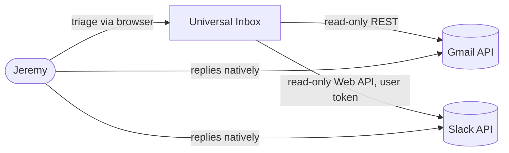
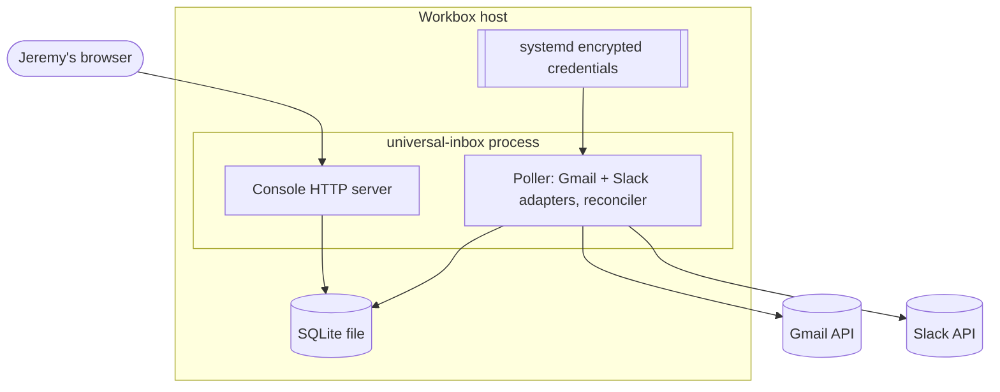
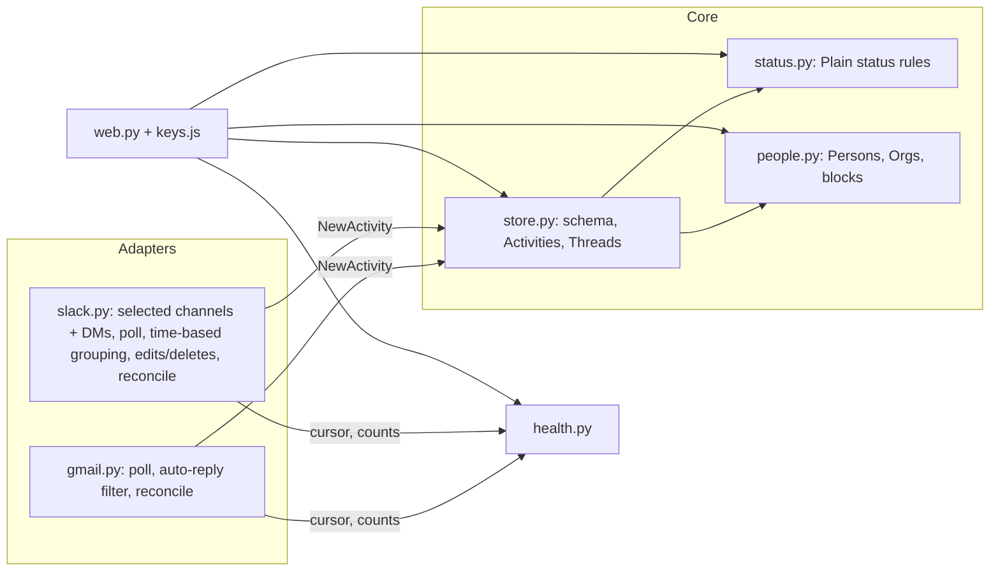

# Universal Inbox MVP — PRD

## 1. Document control

- **Title**: Universal Inbox MVP (Gmail + Slack)
- **Status**: **Draft (revision 2).** This revision applies Jeremy's 2026-10-10 review annotations. Behavior now follows Plain unless a deviation is stated with its reason. The technical design in §4–§5 is **Proposed**. D1 is resolved (2026-10-11, decision #47). Deployment is blocked on D2 (§6).
- **Owner / authority**: Jeremy Legere (single user and product owner)
- **Created**: 2026-10-10T20:04+00:00
- **Updated**: 2026-10-11T23:48+00:00
- **Topic**: MVP of a single-user, Plain-style Thread queue across Gmail and Slack
- **Authority chain**:
  - `.agents/discovery/2026-10-10-universal-inbox.md`: validated problem and strategy.
  - `GLOSSARY.md`: terms.
  - `docs/requirements.md`: MVP scope.
  - `docs/adr/0001-purpose-built-thread-ledger.md`: strategy.
  - Jeremy's review annotations on this PRD (2026-10-10): anchor every behavior on Plain.
  - Plain behavior evidence: Plain docs and GraphQL schema, read 2026-10-10 (cited in §9).
- **Implementation authorization**: **Phase 0 only** (Jeremy, 2026-10-11). Phases 1–6 and installing services each need separate explicit approval. Connecting real accounts is Jeremy's own step after the build (FR-1).
- **History limits**: Built from the full 2026-10-10 session plus the artifacts above. Exact times exist only for observed clock readings or file modification times.

## 2. Executive framing

**Problem (approved).** Jeremy, a founder with ADHD, handles 30–60 professional conversations a day across email, Slack, LinkedIn, phone messaging, and tool comments. He loses track of conversations he has already seen and owes a reply on. Who owes whom what lives only in his head and in per-app read markers, and no system he trusts holds it. The result is dropped or late replies.

**Current behavior (evidence).**
- The latest drop was an email he saw and then lost.
- Workarounds are Gmail unread/star and agent reminders.
- Donna's ball-in-court tracking misses threads.
- A Super Productivity Gmail plugin was abandoned after silent sync failures.

Source: discovery doc §Context.

**Desired outcome.** One pull-only console that works like Plain for one person. Every connected Gmail and Slack Thread has a Status, Jeremy can prove nothing is missing, and the other side's reply always brings a Thread back.

**Audience.** Jeremy only.

**MVP scope.**
- Connectors for Gmail and Slack. Jeremy connects `jeremy@agentmaple.com` and the Agent Maple workspace himself after the build.
- Read-only mirror, ingesting forward from connect (as Plain does).
- Plain status logic.
- Ignore and Block.
- Cases.
- Person and Organization records.
- Completeness and sync health.
- Plain keyboard.
- No notifications.

**Non-goals.** Replying or sending from the console, task management (Linear), CRM pipeline, meeting notes (Tana), and auto-replies.

**Deferred.**
- Tool comments, WhatsApp, LinkedIn.
- Other mailboxes and workspaces.
- Domain, category, or content rules.
- Write-back.
- Cmd+K.
- CRM / Tana / Linear context.
- Plain's "Close the loop" (needs linked issues).
- Auto-resolution.

**Out of scope for now.** SMS and iMessage.

**Success measures.**
1. **Zero silent drops.** Every connected Thread ends Done, Snoozed, or Ignored; none sits unhandled. (Jeremy's review: "every connected thread, not just ones needing my reply.")
2. **One place to check.** Daily triage starts in one console.

**Measurable proxy (Proposed).** For 14 days after Jeremy connects:
- The reconciliation mismatch count stays at 0.
- No Connection stays broken unseen for more than 15 minutes.
- Jeremy reports no dropped Thread from a covered Connection.

**Dependencies.**
- For building: none external.
- For connecting, after the build, by Jeremy:
  - A Google Workspace OAuth client of type Internal with read-only Gmail scope.
  - A Slack internal app with a user token.
  - A host (Workbox proposed, D1).

## 3. Requirements and coverage

Status key in brackets:
- **C**: confirmed by Jeremy.
- **PL**: copied from Plain's documented behavior, per Jeremy's "same as Plain" annotations.
- **P**: proposed here.
- **D**: a deliberate deviation from Plain, with its reason.

### Connections and ingestion

- **FR-1** [C]: Build a Gmail connector and a Slack connector. Connecting real accounts is not part of the build; Jeremy connects them afterwards.
- **FR-2** [C]: Mirror each ingested native message as one Activity with its native ID. Never rewrite an Activity; an edit or deletion becomes a new Activity.
  - [PL] When a Slack message is deleted, its stored content is removed and a minimal audit record is kept.
- **FR-3** [PL]: **Email.** Every new inbound email creates a Thread; a reply in the same Gmail thread joins it.
  - Auto-replies are filtered out. One is detected by at least one header signal (`Auto-Submitted`, `Precedence: auto_reply/bulk`, `X-Autoreply`); a subject pattern alone does not count.
  - A filtered auto-reply is not stored, creates no Thread, and never reopens one.
  - [D] Mail in Gmail Spam or Trash is not ingested. Reason: it is the Gmail equivalent of mail never forwarded to Plain.
- **FR-4** [PL]: **Slack channels.** Only selected channels sync.
  - Jeremy selects channels by hand, or by name prefix/suffix rules (Plain's auto-join rules).
  - Unselected channels are not ingested (Plain's "disabled").
- **FR-4a** [D]: **Slack DMs and group DMs** sync, following the same Thread rules. Reason: DMs carry most of Jeremy's Slack comms, and Plain never ingests them.
- **FR-4b** [PL]: **Slack grouping is time-based** (Plain's default ingestion mode):
  - A new top-level message joins the conversation's latest Thread when it is from the same user within 2 hours, or from a different user within 1 hour, of that Thread's last message. Otherwise it starts a new Thread.
  - Replies in a Slack reply-thread attach to the Thread holding its parent message (inferred from Plain).
  - A group started only by Jeremy's own message becomes a Thread when someone else posts into it (Plain's Teams rule; Slack behavior inferred).
- **FR-5** [PL]: **No history backfill.** Ingestion starts when a Connection is connected (Plain is forward-only).

### Status (Plain logic)

- **FR-6** [PL]: Statuses and details:
  - **Todo**:
    - *Needs first response*: a new Thread Jeremy has not replied to.
    - *Needs next response*: the other side replied after Jeremy.
    - *Investigating*: set manually.
  - **Snoozed**:
    - *Waiting for them*: Plain's "Waiting for customer".
    - *Paused for later*: for a duration, or indefinitely.
  - **Done**:
    - *Done*.
    - *Ignored*.
- **FR-6a** [PL]: A new Thread starts in Todo / Needs first response.
- **FR-6b** [PL]: Jeremy's reply moves the Thread to Snoozed / Waiting for them.
  - An email Thread Jeremy starts begins in Waiting for them.
- **FR-6c** [PL]: Any activity from the other side moves a Snoozed or Done Thread to Todo / Needs next response. This includes messages, and [C] edits and deletions; Plain: "When any activity happens in a thread, it will move back to Todo."
- **FR-6d** [PL]: A snooze ends at its time, or on the other side's next activity, and the Thread returns to Todo.
- **FR-6e** [PL]: An Ignored Thread does not move Status on new activity until Jeremy un-ignores it.

### Ignore and Block

- **FR-7** [C/PL]: **Ignore** is a Thread Status (Done / Ignored), set by Jeremy on a Thread. The Ignored view is a filter over Threads with Status Ignored.
- **FR-7a** [C/PL]: **Block** applies to a sending address: an email address, or a Slack user.
  - Blocking a Person blocks all of that Person's addresses.
  - A new Thread whose inbound messages all come from blocked addresses is created directly as Ignored. This mirrors Plain's spam customers, whose threads "are automatically closed as ignored".
  - [P] Unblocking affects only future Threads; existing Threads stay Ignored until Jeremy un-ignores them.
- **FR-8** [C]: Every new sender reaches the queue by default.

### People

- **FR-10** [C]: A **Person** is a Slack user and/or a set of email addresses. Persons are created automatically when they first message Jeremy (Plain: "Customers that reach out to you will automatically be created"). An email address belongs to one Person.
  - [P] A Slack user joins the Person holding the email address in their Slack profile. Jeremy can add addresses to a Person by hand.
- **FR-11** [C/PL]: **Organizations** are created automatically from email domains (Plain tenants match by domain).
  - [D] Free-mail domains (gmail.com, outlook.com, and similar) never form an Organization. Reason: Jeremy approved this in AS-12; Plain does not state a rule.
- **FR-12** [C]: A Case is an optional grouping of Threads. A Thread is in at most one Case. A Case has no Status of its own and shows its Threads' Statuses.
- **FR-13** [C]: Person and Organization records list their Threads (with Status) and Cases.

### Console

- **FR-14** [PL + D]: **Keyboard**:
  - [PL] Plain's keys: J / K next and previous; E Done; Z Pause for later; W Wait for them; S change status (for example, Investigating).
  - [D] I Ignore; C add to Case. Reason: Plain ignores through status changes and workflows, and has no Case.
  - [D] Enter opens the Thread in Gmail or Slack. Reason: replying happens in the native app.
- **FR-15** [C]: Nothing in the console changes Gmail or Slack.

### Non-functional

- **NFR-1** [C intent / P method]: **Completeness.** For each Connection, a reconciler compares the mirror with the source over a rolling window. Filtered auto-replies are recorded by ID so they do not count as missing. Any other missing message is a mismatch.
- **NFR-2** [C]: **Sync health.** Warning after 15 minutes without a confirmed sync. Broken on an auth failure or any mismatch.
- **NFR-3** [C]: **Pull only.** No notifications.
- **NFR-4** [C intent / D2 path]: **Single user.** Reachable only by Jeremy.
- **NFR-5** [P]: **Secrets.** Tokens are never logged or printed, and are never stored as plaintext user-service credentials (Ledgere precedent).
- **NFR-8** [P]: **Simplicity.** A single process, the standard library first, and no added service without evidence that it is needed.

### Invariants

- **I-1**: every stored Activity belongs to exactly one Thread.
- **I-2**: every Thread has exactly one Status and one Status detail.
- **I-3**: a Thread is in at most one Case.
- **I-4**: Status changes only through:
  - Jeremy's action
  - Jeremy's own message (to Waiting for them)
  - a snooze expiring
  - the other side's activity
  - Block, at Thread creation
- **I-5**: Ignored does not move on new activity.
- **I-6**: an email address belongs to at most one Person.

### Acceptance scenarios

- **AS-1**: Jeremy reads an email in Gmail and forgets it. → The Thread stays Todo / Needs first response.
- **AS-2**: Logan emails, then pings in a DM. → Two Todo Threads on Logan's Person record (via his Slack profile email). C groups them into a Case.
- **AS-3**: Jeremy replies from Gmail. → Snoozed / Waiting for them.
- **AS-4**: The other side then replies. → Todo / Needs next response.
- **AS-5**: A Done Slack Thread's message is edited by its author. → Todo / Needs next response.
- **AS-6**: Jeremy blocks `alerts@signoz.io`, and a new alert arrives. → A new Thread is created directly as Ignored and is visible under the Ignored filter.
- **AS-7**: A new prospect emails for the first time. → Todo / Needs first response; a Person is auto-created.
- **AS-8**: The Gmail token is revoked. → Health shows broken within one sync cycle.
- **AS-9**: The poller stops. → Health shows a warning at 15 minutes.
- **AS-10**: A message exists in the source but not in the mirror. → Mismatch; health shows broken.
- **AS-11**: An out-of-office reply arrives with `Auto-Submitted: auto-replied` on a Waiting Thread. → It is filtered and not stored; the Status stays Waiting.
- **AS-12** [approved in review]: An email from `ana@acme.com`. → Person and Organization "acme.com" are formed. An email from `bob@gmail.com` forms no Organization.
- **AS-13**: In a DM, Logan sends a message, then another 30 minutes later. → One Thread (same user within 2 hours). Logan writes again 3 hours later → a new Thread.
- **AS-14**: Jeremy posts top-level in a selected channel and nobody answers. → No Thread. Someone replies within 1 hour → the group becomes a Thread in Todo.
- **AS-15**: A message in an unselected channel. → Not ingested; no Thread.
- **AS-16**: Z with "indefinitely", then the other side writes. → Todo / Needs next response.

### Traceability

- **FR-2, FR-6–FR-8, FR-12, I-1..I-6**: steps 1.2, 1.3 → `tests/test_store.py`, `tests/test_status.py`.
- **FR-10, FR-11, AS-12**: step 1.4 → `tests/test_people.py`.
- **FR-1, FR-3, FR-5, AS-11**: steps 2.1–2.4 → `tests/test_gmail.py` with synthetic fixtures.
- **FR-1, FR-4, FR-4a, FR-4b, FR-5, AS-13..AS-15**: steps 3.1–3.5 → `tests/test_slack.py` with synthetic fixtures.
- **NFR-1, NFR-2, AS-8..AS-10**: steps 4.1–4.2 → `tests/test_health.py`.
- **FR-13, FR-14, AS-1..AS-7, AS-16**: steps 5.1–5.4 → `tests/test_web.py`; build demo in step 6.4 on synthetic data.
- **NFR-4, NFR-5**: steps 6.1–6.2 → service inspection; secret scan of logs.
- **Success measures**: after Jeremy connects → 14-day observation by Jeremy (a product measure, not an agent-held gate).

## 4. Architecture and solution shape

**Current: N/A.** `universal-inbox/` holds only documents. There is no code, repository, or runtime.

**Target: Approved (D1, 2026-10-11).**
- Strategy C (ADR 0001).
- One process with an embedded database and polling fits:
  - one user
  - two read-only sources
  - a 15-minute freshness budget
- Push is left out. Gmail push needs a public Pub/Sub endpoint, and Slack Socket Mode user events are unverified. A 60-second poll stays well inside the warning window.

### Alternatives considered

- **Ingestion**: poll Gmail `history.list` and Slack `conversations.history` / `replies`, rather than Gmail Pub/Sub or Slack Socket Mode. No public endpoint and one code path.
- **Store**: SQLite (stdlib), rather than Postgres. One user and nothing to operate.
- **Runtime**: Python 3.11+ with `uv` (as in Ledgere and agent-maple-backend), rather than Node 22. Matches the Workbox credential precedent, and the stdlib covers HTTP, JSON, SQLite, and serving.
- **Console**: server-rendered HTML through stdlib `http.server` plus one small key-binding script, rather than an SPA. No build step and no dependency.
- **APIs**: raw REST over `urllib`, rather than vendor SDKs. Few endpoints are needed, and OAuth refresh is one POST.
- **Host**: Workbox as a root-managed systemd system service with `LoadCredentialEncrypted=`, rather than Cloudflare or a VPS. $0, data stays on Jeremy's hardware, and the credential boundary is already proven.

**Complexity justification.** One process and one SQLite file. No queue, cache, framework, or external service.

### L1 Context (Proposed)

### L2 Containers (Proposed)

### L3 Components (Proposed)

### L4 Code map (Proposed; nothing exists yet)

- **`pyproject.toml`**: Python ≥3.11, no runtime dependencies, `pytest` for development.
- **`src/universal_inbox/store.py`**: `connect`, `migrate`, `append_activity(db, NewActivity)` (idempotent on native ID and kind), `thread_for(...)`.
- **`src/universal_inbox/status.py`**: pure `next_status(thread, event, blocked) -> (Status, Detail)`.
  - Events: `NewThread`, `Inbound`, `Outbound`, `Edit`, `Delete`, `SnoozeExpired`, and `UserAction` (Done / PauseForLater(duration or indefinite) / WaitForThem / SetInvestigating / Ignore / Unignore).
- **`src/universal_inbox/people.py`**: `person_for_identity`, `org_for_domain` (with `FREE_MAIL`), `add_address`, `block(address)`, `block_person`, `is_blocked`.
- **`src/universal_inbox/gmail.py`**: `poll` (from stored `historyId`, starting at connect), `is_auto_reply(headers)`, `reconcile(window)`, `refresh_token`.
- **`src/universal_inbox/slack.py`**: `selected_conversations` (manual list plus prefix/suffix rules, plus DMs), `poll`, `group(message, latest_thread)` (2-hour / 1-hour rule), `reconcile(window)`, `user_email`.
- **`src/universal_inbox/health.py`**: `connection_health(db, now)`.
- **`src/universal_inbox/web.py`** and **`static/keys.js`**:
  - Routes: `/` (Todo), `/snoozed`, `/done`, `/t/<id>`, `/p/<id>`, `/o/<id>`, `/c/<id>`, `/channels`, `/health`.
  - Status filters, including Ignored.
- **`src/universal_inbox/main.py`**: poller thread plus HTTP server; reads credentials from `$CREDENTIALS_DIRECTORY`.
- **`scripts/oauth_gmail.py`**, **`scripts/oauth_slack.py`**: consent helpers for Jeremy's post-build connect.
- **`deploy/universal-inbox.service`**: systemd system unit.
- **`tests/…`**: synthetic fixtures only.

**Proposed schema.**
- `connections(id, platform, label, cursor, connected_at, last_sync_at, last_reconcile_at, mismatch_count, auth_ok)`
- `channel_rules(connection_id, kind: channel / prefix / suffix, value)`
- `threads(id, connection_id, conversation_id, native_thread_id, status, detail, snooze_until, case_id, subject, last_activity_at, last_actor)`
- `activities(id, thread_id, native_id, kind, actor_identity, occurred_at, content)` — append-only
- `filtered(connection_id, native_id, reason)` — auto-replies, for reconciliation
- `persons(id, display_name)`
- `identities(person_id, kind: email / slack_user, value UNIQUE, blocked)`
- `organizations(id, domain UNIQUE, name)`
- `person_orgs`
- `cases(id, title)`

## 5. Phased execution plan

Every path is **Proposed**. D1 is approved; each phase from Phase 1 on needs its own implementation authorization.

### Phase 0 — Decision and repository

- **0.1 Resolve D1 (technical shape).**
  - Exit: recorded in the ledger.
- **0.2 Create the repository: `git init`, a remote, and a `dev` branch.**
  - Exit: the first commit contains the docs.
  - Authorization: explicit approval to create the repository and remote.

### Phase 1 — Domain core

- **1.1 `pyproject.toml`.**
  - Verify: `uv run pytest -q` passes on an empty suite.
- **1.2 `store.py`.**
  - Requirements: FR-2, I-1, I-3.
  - Verify: `tests/test_store.py` — an appended duplicate leaves one row; an edit adds an Activity; a deletion clears content and keeps the audit record.
- **1.3 `status.py`.**
  - Requirements: FR-6–FR-6e, FR-7, FR-7a, I-2, I-4, I-5.
  - Verify: `tests/test_status.py` tables for every event against every Status and detail, including:
    - Jeremy's reply → Waiting for them
    - other side → Needs next response
    - Ignored unmoved
    - blocked sender → Ignored at creation
    - a snooze expiry
- **1.4 `people.py`.**
  - Requirements: FR-7a, FR-10, FR-11, I-6, AS-12.
  - Verify: `tests/test_people.py` — auto-created Person; a Slack user joins through their profile email; free-mail forms no Organization; blocking a Person blocks all of its addresses.

### Phase 2 — Gmail connector

- **2.1 `scripts/oauth_gmail.py`** with scope `gmail.readonly`, for Jeremy's post-build connect.
  - Verify: it runs against a fake token endpoint in tests and prints no token.
- **2.2 `gmail.poll`.**
  - On connect, it records the current `historyId` with no backfill (FR-5), then ingests `messageAdded` from there.
  - Outbound means the From address is Jeremy's.
  - Spam and Trash are skipped.
  - Requirements: FR-3, FR-5.
  - Verify: fixtures for a new email, a reply in a thread, a sent email, and a message in Spam.
- **2.3 `gmail.is_auto_reply`.**
  - Requirement: FR-3, AS-11.
  - Verify: fixtures — `Auto-Submitted` header → filtered and recorded in `filtered`; a subject of "Out of office" with no header → kept.
- **2.4 `gmail.reconcile`.**
  - Requirement: NFR-1.
  - Verify: a missing ID gives a mismatch; a filtered ID gives none.

### Phase 3 — Slack connector

- **3.1 `scripts/oauth_slack.py`** with user scopes for history and read across channels, groups, IMs, and MPIMs, plus `users:read` and `users:read.email`.
- **3.2 `slack.selected_conversations`.**
  - Requirements: FR-4, FR-4a.
  - Verify: manual and prefix/suffix rules select channels; DMs and group DMs are always included; unselected channels are excluded.
- **3.3 `slack.group` and `slack.poll`.**
  - Requirements: FR-4b, FR-5.
  - Verify: fixtures for the same user at 30 minutes and 3 hours (AS-13), a different user at 45 and 70 minutes, a reply-thread attaching to its parent's Thread, and a group started by Jeremy alone (AS-14).
- **3.4 Edits and deletions.**
  - Edits are detected by `edited.ts`; deletions are found during reconciliation.
  - Requirements: FR-2, FR-6c.
  - Verify: fixtures for each.
- **3.5 `slack.reconcile` and `user_email`.**
  - Requirements: NFR-1, FR-10.
  - Verify: fixtures.

### Phase 4 — Trust monitor

- **4.1 `health.connection_health`.**
  - Verify: 14 minutes is OK, 16 minutes is WARN, an auth failure is BROKEN, a mismatch is BROKEN.
- **4.2 Poller loop in `main.py`.**
  - Poll every 60 seconds and reconcile every 15 minutes (Proposed).
  - Verify: a fake-clock scenario test.

### Phase 5 — Console

- **5.1 Queue pages, Status filters (including Ignored), and Thread detail.**
  - Verify: `tests/test_web.py`.
- **5.2 Key actions** (J / K / E / Z / W / S / I / C / Enter).
  - Requirement: FR-14.
  - Verify: action tests through `status.py`.
- **5.3 Person, Organization, Case, and Channels pages; Block on Person and address.**
  - Requirements: FR-4, FR-7a, FR-12, FR-13.
- **5.4 `/health`.**
  - Requirement: NFR-2.

### Phase 6 — Package and demo

- **6.1 `deploy/universal-inbox.service` plus a credential runbook.**
  - Authorization: point-of-risk approval to install the system unit.
- **6.2 Bind the console per D2.**
- **6.3 Build demo on synthetic data.**
  - Open the console in Jeremy's browser.
  - Walk AS-1, AS-3, AS-4, AS-6, AS-11, and AS-13 using a fixture-fed Connection.
  - Explain what changed.
  - Exit: Jeremy accepts.
- **6.4 After the build, Jeremy connects real accounts** (FR-1), then checks health and reconciliation on live data.
- **Rollback.** Stop the service. Gmail and Slack are never modified.

## 6. Risks, unknowns, and approvals

- **D1: Approve the technical shape in §4.**
  - Impact: all phases.
  - Owner: Jeremy.
  - Status: **Resolved** 2026-10-11, approved as written (decision #47).
- **D2: Console access path** (Workbox LAN, Tailscale, or other).
  - Impact: NFR-4 and Phase 6.
  - Owner: Jeremy.
  - Blocks: deployment only.
- **R1: Triage load with time-based grouping and DMs is unmeasured.**
  - Mitigation: measure after Jeremy connects.
- **R2: Slack deletions are seen only during reconciliation.**
  - Impact: up to one cycle of lag.
  - Mitigation: accepted for the MVP.
- **R3: Gmail `historyId` expiry after a long outage.**
  - Mitigation: bounded re-list plus reconcile.
- **R4: Slack poll cost grows with the number of selected conversations.**
  - Mitigation: poll only conversations whose `latest` changed.
- **R5: Inferred Plain rules.** Slack reply-thread attachment, own-post groups, and unblock behavior are not stated in Plain's docs.
  - Mitigation: confirm in the 6.3 demo.
- **R6: OAuth consent on a headless host.**
  - Mitigation: run consent from Jeremy's machine and pass tokens through the credential runbook.

## 7. Discussion and decision ledger

All entries are dated 2026-10-10; exact times are unproven unless noted. Full detail is in the discovery doc's decision log.

- **1**
  - Request / decision: Start a new project; asked for the best setup process
  - Source: Jeremy
  - Status: Recorded
- **2**
  - Request / decision: Agent proposed grilling: triage-to-zero, single user, Gmail first, thread as unit, Gmail archive write-back
  - Source: Agent
  - Status: Partly superseded
- **3**
  - Request / decision: Single user; Gmail and Slack first
  - Source: Jeremy
  - Status: Accepted
- **4**
  - Request / decision: Item-unit question deferred; phased discovery required, encoded as `/discovery` for Claude and omp
  - Source: Jeremy
  - Status: Accepted
  - Supersedes: Round-1 unit question
- **5**
  - Request / decision: `/discovery` design: user-approved gates, one living doc, ask-tool rounds, ends at a validated problem and strategy with abstract C4, standalone
  - Source: Jeremy
  - Status: Accepted
  - Supersedes: Agent's "hand to /prd" end point
- **6**
  - Request / decision: `/discovery` infers and validates a seed before Phase 1
  - Source: Jeremy
  - Status: Accepted
  - Supersedes: Topic-as-argument
- **7**
  - Request / decision: Seed confirmed: one console for professional comms, Plain-style
  - Source: Jeremy
  - Status: Approved
- **8**
  - Request / decision: Context: ADHD; dropped replies; no per-person view; trust means nothing dropped; $10/month maximum; open source; build complete over half-baked; narrow tool that integrates with Tana, Slack, Linear
  - Source: Jeremy
  - Status: Recorded
- **9**
  - Request / decision: Phase 1 approved
  - Source: Jeremy
  - Status: Approved
- **10**
  - Request / decision: Problem statement accepted; track state and reply anywhere; success measures: zero silent drops and one place to check
  - Source: Jeremy
  - Status: Accepted
  - Supersedes: Seed's "manage from one console" (narrowed)
- **11**
  - Request / decision: Adopted the shape of Jeremy's B2B support model (Case, Activity, Channel, Person, Organization); Issue excluded; separate system
  - Source: Jeremy
  - Status: Accepted, later revised
  - Supersedes: Agent's "Loop"
- **12**
  - Request / decision: Statuses Todo / Snoozed / Done; waiting is a snooze
  - Source: Jeremy
  - Status: Accepted
  - Supersedes: Agent's "Waiting"
- **13**
  - Request / decision: "Connection" term; coverage of everything inbound; outbound-started items; non-goals
  - Source: Jeremy
  - Status: Accepted
  - Supersedes: Agent's "Source", "human messages only"
- **14**
  - Request / decision: Plain-style ignore; own reply leaves Status unchanged; mirror native structure
  - Source: Jeremy
  - Status: Accepted
- **15**
  - Request / decision: Native grouping term introduced, then renamed Conversation → Thread
  - Source: Jeremy
  - Status: Accepted
  - Supersedes: "Conversation"
- **16**
  - Request / decision: Phase 2 approved after a delineated summary
  - Source: Jeremy
  - Status: Approved, then reopened
- **17**
  - Request / decision: Reopened: "every message is an Activity on a Case" judged wrong; Jeremy proposed Thread as the unit
  - Source: Jeremy
  - Status: Reopened
  - Supersedes: Case-as-unit entries
- **18**
  - Request / decision: Agent's Status-on-Case model rejected; anchor on Plain; every deviation needs a reason
  - Source: Jeremy
  - Status: Accepted principle
  - Supersedes: Agent model
- **19**
  - Request / decision: Medium renamed Platform; Channel means a container
  - Source: Jeremy
  - Status: Accepted
  - Supersedes: Agent's "Space"
- **20**
  - Request / decision: Case kept as optional grouping; one Thread per chat; Slack DMs Plain channel-style; Thread in at most one Case; Case has no Status
  - Source: Jeremy
  - Status: Accepted
  - Supersedes: Agent's "drop Case", "DM = one Thread", many-to-many
- **21**
  - Request / decision: Phase 2 re-approved (Plain-anchored)
  - Source: Jeremy
  - Status: Approved
  - Supersedes: #16
- **22**
  - Request / decision: Option set A–F approved; strategy C chosen
  - Source: Jeremy
  - Status: Approved
  - Supersedes: A, B, D, E, F
- **23**
  - Request / decision: Ignored never reopens; a Thread Jeremy starts begins in Todo; no always-on device
  - Source: Jeremy
  - Status: Accepted
  - Supersedes: Agent's recommendations
- **24**
  - Request / decision: SMS and iMessage dropped for now; edits wake Threads; chatty DMs stay channel-style
  - Source: Jeremy
  - Status: Accepted
  - Supersedes: Phase 2 "every Platform"
- **25**
  - Request / decision: Phase 4 approved; discovery complete
  - Source: Jeremy
  - Status: Approved
- **26**
  - Request / decision: Requirements: Gmail only first; 7-day backfill; Persons by exact match; pull only
  - Source: Jeremy
  - Status: Accepted, later amended
- **27**
  - Request / decision: Backfill → Todo; `.com` only; all mail except Spam and Trash; Plain keys
  - Source: Jeremy
  - Status: Accepted
- **28**
  - Request / decision: `.ai` out of scope; 15-minute stale warning; read-only mirror for MVP; ignore rules deferred; "a lot of these things don't need to be in the mvp"
  - Source: Jeremy
  - Status: Accepted
  - Supersedes: Agent's `.ai` gap handling
- **29**
  - Request / decision: MVP extras: Cases, Person records, Organization records, manual Ignore
  - Source: Jeremy
  - Status: Accepted
  - Supersedes: Agent's "defer all extras"
- **30**
  - Request / decision: Organizations by domain; records show Threads and Cases only
  - Source: Jeremy
  - Status: Accepted
- **31**
  - Request / decision: Allowlist proposal: "only sync threads from persons, auto-ignore the rest"; a flag on the Person named "Screened in"
  - Source: Jeremy
  - Status: Superseded by #32
  - Supersedes: Phase 2 coverage
- **32**
  - Request / decision: Correction: blocklist — every new sender is screened in by default; ignore a Person or address
  - Source: Jeremy
  - Status: Accepted
  - Supersedes: #31
- **33**
  - Request / decision: MVP confirmed complete; ADR 0001 written
  - Source: Jeremy
  - Status: Accepted
- **34**
  - Request / decision: Slack added to the MVP to embed multi-platform from the start; per-channel watch/ignore in MVP
  - Source: Jeremy
  - Status: Accepted
  - Supersedes: #26 "Gmail only first"
- **35**
  - Request / decision: Technical shape, FR-9a, FR-14a, FR-16, NFR-5, NFR-7, NFR-8
  - Source: This PRD
  - Status: **Proposed** — needs approval
- **36**
  - Request / decision: PRD review: success means every connected Thread ends handled, not only ones needing a reply
  - Source: Jeremy's annotation 1
  - Status: Accepted
  - Supersedes: success measure wording "every Thread needing Jeremy's reply"
- **37**
  - Request / decision: Build connectors without connecting; Jeremy connects after the build
  - Source: Annotation 2
  - Status: Accepted
  - Supersedes: D5 and D6 as build blockers
- **38**
  - Request / decision: Email, Slack, backfill, status logic, channels, and snooze follow Plain's behavior
  - Source: Annotations 3, 4, 5, 6, 8, 10
  - Status: Accepted
  - Supersedes: 7-day backfill; Todo for threads Jeremy starts; own reply leaving Status unchanged; per-channel watch/ignore prompt; one Thread per Slack top-level message
- **39**
  - Request / decision: Ignore is separate from Block. Block an email address; blocking a Person blocks all their addresses
  - Source: Annotation 7
  - Status: Accepted
  - Supersedes: "ignore a Person / address / channel"
- **40**
  - Request / decision: A Person is a user or a set of emails; Organizations are auto-created from email domains
  - Source: Annotation 9
  - Status: Accepted
  - Supersedes: "exact match only, manual merge" wording
- **41**
  - Request / decision: Removed snooze presets (FR-14a), body rendering (FR-16, D3), the cost requirement (NFR-6), data minimization (NFR-7), and the new-channel prompt scenario (AS-11, FR-9a)
  - Source: Annotations 11–14, 16
  - Status: Accepted
- **42**
  - Request / decision: The Ignored list is a filter on Threads with Status Ignored
  - Source: Annotation 15
  - Status: Accepted
- **43**
  - Request / decision: AS-12 (domain-based Organizations, no free-mail Organizations) looks good
  - Source: Annotation 17
  - Status: Approved
- **44**
  - Request / decision: Plain research found that Plain never ingests Slack DMs; Jeremy chose to deviate and include DMs
  - Source: Jeremy, ask tool answer
  - Status: Accepted (D)
- **45**
  - Request / decision: Slack grouping follows Plain's default time-based mode (agent recommended one-to-one)
  - Source: Jeremy, ask tool answer
  - Status: Accepted
  - Supersedes: one-to-one (decision #20 and #34 wording)
- **46**
  - Request / decision: Keep W, as in Plain (annotation 10 suggested removing it; Plain has W)
  - Source: Jeremy, ask tool answer
  - Status: Accepted
- **47**
  - Request / decision: D1 approved as written: Python 3.11+ with `uv` and stdlib only, 60-second polling with 15-minute reconcile, SQLite, server-rendered console, raw REST, systemd service on Workbox
  - Source: Jeremy, ask tool answer during Phase 0
  - Status: Approved
  - Supersedes: D1 open
- **48**
  - Request / decision: Execute Phase 0; the repository remote is `JMLegere/universal-inbox`, public (agent recommended private)
  - Source: Jeremy, "execute phase 0" and ask tool answer
  - Status: Accepted

## 8. Work log

- **2026-10-10T18:20:22+00:00**
  - Actor: Agent
  - Activity: Created the omp `/discovery` command
  - Result: File created (later edited)
  - Evidence: `~/.omp/agent/commands/discovery.md` birth time
  - Basis: Source-observed
- **2026-10-10T18:21:17+00:00**
  - Actor: Agent
  - Activity: Created the Claude `/discovery` skill
  - Result: File created (later edited)
  - Evidence: `~/.claude/skills/discovery/SKILL.md` birth time
  - Basis: Source-observed
- **2026-10-10T18:22:23+00:00**
  - Actor: Agent
  - Activity: Discovery started; living doc created
  - Result: Phase 1 opened
  - Evidence: Session clock reading
  - Basis: Source-observed
- **2026-10-10T19:46:21+00:00**
  - Actor: Agent
  - Activity: Discovery marked complete after the Phase 4 gate
  - Result: All gates approved
  - Evidence: Session clock; discovery doc Status
  - Basis: Source-observed
- **2026-10-10 (time unproven)**
  - Actor: Agent
  - Activity: `GLOSSARY.md`, `docs/requirements.md`, ADR 0001 written during the requirements session
  - Result: Last modified 20:01–20:03 UTC
  - Evidence: File modification times
  - Basis: Source-observed (mtime only)
- **2026-10-10T20:04:36+00:00**
  - Actor: Agent
  - Activity: `/prd` invocation: inspected artifacts, sibling repository stacks, local runtimes, and the memory credential precedent; wrote this PRD
  - Result: Draft PRD
  - Evidence: This file
  - Basis: Source-observed
- **2026-10-10T20:23:08+00:00**
  - Actor: Agent
  - Activity: Applied 17 review annotations; read Plain docs and schema through a sub-agent; asked 3 conflict questions; rewrote §1–§6 and §9
  - Result: Draft revision 2
  - Evidence: This file
  - Basis: Source-observed
- **2026-10-11T23:48:49+00:00**
  - Actor: Agent
  - Activity: Phase 0.1: recorded D1 approval; Phase 0.2 started (repository)
  - Result: D1 resolved
  - Evidence: This file, decisions #47–#48
  - Basis: Source-observed

## 9. Sources and coverage check

**Sources inspected**
- Discovery doc, `GLOSSARY.md`, `docs/requirements.md`, ADR 0001.
- Jeremy's 17 annotations on revision 1.
- Sibling repository manifests (stack precedent) and local runtimes.
- `~/.memory` Ledgere credential decision.
- **Plain docs (read 2026-10-10):**
  - Statuses: https://www.plain.com/docs/product/platform/threads/statuses.md and https://www.plain.com/docs/graphql/threads/status-changes.md
  - Snooze: https://www.plain.com/docs/graphql-reference/mutations/snoozeThread.md
  - Shortcuts: https://www.plain.com/docs/product/platform/keyboard-shortcuts.md
  - Slack: https://www.plain.com/docs/product/channels/slack.md, https://www.plain.com/docs/product/channels/slack-ingestion-modes.md, https://www.plain.com/docs/product/security/slack-data-retention.md
  - Teams own-post rule: https://www.plain.com/docs/product/channels/microsoft-teams-installation.md
  - Email auto-replies and spam: https://www.plain.com/docs/product/channels/email-spam-and-auto-reply-detection.md and https://www.plain.com/docs/graphql/customers/spam.md
  - Customers: https://www.plain.com/docs/graphql/customers.md
  - Tenants: https://www.plain.com/docs/product/platform/tenants.md
  - Import: https://www.plain.com/docs/graphql/threads/import.md
  - Public GraphQL schema: https://core-api.uk.plain.com/graphql/v1/schema.graphql
- **Not stated in Plain's docs (inferred, R5):**
  - email threading rules
  - Slack reply-thread attachment
  - own-team posts in Slack
  - backfill on connect
  - free-mail domain handling
  - snooze picker durations
  - unblock behavior

**Coverage gaps**
- The success measures can only be checked after Jeremy connects.
- NFR-4 depends on D2.
- R5 inferences are verified only in the 6.3 demo.

**Downstream sync needed.** `docs/requirements.md` and `GLOSSARY.md` were updated alongside this revision. The discovery doc's decision log references this PRD for decisions 36–46.

**Implementation statement.** This `/prd` invocation performed no implementation. No code, repository, OAuth app, Slack app, credential, or service was created.
